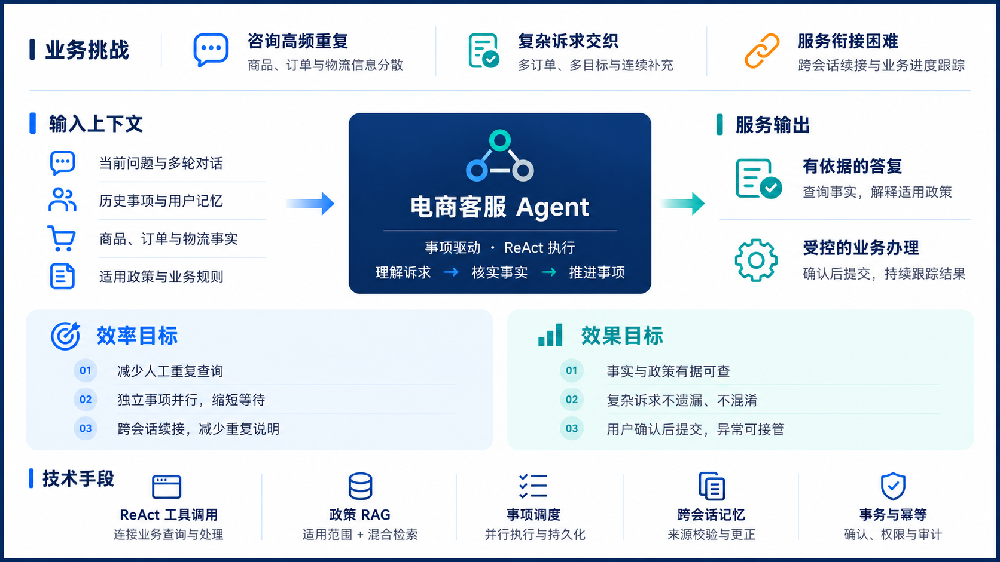
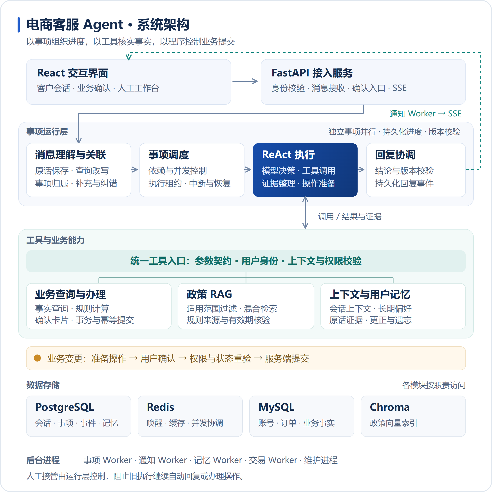

# 电商客服 Agent

## 项目简介

面向商品咨询、订单物流、会员优惠和售后服务的电商客服项目。基于 Python、FastAPI 和 React，Agent 通过 ReAct 调用业务工具查询事实，结合政策知识库解释规则，并在用户确认后由服务端校验、提交业务操作。

系统以持久化的“客服事项”组织进度：一次对话可以包含多个订单和目标，独立事项可以并行处理，用户也可以跨会话继续补充问题。消息归属、执行恢复、业务确认、回复发布和人工接管由后台运行层协调。



### 核心能力

| 能力           | 说明                                                                              |
| -------------- | --------------------------------------------------------------------------------- |
| 业务查询       | 查询商品、SKU、库存、订单、物流、会员、积分和优惠券，按程序规则判断资格与试算金额 |
| 政策问答       | 按店铺、渠道、品类和有效期过滤规则，结合关键词与向量检索返回可追溯的政策依据      |
| 多事项处理     | 区分多订单、多目标、连续补充和用户更正，保存进度并调度独立事项                    |
| 跨会话记忆     | 记录有原话证据的用户偏好，支持更新、更正、遗忘和历史事项续接                      |
| 受控业务办理   | 准备下单、改址、取消及售后申请；用户确认后重新校验权限、状态、金额与库存          |
| 人工协作与恢复 | 支持人工接管、处理回执核实、外部进度跟踪、事件通知和交互日志                      |

业务事实和金额以业务服务查询、计算结果为准；政策检索提供规则依据。申请提交、审核通过与资金到账分别记录，不能互相替代。

> 仓库提供源码、迁移和分批数据导入脚本，已有演示数据库不会随 Git 克隆自动出现。真实支付、商家处理和物流渠道需要独立接入；发票目前保留工具与表结构，演示数据为空。

## 技术栈

| 层次           | 技术                                              | 用途                                               |
| -------------- | ------------------------------------------------- | -------------------------------------------------- |
| 后端服务       | Python 3.11、FastAPI、Uvicorn、Pydantic           | HTTP API、参数契约、身份与会话校验                 |
| 前端界面       | React 19、Vite 8、普通 CSS、Lucide React          | 客户工作台、聊天、业务确认与人工客服界面           |
| Agent          | ReAct、OpenAI 兼容 SDK、MCP                       | 模型调用、业务工具执行和可选外部工具接入           |
| 知识检索       | Chroma、Sentence Transformers / Embedding API     | 政策向量索引、关键词与向量检索、版本与适用范围校验 |
| 数据与调度     | MySQL 8.4、PostgreSQL 16、Redis 7                 | 业务数据；会话、事项和记忆；缓存、唤醒与并发协调   |
| 认证与敏感数据 | PyJWT、Cookie / CSRF 校验、AES-256-GCM            | 登录认证、请求校验与业务敏感字段加密               |
| 部署与观测     | Docker Compose、Nginx、Prometheus、交互日志       | 多进程部署、网关、可选监控与故障定位               |
| 测试与格式     | pytest、Node.js Test Runner、Playwright、Prettier | 后端回归、前端单元测试、浏览器测试和格式检查       |

依赖以 [requirements.txt](requirements.txt)、[frontend/package.json](frontend/package.json) 和锁文件为准。

## 系统架构

系统将消息处理、Agent 执行和业务提交分开：事项运行层保存进度并协调执行，Agent 调用工具查询事实或准备操作，业务服务负责规则校验与事务提交。



[查看可缩放矢量图](assets/系统架构.svg) · [架构与流程详解](docs/系统架构设计.md)

事项 Worker 推进消息关联和 ReAct 执行，通知 Worker 发布持久化回复；记忆、交易与维护进程分别处理记忆提取、超时及业务回执、恢复和外部进度跟踪。PostgreSQL 保存持久化进度，Redis 用于唤醒与协调。

业务写入经过用户确认入口、权限与状态重验，再由业务服务提交。人工接管后，运行层会阻止旧执行继续发布自动回复或办理操作。

## 项目结构

```text
ecom-customer-service/
├── app/
│   ├── api/                 # HTTP 接口、认证、会话与事件流
│   ├── agents/              # 消息关联与模型调用
│   ├── execution/           # ReAct 执行循环
│   ├── tasks/               # 事项归属、调度、确认、恢复与回复协调
│   ├── tools/               # 工具目录、参数契约与分发
│   ├── services/commerce/   # 业务规则、事务、库存、履约与外部渠道
│   ├── data/                # 数据访问与业务查询适配
│   ├── rag/                 # 政策知识文本、索引发布与检索
│   ├── memory/              # 长期记忆，默认使用 v3
│   ├── session/             # 短期上下文、摘要与预算
│   ├── support/             # 会话事件、共享存储与人工协作
│   ├── runtime/             # 并发、唤醒与通知
│   ├── mcp/                 # 可选 MCP 工具服务
│   ├── observability/       # 日志、审计与指标
│   └── config/              # 配置加载
├── frontend/                # React 客户端与浏览器测试
├── migrations/mysql/        # 版本化 MySQL 业务表迁移
├── scripts/                 # 初始化、Worker、数据导入与检查脚本
├── tests/                   # 后端回归与集成测试
├── deploy/                  # 网关、监控与隔离测试环境配置
├── docs/                    # 设计文档与运行说明
├── data/                    # 本地索引及运行数据，不提交
├── model/                   # 本地向量模型，不提交
├── assets/                  # README 等文档使用的图片资源
├── .env.example
├── requirements.txt
├── Dockerfile
└── docker-compose.yml
```

模块设计与阅读顺序见 [文档导航](docs/README.md)，整体依赖与消息流程见 [系统架构设计](docs/系统架构设计.md)。

## 快速开始

以下命令使用 **PowerShell**，除明确说明外均在项目根目录执行。推荐先用 Docker 启动数据库，再在本机运行应用；已有环境可跳过依赖安装和首次初始化步骤。

### 1. 准备环境与依赖

- Python 3.11。
- Node.js `^20.19.0 || >=22.12.0`，满足锁定的 Vite 版本要求。
- Docker Desktop 和 Compose，或自行安装 MySQL、PostgreSQL、Redis。
- 可用的对话模型接口；政策检索另需本地向量模型或 Embedding API。

```powershell
python -m venv .venv
.\.venv\Scripts\Activate.ps1
python -m pip install -r requirements.txt

# 仅首次创建配置文件，不覆盖已有配置
if (-not (Test-Path .env)) { Copy-Item .env.example .env }

# 安装前端锁定版本的依赖
npm --prefix frontend ci
```

若无法激活虚拟环境，后续 `python` 命令可改用 `.\.venv\Scripts\python.exe`。

### 2. 配置环境变量

编辑根目录 `.env`，完整选项见 [.env.example](.env.example)。默认 Compose 的本机连接配置已在模板中给出。

| 配置项                                                                   | 说明                                                                 |
| ------------------------------------------------------------------------ | -------------------------------------------------------------------- |
| `DEEPSEEK_API_KEY`、`DEEPSEEK_BASE_URL`、`DEEPSEEK_MODEL_NAME`           | 对话模型凭证、接口和实际可用模型名称                                 |
| `API_JWT_SECRET`                                                         | 替换模板占位值，设置随机签名密钥                                     |
| `API_AUTH_BACKEND=mysql`、`API_REGISTRATION_ENABLED`                     | 使用 MySQL 登录与注册                                                |
| `ORDER_DB_DSN`                                                           | MySQL 连接；默认 Compose 对本机开放 `127.0.0.1:3307`                 |
| `ORDER_PLATFORM_CODES`                                                   | 与导入的数据保持一致；已有演示数据使用 `mall_demo`，模板默认是 `pdd` |
| `API_SESSION_POSTGRES_DSN`、`MEMORY_POSTGRES_DSN`                        | 会话、事项及记忆相关 PostgreSQL 连接                                 |
| `API_CONCURRENCY_REDIS_URL`、`MEMORY_REDIS_URL`、`ORDER_CACHE_REDIS_URL` | Redis 连接                                                           |
| `BUSINESS_DATA_KEYS`、`BUSINESS_DATA_KEY_VERSION`                        | 地址等字段的加密密钥集合与当前版本                                   |
| `TASK_INTAKE_ENABLED`、`TASK_WORKER_ENABLED`、`TASK_OPERATIONS_ENABLED`  | 开启消息接收、事项执行及业务确认入口；还需检查数据库中的放量状态     |

仅在新建空环境时，可以分别生成 JWT 密钥和版本 1 的业务加密密钥，再填入 `.env`：

```powershell
python -c "import secrets; print(secrets.token_urlsafe(48))"
python -c "import secrets,base64,json; print(json.dumps({'1':base64.urlsafe_b64encode(secrets.token_bytes(32)).decode()}))"
```

已有数据时必须保留原业务加密密钥及旧版本，否则历史地址等字段无法解密。API 与各 Worker 使用同一份配置。正常注册登录无需填写 `API_AUTH_USERS`；新账号不会自动获得其他演示用户的订单。

### 3. 启动数据库并初始化表结构

```powershell
docker compose up -d --wait postgres redis mysql
docker compose ps

python -m scripts.migrate_mysql_business_schema
python -m scripts.migrate_mysql_business_schema --check
python -m scripts.init_support_db
```

迁移按版本执行，包含旧结构清理；升级已有库前先备份并阅读 [数据库表设计](docs/数据库表设计.md)。迁移只建立表结构，不会恢复本机已有的演示数据。

新环境需要导入经过检查的数据库导出，或根据文档按依赖顺序执行 `scripts/seed_*.py`。目前没有单条命令可以完整重建已有开发库；不要直接重复运行所有导入脚本。

### 4. 准备政策知识库

知识文本位于 [app/rag/knowledge](app/rag/knowledge)。为待发布文本准备对应 `名称.policy.json`，填写审核状态、来源、版本、适用范围与生效时间。

- 本地模型：设置 `EMBEDDING_PROVIDER=local` 和 `LOCAL_EMBEDDING_MODEL_PATH`，并准备对应模型文件。
- 远程接口：设置 `EMBEDDING_PROVIDER=openai` 及 `EMBEDDING_API_KEY`、`EMBEDDING_BASE_URL`、`EMBEDDING_MODEL`。

```powershell
python -m app.rag.commands.policy_index publish
```

对话模型接口不一定支持 Embedding。仅存在 Markdown 文件不代表索引已经发布；缺少有效政策或适用条件时，系统返回依据不足。详细流程见 [规则检索说明](docs/政策检索设计.md)。

### 5. 启动应用

在不同终端中激活同一虚拟环境，按下一节的运行命令启动 API、各 Worker 和前端，再检查放量状态：

```powershell
python -m scripts.pipeline_rollout status

# 仅在配置、数据及本地演示环境已核对后启用
python -m scripts.pipeline_rollout set all --operator local-dev --reason "本地演示环境已核对"
```

前端访问 [http://localhost:5173](http://localhost:5173)，注册或登录后使用。只启动 API 不会产生自动回复，还需要事项 Worker、通知进程、可用模型和正确的放量状态。

## 运行命令

### 本地开发

下列进程分别在独立终端启动；前端命令也可直接在项目根目录执行。

| 进程         | 命令                                                              | 职责                                   |
| ------------ | ----------------------------------------------------------------- | -------------------------------------- |
| API          | `python -m uvicorn app.api.main:app --host 127.0.0.1 --port 8010` | 认证、消息接收、SSE 与操作确认         |
| 事项 Worker  | `python -m scripts.task_worker`                                   | 消息关联、Agent 执行与事项推进         |
| 记忆 Worker  | `python -m scripts.memory_worker`                                 | 长期记忆提取、更新、遗忘与归档         |
| 回复通知     | `python -m scripts.notification_worker`                           | 发布持久化会话通知                     |
| 后台维护     | `python -m scripts.platform_maintenance`                          | 维护、恢复、清理及外部进度处理         |
| 交易 Worker  | `python -m scripts.commerce_worker`                               | 待付款超时关闭、库存与券释放、业务回执 |
| 前端开发服务 | `npm --prefix frontend run dev`                                   | 默认监听 5173 端口                     |

交易后台单轮检查可运行 `python -m scripts.commerce_worker --once`。已有进程时先核对运行状态，避免重复启动。

| 地址                                                         | 用途                         |
| ------------------------------------------------------------ | ---------------------------- |
| [http://localhost:5173](http://localhost:5173)               | 客户界面与人工客服工作台入口 |
| [http://localhost:8010/docs](http://localhost:8010/docs)     | API 文档                     |
| [http://localhost:8010/health](http://localhost:8010/health) | 健康检查                     |
| [http://localhost:8010/ready](http://localhost:8010/ready)   | 就绪检查                     |

### Docker Compose 运行

先完成上述环境配置、数据库表初始化和知识库准备。首次迁移按快速开始中的本机命令执行；当前 Dockerfile 未复制 `migrations/`，不要依赖空库容器独立完成首次迁移。镜像构建说明见[构建命令](#构建命令)。

本地应用进程与完整 Compose 部署选一种运行，避免重复占用端口或同时启动两套 Worker。

```powershell
docker compose build backend frontend
docker compose up -d
docker compose ps
docker compose exec backend python -m scripts.pipeline_rollout status

# 如需启用本地演示环境的自动处理
docker compose exec backend python -m scripts.pipeline_rollout set all --operator local-dev --reason "本地演示环境已核对"

# 查看日志
docker compose logs --tail 100 backend worker memory-worker dispatcher commerce-worker

# 停止应用与数据库容器，保留绑定挂载的数据
docker compose down
```

容器内 MySQL 地址为 `mysql:3306`，本机访问为 `127.0.0.1:3307`；Compose 为应用进程覆盖相应数据库地址。本机 `data/` 与容器 `.docker-data/app/` 使用不同目录，容器政策索引需单独发布：

```powershell
docker compose exec worker python -m app.rag.commands.policy_index publish
```

使用本地 Embedding 时，Compose 将 `MODEL_DIR`（默认 `./model`）挂载到 `/app/model`。监控、远程检索和运行控制的模块关系见 [运行与可观测性设计](docs/运行与可观测性设计.md)；人工工作台权限见 [人工接管设计](docs/人工接管设计.md)。

### 数据保存位置

| 内容                            | Compose 本机挂载目录     |
| ------------------------------- | ------------------------ |
| MySQL 账号及业务数据            | `.docker-data/mysql/`    |
| PostgreSQL 会话、事项和持久记忆 | `.docker-data/postgres/` |
| Redis 数据                      | `.docker-data/redis/`    |
| 政策索引与应用运行数据          | `.docker-data/app/`      |
| 应用日志                        | `.docker-data/logs/`     |

本机运行通常使用 `data/` 和 `logs/`。`.env`、数据库、日志、索引与模型权重不随 Git 分发，迁移电脑时需独立备份和导入。

## 测试命令

### 后端离线回归

先安装项目依赖及测试工具。推荐使用统一检查入口，它会隔离本机 `.env` 中的主要业务连接和模型密钥。

```powershell
python -m pip install pytest
python scripts/run_platform_checks.py

# 只运行指定模块
python scripts/run_platform_checks.py tests/test_memory_v3.py
```

### RAG 质量评测

正式评测入口位于 `app/evaluation/`，支持 Recall@k、Precision@k、MRR@k、NDCG@k，以及基于实际证据的答案忠实度评分。

```powershell
# 离线演示，不调用模型；示例分数不代表真实项目效果
python -m app.evaluation.run --output data/evaluation/demo.json

# 回放已采集的检索结果，计算召回与排序指标
python -m app.evaluation.run --dataset data/evaluation/cases.json --traces data/evaluation/traces.json --output data/evaluation/replay.json

# 使用当前政策检索服务，需要已发布的政策索引及相应检索配置
python -m app.evaluation.run --mode retrieve --dataset data/evaluation/cases.json --live --output data/evaluation/retrieval.json

# 对采集的实际答案进行模型评分
python -m app.evaluation.run --dataset data/evaluation/cases.json --traces data/evaluation/traces.json --judge --live --output data/evaluation/judged.json

# 生成独立的 RAG 答案并评分
python -m app.evaluation.run --mode retrieve --dataset data/evaluation/cases.json --generate-answers --judge --live --output data/evaluation/generated.json
```

`cases.json` 与 `traces.json` 需按 `app/evaluation/datasets/` 中的示例结构准备。`--live` 开启配置中的检索或模型调用；模型评分复用项目的模型服务配置，可能产生 API 费用。可用 `--k 1 3 5` 指定评测范围，`--model` 与 `--answer-model` 分别指定裁判和生成模型。

退出码 0 表示通过当前启用的检查，1 表示有题未通过，2 表示参数、输入或配置错误。模块职责、数据流和指标口径见 [RAG 评测说明](docs/RAG评测说明.md)。

### 真实数据库集成测试

使用专用 MySQL、PostgreSQL 和 Redis 测试环境：

```powershell
docker compose -p ecom-refactor-tests -f deploy/compose.integration.yml up -d --wait
python scripts/run_platform_checks.py --integration

# 测试结束后停止隔离环境
docker compose -p ecom-refactor-tests -f deploy/compose.integration.yml down
```

部分核心交易测试另需 `CORE_TOOLS_TEST_MYSQL_ADMIN`，指向允许创建、删除临时数据库的专用测试连接；未配置时跳过。测试连接必须是专用测试库的管理连接；交易与幂等边界见 [业务操作与交易设计](docs/业务操作与交易设计.md)。跳过的测试不代表对应数据库行为已通过验证。

### 前端检查

在项目根目录运行：

```powershell
npm --prefix frontend test
npm --prefix frontend run test:browser
npm --prefix frontend run format:check

# 一次运行格式检查、单元测试、构建和浏览器测试
npm --prefix frontend run check
```

浏览器测试使用模拟 API 和独立端口 `5178`。Windows 默认使用已安装的 Edge；其他环境可先运行 `npm --prefix frontend exec -- playwright install chromium`，也可通过 `PLAYWRIGHT_CHANNEL` 指定浏览器。

真实模型与记忆链路验证可运行 `python -m scripts.eval_memory_v3 --live`；该命令使用隔离数据，但会调用配置中的模型并产生 API 费用。详见 [上下文与记忆设计](docs/上下文与记忆设计.md)。

## 构建命令

### 前端生产构建与预览

```powershell
npm --prefix frontend ci
npm --prefix frontend run build
npm --prefix frontend run preview
```

构建产物输出到 `frontend/dist/`。预览服务用于检查构建产物，API 与后台进程仍需单独运行。自定义后端地址时，在 `frontend/.env.local` 中设置 `VITE_API_BASE_URL`，然后重新构建；示例见 [frontend/.env.example](frontend/.env.example)。

### Docker 镜像构建

```powershell
# 后端镜像供 API 与各 Worker 共用
docker compose build backend

# 前端使用 Vite 构建，再由 Nginx 提供静态资源
docker compose build frontend

# 同时构建
docker compose build backend frontend
```

后端直接运行 Python 源码，无单独的前端式打包步骤；后端构建入口为根目录 `Dockerfile`。

## 常见问题与文档

| 现象                     | 检查方向                                                            |
| ------------------------ | ------------------------------------------------------------------- |
| 前端可打开但没有自动回复 | 事项 Worker、通知进程、放量状态、模型配置和 PostgreSQL / Redis 连接 |
| 登录后没有演示订单       | 数据是否导入、用户是否拥有订单、`ORDER_PLATFORM_CODES` 是否匹配     |
| 地址无法解密             | 原业务加密密钥及旧版本是否保留，各进程配置是否一致                  |
| 政策检索依据不足         | 审核元数据、Embedding 模型、当前运行环境的索引及适用条件            |
| 订单未自动超时关闭       | 交易 Worker、到期记录和当前支付 / 发货状态                          |
| 换电脑后数据为空         | 独立导入数据库、核对挂载目录及配置；镜像不包含原数据库数据          |

- [模块设计文档导航](docs/README.md)：阅读顺序、模块清单与关键术语。
- [系统架构设计](docs/系统架构设计.md)：分层、主链路、存储与后台进程。
- [工具设计](docs/工具设计.md)：工具契约、职责、参数模型与 MCP 边界。
- [业务操作与交易设计](docs/业务操作与交易设计.md)：确认、事务、库存、幂等与外部处理。
- [数据库表设计](docs/数据库表设计.md)：业务领域表、约束与运行数据。
- [上下文与记忆设计](docs/上下文与记忆设计.md)：原话、请求预算、记忆更新与遗忘。
- [政策检索设计](docs/政策检索设计.md)：适用条件、证据与索引版本。
- [RAG 评测说明](docs/RAG评测说明.md)：召回、排序、答案忠实度和评测命令。
- [人工接管设计](docs/人工接管设计.md)：工单、权限、交接与机器人恢复。
- [运行与可观测性设计](docs/运行与可观测性设计.md)：调度、通知、额度、控制与日志。
- [前端交互设计](docs/前端交互设计.md)：界面分工、事件恢复与确认卡片。
- [前端维护说明](frontend/README.md)：前端代码约定与检查命令。

记忆实现参考腾讯开源项目的上下文提取与批量冲突决策，相关来源及保留的许可证见 [上下文与记忆设计](docs/上下文与记忆设计.md)。当前运行任务的 Outbox 已实现；MySQL 交易 Outbox、RocketMQ 和真实支付渠道仍待接入。
