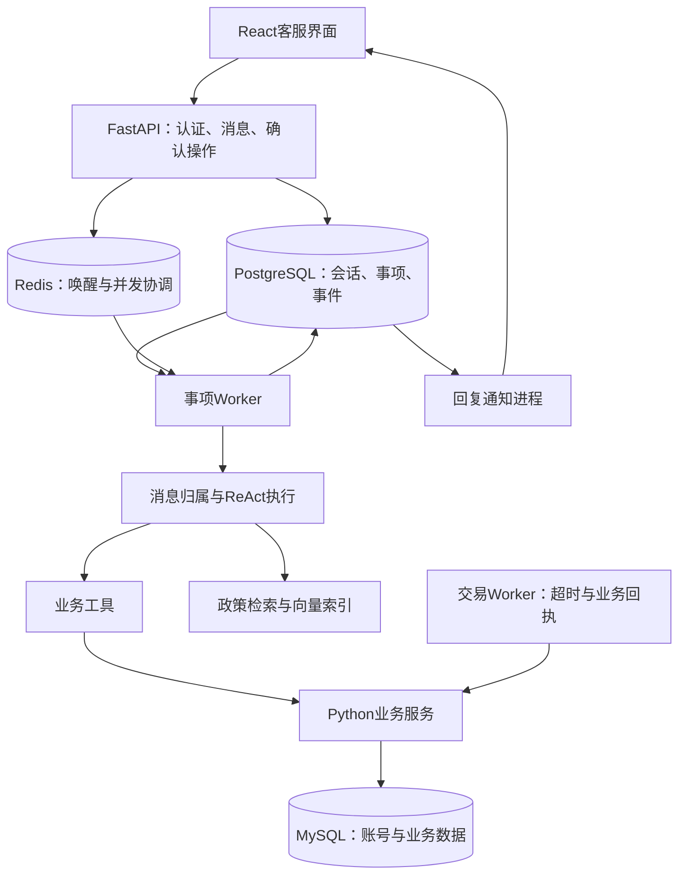

# 电商客服 Agent

基于 **Python、FastAPI、React 和 MySQL** 的电商客服项目。Agent 使用 ReAct 查询商品、订单、物流、会员和优惠券，结合政策知识库回答问题；修改业务数据时先准备操作，再由服务端在用户确认后校验并提交。

项目以“事项”保存处理进度：一次对话可以涉及多个订单，用户可以连续补充消息，也可以在后续会话中继续未完成的问题。后台负责消息归属、任务恢复、权限、确认和回复发布。

> 仓库包含代码、迁移和分批数据导入脚本；**本机已有的 MySQL 演示数据不会随 GitHub 克隆自动出现**。真实支付、商家处理和物流渠道需要独立接入。

## 1. 当前能力

工具注册表目前有 **48 个工具**，其中 **31 个读取、判断或试算工具**可通过独立 MCP 暴露。名称、描述和参数以[工具目录](app/tools/catalog.py)、[参数模型](app/tools/contracts.py)和[工具设计](docs/工具设计.md)为准。

| 领域 | 已有能力 | 边界 |
| --- | --- | --- |
| 账号 | 注册、登录、退出、密码哈希、登录会话 | 账号与凭证保存在 MySQL，正常使用不靠 `.env` 管理账号 |
| 商品 | 商品和商家查询、材质与规格、SKU价格、库存、补货计划 | 模型基于查询结果比较商品，工具不生成推荐结论 |
| 订单与物流 | 本人订单、购买规格、支付记录、包裹和轨迹 | 数据缺失返回缺项；模拟轨迹不代表真实承运商记录 |
| 会员与优惠券 | 成长等级、VIP、积分、可领券、持券、资格与金额试算 | 资格、数量和金额由程序核验，不自动替用户选券或领券 |
| 报价与下单 | 配送计价、保存报价、确认下单、库存和券预占 | 报价不预占，确认时重新检查价格、地址、库存和权益 |
| 取消与改址 | 待付款取消、占用释放、订单地址快照与加密历史 | 受支付、发货、状态和本地控制权限约束 |
| 售后与价保 | 查询流程、判断资格、准备申请、跟踪退回及补发 | 申请成功不等于审核通过、退款到账或补发完成 |
| 政策问答 | 检索经审核且具有适用范围、有效期的规则 | 需要配置向量模型、政策元数据并发布索引 |
| 发票 | 已有工具与表结构 | 当前暂停补充发票内容，演示库相关记录为空 |

本地交易 Worker 支持待支付订单超时关闭。真实支付验签、查单与关单和生产业务渠道仍待接入；RocketMQ 和 Outbox 尚未实现。模拟支付记录不能作为真实资金到账依据。

## 2. 系统结构



- **Agent**负责理解问题、查询事实、澄清对象、准备操作和解释结果。
- **业务服务**负责身份、归属、金额、规则、事务、幂等和库存控制。
- **事项运行层**负责进度、并发、纠错、确认、恢复和回复发布。
- **RAG**提供政策依据，不能替代订单状态、库存、会员资格和金额计算。

用户身份由服务端注入。模型不能自行指定他人身份，也不能把“只查到一个订单”视为修改订单的授权。

## 3. 本地启动：Windows / VS Code

以下命令使用 PowerShell，在仓库根目录执行。推荐用 Docker 运行数据库，在本机运行后端和前端。

### 3.1 环境与配置

- Python 3.11，参考仓库 [Dockerfile](Dockerfile) 的运行版本。
- Node.js 满足当前锁定的 Vite 要求：`^20.19.0 || >=22.12.0`；安装前端依赖使用 `npm ci`。
- Docker Desktop，或者已配置的本机 MySQL、PostgreSQL 和 Redis。
- 可用的对话模型接口；政策检索还需要 Embedding 模型或接口。

```powershell
# 已有 .venv 时跳过创建
python -m venv .venv
.\.venv\Scripts\Activate.ps1
python -m pip install -r requirements.txt

# 保留已有配置，仅首次使用时复制
if (-not (Test-Path .env)) { Copy-Item .env.example .env }
```

在 VS Code 中选择 `.venv` 为 Python 解释器。若终端不允许激活，可直接用 `.\.venv\Scripts\python.exe` 代替后续命令中的 `python`。

编辑 `.env`，完整选项见[配置模板](.env.example)：

| 配置 | 要求 |
| --- | --- |
| `DEEPSEEK_API_KEY`、`DEEPSEEK_BASE_URL`、`DEEPSEEK_MODEL_NAME` | 对话模型凭证、接口及实际可用模型名称 |
| `API_JWT_SECRET` | 替换模板中的签名密钥占位值 |
| `API_AUTH_BACKEND=mysql` | 使用 MySQL 账号、凭证和登录会话 |
| `API_REGISTRATION_ENABLED` | 是否开放注册 |
| `ORDER_DB_DSN` | MySQL连接，本机访问当前Compose使用 `127.0.0.1:3307` |
| `ORDER_PLATFORM_CODES` | 使用现有演示数据时设为 `mall_demo`；模板默认值不是该演示平台 |
| `API_SESSION_POSTGRES_DSN`、`MEMORY_POSTGRES_DSN` | 会话、事项和记忆的PostgreSQL连接 |
| `API_CONCURRENCY_REDIS_URL`、`MEMORY_REDIS_URL`、`ORDER_CACHE_REDIS_URL` | Redis连接 |
| `BUSINESS_DATA_KEYS`、`BUSINESS_DATA_KEY_VERSION` | 地址等字段的加密密钥集合及当前版本 |
| `TASK_INTAKE_ENABLED`、`TASK_WORKER_ENABLED`、`TASK_OPERATIONS_ENABLED` | 消息、事项和确认入口；还需检查数据库放量开关 |

本机通过Docker数据库运行时，地址示例如下；账号、密码按实际配置填写：

```dotenv
ORDER_DB_DSN=mysql://用户名:密码@127.0.0.1:3307/ecom_agent_orders
ORDER_PLATFORM_CODES=mall_demo
API_SESSION_POSTGRES_DSN=postgresql://用户名:密码@127.0.0.1:5432/ecom_agent
MEMORY_POSTGRES_DSN=postgresql://用户名:密码@127.0.0.1:5432/ecom_agent
API_CONCURRENCY_REDIS_URL=redis://127.0.0.1:6379/0
MEMORY_REDIS_URL=redis://127.0.0.1:6379/0
ORDER_CACHE_REDIS_URL=redis://127.0.0.1:6379/0
```

**已有数据时保留原业务加密密钥及旧版本。** 换掉密钥会导致历史地址等字段无法解密；API、事项 Worker 和交易 Worker 必须使用一致配置。

仅在新建空环境时，可生成 JWT 密钥与版本1的业务加密密钥，分别填入 `.env`：

```powershell
python -c "import secrets; print(secrets.token_urlsafe(48))"
python -c "import secrets,base64,json; print(json.dumps({'1':base64.urlsafe_b64encode(secrets.token_bytes(32)).decode()}))"
```

`API_AUTH_USERS`仅供可选的旧账号导入，正常使用保持为空，通过前端注册。新注册用户名以字母开头，长度3—32位，可含字母、数字和下划线；密码至少12位。新账号不会自动获得已有演示用户的订单。HTTPS部署应设置 `AUTH_COOKIE_SECURE=true`。

### 3.2 数据库与表结构

```powershell
docker compose up -d postgres redis mysql
docker compose ps

python scripts/migrate_mysql_business_schema.py
python scripts/migrate_mysql_business_schema.py --check
python -m scripts.init_support_db
```

MySQL迁移按版本执行，包含旧结构清理，已有环境先核对[数据库设计](docs/数据库表设计.md)。迁移建立结构，**不自动恢复现有演示数据**。

完全不用Docker也可以：自行启动本机MySQL、PostgreSQL和Redis，修改对应连接。若当前数据仍在Docker中的MySQL，需要先导出、导入到本机MySQL，再切换连接。

### 3.3 应用进程

在不同终端进入仓库根目录，使用同一虚拟环境和 `.env`：

| 进程 | 命令 | 职责 |
| --- | --- | --- |
| API | `python -m uvicorn app.api.main:app --host 127.0.0.1 --port 8010` | 认证、消息、事件流与操作确认 |
| 事项 Worker | `python -m scripts.task_worker` | 消息归属、Agent执行与事项推进 |
| 回复通知 | `python -m scripts.notification_worker` | 发布持久化会话通知 |
| 后台维护 | `python -m scripts.platform_maintenance` | 维护、恢复和清理 |
| 交易 Worker | `python -m scripts.commerce_worker` | 待付款超时、库存和券释放、外部回执 |

交易 Worker 每10秒扫描一次，`python -m scripts.commerce_worker --once`执行单轮检查。已有后台进程时先确认运行状态，避免重复启动；普通本地进程在电脑重启后需要重新启动。

前端另开终端：

```powershell
cd frontend
npm ci
npm run dev
```

| 地址 | 用途 |
| --- | --- |
| <http://localhost:5173> | 客服前端 |
| <http://localhost:8010/docs> | API文档 |
| <http://localhost:8010/health> | 健康检查 |
| <http://localhost:8010/ready> | 就绪检查 |

### 3.4 自动处理开关

```powershell
python -m scripts.pipeline_rollout status
```

若处于暂停状态，核对本地演示配置后启用：

```powershell
python -m scripts.pipeline_rollout set all --operator local-dev --reason "本地演示环境已核对"
```

只启动API不代表Agent会自动回复，还需要事项 Worker、通知进程、可用模型和正确的放量开关。健康接口通过不代表政策索引或真实业务渠道已经验证成功。

## 4. 完整 Docker 部署

按上一节准备 `.env`、模型和业务加密配置后运行：

```powershell
docker compose build backend frontend
docker compose up -d
docker compose ps
docker compose exec backend python -m scripts.pipeline_rollout status
```

Compose启动数据库、迁移任务、API、网关、前端和各后台进程。API经网关映射到8010端口。MySQL对容器内服务使用 `mysql:3306`，对本机使用 `127.0.0.1:3307`；不要把容器内部地址用于本机Python进程。

```powershell
# 查看日志
docker compose logs --tail 100 backend worker dispatcher commerce-worker
# 停止并移除本项目容器，保留绑定挂载的数据目录
docker compose down
```

本地应用与完整Compose二选一启动，避免重复占用5173/8010端口或无意运行两套Worker。监控、远程检索等可选配置见[运行手册](docs/并发平台运行手册.md)。

## 5. 数据保存与演示环境

### 数据保存位置

| 数据 | 存储 | Compose本机挂载目录 |
| --- | --- | --- |
| 用户账号、凭证、登录会话、商品、订单、会员、优惠券和售后 | MySQL | `.docker-data/mysql` |
| 客服消息、事项、执行记录、确认、人工工单和持久记忆 | PostgreSQL | `.docker-data/postgres` |
| 唤醒队列、缓存、通知与共享并发控制 | Redis | `.docker-data/redis` |
| 向量索引及应用运行文件 | 本地文件/Chroma | Docker中为`.docker-data/app`，本机运行通常为`data/` |
| 本地向量模型 | 模型文件 | `model/`，Docker挂载来源可由`MODEL_DIR`指定 |

目录相对于仓库根目录。例如仓库位于 `D:\GitHub\ecom-customer-service`，MySQL持久化位置就是 `D:\GitHub\ecom-customer-service\.docker-data\mysql`。

保留挂载目录时，本机重建容器可以继续使用原数据；换电脑、换目录或删除数据目录不能假设数据仍在。`.gitignore`已排除`.docker-data/`、`.env`、`data/`、日志和模型权重。**数据库数据不在Docker镜像里，也不会随代码提交到GitHub。**

### 当前开发库快照

截至2026-10-25，本机`ecom_agent_orders`完成001—010迁移，共65张表。以下描述本机准备好的演示环境，不是克隆后的默认初始化结果：

| 内容 | 已准备的数据 |
| --- | --- |
| 用户、地址 | 10位用户、13个地址 |
| 商家与商品 | 41家店、774个商品、1,018个SKU，其中1个为不可售历史SKU |
| 订单与物流 | 174笔订单、219条明细、81个包裹、347条轨迹 |
| 优惠券 | 74个模板、113张持券，包含占用、释放和使用样例 |
| 会员与积分 | 成长等级、VIP订阅、会员券额度、21条积分流水 |
| 配送与交易 | 内地31个省级地区、1,271条配送规则，以及报价、预占、改址、补货和价保样例 |
| 发票 | 结构存在，当前暂停补充内容，相关业务记录为空 |

数据来自mall、litemall开源示例和本地补充样例。店铺映射、库存、轨迹、运费及部分流程为明确标记的模拟配置；历史金额差异等限制保留在文档中。使用真实时钟，订单和券状态会随到期处理变化。

来源、字段、金额口径和最新实施记录统一见[数据库表设计](docs/数据库表设计.md)，README不作为实时数据库报表。

### 新环境如何准备数据

1. 执行迁移建立结构。
2. 导入经过检查的数据库导出，或按依赖顺序使用分批导入脚本。
3. 正确迁移业务加密密钥，核对用户归属、金额、库存和规则。
4. 验证后启动Worker；历史待付款记录需要明确处理，不能无限占用库存。

`scripts/seed_mall_catalog.py`、`seed_litemall_catalog.py`、`seed_mall_orders.py`、`seed_memberships.py`、`seed_rag_coupons.py`分别负责不同批次，部分依赖已有用户、模板和固定来源校验值。**目前没有一个命令可以完整重建上述开发库快照**。执行前阅读脚本`--help`和数据库文档，不要重复覆盖已有环境。

不要将运行中的`.docker-data/mysql`直接复制进Git仓库。迁移使用一致性数据库导出；公开演示数据前需完成脱敏和初始化设计，不公开数据库密码、真实个人信息或业务加密密钥。

## 6. 政策知识库与 MCP

### 政策知识库

文本位于[app/rag/knowledge](app/rag/knowledge)。业务库回答当前业务事实，政策检索提供适用规则，两者分别准备：

1. 核对文本，为待发布文档准备对应`名称.policy.json`，填写来源、版本、适用范围、生效时间和审核状态。
2. 配置向量模型：本地使用`EMBEDDING_PROVIDER=local`及`LOCAL_EMBEDDING_MODEL_PATH`；远程使用`EMBEDDING_PROVIDER=openai`及相应Embedding接口配置。
3. 发布索引并验证实际命中：

```powershell
python -m app.rag.commands.policy_index publish
```

对话模型密钥不一定支持Embedding。仅有Markdown不代表政策索引已发布；缺少审核资料、模型、索引或适用条件时返回依据不足。Docker镜像中的知识文本修改后需重建镜像，再在相应环境发布索引。详见[规则检索设计](docs/refactoring/11-规则检索.md)。

### MCP与业务确认

本地调用与MCP复用工具目录和参数契约。独立MCP暴露31个允许独立调用的工具；报价、领券、办理准备和事项流程工具需要可信事项上下文。

`prepare_*`准备确认内容，真正提交经过确认入口、状态重验和数据库事务。外部渠道通过`COMMERCE_PROVIDER_CONFIG`配置，未接通的操作返回不可用。协议见[工具实现与运行配置](docs/工具实现与运行配置.md)。

## 7. API与测试

### 主要API

| 接口 | 用途 |
| --- | --- |
| `POST /api/v1/auth/register` | 注册 |
| `POST /api/v1/auth/login`、`POST /api/v1/auth/logout` | 登录、退出 |
| `POST /api/v1/task-messages` | 提交消息，返回接收回执 |
| `GET /api/v1/task-messages/{session_id}` | 消息处理进度 |
| `GET /api/v1/sessions/{session_id}/transcript` | 会话记录 |
| `GET /api/v1/sessions/{session_id}/support-events` | SSE事件流 |
| `GET /api/v1/task-operations/{session_id}` | 待确认操作 |
| `POST /api/v1/task-operations/{operation_id}/confirm` | 确认操作 |
| `POST /api/v1/sessions/{session_id}/handoff` | 转人工 |

提交消息包含`session_id`、`request_id`和`message`。网络重试同一条消息复用请求编号，新消息使用新编号。当前使用持续消息入口，旧`/api/v1/chat`链路已退役。完整契约以`/docs`和[API源码](app/api)为准。

### 测试命令

测试入口隔离本机`.env`中的主要业务连接。后端检查前安装测试工具：

```powershell
python -m pip install pytest
python scripts/run_platform_checks.py
```

真实PostgreSQL、MySQL和Redis集成测试使用专用环境：

```powershell
docker compose -p ecom-refactor-tests -f deploy/compose.integration.yml up -d --wait
python scripts/run_platform_checks.py --integration
```

核心交易测试另使用`CORE_TOOLS_TEST_MYSQL_ADMIN`指定允许创建临时库的测试连接，未配置会跳过。测试创建并删除独立临时库，配置见[工具实现说明](docs/工具实现与运行配置.md)。跳过集成测试不等于真实数据库行为已经验证。

前端在`frontend`目录执行：

```powershell
npm test
npm run test:browser
npm run build
```

浏览器测试在Windows默认使用Edge，其他环境需准备Playwright对应浏览器。模型接口、检索效果和真实业务渠道需要单独验证。

## 8. 常见问题

| 现象 | 检查方向 |
| --- | --- |
| 前端打开但没有自动回复 | 事项Worker、通知进程、放量开关、模型配置及PostgreSQL/Redis连接 |
| 登录正常但没有演示订单 | 当前用户是否拥有订单，平台是否为`mall_demo`，是否连接原业务库 |
| 地址无法解密 | 是否保留原`BUSINESS_DATA_KEYS`及旧版本，各进程配置是否一致 |
| 报价或确认失效 | 有效期、地址/价格/券变化、库存不足；按当前状态重新准备 |
| 过期订单未关闭 | 交易Worker、到期记录，以及进行中支付或发货是否阻止关闭 |
| 政策检索依据不足 | 审核元数据、Embedding模型、发布索引及适用范围 |
| 换电脑后数据为空 | 业务数据未随Git分发，需要导入并核对挂载目录 |
| Docker只有MySQL运行 | 可做部分业务库检查，完整客服链路还需要PostgreSQL、Redis和应用进程 |

## 9. 项目目录与文档

| 目录 | 职责 |
| --- | --- |
| `app/api` | HTTP接口、认证和事件流 |
| `app/agents`、`app/execution` | Agent与ReAct执行 |
| `app/tasks` | 事项归属、并行处理、确认和回复协调 |
| `app/tools` | 工具注册、参数契约和适配 |
| `app/services/commerce`、`app/data` | 业务规则、事务、履约和数据访问 |
| `app/rag`、`app/memory` | 知识检索与用户记忆 |
| `app/support`、`app/mcp` | 会话事件、人工协作及MCP接入 |
| `frontend` | React客服界面 |
| `migrations/mysql` | 版本化业务表迁移 |
| `scripts`、`deploy` | 初始化、导入、后台进程、检查和部署 |
| `tests`、`docs` | 测试与设计文档 |

- [数据库表设计](docs/数据库表设计.md)：业务表、来源、会员优惠券和实施记录。
- [工具设计](docs/工具设计.md)：工具职责、描述和参数。
- [工具实现与运行配置](docs/工具实现与运行配置.md)：事务、确认、外部协议和验证。
- [并发平台运行手册](docs/并发平台运行手册.md)：部署、放量、故障处理和恢复。
- [Python交易后端设计与面试要点](docs/Python交易后端设计与面试要点.md)：库存、幂等、并发、支付和MQ演进。
- [项目结构](docs/项目结构.md)与[重构实施入口](docs/refactoring/重构实施入口.md)：模块职责与实现过程。
