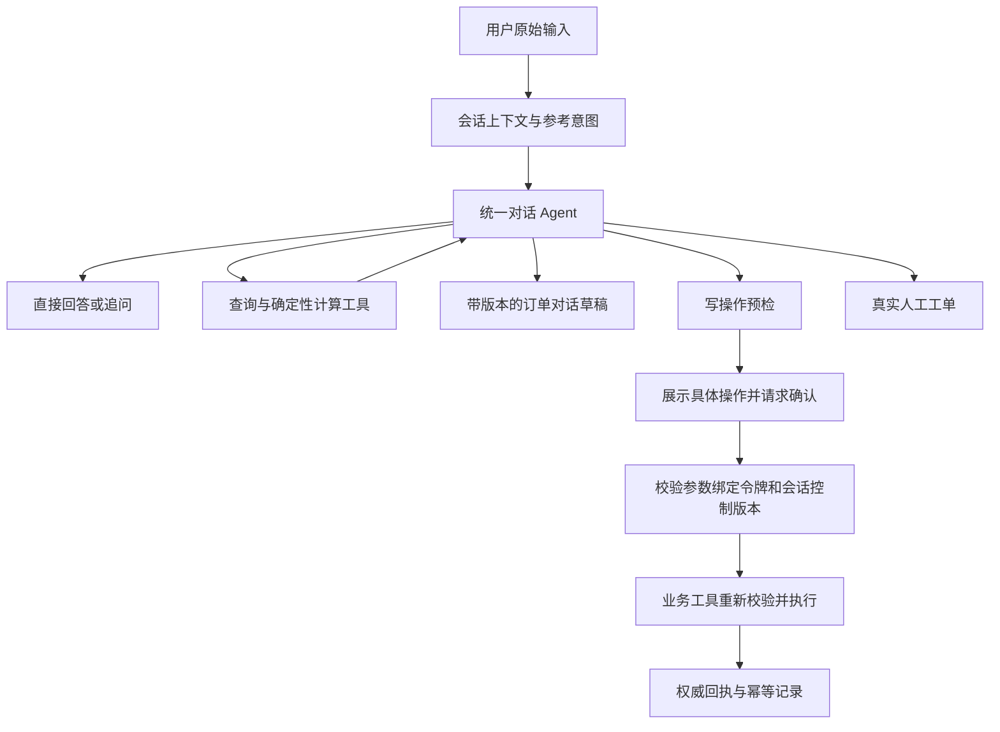

# 统一对话 Agent

2026-10-16，分支 `assistant-just-react`。

## 默认运行方式

所有用户消息先进入同一个对话 Agent。31 类意图仍由现有分类器识别，但只作为参考，不决定工具权限、不自动创建任务、不强制进入填槽流程。小模型的训练目标仍然只有一个业务标签；订单定位、对话理解和工具选择由主 Agent 结合原始多轮对话完成。



“按需使用 ReAct”意味着每轮至少由模型理解一次；没有查询或操作需求时直接回复，有需求才进入工具循环。确认轮直接执行已审核参数，不让模型重新规划。

## 本次改动

| 层 | 当前实现 |
| --- | --- |
| API | `app/api/conversation.py` 保留用户当前原话，使用会话历史；不调用旧查询改写入口、不根据意图自动建任务 |
| Agent | `build_conversation_plan` 为全部标签装配同一个已实现工具白名单；原 IntentSpec 的缺工具状态不阻断整个对话 |
| 提示词 | `app/prompts/conversation.py` 规定插问、改口、对象消歧、咨询/办理区分和证据要求 |
| 操作预检 | `app/execution/proposals.py` 对退款核实订单归属，对发票校验个人/公司字段及最新预检版本 |
| 确认 | 展示订单、动作、原因或发票字段；确认令牌绑定具体参数。`confirmed=True` 不能绕过统一入口的保护 |
| 任务入口 | 普通消息不再经过关键词拆分、自动填槽或意图锁定；显式旧任务按钮接口保留兼容 |
| 前端 | 客户端移除自动待办面板；提问选项与自由输入共存，确认仍是独立操作 |
| 记忆 | `read_case_memory` / `save_case_context` 保存当前用户订单的跨会话对话草稿，使用乐观版本检查 |
| 评测 | 默认沙箱不再执行旧查询改写；旧流程测试显式启用回滚模式，统一模式有独立执行器与 HTTP 集成测试 |

## 发票对话示例

1. 用户：“耳机帮我开发票。”Agent 根据上下文定位订单；如有多个候选，先询问。
2. Agent：“您需要个人还是公司抬头？”
3. 用户：“两种有什么区别？”Agent 检索并解释政策。这句话不会被系统直接塞进发票字段。
4. 用户：“公司，抬头是某某公司。”Agent 保存草稿并继续询问税号。
5. 用户：“算了，改个人。”Agent 更新同一订单草稿，完整替换字段，不继承已不适用的公司税号。
6. 字段明确后调用 `query_invoice` 做预检。Agent 请求写操作时，执行器再次校验字段和预检版本，展示具体待确认内容。
7. 用户点击确认，服务端校验令牌后执行同一动作及同一参数。发票工具在数据库事务内重新校验订单、规则与原票状态。

模型负责语义理解，不能保证它永不误解。服务端能确定性保证的是：未确认不写入、参数变化不复用确认、归属与工具契约必须通过、未知结果不盲目重试。真实对话质量仍需模型评测，提示词不能代替这项验收。

## 三种状态分开保存

| 状态 | 存储/来源 | 含义 |
| --- | --- | --- |
| 对话草稿 | Case 的 `dialogue_draft` | 当前主要意图、用户提供的字段、等待或暂停原因；不是业务事实 |
| 操作状态 | MutationGuard 的确认及幂等记录 | 待确认、执行中、成功、失败或未知；不由模型文本改变 |
| 业务状态 | 查询工具及写入回执 | 订单、退款、发票等真实业务记录；不能由草稿覆盖 |

同一用户、同一订单只有一个 `conversation_context` 草稿，草稿含一个当前主要意图。历史查询和操作 Case 仍分别保留，不能为了“一个意图”删掉已执行操作的审计记录。插入咨询不必修改草稿，明确改口才更新。

`save_case_context` 先核实订单归属，要求 `expected_version`；首次版本为 0，保存后递增。字段整体替换，版本冲突必须先读最新草稿。不同会话共享用户范围内的 Case；另一个用户无法读取这些草稿。更新草稿使该订单尚未执行的确认失效，但不会撤销已经开始或完成的业务操作。

`collecting / waiting_user / paused / resolved` 只表示对话事项状态。草稿 `resolved` 不代表已退款或已开票。没有订单号的售前咨询正常进行；当前持久草稿实现以订单为单位，尚未增加同一订单内按商品行分别保存的独立状态。

## 中断和失败

- 普通新消息推进会话控制版本，使旧 Agent 作业和旧确认失效；确认消息保持签发时的版本，以便执行确切参数。
- 相同内容在执行中再次以另一个请求 ID 提交会被拒绝；原请求 ID 的重放使用既有幂等处理。
- 已有业务写操作执行中或结果未知时，后续输入不会自动重提或假称撤回，而是转人工核实。
- 修改草稿只改变对话准备状态；操作开始后无法通过修改草稿回滚数据库。
- 一次最多返回一个待确认操作。多对象查询可以在同轮处理，多笔写操作需分别核对确认。
- 客户端刷新后对话原文仍在；提问选项和确认按钮不依赖旧任务列表恢复，用户可继续自然输入并重新核对操作。

## 能力边界与运行配置

默认 `ASSISTANT_JUST_REACT=true`。需要可用主模型才能进行对话；0.5B 分类器不是业务规划模型。分类器未加载时仍可使用规则参考标签。

目前统一计划给 Agent 提供本地能力目录中全部已实现工具，服务端继续检查工具白名单。这里没有承诺按标签裁剪工具或动态加载工具；后续可根据实际 token 与延迟数据优化，不能重新引入硬路由。

退款、发票申请及重开进入确定性预检与确认链。换货、价保申请、取消订单等没有实现的业务写工具不会被暴露；Agent 可以查询、解释或转人工，但不能宣称已办理。新增商业数据工具使用本地 MySQL，演示发票不会生成真实税务发票。新增草稿工具注册在本地 registry，本次没有扩展远程 MCP 服务的工具集合。

旧 Workflow、IntentSpec 分流和任务 API 为已有数据及回滚保留。`ASSISTANT_JUST_REACT=false` 可恢复后端旧路由；若要完整恢复旧客户任务面板，还需使用旧版本前端。31 类标签清单和训练文件格式没有因此变更。

## 验证

新增覆盖：全部 31 类的统一接待、同步/异步执行、错误参考标签、无安全上下文拒绝写入、具体操作预检、发票插问和改口、确认令牌失效、结果未知不重试、跨会话版本冲突和用户隔离。

本地 `.env` 中的 MySQL 配置会使旧 mock 单测连接实际数据源。离线回归应只在测试进程内清空连接配置，不修改用户 `.env`：

```powershell
.\.venv\Scripts\python.exe -c "import os; os.environ['ORDER_DB_DSN']=''; os.environ['ORDER_CACHE_REDIS_URL']=''; import pytest; raise SystemExit(pytest.main(['-q','--disable-warnings']))"
cd frontend
npm run build
```

验证结果：898 个测试通过，35 个按可选环境或数据条件跳过；前端生产构建通过。HTTP 集成测试替换了 LLM 和业务工具，验证控制链路，不代表真实模型理解质量或真实 MySQL、PostgreSQL、Redis 部署验收。
