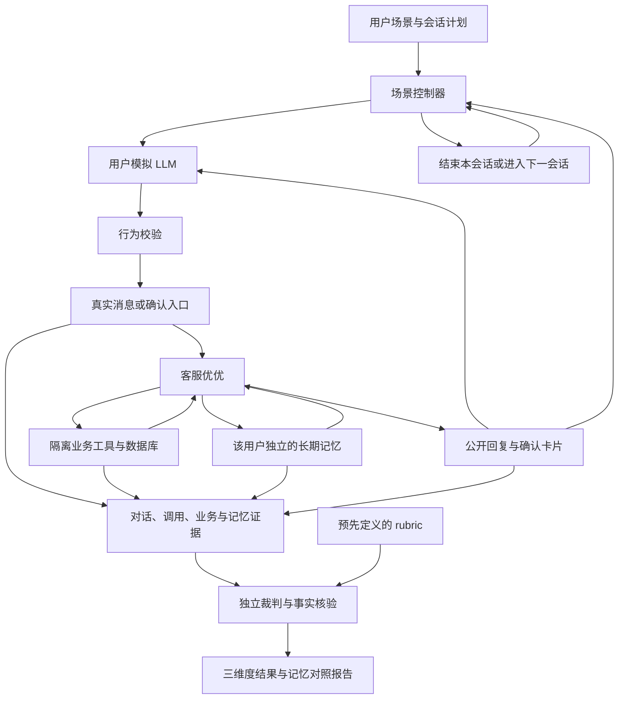

# Agent 评测设计

## 模块职责

Agent 评测从真实消息服务入口驱动事项关联、工具执行、业务确认和公开回复，再按任务完成、对象与上下文一致性、回复准确性三个维度评分。场景数据和业务替身隔离，实际事项与确认逻辑运行项目代码。

| 输入方式 | 运行行为 | 示例 |
| --- | --- | --- |
| v3 静态步骤 | 按触发条件提交固定消息、补充和卡片确认，关闭长期记忆处理 | [agent_demo.json](../app/evaluation/agent/agent_demo.json) |
| v4 动态交互 | 模拟用户根据实际回复生成动作，经独立行为复核后提交；按场景配置处理记忆 | [agent_simulation_demo.json](../app/evaluation/agent/agent_simulation_demo.json) |
| 采集文件回放 | 校验题集、输入摘要及轨迹后重新评分，不重新执行服务 | `--traces` 指定的采集文件 |

动态运行器的 `off/enabled/paired` 模式分别控制记忆处理与同快照读取对照。Agent 通过正常工具入口按需召回，评测记录实际调用与来源，不额外注入偏好。政策检索的召回、排序和答案忠实度由独立的 [RAG 评测](RAG评测说明.md)负责。

## 核心评测范围

本项目分别报告 **RAG、三项 Agent 质量指标与响应时间**。工具调用、记忆、纠错和授权记录作为质量维度的场景证据与诊断信息。

| 核心指标                                       | 主要问题                                             | 推荐场景                                                           | 评分依据                                                                    |
| ---------------------------------------------- | ---------------------------------------------------- | ------------------------------------------------------------------ | --------------------------------------------------------------------------- |
| 任务完成率 `task_completion`                   | 用户实际提出的目标是否完成                           | 查询物流、取消订单、需要补充信息才能继续的任务；以动态完整交互为主 | rubric 判断目标与通知是否完成，程序核对有效工具回执、实际写入和最终业务状态 |
| 对象与上下文一致性通过率 `context_consistency` | 是否处理正确用户、订单和事项，是否采纳有效补充与更正 | 多订单指代、同订单多个目标、歧义澄清、用户改口、跨会话续接         | rubric 判断归属与澄清是否合理，程序核对调用对象、事项状态和失效依据         |
| 回复准确性通过率 `reply_accuracy`              | 公开回复是否符合当时有效事实，并说明必要限制         | 空查询结果、办理失败、申请提交但尚未完成、用户更正后的答复         | rubric 判断事实与完整性，结合查询结果、业务状态及公开原话核验               |

静态与动态是输入方式，不是六套不同指标：

- 静态固定步骤适合回归事项归属、指代、更正和回复事实；若运行实际隔离工具，也可以评测本轮任务结果。当前 `static_steps` 会重新执行用户步骤，按 rubric 评价产生的轨迹。
- 动态交互主要验证任务最终完成、连续多轮是否串单，以及澄清和纠错后能否继续正确处理；三个质量维度同时评分。
- 长期记忆对照属于可选专项，不作为第四项核心 Agent 质量指标；它补充说明三个质量维度中的历史信息使用。

每个维度以适用的全部计划运行作为主分母，`pass` 才计通过；`partial`、失败、未开始、裁判错误均不计通过。报告同时保留各状态计数和评分覆盖率，不能将未评分描述为确定的产品错误。三个维度分别展示，不平均成一个笼统“Agent 准确率”。

题集将 `inputs` 与 `expected` 分离：执行只读取输入，评分再读取预期。运行编号区分场景、重复次数和分支，报告保留全部计划记录及各状态计数。

## 响应时间评测

响应时间作为独立性能结果，不交给 LLM 打分，也不与三个质量分数相加。当前测量的是隔离服务入口的实际观察时间。

| 指标                               | 起点                                   | 终点                                                  | 含义                                                     |
| ---------------------------------- | -------------------------------------- | ----------------------------------------------------- | -------------------------------------------------------- |
| 首条公开回复耗时 `first_reply`     | 控制器开始向消息或确认服务提交本轮动作 | 采集器首次观察到本会话新发布的 assistant 消息         | 用户等待第一条回复的服务侧耗时；该回复可能只是进度说明   |
| 本轮服务处理耗时 `service_settled` | 同上                                   | Worker 无待处理输入、执行及发布工作，本轮进入稳定状态 | 本轮服务流程结束或进入等待用户的状态，不等于业务目标成功 |

每项统计有效测量数 `n`、平均值、P50、P95，单位为秒。分位数采用 nearest-rank：排序后取第 `ceil(p × n)` 个值；无样本时返回空值。样本少时 P95 波动很大，应同时展示样本数，不据此承诺生产 SLA。

计时使用同一进程的单调时钟。起点在模拟用户生成及行为复核之后，稳定状态在下一次模拟用户调用之前记录，因此不包含用户生成、用户思考、行为复核、会话结束后的记忆归档和最终裁判耗时。Agent 自己的模型调用、工具调用、排队、回复发布及采集轮询开销包含在内。预热会话耗时保留在预热记录中，不重复加入两组后续会话的响应时间分布。

首条回复按已提交的公开消息计时，不把内部草稿、工具回执或历史 assistant 消息当成新回复。这里没有 HTTP/SSE 传输和浏览器渲染，也没有测量首 token；不能把结果写成模型 TTFT 或前端端到端延迟。时间终点由采集器观察，包含轮询延迟。

### 异常与统计分组

- 超时、预算耗尽和未结束请求单独计数。已经观察到的首条回复可以保留耗时，但未达到稳定状态的处理耗时为空，不能将超时时限当成成功完成耗时。
- 无回复不填 0。历史轨迹没有计时字段时标记缺失，不从模型调用耗时之和推算端到端耗时。
- 输入尚未处理完又提交下一条时，相关请求标记 `overlapping`。当前计时器不能可靠归因这些交叠回复，因此保留原始记录并排除出主延迟分布；这类场景仍用于质量评测。
- 模拟用户无效或复核错误的运行不进入主延迟分布，同时保留排除数量。有效模拟下的产品失败不自动排除，以免只统计成功且快速的请求。
- 按真实模型/脚本回归、静态/动态、实验分支、完整任务/阶段任务和客服模型分别汇总，不把不同执行条件混成一个数。

测量性能时保持模型、部署位置、并发设置和工具环境一致，并记录缓存条件。当前业务工具使用隔离替身，结果主要反映这套评测环境；脚本模型的耗时仅验证计时实现。报告中的性能数字应来自实际模型实验，并同时说明样本量、环境和异常情况。

### 主报告与使用方法

轨迹包含 `metadata.latency.requests`。静态请求记录 `step_id/session_id/action`，动态请求另带 `phase_id`；每条记录保留首条/最后一条公开回复耗时、稳定状态耗时、消息事件编号、重叠标记和终止状态。采集文件回放时直接使用原始计时，重新评分不会重新计时。

CLI 默认打印 `report.json` 的 `resume_summary`，每个分组只展示：

1. 三个质量维度的通过率、状态计数、计划分母及评分覆盖率。
2. 两个响应时间指标的样本数、平均值、P50 和 P95。
3. 缺少计时、无回复、未结束、超时、预算耗尽和排除数量。

完整证据、逐 rubric 判定和记忆对照保存在原报告中。延迟统计与质量判定独立，响应时间不改变质量维度的通过状态。

报告同时提供三个维度的实际通过率、首条回复与稳定状态的 P50/P95、样本量及运行条件。没有真实实验时只说明实现范围，不用占位数字充当成绩。

## 角色与信息边界

模拟用户、优优和裁判分别使用独立的对话上下文。可以使用相同模型服务，也可以使用不同模型；不同职责不能共享隐藏提示词或评测答案。

| 角色         | 可以读取                                                                   | 职责与限制                                                                                       |
| ------------ | -------------------------------------------------------------------------- | ------------------------------------------------------------------------------------------------ |
| 用户模拟 LLM | 用户目标、用户已知信息、披露与确认规则、当前阶段、优优实际公开的回复与卡片 | 回应真实提问、补充信息、更正或选择；不读取 rubric、标准工具路径、优优内部推理或隐藏业务状态      |
| 客服优优     | 正常服务入口提供的消息、当前授权上下文、允许读取的记忆及真实工具结果       | 自主理解和办理；不接收用户模拟器的完整私有资料、未发生的未来消息或评分标准                       |
| 场景控制器   | 场景配置、会话计划、模拟用户行为、预算及环境状态                           | 管理轮次、校验行为、提交确认、推进会话、记录终止原因；不替优优完成缺失的推理或操作               |
| 业务环境     | 隔离业务快照、明确的查询与办理规则                                         | 根据实际对象和参数查询、变更状态并保存回执；不对所有请求固定返回成功                             |
| 独立裁判     | rubric、实际交互、业务真值、有效工具证据及采集完整性                       | 在交互结束后评分，不参与用户生成或帮助优优完成目标；不能把未披露的用户信息当作优优应该知道的事实 |

用户模拟器拥有的事实与业务环境中的事实分开。例如“我怀疑扣了两次款”是用户陈述，是否重复支付要由渠道记录核验；用户的期待不能直接改写业务状态。

## 场景配置

评测单位是一个用户围绕一组目标进行的一次或多次会话。同一场景可以包含多个对象、需求变化、补问和确认。运行前固定场景与评分标准，执行后不能因模型失败而更换目标或降低标准。

| 配置内容       | 必需信息                                                       |
| -------------- | -------------------------------------------------------------- |
| 用户身份       | 隔离的稳定用户标识、对象所属关系；会话身份由服务端绑定         |
| 用户目标       | 每阶段希望查询或完成的事项、目标对象、允许的替代方案及结束条件 |
| 用户已知信息   | 用户能够提供的订单线索、商品选择、原因和偏好；不填预设工具结果 |
| 信息披露规则   | 哪些信息首轮主动说、哪些被问到后提供、哪些本轮不能重复提醒     |
| 行为与确认规则 | 可接受的澄清、拒绝或转人工方式；什么对象和参数允许确认         |
| 业务初始状态   | 订单、商品、政策版本、工具可查询数据及可发生的合法状态变化     |
| 多会话计划     | 各阶段目标、稳定用户与不同会话标识、披露规则和行为约束 |
| 预算与模型配置 | 会话数、每会话用户轮数、三类模型的调用上限、工具上限和总时间   |
| 评分预期       | 三个维度的 rubric、关键事实检查、记忆专项标注及适用性          |

场景的实际字段、校验条件和预算见后文 v4 格式。仓库动态示例分别展示物流空结果、取消订单确认与跨会话颜色偏好读取对照；业务对象通过 `inputs.objects/reads/writes` 绑定到隔离环境。

## 动态交互流程



1. 控制器初始化该次运行的隔离用户和业务环境，将当前阶段的目标、用户可知信息及行为规则交给模拟用户。
2. 模拟用户生成首条消息，控制器通过 `MessageIntake.receive` 发送；`ConversationWorker` 推进实际关联、查询改写、工具执行和回复发布。
3. 控制器只把新发布的用户可见回复和确认卡片交给模拟用户。内部草稿、未发布结果和裁判要求不进入用户输入。
4. 模拟用户根据实际问题作答，或提出澄清、更正、拒绝。控制器验证后提交消息或确认动作，再推进优优的本轮处理。
5. 达到预先声明的会话终止条件后，等待相关在途工作收尾并保存边界快照；若还有阶段，按会话计划启动新的会话。
6. 全部会话结束或预算耗尽后，冻结采集，由独立裁判按同一套 rubric 评分。

运行范围是服务入口级端到端链路。HTTP 鉴权、浏览器和 SSE 展示由对应测试验证。模拟器不能绕过正常消息关联、业务确认、来源校验和发布约束。

### 用户行为与确认

用户模拟器采用结构化 `UserAction`，动作是 `message`、`confirm`、`cancel_operation`、`end`。`simulator.py` 校验结构和实际卡片，再以独立模型请求复核信息披露与行为；通过后才转成 `Step` 交给真实服务入口。复核不确定或失败即停止本次轨迹，不能静默修正后继续。

普通消息由模拟器自然生成。确认动作必须引用优优实际发布、属于当前用户且仍有效的卡片；控制器核对对象、动作及场景允许的参数后，经 `TaskOperations` 提交。模拟用户不能自行生成操作编号、令牌或业务回执，也不能用一句泛泛的“好的”替代界面的结构化确认。

控制器拒绝错误或含糊的确认请求，不替模拟用户改选正确卡片。若优优没有提出正确的确认，目标就可能无法完成；控制器不能为了跑通场景补造确认条件。

### 终止与预算

会话可因目标处理完成、用户明确放弃、符合场景的拒绝或转人工、持续无进展，或者预算耗尽而结束。模拟用户说“谢谢”或申请结束，仅是结束候选，不证明业务成功。控制器记录原因，裁判仍核对实际目标。

每次运行固定用户轮数、优优与模拟用户及裁判的调用预算、工具调用上限和总截止时间。超时或循环保留已发生的全部记录，不能丢弃后重跑直到成功。结束时存在未决业务结果，要记录“未知”并停止进一步提交，不能凭缺少回执认定未发生。

### 模拟用户的有效性

需要校验模拟用户是否保持身份和目标、遵守信息披露规则、只提供已知事实、依据实际问题作答，以及是否按允许条件确认。验证结合可确定的字段检查和独立复核，不能只依赖模拟用户自称遵守规则。

模拟用户编造订单、提前泄露记忆测试信息或违规确认，记为模拟异常；优优重复追问、答非所问或错误办理，不应因此自动归因于模拟异常。对无法可靠区分的情况保留证据并人工复核。

报告同时展示全部计划运行、已开始运行、有效模拟运行和异常运行。异常不能无记录删除，也不能因该次优优表现不好就判定模拟无效。

## 三个评测维度

三个维度使用同一次真实交互的证据，分别配置 rubric。允许不同的执行路径和措辞；关键客观事实仍由程序核验。

| 维度               | 主要评价内容                                                                       | 关键证据                                                       |
| ------------------ | ---------------------------------------------------------------------------------- | -------------------------------------------------------------- |
| 任务完成           | 用户实际提出的目标是否达到预定终点；多目标是否遗漏；需要澄清时是否合理推进         | 工具结果、业务最终状态、写入账本、操作回执及必要通知           |
| 对象与上下文一致性 | 是否处理正确用户和对象；是否采纳补充、更正及新目标；是否正确使用或拒绝使用历史信息 | 用户消息、事项变化、调用参数、输入生效边界、记忆来源与使用记录 |
| 最终回复准确性     | 所有公开回复是否符合当时有效事实，完整表达结果、限制与进展                         | 公开消息、有效工具证据、对应业务状态、确认内容和时间           |

“申请已提交”“渠道处理成功”“银行卡到账”是不同终点。工具返回 `success`、事项结束或模型自称完成，都不能单独证明目标达成。查询任务既需取得对应对象的有效信息，也需向用户反馈；办理任务需核对实际写入及回执。

对象发现阶段可以读取同一用户的多个合法候选，不能把所有非最终对象的查询都判为串单。用户改变目标时按实际消息和提交边界评价；更正前已合法执行的操作不能被当作未发生，迟到结果也不能自动当作新的有效依据。

回复评分覆盖处理中与结束时所有公开内容。分批回复可以满足完整性，后续正确答复不能自动抹掉先前错误。准确告知办理失败时，回复准确性可以通过，而任务完成仍失败。

### Rubric 与事实检查

每条 rubric 描述一个可判断的要求，而不是标准答案全文。沿用现有字段：

| 字段               | 含义                       |
| ------------------ | -------------------------- |
| `id`               | 维度内唯一的项目标识       |
| `criterion`        | 要评价的能力或行为         |
| `pass_when`        | 完全满足标准的条件         |
| `partial_when`     | 只满足部分要求的具体边界   |
| `fail_when`        | 明确失败的条件             |
| `evidence_sources` | 判通过时必须引用的采集集合 |

例如“退款申请进度表达”要求根据真实回执说明申请阶段，部分通过可定义为核心事实正确但遗漏非关键说明，失败包括声称已到账或编造到账时间。标准不能要求优优知道模拟用户尚未公开且无法从授权工具获得的信息。

裁判逐条返回状态、理由和证据引用。当前评分映射为 `pass=1`、`partial=0.5`、`fail=0`，证据不足和裁判错误为未评分。证据引用必须指向存在且允许的采集集合；评分结果保留理由与引用，供复核。

报告分别保留 `rubrics` 与程序 `checks`。某个关键事实检查失败，即使 rubric 满分，维度也不能通过。每维度 rubric 等权平均，任一项未评分则平均分为空；部分通过不计入通过数。三个业务维度不做简单平均，完整任务需全部适用维度通过。

## 长期记忆评测（可选诊断）

长期记忆专项在同一用户的多次新会话之间验证“保存、召回、使用、更正与遗忘”。它是对三个业务维度的专项诊断及效果对照，不替代任务和回复的实际结果。

记忆事实应是用户明确表达且适合长期使用的信息，例如作用范围清楚的尺码与偏好。订单状态、退款金额和物流进度仍需业务工具查询；记住旧状态不等于得到当前事实。具体模型及约束见 [上下文与记忆设计](上下文与记忆设计.md)。

### 会话与存储生命周期

同一个场景内保持稳定用户标识，每次新会话使用新的 `session_id` 和新的请求上下文。该用户的长期记忆、可验证来源和必要索引跨会话保留；不同场景、重复运行及实验分支使用独立命名空间或数据库。

会话结束后等待该消息截止点的记忆处理完成，再进入下一阶段。v3 记忆与事项共用 SupportStore，快照复制保留事项、原话来源和记忆记录。`MemoryObserver` 采集提取调用、归档结果、记忆快照和实际读取；归档返回错误或重试状态时停止该轨迹并记录原因。

下一会话不能直接拼入先前完整对话或人工提供的答案摘要。测试前记录实际注入优优的上下文，追踪信息究竟来自本轮消息、事项续接、原话回查还是长期记忆。若答案通过其他历史渠道取得，应如实报告，不能全部归功于长期记忆。

需要测试“没有重复提醒也能记住”时，模拟用户的下一会话首轮不重复待测信息；优优主动询问后可以回答，并记录这次询问。用户未曾披露的私有信息不进入记忆正确率的分母。

### 记忆开关对照

主要对照用于测量“已有长期记忆是否改善后续服务”：

1. 以固定场景完成建立记忆阶段，核验用户实际披露的信息，等待对应记忆处理完成。
2. 保存此时的业务、事项、来源与记忆快照，从同一快照复制两个隔离实验分支。
3. A 组关闭优优读取长期记忆的入口，B 组开启；其余上下文来源、业务初态、工具、模型和预算保持一致，禁止共享运行中的写入和缓存。
4. 在两组中开展相同目标和用户规则的后续会话，记录实际注入上下文、重复询问、目标结果和错误引用。
5. 对事先固定的场景与重复次数逐对比较，完整保留结果，不挑最好一次。

读取开关独立于历史数据和记忆写入，通过评测进程内的读取入口包装实现。A 组保留底层快照供核验，读取结果受开关阻断。两组使用相同的模型配置、场景事实和披露规则，但不共享生成中的对话，模拟用户分别回应各自收到的实际问题。

事项历史等其他信息渠道在两组中保持一致，并记录是否绕过长期记忆获取了答案。重复调用和不同阶段结果按场景配对汇总，不当作彼此独立的业务样本。

### 记忆标注与实际报告字段

[reporting.memory_metrics](../app/evaluation/agent/reporting.py) 按场景顶层的 `memory_targets` 核验，标注不传给模拟用户或 Agent。

| 字段 | 计算依据 |
| --- | --- |
| `targets[].disclosed` | 有效用户动作声明的引用确实出现在对应会话的公开用户消息中 |
| `targets[].storage_pass` | 被检查阶段归档后的本人有效记忆是否匹配 predicate、value 和 qualifiers；`absent` 目标反向判断 |
| `targets[].recall_pass` | 该阶段实际返回的本人检索结果是否匹配；无调用、调用被阻断或证据不完整时为空 |
| `storage/recall` | 各自提供 `annotated/scored/passed/rate`，仅对可判定目标计算比率 |
| `observed_retrieval_calls` | 实际长期记忆读取记录数 |
| `observed_history_reads` | 实际事项历史读取记录数 |
| `usage_accuracy/unnecessary_questions` | 报告中保持空值；回复行为通过场景配置的 rubric 单独判定 |

保存与召回核验还要求模拟行为有效且记忆采集完整。标注中的 `active/absent` 分别要求事实存在或不存在；原始披露必须得到公开消息验证，不能拿模拟用户的私有设定代替真实披露。保存、检索及最终回复中的使用分别判断，最终回答相似不直接产生记忆命中分数。

## 证据、有效性与报告

记录按场景、重复次数、实验分支、会话及运行编号关联。`Capture.observations` 使用以下集合：

- `tasks/tool_calls/replies/writes/operations/events/models/objects` 保存事项快照、实际调用、回复、写入和业务对象状态。
- 动态轨迹另有 `user_actions/sessions/memory`，保存模拟动作与复核、阶段结束状态、记忆读取及归档快照。
- `metadata` 保存角色模型配置、预算用量、快照摘要、响应计时及预热或在途轨迹；命令入口补充源码摘要和 Python 版本。
- `complete` 标记各集合是否完整，`error/termination/simulator_validity` 区分执行、预算和模拟行为状态。裁判理由与逐项引用另存 `judge.json`。

对比评测的主报告展示全部计划与已开始运行中的通过数量、错误数量及覆盖率；只有完成相应校验的运行才能贡献通过。产品错误、模拟异常、业务环境错误、记忆处理错误和裁判错误分别记录，不把未评分自动变成通过。

同时提供“模拟有效运行”和“两分支均有效的配对运行”的结果与样本数。有效性须按预先定义的规则判断；不能在看到优优分数后删除不利场景。主报告保留被排除原因及全量统计，避免只展示有效子集造成虚高。

模型裁判不参与对话生成，裁判输入与模拟用户输入分别构造。判定保存状态、理由和证据位置，模型格式错误、引用无效与业务失败使用不同状态记录。

动态交互轨迹保存后可以反复评分。业务规则评分应可复现；再次调用 LLM 裁判可能产生不同判定，保留新裁判配置及结果，不覆盖之前的评分。原始交互、记忆内容和判定理由可能含完整场景数据，沿用本地运行产物的存储范围，不直接当作公开汇总。

## 代码入口

Agent 评测源码位于 `app/evaluation/agent/`。

| 文件                                                                                                 | 职责                                                                      |
| ---------------------------------------------------------------------------------------------------- | ------------------------------------------------------------------------- |
| [contracts.py](../app/evaluation/agent/contracts.py)                                                 | v3 静态与 v4 动态契约、披露规则、会话计划、预算、rubric 与独立记忆标注    |
| [run.py](../app/evaluation/agent/run.py)                                                             | CLI、子进程隔离与超时监督、完整轨迹回放、报告写入                         |
| [runtime.py](../app/evaluation/agent/runtime.py)                                                     | 真实消息入口、Worker、工具、确认及公开回复采集                            |
| [simulator.py](../app/evaluation/agent/simulator.py)                                                 | 用户生成、事实披露和卡片校验、独立行为复核、模型调用计量                  |
| [simulation.py](../app/evaluation/agent/simulation.py)                                               | 多会话调度、共享预算、预热、同快照分支、部分轨迹保存                      |
| [memory.py](../app/evaluation/agent/memory.py)                                                       | 实际 v3 记忆提取与归档、SQLite 完整快照、读取开关、事项历史与记忆来源观测 |
| [business.py](../app/evaluation/agent/business.py)、[sandbox.py](../app/evaluation/agent/sandbox.py) | 独立临时存储和受控业务数据，运行实际业务确认逻辑                          |
| [grading.py](../app/evaluation/agent/grading.py)、[judge.py](../app/evaluation/agent/judge.py)       | 三维度 rubric、事实核验、证据引用和完整性检查                             |
| [reporting.py](../app/evaluation/agent/reporting.py)                                                 | 全量/有效运行统计、配对差异、独立记忆标注核验                             |
| [latency.py](../app/evaluation/agent/latency.py)                                                     | 响应时间边界、平均值/P50/P95、三项质量与响应时间主报告                    |
| [agent_demo.json](../app/evaluation/agent/agent_demo.json)                                           | 三个静态回归示例                                                          |
| [agent_simulation_demo.json](../app/evaluation/agent/agent_simulation_demo.json)                     | 动态物流查询、取消订单、跨会话颜色偏好对照示例                            |

### v4 场景格式

题集使用 `schema_version: 4`，每个场景沿用 `id`、`inputs`、`expected`。动态场景用 `inputs.simulation` 替代 `inputs.steps`，两者不能同时设置。

| 字段                          | 含义                                                                                                      |
| ----------------------------- | --------------------------------------------------------------------------------------------------------- |
| `inputs.sessions`             | 会话与用户的绑定                                                                                          |
| `inputs.simulation.phases`    | 按顺序执行的会话，分别配置唯一 `id`、`session`、`goal`、`facts`、`behavior`、`confirmations`、`max_turns` |
| `facts.<名称>.value`          | 模拟用户已知事实                                                                                          |
| `facts.<名称>.disclosure`     | `anytime` 可主动说、`when_asked` 被问到才说、`never` 本阶段禁止说                                         |
| `confirmations[].review`      | 允许确认的订单、动作及必要参数；至少明确 `order_id` 与 `action`                                           |
| `simulation.memory`           | `off` 禁用记忆处理，`enabled` 单轨迹启用，`paired` 同一预热快照的读取对照                                 |
| `simulation.warmup_sessions`  | 仅 paired 使用，至少一次预热，且保留至少一次后续会话                                                      |
| `inputs.objects/reads/writes` | 沿用原有有状态业务环境配置                                                                                |
| `inputs.budget`               | `seconds/model_calls/tool_calls/rounds/simulator_calls/memory_calls`                                      |
| `expected`                    | 三个维度的 rubric 与关键事实 checks                                                                       |
| `memory_targets`              | 可选独立真值标注，放在场景顶层，不传给用户模拟器或 Agent                                                  |

`memory_targets` 每项包含 `id`、被检查的 `phase_id`、原始披露的 `disclosed_phase/fact_id`、`predicate/value/qualifiers` 与 `expected_state: active|absent`。例如颜色为 `prefers_color=blue`，作用范围可为 `product_category=clothing`。当前记忆引擎只保存本人偏好；用户身份从会话绑定取得。实际有效动作中声明的原话必须能在已发布用户消息中找到，才进入已披露样本；不能以场景预设代替真实披露。

保存核验使用目标会话归档后的实际快照；召回核验使用该会话实际返回的、属于对应用户的检索记录。无检索调用或证据不完整时，召回分数为空；真实检索返回空结果时才可计作未召回。`absent` 支持存储/召回层的遗忘或禁止事实检查，最终是否错误使用仍需结合回复 rubric。

`seconds` 和调用/轮次预算覆盖一条完整轨迹。paired 先消耗预热预算，两组分别从相同剩余预算开始，预热成本不重复计入两组差值。用户生成和独立行为复核共同消耗 `simulator_calls`；记忆提取消耗 `memory_calls`。裁判每个适用维度最多请求一次，不自动重试，每次最多 30 秒；其调用在交互结束后执行，单独保存。所有 SDK 请求关闭自动重试。

### 运行与产物

```powershell
# 查看包含 v3/v4 的协议
python -m app.evaluation.agent.run --print-schema

# 动态交互：分别指定 Agent、模拟用户与裁判模型
python -m app.evaluation.agent.run --dataset app/evaluation/agent/agent_simulation_demo.json --live-model --model 客服模型名 --user-model 用户模拟模型名 --judge-model 裁判模型名 --repetitions 3

# 可额外使用 --reviewer-model 指定用户行为复核模型，--memory-model 指定记忆提取模型
# 默认分别沿用用户模型、客服模型；各角色的请求上下文分开

# 保存后的轨迹可独立重新评分，须保持原题集与重复次数
python -m app.evaluation.agent.run --dataset app/evaluation/agent/agent_simulation_demo.json --traces output/某次运行/captures.json --judge-model 裁判模型名 --repetitions 3

# 无需模型服务的程序回归
python scripts/run_platform_checks.py tests/test_agent_e2e.py tests/test_agent_rubrics.py tests/test_agent_simulation.py tests/test_agent_latency.py
```

CLI 复用项目已配置的模型服务地址和凭证，真实执行与裁判调用可能产生费用。动态真实执行缺少 `--user-model`，或含 rubric 却缺少 `--judge-model` 时，开始前直接报配置错误。输出目录必须是新目录，不覆盖已有结果。

`captures.json` 保存完整证据、各角色模型调用、实际上下文、预热来源、分支标识和快照摘要；超时仍保留已经写出的 `metadata.inflight` 部分轨迹。`judge.json` 保存逐维度裁判理由和引用。`report.json` 中：

- `groups` 按执行来源、分支和 complete/stage 分组，展示计划数、开始数、模拟有效性、各维度计划分母和已开始分母。
- `experiments.valid_runs` 展示有效且采集完整的运行数、通过率及被排除原因；裁判未评分仍不计通过。
- `experiments.pairs/paired_summary` 校验同一快照与配对编号，给出两组均有效时的通过率、轮次、模型和工具调用数差值，方向为开启减关闭。裁判错误对应的维度差值为空。
- `experiments.memory` 展示独立标注核验、检索调用与事项历史读取计数；使用质量和重复询问字段为空，行为判断见对应 rubric。

调用次数是成本代理，不能当成金额。SDK 返回的 token 用量和耗时保留在原始模型记录；无用量信息时不猜测费用。两组没有完整有效结果时仍保留两条计划记录及失败原因，不补跑替换。

v3 静态题集、v2 采集文件以及旧输入摘要仍可回放。v4 动态采集必须与动态场景匹配；缺少分支、重复轨迹、快照不一致或输入不匹配会被拒绝。动态步骤编号是运行时生成的，不支持用预先猜测的步骤编号设置时间边界；可通过 `phase_id`、会话记录和实际消息筛选阶段证据。

### 隔离环境与回归范围

运行器为每次轨迹创建独立进程、临时 SQLite 和有状态业务替身。临时支持库承载真实事项、操作、事件和 v3 记忆记录；业务替身按配置的用户、对象和参数返回查询结果或变更状态。服务入口级评测不经过 HTTP、浏览器与 SSE，这些协议由各自测试覆盖。

动态记忆处理在每次会话结束后执行归档屏障，再进入下一阶段。隔离环境关闭外部缓存与向量检索，实际观察词法召回；会话计划按阶段顺序运行，使用正常业务时间。paired 分支从完整 SQLite 快照复制，读取开关不清除底层来源或记忆。

[test_agent_simulation.py](../tests/test_agent_simulation.py) 等程序回归使用脚本化模型响应，覆盖动态入口、确认、行为复核、调用预算、归档失败、独立分支、读取开关、遗忘隔离和回放。脚本模型测试用于校验运行器行为；真实模型运行的轨迹、评分和延迟按上述产物保存。
