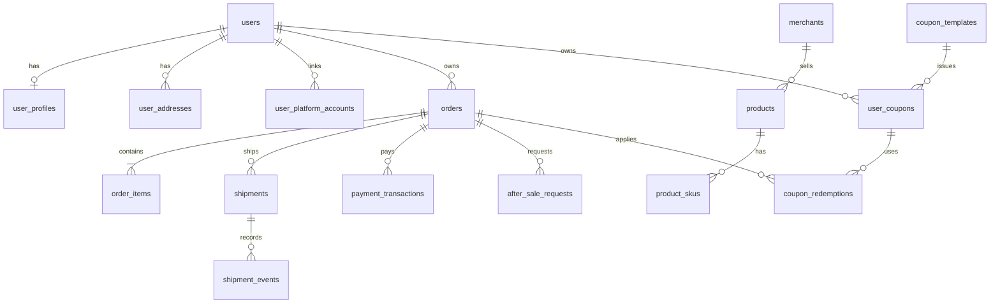

# MySQL 业务数据库表设计

本文定义电商客服项目的 MySQL 业务数据模型，供后续建表、迁移和接口改造使用。目标是让用户、商品、订单、支付、物流、优惠券和售后数据有明确的归属、状态与关联，客服工具能够按认证身份查询可靠的业务事实。

**实施状态：新版表结构和旧结构清理已执行。** [迁移脚本](../scripts/migrate_mysql_business_schema.py)依次执行 [001 建表](../migrations/mysql/001_business_schema.sql)与 [002 清理](../migrations/mysql/002_remove_legacy_commerce.sql)，`schema_migrations` 记录版本。`orders` 旧列、`logistics` 和全部 `commerce_*` 表已删除；38 个核心工具已切换到目标表，003 配套迁移需在部署时执行，配置见 [工具设计第 10 节](TOOL_DESIGN.md#10-核心工具实现与运行配置)。下文“原有”指迁移前结构，“目标”指新版结构。PostgreSQL 仍承载客服对话、事项、任务执行和审计等运行数据。

## 1. 当前结构与主要问题

| 范围 | 原有运行时表 | 当前结构与限制 |
| --- | --- | --- |
| 账号 | `users`、`user_credentials`、`auth_sessions`、`auth_login_attempts` | 已分开保存身份、密码哈希和可撤销会话；尚无资料、联系方式、地址和外部平台账号映射。见 [认证表定义](../app/data/auth_store.py)。 |
| 商品 | `merchants`、`products` | 商品只有一层 `product_id`；价格和库存位于商品行，尚未区分不同规格的 SKU。见 [商品表定义](../app/data/product_dao.py)。 |
| 订单 | `orders` | 主键为 `(platform_code, order_id)`；商品明细在 `items` JSON，金额只有 `total`，物流和退款状态也写在订单行。见 [订单表定义](../app/data/order_dao.py)。 |
| 物流 | `logistics` | 以 `(platform_code, tracking_number)` 为主键，轨迹在 `events` JSON；一单多包裹和包裹商品明细缺少独立结构。见 [物流表定义](../app/data/logistics_dao.py)。 |
| 业务证据 | `commerce_offers`、`commerce_promotions`、`commerce_coupons`、`commerce_delivery`、`commerce_price_history`、`commerce_after_sales`、`commerce_invoices`、`commerce_payments`、`commerce_order_policies`、`commerce_mutations` | 前九类共用 `platform_code、user_id、record_id、object_id、channel、region、recorded_at、is_demo、payload` 结构；业务字段主要在 JSON 中。`commerce_mutations` 保存写操作的幂等结果。它们适合当前证据和演示台账，但不等同于完整的领券、支付或售后交易模型。见 [通用台账定义](../app/data/commerce_dao.py)。 |

原有 `commerce_*` 记录使用 `VARCHAR(128)` 用户标识及空字符串表示公共规则，不能可靠映射到认证用户。按本次清理要求，这批旧记录不迁入新表；旧演示初始化入口已停用。

## 2. 建模约定

1. `users.user_id` 是系统内部稳定身份。用户名、手机号、邮箱和外部平台用户号均不能作为订单外键。新账号当前生成 32 位 UUID 十六进制字符串；旧账号保留原 `user_id`，所以近期继续使用 `VARCHAR(64)`。目标用户专属业务表的 `user_id` 与之保持相同字符集、排序规则和长度。
2. 平台订单继续用 `(platform_code, order_id)` 标识；外部订单号在不同平台可能重复。商品、包裹、优惠券实例和售后申请使用各自稳定 ID。迁移前不改变现有订单主键。
3. 金额使用 `DECIMAL(12,2)`，同时记录 `currency CHAR(3)`；数量使用非负整数。金额计算和优惠叠加规则由业务层明确，不能只信任前端或模型计算值。
4. 时间统一按 UTC 写入 `DATETIME(6)`，接口展示时转换时区。历史交易保存下单时的商品名称、单价、收货地址和优惠金额快照；之后修改资料或商品目录不能改写历史事实。
5. 高频查询与唯一性所需的字段使用普通列及索引。JSON 只保存不常筛选的原始证据或扩展属性，不承担用户归属、金额、状态、幂等键等核心约束。
6. 交易表默认禁止级联删除用户或订单，账号停用不删除交易历史。敏感资料按业务需要收集、限制读取；联系方式和地址中的敏感值应加密，密文应带密钥版本以支持轮换，密钥不放在同一数据库中；密码只保存哈希。
7. 以下字段为目标逻辑结构，`?` 表示可空。主键、外键和唯一约束列在“约束”栏；创建实际 DDL 时须统一 MySQL 字符集与排序规则，并先核对历史数据。[MySQL 外键约束](https://dev.mysql.com/doc/refman/8.4/en/create-table-foreign-keys.html)要求引用列具备兼容类型和索引。

## 3. 用户、身份与权限

`users` 只回答“这是哪个用户”。密码凭证、登录状态、个人资料、平台账号和客服角色分别管理。

| 表及状态 | 字段 | 约束与用途 |
| --- | --- | --- |
| `users`（现有，保留） | `user_id VARCHAR(64)`、`username VARCHAR(64)`、`username_key VARCHAR(64)`、`status VARCHAR(16)`、`created_at DATETIME(6)`、`updated_at DATETIME(6)` | PK `user_id`；UNIQUE `username_key`；当前状态为 `active/disabled`。改用户名不能改 `user_id`。 |
| `user_credentials`（现有，保留） | `user_id VARCHAR(64)`、`password_hash VARCHAR(255)`、`changed_at DATETIME(6)` | PK/FK `user_id → users`；仅存密码哈希，不存明文。 |
| `auth_sessions`（现有，保留） | `session_hash CHAR(64)`、`user_id VARCHAR(64)`、`created_at`、`expires_at`、`revoked_at?`，后三者为 `DATETIME(6)` | PK `session_hash`；FK `user_id → users`；索引 `(user_id, expires_at)`；退出登录通过 `revoked_at` 失效。此表是**登录会话**，不是客服聊天会话。 |
| `auth_login_attempts`（现有，保留） | `username_key VARCHAR(64)`、`attempts INT`、`window_started_at DATETIME(6)`、`locked_until DATETIME(6)?` | PK `username_key`；限制连续失败登录。未注册用户名也可能产生记录，故不直接加用户外键。 |
| `user_profiles`（目标新增） | `user_id VARCHAR(64)`、`display_name VARCHAR(80)?`、`avatar_url VARCHAR(512)?`、`updated_at DATETIME(6)` | PK/FK `user_id → users`；仅放展示资料。暂不收集与业务无关的生日、性别等字段。 |
| `user_contacts`（目标新增） | `contact_id BIGINT UNSIGNED`、`user_id VARCHAR(64)`、`contact_type VARCHAR(16)`、`value_ciphertext VARBINARY(512)`、`lookup_digest BINARY(32)`、`key_version SMALLINT UNSIGNED`、`verified_at DATETIME(6)?`、`created_at DATETIME(6)` | PK `contact_id`；FK `user_id → users`；UNIQUE `(contact_type, lookup_digest)`。`lookup_digest` 对规范化值计算带密钥的 HMAC，便于查重，不存明文手机号或邮箱；只有完成验证的联系方式才可用于找回账号。 |
| `user_addresses`（目标新增） | `address_id BIGINT UNSIGNED`、`user_id VARCHAR(64)`、`recipient_name_ciphertext VARBINARY(512)`、`phone_ciphertext VARBINARY(512)`、`province_code VARCHAR(16)`、`city_code VARCHAR(16)`、`district_code VARCHAR(16)`、`detail_ciphertext VARBINARY(1024)`、`key_version SMALLINT UNSIGNED`、`is_default BOOLEAN`、`created_at DATETIME(6)`、`updated_at DATETIME(6)`、`deleted_at DATETIME(6)?` | PK `address_id`；FK `user_id → users`；索引 `(user_id, deleted_at)`。默认地址“每人最多一个”须在事务中保证；订单另存地址快照。 |
| `user_platform_accounts`（目标新增） | `id BIGINT UNSIGNED`、`user_id VARCHAR(64)`、`platform_code VARCHAR(16)`、`external_user_id VARCHAR(128)`、`verified_at DATETIME(6)`、`status VARCHAR(16)` | PK `id`；FK `user_id → users`；UNIQUE `(platform_code, external_user_id)`。只在平台身份被可靠核验后建立绑定；不能凭订单姓名或手机号猜测归属。 |
| `user_roles`（目标新增，需单独迁移） | `user_id VARCHAR(64)`、`role VARCHAR(16)`、`enabled BOOLEAN`、`granted_by VARCHAR(64)?`、`granted_at DATETIME(6)` | PK `(user_id, role)`；FK `user_id → users`。客服、管理员权限不能由注册请求自报。当前客服角色在 PostgreSQL 的 `support_staff` 中，迁移前仍以现有权限来源为准。 |

## 4. 商家、商品、规格与库存

商品目录是公开业务数据，不能强行挂某个 `user_id`。同一商品的不同规格需要独立 SKU，订单引用 SKU 并保留购买时快照。

| 表及状态 | 字段 | 约束与用途 |
| --- | --- | --- |
| `merchants`（现有，扩展） | `merchant_id VARCHAR(64)`、`name VARCHAR(128)`、`category VARCHAR(32)`、`description VARCHAR(512)`；目标增加 `status VARCHAR(16)`、`created_at DATETIME(6)`、`updated_at DATETIME(6)` | PK `merchant_id`。商家是商品和活动的经营主体。 |
| `products`（现有，逐步调整） | `product_id VARCHAR(64)`、`merchant_id VARCHAR(64)`、`name VARCHAR(128)`、`category VARCHAR(32)`、`description VARCHAR(512)`、`specs JSON?`；现有 `price DECIMAL(12,2)`、`stock INT` 在迁移期保留 | PK `product_id`；目标 FK `merchant_id → merchants`，索引 `(merchant_id, category)`。清理现有空 `merchant_id` 后再加外键。 |
| `product_skus`（目标新增） | `sku_id VARCHAR(64)`、`product_id VARCHAR(64)`、`sku_code VARCHAR(64)`、`spec_values JSON`、`list_price DECIMAL(12,2)`、`currency CHAR(3)`、`status VARCHAR(16)`、`created_at DATETIME(6)`、`updated_at DATETIME(6)` | PK `sku_id`；FK `product_id → products`；UNIQUE `(product_id, sku_code)`。不同颜色、尺码等规格分别定价。 |
| `sku_inventory`（目标新增） | `sku_id VARCHAR(64)`、`available_qty INT`、`reserved_qty INT`、`version BIGINT`、`updated_at DATETIME(6)` | PK/FK `sku_id → product_skus`；库存扣减与预留在事务中校验版本和非负数量。 |
| `sku_price_history`（目标新增） | `price_id BIGINT UNSIGNED`、`sku_id VARCHAR(64)`、`price_type VARCHAR(16)`、`amount DECIMAL(12,2)`、`currency CHAR(3)`、`effective_from DATETIME(6)`、`effective_until DATETIME(6)?`、`source VARCHAR(64)` | PK `price_id`；FK `sku_id → product_skus`；索引 `(sku_id, price_type, effective_from)`。历史报价与当前价分离，避免用今天价格解释旧订单。 |

## 5. 订单、支付与退款

订单头保存总体状态与金额，商品行保存实际购买内容，交易流水保存支付及退款结果。订单归属使用 `user_id`；需要展示姓名时，从用户资料或订单地址快照读取。

| 表及状态 | 字段 | 约束与用途 |
| --- | --- | --- |
| `orders`（现有，已清理旧列） | `platform_code VARCHAR(16)`、`order_id VARCHAR(40)`、`user_id VARCHAR(64)`、`merchant_id VARCHAR(64)?`、`status VARCHAR(32)`、`currency CHAR(3)?`、`goods_amount DECIMAL(12,2)?`、`discount_amount DECIMAL(12,2)?`、`shipping_amount DECIMAL(12,2)?`、`payable_amount DECIMAL(12,2)?`、`paid_amount DECIMAL(12,2)?`、`created_at DATETIME`、`paid_at DATETIME(6)?`、`updated_at DATETIME(6)?` | PK `(platform_code, order_id)`；UNIQUE `(platform_code, order_id, user_id)` 供子表复合外键引用。用户和商家外键及部分非空约束待数据接入时收紧。旧 `user_name/items/total/tracking_number/refund_*` 等列已删除。 |
| `order_items`（目标新增） | `order_item_id VARCHAR(64)`、`platform_code VARCHAR(16)`、`order_id VARCHAR(40)`、`sku_id VARCHAR(64)?`、`product_id VARCHAR(64)?`、`title_snapshot VARCHAR(255)`、`spec_snapshot JSON?`、`quantity INT`、`unit_price DECIMAL(12,2)`、`discount_amount DECIMAL(12,2)`、`payable_amount DECIMAL(12,2)` | PK `order_item_id`；FK `(platform_code, order_id) → orders`；索引 `(platform_code, order_id)`。即使商品下架，历史行仍可展示。 |
| `order_address_snapshots`（目标新增） | `platform_code VARCHAR(16)`、`order_id VARCHAR(40)`、`recipient_name_ciphertext VARBINARY(512)`、`phone_ciphertext VARBINARY(512)`、`province_code VARCHAR(16)`、`city_code VARCHAR(16)`、`district_code VARCHAR(16)`、`detail_ciphertext VARBINARY(1024)`、`key_version SMALLINT UNSIGNED`、`captured_at DATETIME(6)` | PK/FK `(platform_code, order_id) → orders`。创建订单时复制地址，之后用户修改地址簿不影响旧订单。 |
| `payment_transactions`（目标新增） | `payment_id VARCHAR(64)`、`platform_code VARCHAR(16)`、`order_id VARCHAR(40)`、`user_id VARCHAR(64)`、`provider VARCHAR(32)`、`provider_txn_id VARCHAR(128)?`、`amount DECIMAL(12,2)`、`currency CHAR(3)`、`status VARCHAR(24)`、`paid_at DATETIME(6)?`、`created_at DATETIME(6)` | PK `payment_id`；FK 订单及用户；UNIQUE `(provider, provider_txn_id)`（仅非空交易号）；索引 `(platform_code, order_id)`。第三方支付回执才可确认为已支付。 |
| `refund_transactions`（目标新增） | `refund_id VARCHAR(64)`、`after_sale_id VARCHAR(64)`、`payment_id VARCHAR(64)?`、`provider VARCHAR(32)?`、`provider_refund_id VARCHAR(128)?`、`amount DECIMAL(12,2)`、`currency CHAR(3)`、`status VARCHAR(24)`、`requested_at DATETIME(6)`、`completed_at DATETIME(6)?` | PK `refund_id`；FK `after_sale_id → after_sale_requests`；可关联原支付；`(provider, provider_refund_id)` 对非空回执唯一。申请退款与退款到账是不同状态。 |

订单金额满足 `payable_amount = goods_amount + shipping_amount - discount_amount` 等业务规则；退款累计不得超过可退金额。金额规则涉及行优惠、运费和多次退款，不能仅靠数据库 `CHECK` 完成，需在同一事务中锁定相关订单及流水并校验。

同时含 `user_id` 与订单号的支付、售后、开票等子表，必须保证 `user_id` 与订单实际归属相同。可在 `orders` 增加 `(platform_code, order_id, user_id)` 唯一键并让子表使用同组复合外键；迁移前及不适合加外键的路径，仍要在事务中核验归属。

## 6. 发货与物流

一张订单可以拆为多个包裹，一个包裹可以包含多个订单商品行。轨迹事件独立保存以支持按时间查询和去重。

| 表及状态 | 字段 | 约束与用途 |
| --- | --- | --- |
| `shipments`（目标新增） | `shipment_id VARCHAR(64)`、`platform_code VARCHAR(16)`、`order_id VARCHAR(40)`、`tracking_number VARCHAR(64)?`、`carrier VARCHAR(32)?`、`status VARCHAR(32)`、`shipped_at DATETIME(6)?`、`delivered_at DATETIME(6)?`、`created_at DATETIME(6)` | PK `shipment_id`；FK 订单；索引 `(platform_code, order_id)`；非空运单号按承运商、平台建立唯一约束前须核对复用规则。 |
| `shipment_items`（目标新增） | `shipment_id VARCHAR(64)`、`order_item_id VARCHAR(64)`、`quantity INT` | PK `(shipment_id, order_item_id)`；FK 包裹和订单商品行；写入时校验商品行属于同一订单且发货总量不超购买量。 |
| `shipment_events`（目标新增） | `event_id VARCHAR(64)`、`shipment_id VARCHAR(64)`、`event_time DATETIME(6)`、`status VARCHAR(32)`、`location VARCHAR(128)?`、`description VARCHAR(512)?`、`source_event_id VARCHAR(128)?`、`recorded_at DATETIME(6)` | PK `event_id`；FK `shipment_id → shipments`；索引 `(shipment_id, event_time)`；承运商事件 ID 用于幂等去重。 |

旧 `logistics` 与 `orders.tracking_number` 已删除。物流数据应写入 `shipments`、`shipment_items`、`shipment_events`。

## 7. 活动、优惠券与价格权益

区分**优惠券规则**、**用户持有的券**与**订单核销记录**。公共规则没有用户归属；持券和核销记录必须绑定真实用户。当前 `commerce_coupons` 的演示 `owned` 字段只是证据，不自动成为生产权益。

| 表及状态 | 字段 | 约束与用途 |
| --- | --- | --- |
| `promotion_rules`（目标新增） | `promotion_id VARCHAR(64)`、`merchant_id VARCHAR(64)?`、`platform_code VARCHAR(16)`、`channel VARCHAR(64)?`、`name VARCHAR(128)`、`kind VARCHAR(24)`、`currency CHAR(3)`、`minimum_amount DECIMAL(12,2)`、`discount_amount DECIMAL(12,2)?`、`discount_bps INT?`、`cap_amount DECIMAL(12,2)?`、`exclusive_group VARCHAR(64)?`、`priority INT`、`starts_at DATETIME(6)`、`ends_at DATETIME(6)`、`status VARCHAR(16)`、`version INT` | PK `(promotion_id, version)`；规则版本与适用期固定，计算时记录所用版本。品类、商品和地区适用范围可另设关系表，避免把可查询条件长期藏在 JSON。 |
| `coupon_templates`（目标新增） | `coupon_id VARCHAR(64)`、`merchant_id VARCHAR(64)?`、`platform_code VARCHAR(16)`、`name VARCHAR(128)`、`kind VARCHAR(24)`、`currency CHAR(3)`、`threshold_amount DECIMAL(12,2)`、`discount_amount DECIMAL(12,2)?`、`discount_bps INT?`、`cap_amount DECIMAL(12,2)?`、`total_limit INT?`、`per_user_limit INT`、`claim_starts_at DATETIME(6)`、`claim_ends_at DATETIME(6)`、`valid_days INT?`、`fixed_expires_at DATETIME(6)?`、`status VARCHAR(16)` | PK `coupon_id`；模板只定义发券和使用规则，不表示用户已领券。固定有效期与领券后有效天数按规则明确二选一。 |
| `coupon_scopes`（目标新增） | `coupon_id VARCHAR(64)`、`scope_type VARCHAR(16)`、`scope_id VARCHAR(64)` | PK `(coupon_id, scope_type, scope_id)`；FK `coupon_id → coupon_templates`；表示适用商家、商品或 SKU。全场券使用明确的 `scope_type='all'` 记录或规则字段，不能靠缺记录猜测。 |
| `user_coupons`（目标新增） | `user_coupon_id VARCHAR(64)`、`coupon_id VARCHAR(64)`、`user_id VARCHAR(64)`、`status VARCHAR(16)`、`claimed_at DATETIME(6)`、`expires_at DATETIME(6)`、`used_at DATETIME(6)?`、`version BIGINT` | PK `user_coupon_id`；FK 券模板及用户；索引 `(user_id, status, expires_at)`。同一模板可向同一用户发多张券，每张有独立实例和状态。 |
| `coupon_redemptions`（目标新增） | `redemption_id VARCHAR(64)`、`user_coupon_id VARCHAR(64)`、`platform_code VARCHAR(16)`、`order_id VARCHAR(40)`、`discount_amount DECIMAL(12,2)`、`currency CHAR(3)`、`status VARCHAR(16)`、`request_id VARCHAR(128)`、`created_at DATETIME(6)`、`released_at DATETIME(6)?` | PK `redemption_id`；FK 券实例及订单；UNIQUE `request_id`；索引 `(platform_code, order_id)`。占用、确认、取消及释放要与订单金额更新保持事务一致，避免重复核销。 |

券模板发放后不原地修改金额或适用范围；规则变化时使用新的 `coupon_id`。券实例可经历 `available → reserved → used`，取消订单时再按规则释放；同一券的有效占用在事务中串行化。旧 `commerce_offers`、`commerce_delivery`、`commerce_price_history` 已删除；若要提供正式报价，后续需单独定义报价有效期、渠道、地区和费用明细。

## 8. 售后、发票与规则版本

| 表及状态 | 字段 | 约束与用途 |
| --- | --- | --- |
| `after_sale_requests`（目标新增） | `after_sale_id VARCHAR(64)`、`platform_code VARCHAR(16)`、`order_id VARCHAR(40)`、`user_id VARCHAR(64)`、`kind VARCHAR(24)`、`status VARCHAR(24)`、`reason VARCHAR(255)`、`requested_amount DECIMAL(12,2)?`、`created_at DATETIME(6)`、`updated_at DATETIME(6)`、`closed_at DATETIME(6)?` | PK `after_sale_id`；FK 订单及用户；索引 `(user_id, created_at)`、`(platform_code, order_id)`。申请状态不代表退款到账。 |
| `after_sale_items`（目标新增） | `after_sale_id VARCHAR(64)`、`order_item_id VARCHAR(64)`、`quantity INT`、`requested_amount DECIMAL(12,2)?` | PK `(after_sale_id, order_item_id)`；FK 售后申请及订单商品行；支持部分商品、部分数量售后。 |
| `invoice_requests`（目标新增） | `invoice_id VARCHAR(64)`、`platform_code VARCHAR(16)`、`order_id VARCHAR(40)`、`user_id VARCHAR(64)`、`invoice_type VARCHAR(24)`、`title_ciphertext VARBINARY(1024)`、`tax_number_ciphertext VARBINARY(512)?`、`key_version SMALLINT UNSIGNED`、`status VARCHAR(24)`、`request_id VARCHAR(128)`、`created_at DATETIME(6)`、`issued_at DATETIME(6)?` | PK `invoice_id`；FK 订单及用户；UNIQUE `(user_id, request_id)`。本地申请与外部正式开票分别记录状态及回执。 |
| `business_policy_versions`（目标新增） | `policy_id VARCHAR(64)`、`version INT`、`action VARCHAR(32)`、`platform_code VARCHAR(16)`、`channel VARCHAR(64)?`、`rules JSON`、`effective_from DATETIME(6)`、`effective_until DATETIME(6)?`、`source VARCHAR(128)`、`status VARCHAR(16)` | PK `(policy_id, version)`；索引 `(action, platform_code, effective_from)`。规则版本必须可追溯，历史订单使用当时适用的版本。 |

## 9. 表间关系与查询边界

客服查询用户订单、券、支付和售后时，先以认证后的 `user_id` 限制业务范围，再按平台和业务编号查找。仅知道订单号、运单号或优惠券码不足以获得他人数据。公共商品、活动和政策无需伪造空 `user_id` 外键；它们与用户专属权益应分表。

## 10. 分阶段迁移与验收

执行 `python scripts/migrate_mysql_business_schema.py --dsn mysql://.../ecom_agent_orders`；`--check` 只读取两个迁移版本。001 建立目标表，002 删除旧订单列、`logistics` 和全部 `commerce_*` 表。迁移不插入演示数据，也不把旧 JSON 台账转换为正式交易或权益。Compose 启动时自动执行同一迁移。重复执行安全；MySQL DDL 不作为单笔事务回滚，执行中断后重新运行即可继续。

后续工具改造按以下顺序进行：

1. 将订单、商品、物流、优惠券、支付、售后查询改为直接读取对应新表，统一以认证后的 `user_id` 校验归属。
2. 将领券、核销、支付回调、退款和售后写操作接入事务、幂等键和外部回执；按真实数据补齐订单与用户、商家的外键和非空约束。
3. 补充针对多商品、多包裹、部分退款、并发领券、过期券、跨用户访问和历史快照的回归测试。旧工具目前仍访问已删除字段或表，因此在完成改造前不能用于新版 MySQL 业务流程。

MySQL 索引应按实际查询和写入量选择。[MySQL 索引说明](https://dev.mysql.com/doc/refman/8.4/en/optimization-indexes.html)

## 11. 核心工具配套表

[003_core_tools.sql](../migrations/mysql/003_core_tools.sql) 定义以下 7 张表。连同基础 31 张共 38 张业务与账号表，版本登记表另计。

| 表 | 字段 | 约束／用途 |
| --- | --- | --- |
| `business_operation_receipts` | operation_id, user_id, action, arguments_digest, result, created_at | operation_id 主键；记录同一事务中的最终业务回执，支持重放核实 |
| `promotion_scopes` | promotion_id, version, scope_type, scope_id | 四字段复合主键；外键绑定活动版本，提供确定的适用范围 |
| `coupon_claim_rules` | user_coupon_id, rules_snapshot, captured_at | 持券编号主键与外键；冻结领取时模板和范围 |
| `inventory_reservations` | reservation_id, platform_code, order_id, order_item_id, sku_id, quantity, status, version, request_id, created_at, updated_at | reservation_id 主键，request_id 唯一，quantity > 0；关联订单、商品行、SKU。取消前按行核实归属和数量 |
| `order_events` | event_id, platform_code, order_id, operation_id, kind, payload, created_at | event_id 主键，operation_id 唯一；业务操作事件 |
| `after_sale_events` | event_id, after_sale_id, operation_id, kind, source, payload, created_at | event_id 主键，operation_id 唯一；本地 submitted/cancelled 过程及来源 |
| `order_address_changes` | change_id, platform_code, order_id, operation_id, previous_ciphertext, replacement_ciphertext, key_version, created_at | change_id 主键，operation_id 唯一；加密保存旧、新地址，修改订单不覆盖用户地址簿 |

这些表的写入与所对应业务变更共用 MySQL 事务。PostgreSQL 的确认提案保存加密参数及脱敏摘要，不充当 MySQL 业务事实来源。状态和规则契约详见 [工具实现说明](TOOL_DESIGN.md#103-可执行业务规则)。
