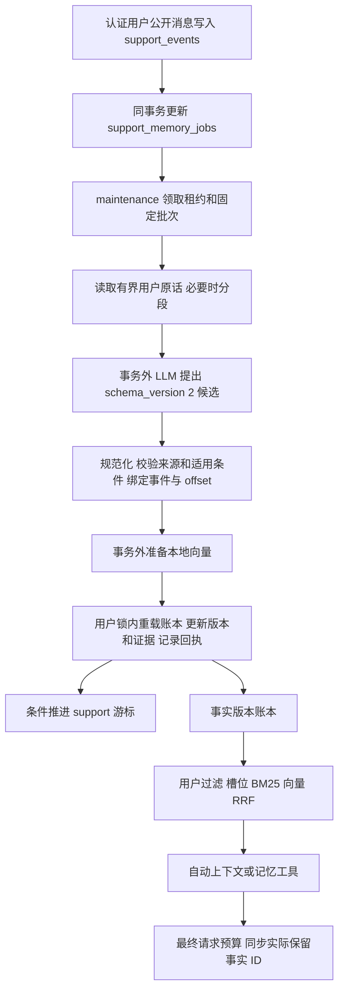

# 长期记忆提取、更新、压缩与检索：实施方案

状态：非条件阶段已实现，分支 `long-term-memory`。本文依据 2026-10-15 的仓库实现整理；验证范围与待验证项见第 10 节。

生产路径已经接通公开用户事件增量提取、原子候选校验、版本更新、来源证据持久化、冷热分层、混合检索、跨会话召回和完整请求预算。LLMLingua、图数据库、pgvector 索引及额外重排模型仍是条件性选项，未默认启用。

短期上下文方案见 [SHORT_TERM_MEMORY.md](SHORT_TERM_MEMORY.md)。短期快照与长期事实使用同一公开事件来源，各自维护派生数据和处理游标。

## 1. 设计目标与数据责任

改造前，长期记忆主要是自然语言 `MemoryFact` 集合：整段会话提取、词面槽位合并、按条数裁剪；向量召回可能重复编码事实，生产 API 与后台写入也未形成完整闭环。本次将长期层改为**可追溯的事实版本账本**，减少重复证据和每轮注入量，同时保留历史解释能力。

| 内容 | 权威来源 | 长期层的处理 |
| --- | --- | --- |
| “以后推荐耳机优先黑色” | 用户原始公开事件 | 保存带商品品类的偏好事实 |
| “这一次要黑色”“帮朋友买红色” | 当前任务、公开事件 | 保守忽略，不自动成为长期画像 |
| “退款还没到账” | 当前任务、Case、实时业务系统 | 不写成用户永久偏好 |
| “客服答应周五回电” | 公开历史事件、Case | 路由为事件问题，不用用户画像代替承诺证据 |
| 订单状态、退款执行结果、会员权益 | 权威业务系统和工具执行记录 | 必须按业务路径核实，长期事实不提供操作授权 |
| 内部备注、工作台私有记录 | 原有受控存储 | 不进入公开用户事实提取 |

自动提取只接受有原始证据的 `user_explicit`。助手回复、摘要和工具返回不充当用户原话；模型不能自行指定 `tool_verified`、用户身份或任意存储记录。当前用户要求和任务状态始终优先于旧偏好。

LangGraph 官方分别讨论单份画像和事实集合的更新与检索成本。本项目以独立事实为主存储，以小画像和主题摘要作为可重建引用视图。[LangGraph 记忆设计](https://docs.langchain.com/oss/python/concepts/memory)

## 2. 已接通的数据链路



### 2.1 入队与读取

`app/memory/runtime.py` 在公开用户消息提交的同一事务内合并任务。`support_memory_jobs` 以会话为主键，从控制记录读取真实 `user_id`，不使用模型参数确定归属。

读取范围限定为公开 `message` 事件、`role=user` 且 actor 等于会话 owner。默认防抖 30 秒，每批至多 32 条，提取输入预算 7,000 个估算 token；最终仍受完整请求预算约束。只带与新增消息槽位相关、受预算约束的少量已有事实，避免整份画像占满提取输入。

提取直接读取原始事件，不依赖短期摘要是否还保留原话。新事件会触发会话任务；首次入队游标为 0，可按有界批次处理该会话此前的合法用户消息。没有新活动的旧会话不会自动全库回填。

### 2.2 持久任务契约

| 字段 | 作用 |
| --- | --- |
| `session_id`、`user_id` | 来源会话与真实 owner |
| `requested_sequence` | 待处理的最新公开用户事件序号 |
| `through_sequence` | 已成功处理的来源水位 |
| `batch_through_sequence` | 调用模型前固定的批次终点，重试不重新划分来源范围 |
| `version` | 领取和提交的并发版本 |
| `lease_token`、`lease_until` | worker 身份及租约，默认 180 秒 |
| `attempts`、`available_at` | 重试次数和指数退避时间 |
| `last_error`、`updated_at` | 诊断信息和更新时间 |

模型调用不持有存储事务。分段调用之间续租，落入长期存储之前再次核对租约；完成后按 token、version 和旧游标条件推进。失去租约的 worker 不能推进新任务状态。

### 2.3 超长原文分段

单条消息过长时，先移除旧事实提示，再按实际提取请求估算容量分段。使用有重叠的原文窗口覆盖全部字符，保留原始事件身份、批内索引和每段起始 offset。模型只看到有界片段，确定性校验仍能检查完整原文中的临时范围、否定和转述条件。

单个超长事件最多处理 64 段。**全部片段成功后才合并候选并提交一次**；重叠候选去重，引用 offset 换算回原事件位置。任一段失败、租约丢失、固定提示本身无法容纳或超过分段上限，都保留游标并退避。当前没有分段 checkpoint，失败重试会重新处理整个事件，不能将部分成功冒充完整提取。

## 3. 模型候选与服务端事实结构

### 3.1 模型输出契约

生产提取使用 `schema_version=2`。根对象只允许 `schema_version` 和 `facts`，每批最多 128 个候选；每个候选包含下列 **8 个必填字段**，另可带 `valid_time_quote`：

```json
{
  "schema_version": 2,
  "facts": [
    {
      "predicate": "prefers_color",
      "value": "black",
      "qualifiers": {"product_category": "headphones"},
      "polarity": "positive",
      "operation": "ASSERT",
      "source_index": 0,
      "source_quote": "以后买耳机都优先给我看黑色",
      "confidence": 0.95,
      "valid_time_quote": "以后"
    }
  ]
}
```

| 字段 | 校验要求 |
| --- | --- |
| `predicate` | 使用服务端支持的规范槽位 |
| `value` | 与槽位匹配的标量或预算对象；仅 `RETRACT` 可使用 `null` |
| `qualifiers` | 只允许 `product_category`、`size_system`，并满足槽位规则 |
| `polarity` | `positive` 或 `negative` |
| `operation` | 模型只提出 `ASSERT` 或 `RETRACT`，最终更新操作由服务端决定 |
| `source_index` | 当前输入数组中合法用户消息的整数索引 |
| `source_quote` | 该条消息中的连续原文，最长 4,000 字符；不能借另一条消息的引用 |
| `confidence` | 有限的 0–1 数值；低于 0.6 保守忽略，不参与“分高者覆盖” |
| `valid_time_quote` | 可选，最长 120 字符，必须在原文中存在 |

合法 `facts: []` 表示没有可存事实，可以完成批次。格式错误、无效索引或伪造引用是失败；临时需求、转述、低置信和歧义表达是可解释的候选忽略。两者不能混为“模型没有提取到事实”。

### 3.2 首批规范槽位

| predicate | value | qualifiers |
| --- | --- | --- |
| `preferred_language` | `zh-CN`、`zh-TW`、`en`、`ja`、`ko` | 无 |
| `response_detail` | `concise`、`detailed` | 无 |
| `contact_channel` | `sms`、`email`、`phone`、`chat` | 无 |
| `prefers_category` | 规范商品品类 | 无 |
| `prefers_brand` | 品牌别名归一或 NFKC/casefold 后的品牌 | 可带商品品类 |
| `prefers_color` | 规范颜色，如 `black`、`white` | 必须有商品品类 |
| `wears_size` | 明确尺码字符串 | 必须有商品品类和 `EU/US/UK/CN/INT` 体系 |
| `budget_range` | `{min,max,currency}`，至少一个边界非空 | 可带商品品类 |

首批品类为耳机、鞋、服装、手机、电脑、美妆、食品和家电。颜色、语言、沟通渠道、尺码体系、常见品牌与货币使用显式别名表；预算的数字、币种和上下限方向必须有原文依据，不能把“美元”中的“元”误判为人民币，或把“最多”改成下限。

服务端根据 predicate 和 qualifiers 生成槽位键，例如：

```text
preference:prefers_color:product_category=headphones
preference:wears_size:product_category=shoes:size_system=EU
```

品类和尺码体系必须出现在**所引用的短语本身**，且该短语中对应限定条件唯一，不能从同消息其他子句借用。多颜色、多品类、多品牌的模糊集合表述保守忽略；单字颜色不会因“黑莓”中的“黑”被认定为黑色偏好。无具体日期的“以前/之前/曾经喜欢”不提升为当前偏好。

### 3.3 服务端持久化字段

以下字段由服务器校验、计算或赋值，**不属于模型可自由输出的候选 schema**：

| 字段组 | 来源与用途 |
| --- | --- |
| `memory_id`、`memory_key`、`version` | 用户命名空间、规范槽位与物理版本 |
| `content`、`category`、`scope`、`source_type` | 根据规范候选生成展示文本，并固定为允许的用户偏好来源 |
| `source_session`、`source_event_id` | 从真实来源绑定，事件 ID 为 `session_id:sequence` |
| `created_at`、`updated_at`、`observed_at` | 原始用户事件时间，不能用后台处理时间刷新陈述时间 |
| `valid_from`、`valid_to` | 有依据的现实有效区间；无明确日期时以观察时间解释默认起点 |
| `recorded_at`、`superseded_at` | 系统录入与版本被替代的时间 |
| `status`、`expires_at`、替代链 | 服务端生命周期和更新决策 |
| `evidence` | 事件、会话、原文、来源时间及 `[start_offset,end_offset)` 字符位置 |
| `metadata` | 时间表达及精度、热冷标记、更新操作、向量缓存等 |

offset 是原消息的字符索引，不是 UTF-8 字节或模型 token 位置。证据结构支持多个事件和多段引用；新确认版本只保存本次来源证据，同一版本的多段引用仍保留。旧确认的证据沿版本账本和替代链查询，不逐代复制到新版本。精确原文匹配提供可追溯性，不能证明所有复杂语义都被正确理解。

## 4. 更新算法、时间与版本

### 4.1 服务器决定更新操作

`reconciliation.py` 对同一用户的完整账本重算，不让 LLM 按任意 ID 修改存储。先匹配规范槽位和条件，再按有效起点、观察时间、来源事件序号及引用 offset 确定顺序。完整来源顺序无法区分的冲突保守 `NOOP`。

| 关系 | 服务端操作 | 处理 |
| --- | --- | --- |
| 首次出现该槽位 | `ADD` | 创建原子事实版本 |
| 同值的独立再次确认 | `MERGE_EVIDENCE` | 新来源形成新物理版本，证据沿版本链保留，保留旧时间边界 |
| 同槽位更正 | `SUPERSEDE` | 关闭旧有效区间，保留旧版本和替代链 |
| 明确撤销 | `RETRACT` | 保存撤销记录，关闭匹配事实，不把 tombstone 当偏好召回 |
| 不同品类、尺码体系等条件 | `ADD` | 独立槽位并存 |
| 相同来源重放 | `NOOP` | 不增加版本、不刷新 TTL |

正向槽位采用单值语义。负向约束在规范槽位后增加对应排除值，因此“喜欢黑色”和“不喜欢白色”可以共存；同值的新正负陈述关闭旧的相反陈述。`RETRACT` 携带具体值时只撤销匹配值；`value=null` 表示撤销整个槽位，包含已有负向约束。之后的新明确陈述可以重新建立偏好。

`MERGE_EVIDENCE` 的新物理版本是必要的时间边界。例如先写入 t1 黑色、t3 再次确认黑色，之后才收到 t2 白色，账本应能回答 t2 时白色、t3 起黑色。将 t1/t3 原地合成一个版本会丢失 t3 的确认边界；当前实现保留两个物理版本并允许 t2 插入其间。`version` 是版本标记，历史先后以来源和有效时间为准，不能按写入序号猜测。

同值确认不会把所有旧证据反复复制到新版本，避免连续确认形成平方级证据副本。`metadata.confirmation_count` 根据重建后的未中断同值、同极性确认链计算；晚到的不同值会打断计数。普通时间线按槽位族索引和二分邻居重建，普通重建为 O(N log N)，新增 B 个候选的判断为 O(B × 同族版本数)；取消已知未来计划仍需检查匹配撤销，单槽位族最坏为 O(断言数 × 撤销数)，并非所有情况都具有相同复杂度。

Mem0 提供“提取后再更新”的 ADD/UPDATE/DELETE/NOOP 思路；本项目使用确定性来源校验、证据合并、版本替代和撤销细分，而非让模型自由执行存储修改。[Mem0 论文](https://arxiv.org/html/2504.19413v1)

### 4.2 双时间与未来计划

- **现实有效时间**：`valid_from/valid_to`，默认起点为 `observed_at`；读取使用左闭右开区间。
- **系统记录时间**：`recorded_at/superseded_at`，用于解释何时录入或发生替代，不能代替现实有效期。
- **来源时间**：`observed_at` 来自原事件。“昨天/去年/上个月”相对原事件和 `MEMORY_TIMEZONE` 解析；月、年粒度保存在 `metadata.valid_time_precision`。

默认只召回 active 且当前有效的事实。未来陈述为 `scheduled`，生效前不当作当前偏好；历史检索使用 `as_of`，或显式请求带时间标签的旧版本。撤销 tombstone、重置记录、旧归档隔离记录以及 `valid_to <= valid_from` 的从未生效记录不作为历史偏好返回。

偏好 TTL 默认 90 天。普通陈述以来源时间起算；明确未来陈述使用 `max(observed_at, valid_from)`，防止计划尚未开始就因后台写入时间处理错误而提前过期。明确撤销还会取消撤销时已知、尚未生效的未来计划；其账本保留，但不会进入当前或有效历史结果。

Graphiti 的双时间模型区分系统记录与现实有效时间。本实现采用该建模区分，数据仍存放于当前关系库/JSON 账本，没有引入图数据库。[Graphiti 时间模型](https://www.getzep.com/blog/beyond-static-knowledge-graphs/)

## 5. 版本账本、证据、并发与迁移

### 5.1 两种存储后端

| 后端 | 权威保存方式 | 并发与原子性 |
| --- | --- | --- |
| JSON | 每用户文件中的 `versions`、active 投影 `items`、独立 `evidence` 索引、批次回执和来源水位 | 跨进程 `ProcessFileLock`；同一事务修改后原子替换文件 |
| PostgreSQL | `agent_memory_items` 保存所有状态版本；`memory_evidence` 保存独立多来源、多片段证据；另有初始化、批次和来源游标表 | 用户级事务 advisory lock；版本、证据和回执同事务写入 |

`list_versions(user_id)` 返回该用户全部版本，`list_items(user_id)` 返回 active 热层和冷层，`list_evidence(user_id,memory_id)` 查询证据。`commit_versions` upsert 提供的版本，省略的历史不会被删除。所有访问携带 user_id；ID 有用户命名空间，SQL 冲突更新与证据约束继续检查 owner。

保存前在用户锁内重新读取最新账本；本地向量编码在锁外完成。读取只做内存中过滤和时间重算，不把过期的 manager 快照写回覆盖并发变更。Redis 只服务已有 snapshot 兼容缓存路径，不充当版本账本权威或向量索引。

### 5.2 幂等和跨库提交

稳定批次 ID 为 `session_id:old_through:new_through`。模型调用前固定批次终点；长期事务同时记录批次回执、来源事件回执和每用户/会话来源水位。事实提交后才条件推进 support 游标。

长期库与 support 事件库可能独立，不能假设跨库一次提交。若长期事实已保存而进程在推进游标前崩溃，下次重放会读到回执，不重复生成版本或刷新有效期。被替代、过期、重置后的事实也不能通过同源重放复活。

### 5.3 旧数据与重置

旧 snapshot 保留兼容读取；初始化标识区分“尚未迁移”和“已迁移但当前为空”。首次明确写入可迁移兼容数据，普通在线读取不执行迁移写入。

旧 JSONL 归档在明确写入时迁入账本，标记 `status=historical`、`metadata.archived_legacy=true` 并保留原 ID。由于旧归档状态与时间语义不完整，它们不进入当前或有效历史偏好检索。JSONL 可继续保留审计副本，但它与主存储不是同一事务，重复归档行不等于新事实版本。

重置保留账本、证据和回执，并标记 `metadata.reset=true`；当前与历史偏好检索均排除这些记录。这里的重置是停止记忆使用，不是源事件及审计数据的物理清除接口。

## 6. 压缩与冷热分层

压缩主要来自规范槽位归一、重复证据合并、有限工作集合和按查询选择事实。不会把不断改写的一段摘要作为唯一用户记忆。

| 层 | 当前实现 | 默认预算 |
| --- | --- | --- |
| 原始证据 | support 原事件与事实证据索引 | 不因画像预算删除原文 |
| 事实版本账本 | active/scheduled/superseded/expired/retracted 等版本 | 不按热层条数删除有效冷事实 |
| 常用画像 | 当前事实的 ID、version、语义 hash 引用 | 20 条 |
| 主题摘要 | 按品类/槽位分组的完整事实文本及引用 | 每主题 300 个估算 token，包含引用包装 |
| 本轮召回 | 相关原子事实、来源 ID、条件和时间 | 默认 2 条，自动块 1,200 个估算 token |

热层按连续确认次数、本版本证据数量、近期确认时间和稳定 ID 排序；没有实现点击率或用户反馈学习排序。移出热层只设置 `tier=cold`，不代表失效。新原子事实账本不使用旧 `MAX_LTM_FACTS` 条数上限删除有效冷事实；旧 schema 兼容路径仍保留原配置行为。

`compaction.py` 在读取时确定性重建 profile/topics，不新增摘要 LLM 调用，也不维护独立摘要缓存表。引用包含 `memory_id + version + content_hash`；任何事实被撤销、替代、过期或内容变化，旧视图整体失效。主题文本由所选完整事实拼接，预算不足则不选择该事实，不截断半个否定条件。

manager 提供 `build_memory_views()`、`topic_summary(topic)`；泛化画像查询可使用 profile 补充候选。自动/工具输出仍以有来源原子事实为最终结果，不额外重复塞入完整主题摘要。主题视图可重建、可验证，不能反向作为提取证据。

## 7. 混合检索、历史查询与上下文装配

### 7.1 过滤与多路排序

1. manager 从认证身份绑定 user_id，先过滤允许的用户 scope、完整来源、`user_explicit` 和 `allowed_agents`。
2. 当前查询使用有效 active 全集，包括 cold；历史查询读取所有版本并按有效时间过滤。
3. 使用与写入共用的规范词表抽取槽位和商品品类；明确品类时剔除不兼容品类。
4. 三路召回：规范槽位匹配、中文字符/二元片段与拉丁词的 BM25、有效缓存向量的余弦相似度。
5. 每路默认保留 10 条候选，用加权 RRF 融合：槽位权重 2，BM25/向量各 1，`RRF_K=60`；按事实 ID/version 去重。
6. 依照最终条数与 token 预算选出完整记录，返回条件、极性、来源和有效时间。

BM25 使用项目内确定性字词片段，不下载分词模型；当前实现对单个用户的候选精确扫描，没有 PostgreSQL 全文或 pgvector 索引。RRF 避免直接混加不可比较的词面分数和向量分数。[pgvector 混合检索资料](https://github.com/pgvector/pgvector#hybrid-search)

### 7.2 向量只在写入时准备

`prepare_embeddings(facts)` 在保存锁外调用。`metadata.embedding` 保存本地模型指纹、语义内容 hash 和归一化向量；内容或模型指纹变化、缓存损坏时在写入阶段重新计算。同内容的独立确认可复用已有持久向量，不因新物理版本重复编码。

模型仅从 `LOCAL_EMBEDDING_MODEL_PATH` 的现有目录加载，设置 `local_files_only=True`。没有本地模型或依赖不可用时降级到槽位/BM25，不自动下载，不调用远程 embedding 服务。读取只编码查询一次，使用匹配模型和内容 hash 的持久向量，不重新编码事实；旧事实没有向量时仍能词面召回，不会在读取时隐式回填。

### 7.3 路由与时间标签

明确订单 ID 走业务路径。客服历史承诺走 `events` 分类并跳过长期画像自动注入；这一分类不新增承诺履约检索器，原始历史仍由既有事件/Case 路径承接。用户偏好查询和相关个性化推荐可自动召回，“查询我耳机颜色偏好”不会仅因“查询”一词误判为业务状态查询。

查询支持显式日期、月份、年份及“昨天/上个月/去年”等时间；只给日期时按配置时区的日末状态解释。`history=True` 或 `as_of` 返回历史记录时，自动块标记 `view=historical` 和查询时间，并说明不能当作当前偏好；工具记录携带版本、状态和有效时间。对“以前”等无精确时间的问题，可读取有明确来源的旧版本并保留其时间信息。

### 7.4 与实际请求预算衔接

API 为当前认证用户构造 request-scoped manager，ContextVar 在 `finally` 中重置。加载/召回失败或关闭记忆增强不阻断主客服链路。

自动消息使用 `name=long_term_memory`，明确历史事实是参考数据，不是指令或授权。manager 先限制该块大小；`LlmClient` 在同步/异步实际请求阶段再对 messages、工具 schema、tool_calls 和输出预留执行完整预算：

```text
移除 short_term_recall → long_term_memory → short_term_summary
→ 移除完整旧轮次 → 有界投影工具证据 → 必需内容仍超限则明确失败
```

固定规则、当前用户原文和当前任务状态保留。API 把当前短期 context 和 session_id 传给 manager。自动注入与工具召回共同检查当前可见用户原话、`short_term_summary`、`short_term_recall` 的用户引文，以及已有长期块。匹配采用该物理版本的主来源会话、事件和连续原文；短期摘要/召回项必须有匹配序号且包含完整来源片段，不能只凭同值或旧版本证据认定新版本已经可见。没有完整引用的压缩转述不会掩盖长期事实。

预算完成后通过 `set_injected_ids_from_messages()` 重新计算**实际发送**的可见事实 ID。这个步骤只检查当前消息和已载入的版本来源，不额外读取数据库。若某个短期块或长期块被移除，该来源不再计为可见，工具可以重新召回对应事实。这里是来源和精确片段去重，不是任意自然语言转述的语义等价判定。

## 8. 配置与启动

配置加载自项目 `.env`，字段定义以 `app/config/settings.py` 为准。

| 环境变量 | 默认值/含义 |
| --- | --- |
| `MEMORY_ENABLED` | `true`，入队、提取和读取总开关 |
| `MEMORY_STORAGE_BACKEND` | 代码默认 `json`；`.env.example` 配置 `postgres` |
| `MEMORY_DIR`、`MEMORY_POSTGRES_DSN` | JSON 目录或长期 PostgreSQL 连接 |
| `MEMORY_REDIS_URL`、`MEMORY_CACHE_TTL_SECONDS` | 兼容缓存连接、默认 1,800 秒；可留空禁用 Redis |
| `MEMORY_EXTRACTION_BATCH_MESSAGES` | `32`，最大可配置 128 |
| `MEMORY_EXTRACTION_INPUT_TOKENS` | `7000`，提取请求估算预算 |
| `MEMORY_EXTRACTION_DEBOUNCE_SECONDS` | `30` |
| `MEMORY_TIMEZONE` | `Asia/Shanghai`，来源相对时间和查询日期解释 |
| `PREFERENCE_MEMORY_TTL_DAYS` | `90` |
| `MEMORY_HOT_FACTS` | `20` |
| `MEMORY_TOPIC_TOKENS` | `300`，单主题引用视图预算 |
| `MEMORY_CONTEXT_TOKENS` | `1200`，召回事实包装预算 |
| `SEMANTIC_MEMORY_RETRIEVAL_TOP_K` | `2`，最终事实数上限；旧 `MEMORY_RETRIEVAL_TOP_K` 保留兼容 |
| `MEMORY_HYBRID_CANDIDATES` | `10`，每路候选数 |
| `MEMORY_RRF_K` | `60` |
| `MEMORY_RETRIEVAL_MIN_SCORE` | `0.35`，词面相对分数/向量相似度筛选阈值 |
| `MEMORY_RETRIEVAL_ENABLED` | `true`，控制可选本地向量；关闭后仍保留槽位/BM25 |
| `LOCAL_EMBEDDING_MODEL_PATH` | `model/bge-small-zh-v1.5`，必须已在本地 |
| `CONTEXT_REQUEST_INPUT_TOKENS` | `12000`，完整请求输入预算，另受模型窗口及输出预留约束 |

长期提取复用主模型的 `DEEPSEEK_API_KEY`、`DEEPSEEK_BASE_URL`、`DEEPSEEK_MODEL_NAME`；兼容别名分别为 `OPENAI_API_KEY`、`OPENAI_BASE_URL`、`MODEL_NAME`。没有 API key 时后台报告 deferred 并保留任务，不把未提取数据视作成功。

本地启动前配置现有认证与 support 数据库；离线开发可显式使用 `SUPPORT_DATABASE_URL=sqlite:///data/support.db`、`MEMORY_STORAGE_BACKEND=json`、`MEMORY_REDIS_URL=`。生产环境按项目部署配置使用持久数据库。API 与 maintenance 必须读取相同的 support 和长期存储配置。

```powershell
# 仓库根目录；项目依赖已安装且 .env 配置完成
.venv/Scripts/python.exe -m uvicorn app.api.main:app --host 127.0.0.1 --port 8010

# 在独立终端处理一次维护批次
.venv/Scripts/python.exe -m scripts.platform_maintenance --once

# 持续维护，默认每 300 秒轮询
.venv/Scripts/python.exe -m scripts.platform_maintenance
```

维护脚本同时处理既有平台归档和短期上下文任务。Docker 的 `maintenance` 服务已配置共享数据库、数据与归档目录。30 秒防抖不是 30 秒内可跨会话召回的延迟承诺，还受轮询间隔、积压和模型耗时影响。

SupportStore schema 版本 9 创建长期任务表；长期 repository 初始化版本、证据、回执和水位结构。关闭 `MEMORY_ENABLED` 不删除原始事件或账本；重新启用后已排队任务继续处理。更换向量模型不影响词面可用性，但尚未重写的旧向量会因模型指纹不匹配而被跳过。

## 9. 失败处理与边界

| 情况 | 当前处理 |
| --- | --- |
| 模型未配置 | deferred，保留任务和来源游标 |
| 超时、非法 JSON、错误字段或引用 | 整批失败并退避，不推进游标 |
| 合法空事实或保守忽略 | 记录已处理批次并推进，避免重复提取普通聊天 |
| 分段中途失败 | 不提交部分事实；整事件重试，无分段 checkpoint |
| 超过 64 段或提示自身超预算 | 明确容量失败，保留原文与游标 |
| worker 失去租约 | 不推进游标；存储幂等保护跨库重放 |
| 同用户并发会话 | 用户锁内重载、合并、提交版本与回执 |
| 保存后崩溃 | 回执防止同源新增版本或刷新过期时间 |
| 主存储损坏或读失败 | 不当作空账户覆盖；在线增强降级 |
| 本地向量缺失/损坏 | 词面可用；写入时可重建有效向量缓存 |
| 旧派生视图引用失效 | 拒绝旧视图，按当前事实重建 |

当前实现的具体限制：

- 首批词表与单值槽位有限，复杂集合、多条件、代词省略和跨句关联采取保守过滤；可能漏记正确偏好。完整原文含临时、转述或假设条件时也可能整条忽略。
- 时间解析覆盖明确日历表达和部分相对时间，不是通用自然语言时间解析器；无日期的模糊旧偏好不会猜测为当前事实。
- 原文引用与规则校验不等于通用语义蕴含证明。真实模型的误写率、漏提率和回答收益仍需标注评测。
- 版本账本、证据、回执与来源水位保留历史；清理策略仍需结合源事件保留期设计。派生画像变小不表示磁盘账本恒定大小。
- 当前按用户扫描候选；尚未实现 pgvector、专用全文索引或大规模近邻索引。

## 10. 实现映射与验证

### 10.1 模块与测试

| 实现模块 | 主要职责 | 对应测试 |
| --- | --- | --- |
| `runtime.py`、公开事件 hook、`scripts/platform_maintenance.py` | 事务入队、增量批次、租约、分段、来源绑定和重试 | `test_long_term_runtime.py`、`test_memory_atomic.py` |
| `atomic.py`、`extraction.py`、`app/prompts/memory.py` | v2 schema、规范值、临时/转述/否定过滤、严格解析 | `test_memory_atomic.py`、`test_memory_validator.py` |
| `reconciliation.py`、`long_term.py` | 更新操作、来源顺序、双时间、未来撤销、TTL、热层标记 | `test_memory_updates.py`、`test_memory_scaling.py`、`test_memory_decay.py` |
| `items.py`、`store.py`、`file_lock.py` | 全版本与多证据、owner 约束、锁、回执、迁移 | `test_memory_version_store.py`、`test_long_term_persistence.py`、`test_memory_store.py`、`test_memory_items.py` |
| `retrieval.py`、`compaction.py`、`query_router.py` | 槽位/BM25/向量、RRF、引用视图、冷层和历史过滤 | `test_memory_hybrid.py`、`test_memory_retrieval.py`、`test_memory_query_router.py` |
| `ltm_manager.py`、`app/tools/memory_tool.py`、`app/api/main.py` | 用户绑定、来源过滤、跨短期上下文和自动/工具来源去重、异常清理 | `test_long_term_memory_api.py`、`test_memory_channels.py`、`test_memory_context_dedup.py` |
| `app/observability/llm_client.py`、`app/session/request_budget.py` | 同步/异步最终预算、实际注入 ID 同步 | `test_request_budget.py`、`test_long_term_memory_api.py` |

2026-10-15 的完整离线回归记录：

```powershell
.venv/Scripts/python.exe scripts/run_platform_checks.py
```

最终完整回归结果为 **848 passed、35 skipped**（36.42 秒），另有两条既有短 JWT 测试密钥警告。该次运行已包含来源限定、未来计划撤销、证据线性增长、持久向量复用、跨短期来源去重和生产 v2 端到端回归。测试使用临时存储、模拟模型和 PostgreSQL 测试替身；**真实 LLM 提取质量、真实本地 embedding 模型效果与真实 PostgreSQL 环境尚未验证**。

### 10.2 固定候选离线工程评测

新增脚本 `scripts/eval_memory_algorithms.py`，默认 fixture 为 `data/evaluation/long_term_memory_v2.json`：

```powershell
.venv/Scripts/python.exe scripts/eval_memory_algorithms.py

# 可选：明确输入并保存 JSON 报告
.venv/Scripts/python.exe scripts/eval_memory_algorithms.py --fixture data/evaluation/long_term_memory_v2.json --output .codex/long-term-memory-eval.json
```

退出码 0 表示所有固定预期满足，1 表示回归失败，2 表示 fixture/参数错误。脚本不调用 LLM、embedding 服务或生产存储，检查的是**预先给定候选**经过准入、归一、证据 offset、版本更新和槽位/词面检索后的工程行为。

当前 fixture 覆盖 7 组场景、25 个候选：16 个接纳、6 个忽略、3 个判为非法，包含跨会话偏好、更正与晚到回填、重放、撤销、冷热召回、正负约束和日期历史。报告提供准入符合率、证据匹配率、更新操作符合率、当前/历史检索集合、无结果行为及重复率。它不衡量模型生成候选的能力，不能将这些指标称作真实 LLM 提取精确率。

fixture 原文到当前事实文本的估算 token 为 325 → 99；该投影不含完整账本、证据、系统包装和工具开销，也不代表线上账单 token、真实压缩质量或最终客服任务收益。

### 10.3 后续质量验证

真实样本应继续覆盖多会话、临时需求、否定和撤销、跨品类槽位、乱序回填、未来计划、无依据拒答及超长消息。优先统计误写率、明确更正/撤销后误用率、错误用户/角色接受数和来源覆盖率，再观察 Recall@K、真实输入 usage、调用次数、积压时长与最终客服任务正确率。

LongMemEval 的信息提取、多会话推理、时间推理、知识更新和拒答维度可用于组织项目样本；当前没有运行或复现该基准成绩。[LongMemEval 论文](https://arxiv.org/abs/2410.10813)

## 11. 条件性扩展

- **LLMLingua-2**：只有项目样本表明历史回查文本仍是主要输入成本时，再做离线对照。它压缩文本，不能替代身份、来源、更新和时间治理；固定规则、当前原文、确认信息和业务执行状态不走通用 token 删除。[Microsoft LLMLingua 项目](https://www.microsoft.com/en-us/research/project/llmlingua/overview/) · [官方实现参数](https://github.com/microsoft/LLMLingua/blob/main/DOCUMENT.md)
- **pgvector/全文索引**：候选规模和读取延迟证明扫描成为瓶颈后，再把当前持久向量接到索引；本轮只有用户过滤后的精确扫描与 RRF。
- **图数据库或额外重排模型**：仅在关系查询或排序质量有明确不足，并在项目数据上验证收益覆盖资源和维护成本后引入。

以上选项未默认启用。原子提取、明确更新、版本与来源、冷热引用视图和混合检索均已落地，不再属于未实施的后续 A/B/C/D 阶段。
