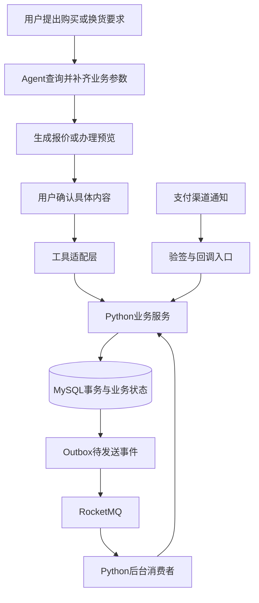
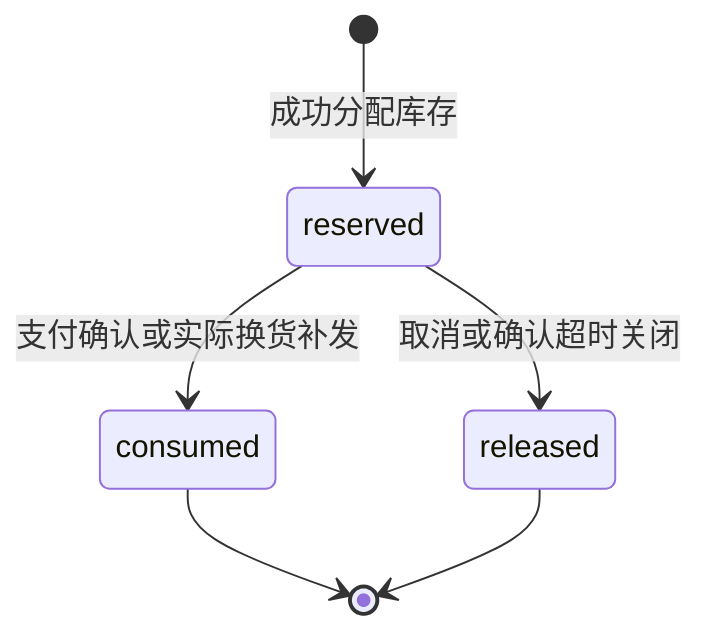

# Python交易后端设计与面试要点

更新日期：2026-10-25。本文是本项目的后端扩展方案与学习材料，区分当前已有代码、数据库落地情况和后续建议。初稿仅新增文档，随后已按用户要求补建库存、地址、报价、配送相关表并填入演示数据；本文同步更新该基线，其余建议不代表已经上线。

## 1. 是否会用到CAS、RocketMQ等知识

会。这些知识并不专属于Java，Python同样可以实现可靠的订单、库存和支付后端。CAS是Compare-And-Swap（比较并交换）的思想，RocketMQ是消息中间件，两者解决不同问题。

| 知识 | 本项目中的实际问题 | 建议优先级 |
| --- | --- | --- |
| MySQL事务、行锁、条件更新 | 下单预占库存，多商品一起成功或回滚 | 第一阶段必须 |
| CAS、乐观并发控制 | 防止基于旧版本更新；只允许预占从指定状态向前变化 | 第一阶段掌握，按场景使用 |
| 唯一约束、幂等 | Agent重试、用户重复点击、支付通知重复到达 | 第一阶段必须 |
| 状态机 | 支付、取消、超时和售后之间的合法转换 | 第一阶段必须 |
| 定时任务、任务租约 | 扫描超时订单，多进程领取后台任务 | 第二阶段 |
| RocketMQ延时消息、重试、死信 | 在到期时触发订单检查，可靠传递业务事件 | 第三阶段 |
| Outbox、本地消息表 | 解决数据库提交成功但MQ消息未发出的间隙 | 接入MQ时实现 |
| Redis缓存、限流、分布式锁 | 减少无效请求、缓存公共商品信息、协调部分后台任务 | 有明确需求再加 |
| 支付查询、关单、补偿与对账 | 处理已付款但通知迟到、支付结果未知等情况 | 接入支付时必须 |
| 压测、监控、故障注入 | 用证据验证没有超卖、重复扣减或库存泄漏 | 与各阶段同步 |

建议先完成一个能解释并验证的交易流程，再增加中间件。面试中要能说明每个组件解决了什么故障，以及移除它会出现什么问题。

## 2. 当前项目有哪些基础

结合现有源码及本次会话中的业务库核查：

| 模块 | 当前基础 | 仍需完成的工作 |
| --- | --- | --- |
| 数据事务 | [business_store.py](../app/data/business_store.py)使用PyMySQL，显式事务、提交/回滚，隔离级别为REPEATABLE READ | 为并发争用增加统一、有限的事务重试；评估连接池 |
| 下单与换货预留 | [extended_writes.py](../app/services/commerce/extended_writes.py)已有带库存下限的条件更新、预占插入和确认提交代码；本地已补库存预占、换货预留、报价、配送和支付期限数据，19笔过期历史未支付订单已核查关闭 | 继续接通换货处理方与真实支付；历史关闭记录不补造旧库存流水 |
| 超时与释放 | [fulfillment.py](../app/services/commerce/fulfillment.py)已有释放预留、超时关单代码 | 当前依赖本地记录判断；真实支付接入后须增加渠道查询与关单协调 |
| 后台处理 | [commerce_worker.py](../scripts/commerce_worker.py)已在本地后台运行，配套表齐备；已实测自动超时关闭和库存释放 | 继续验证外部处理方失败恢复、多进程压力及运维；当前不是开机自启服务或RocketMQ消费者 |
| 幂等 | 已有business_operation_receipts、唯一请求标识和业务事件 | 支付渠道通知和MQ消费须建立各自的业务去重边界 |
| 优惠券与会员 | 已有领取事务、总量与会员额度检查、领取快照，以及新订单占用、取消释放、模拟支付核销样例 | 真实支付回调和核销须联合验收；模拟支付不代表外部资金到账 |
| 支付 | 已保存历史payment_transactions | 历史记录不等于实时支付能力；需要支付请求、验签回调、查单及关单流程 |
| RocketMQ | 当前依赖及Compose没有交易RocketMQ接入 | SDK选型、Broker/Proxy、Topic、生产者、消费者和观测均属后续工作 |

2026-10-25已补齐003/004全部目标表，业务库共65张表，001—010均已登记。已补历史SKU、物流、内地31个省级地区配送、用券交易、补货、价保和积分样例；本地交易Worker已实际执行到期关闭及释放。最新数量和边界见[数据库表设计第18节](数据库表设计.md)。用户要求暂停发票内容，相关表为空；真实支付、真实外部处理及MQ接入仍未完成。

当前库存代码中的`version=version+1`用于记录变更；若WHERE中没有比较旧version，就不能称为基于版本的CAS。

## 3. Agent与后端的职责



图中的Outbox、RocketMQ和实时支付入口是拟增加内容。

- Agent负责理解需求、调用工具、发起确认和解释结果。
- 后端负责授权、金额、库存、状态机、事务和幂等；不能接受模型自报的“已付款”“已确认”作为业务依据。
- 后台Worker和支付回调通过业务服务推进状态，不需要LLM参与扣库存或记账。
- 已提交的一次确认操作应持有稳定operation_id。Agent因网络超时重试时沿用它；用户修改商品、数量或地址后必须重新预览和确认，不能复用旧确认内容。
- MCP参数精简不意味着省略后端校验。用户身份由认证上下文注入，工具不能让模型自行指定任意user_id。

## 4. 需要哪些业务表

| 表 | 职责 | 当前或拟议状态 |
| --- | --- | --- |
| sku_inventory | SKU可售数、预留数、版本 | 已有 |
| inventory_reservations | 订单明细对应的预占数量、状态、幂等请求号 | 已建表并填入24条，包含占用、释放和演示支付消耗 |
| service_inventory_reservations | 换货工单对应的替换SKU预留及剩余数量 | 已建表并填入3条，包含待审核预留与历史补发消耗 |
| orders / order_items | 订单归属、金额、状态及购买快照 | 已有 |
| checkout_quotes | 用户确认的报价及有效期 | 已建表并填入24条，报价本身不占库存 |
| order_expirations | 持久化支付期限和超时任务状态 | 已建表并填入33条，包含19条历史清理记录；本地后台自动关闭已实测 |
| payment_transactions | 支付渠道交易结果和金额 | 已有；需承接实时回调 |
| coupon_redemptions | 用券占用、使用、释放记录 | 已有3条，覆盖占用、演示支付使用和取消释放 |
| business_operation_receipts / order_events | 操作去重、结果查询及业务变更证据 | 已有，可复用 |
| commerce_provider_requests | 外部业务调用及结果未知时的恢复 | 已建表，补录1条明确标记的历史演示换货完成记录；真实外部渠道和支付请求分工待接通 |
| payment_attempts（建议） | 支付发起编号、渠道订单、支付/关单状态、查单重试 | 拟增加，是否独立建表在实现前确定 |
| business_outbox（建议） | 待发消息、发送租约、重试与发送结果 | 拟增加，接入MQ时建立 |
| payment_callback_receipts / consumer_receipts（可选） | 渠道通知及消费者业务事件去重 | 可独立建表或复用合适的回执结构，不能只靠内存集合 |

新建议表用于业务恢复和一致性，并非导入来源辅助表；payment_attempts、business_outbox等建议表尚未创建。平台订单继续使用`(platform_code, order_id)`，不能假设order_id跨平台唯一。

## 5. 先约定库存口径和不变量

建议沿用当前项目的数量语义：

- `available_qty`：还能分配给新订单或换货的数量。
- `reserved_qty`：已分配、尚未转为消耗的数量。
- 预占：available减q，reserved加q。
- 释放：available加q，reserved减q。
- 消耗：reserved减q，available不再减一次。

订单以确认支付作为预占消耗时点；换货以实际补发对应数量作为消耗时点。这是本项目的交易库存约定，不等同于仓库实物出库记账。以后接入WMS，需要另行管理实物库存及在途数量。

必须持续成立的约束：

1. available、reserved始终非负，申请数量为正整数。
2. 每笔预占有唯一业务归属，不能重复创建。
3. 同一预占只能消耗或释放一次，终态不能被重复通知改回reserved。
4. 多商品订单全部预占成功才提交，否则全部回滚。
5. reserved应能与订单预占和换货剩余预留的明细合计对账；若增加其他预留用途也须纳入。
6. 支付金额、订单金额、币种、优惠核销必须一致。退款不自动增加可售库存，退货商品须验收后按入库规则处理。

## 6. 下单预占与防超卖

### 6.1 条件更新

以下是拟采用的核心SQL，q已通过正整数校验，sku_id有唯一索引：

```sql
UPDATE sku_inventory
SET available_qty = available_qty - %s,
    reserved_qty = reserved_qty + %s,
    version = version + 1,
    updated_at = UTC_TIMESTAMP(6)
WHERE sku_id = %s
  AND available_qty >= %s;
```

四个参数依次是q、q、sku_id、q。影响1行表示预占成功；0行表示库存不足或SKU不存在，须回滚相关订单写入。并发请求在数据库中协调，不能先普通SELECT库存，再把内存中计算好的值直接写回。

另一种正确方案是在同一事务用`SELECT ... FOR UPDATE`锁住库存行，再检查和更新。普通快照读与锁定读不同，REPEATABLE READ本身不会让任意“先查后改”都变安全。[MySQL锁定读取](https://dev.mysql.com/doc/refman/8.4/en/innodb-locking-reads.html)

### 6.2 Python事务边界

以下是流程伪代码，辅助函数需实现，不是可直接运行的新接口：

```python
def submit_purchase(user_id, confirmation, operation_id):
    with store.transaction(write=True) as tx:
        # 原子竞争唯一操作记录；相同编号不同参数必须拒绝。
        prior = acquire_operation(tx, user_id, operation_id, confirmation)
        if prior is not None:
            return prior
        quote = validate_and_lock_quote(tx, user_id, confirmation)
        lines = aggregate_duplicate_skus(quote.items)
        # 不在事务中调用LLM或等待用户，也不调用远程支付接口。
        recheck_price_address_coupon_and_membership(tx, quote)
        order = create_order_with_snapshots(tx, quote)
        for line in sorted(lines, key=lambda x: x.sku_id):
            reserve_inventory(tx, order, line)
        reserve_coupon(tx, order, quote)
        persist_expiration(tx, order)
        append_outbox(tx, "order.created", order)
        save_operation_result(tx, operation_id, order)
    return order
```

唯一操作记录冲突时读取并核验原结果，不能“查不到就分别插入”而忽略唯一约束竞争。报价仅提供确认依据，不承诺提前占库存；价格、库存或资格变化时返回需重新确认的结果。

## 7. CAS、乐观锁和悲观锁分别怎么用

### 7.1 基于版本的CAS

假设读取库存版本为12，只允许基于这个版本提交更新：

```sql
UPDATE sku_inventory
SET available_qty = available_qty - %s,
    reserved_qty = reserved_qty + %s,
    version = version + 1
WHERE sku_id = %s
  AND version = %s
  AND available_qty >= %s;
```

参数中的旧version为12。其他事务先修改成13后，本次影响0行；需要重新读取并判断是版本冲突、库存不足还是业务已失效。

- CAS的关键是“比较旧值后更新”，只有version加一不是CAS。
- SQL版本检查属于乐观并发控制，但UPDATE在数据库内部仍会用锁，不是CPU层面的无锁CAS指令。
- 版本单调递增可以发现“库存从10变9又变10”的中间变化；只比较数量无法识别这种变化。
- 热点SKU频繁冲突时不能无限重试。当前项目可优先使用条件更新或短事务行锁，版本校验用于需要拒绝旧状态的操作。

### 7.2 基于状态的条件转换

```sql
UPDATE inventory_reservations
SET status = 'released', version = version + 1
WHERE reservation_id = %s AND status = 'reserved';
```

这是CAS式状态转换：只有抢到reserved→released的事务能继续回补库存。状态改动、数量回补、订单变更必须一起提交，不能把这句SQL与库存更新拆成两个事务。

| 方法 | 适用场景 | 代价或限制 |
| --- | --- | --- |
| 条件更新 | 库存下限、额度扣减 | 必须检查影响行数 |
| version乐观检查 | 基于旧数据生成的编辑或业务操作 | 冲突后重算，热点下重试成本高 |
| SELECT FOR UPDATE | 需要检查多个字段再决策的订单操作 | 持锁时间和锁顺序需控制 |
| 唯一约束 | 同一请求、渠道交易、业务事件只能登记一次 | 处理冲突后要核对参数，不是一律成功 |

## 8. 取消、超时与库存释放

取消和超时应调用同一套释放服务，按数据库预占明细取SKU和数量，不相信客户端传来的释放数量。

本地事务中锁定订单，确认可以关闭；按固定顺序处理预占，将reserved改为released并回补数量，释放未支付用券占用，写订单事件和操作回执。库存不足以释放、明细归属不一致等异常应回滚并告警，不能用截断为0来掩盖错误。



分批换货时保留未补发的剩余预留数量，最后一批才进入终态；用“工单＋包裹/补发业务编号”防止同一批重复消耗。这里的consumed不表示一定已经完成实物出库。

### 超时触发方式

| 方式 | 项目用法 | 注意事项 |
| --- | --- | --- |
| MySQL轮询 | 先使用order_expirations扫描到期订单 | 索引建议覆盖status、expires_at；分批处理，单笔失败不阻塞整批 |
| RocketMQ延时消息 | 到expires_at时触发检查 | 消息可能迟到或重投，收到后仍需检查数据库时间和状态 |
| 兜底扫描 | 接MQ后继续保留低频扫描 | 修复未投递、消费积压或发布故障留下的超时任务 |

不使用进程内sleep计时来保证关单；进程重启后任务仍须能恢复。RocketMQ官方将电商未支付超时检查列为延时消息场景，但延时触发不替代订单判断。[RocketMQ延时消息](https://rocketmq.apache.org/docs/featureBehavior/02delaymessage/)

## 9. 支付回调与“付款、关单同时发生”

### 9.1 支付请求与回调

建议先接入可控制结果的模拟支付处理方，再接选定渠道的沙箱。模拟环境不写成真实收款，不用客户端的支付成功提示替代渠道结果。

1. 在本地持久化支付尝试、订单关联、金额、币种和稳定请求编号。
2. 在数据库事务之外调用渠道创建支付；超时视为结果未知，按同一请求号查单或重试，不立即创建新的支付尝试。
3. 回调入口校验签名及渠道要求，核对商户、订单映射、金额、币种和交易状态。按选定渠道官方协议实现验签、响应和重试语义。
4. 在本地事务中锁订单，利用渠道＋交易号唯一约束处理重复通知，检查同一订单是否已经成功支付，防止不同支付尝试重复履约。
5. 将支付记录、订单paid、预占consumed、券占用转used及业务事件一起提交。若状态已一致，返回已处理；若事实冲突，记录异常，不能盲目覆盖。
6. 成功响应必须在业务提交之后，或在通知已可靠落入持久化Inbox并保证恢复处理之后。不得先响应成功再仅放入内存队列。

### 9.2 不能只看本地待付款状态

本地还没收到通知，并不能证明渠道没收款。真实支付接入后，建议把支付尝试的关单处理分成三个阶段：

1. **本地短事务**：登记关单请求/任务租约，阻止继续发起新的支付尝试，记录需要核实的渠道订单。
2. **事务外**：查询渠道，按其协议请求关单；网络超时则保留未知状态并继续查证。
3. **新的本地事务**：重新锁订单，核实渠道结果和当前状态；已支付则处理支付成功，确认关闭且未付款才释放库存。

这样不需要持有MySQL行锁等待网络。拟增加的close_requested等状态优先属于支付尝试/后台任务；若新增orders主状态，必须同步迁移CHECK约束及工具契约，不能直接写入未定义值。

对于已关闭并释放库存后发现真实收款的异常，进入退款/人工处理，不能直接恢复订单并抢回已经售出的库存。重复支付也应识别额外收款并补偿，而不是再扣一次库存。退款接口自身同样需要幂等与结果查询。

## 10. 幂等：让重复请求只产生一次业务效果

“重试后结果与第一次一致”称为幂等。请求、消息、通知仍可能执行多次，数据库业务变化只能生效一次。

| 入口 | 建议业务去重键 | 重复时行为 |
| --- | --- | --- |
| Agent确认提交 | 用户＋operation_id，并保存参数摘要 | 相同参数返回原结果；不同参数拒绝 |
| 订单商品预占 | 平台＋订单明细＋预占用途 | 返回原预占或拒绝矛盾数量 |
| 换货补发 | 工单＋补发包裹/批次业务编号 | 不重复消耗该批数量 |
| 支付入账 | 渠道＋渠道交易号 | 核对订单、金额、币种，重复有效通知不再扣库存 |
| 库存释放 | 预占编号的状态转换 | 已释放不重复增加库存 |
| MQ消费 | 消费者用途＋稳定业务event_id | 已提交的事件直接确认消费 |

幂等记录必须与业务变更在同一事务。MQ的message_id可能随重发变化，不能只依赖它。业务唯一键去重还要结合状态机：用户取消与超时是不同事件，但只能释放同一笔预占一次。[RocketMQ消费幂等建议](https://rocketmq.apache.org/docs/bestPractice/01bestpractice/)

业务提交后网络断开时，客户端无法判断结果；应查询幂等回执或用原编号重试。不要生成新编号，否则原来的重复保护会失效。

## 11. Python如何接入RocketMQ

### 11.1 客户端与部署

Apache的rocketmq-clients仓库提供Python 5.x客户端，公开能力表列出普通、顺序、延时及事务消息支持；5.x客户端采用gRPC协议。接入时须固定发布版本，核对所选版本、Broker及Proxy配置，不把Java示例直接翻译成Python API。[官方客户端仓库](https://github.com/apache/rocketmq-clients)

开发环境可继续使用Windows上的Python，Broker/Proxy通过Docker或独立Linux环境运行；客户端平台兼容性和示例启动需先做最小验证。本文不添加依赖、不部署服务，也不假设项目已经装好SDK。

建议先抽象消息发布与消费接口，将SDK调用封装在适配器里。业务服务只依赖事件类型、业务键和载荷；测试中可用可控适配器注入重复、乱序、延迟和发送失败。

### 11.2 建议的事件

| 事件 | 用途 | 消费处理 |
| --- | --- | --- |
| order.timeout_check | 到付款期限后检查订单 | 查当前状态、协调渠道关单、必要时释放库存 |
| order.paid | 通知后续履约或客服进度 | 根据订单事实推进，重复消息不重复发货 |
| after_sale.updated | 售后进度通知 | 去重更新通知状态，避免用户收到重复答复 |

订单事件携带event_id、schema_version、platform_code、order_id、业务发生时间等必要信息。不要发送地址明文、登录令牌或支付密钥。消费者根据业务关联查询归属，不能把消息中的任意user_id当作授权依据。

延时消息与普通消息按选定版本要求配置Topic类型；顺序消息的分组键可使用平台＋订单号，但顺序消费仍不能替代数据库状态检查。延时范围、精度及超出范围的行为须按部署版本核实。

### 11.3 MySQL提交与MQ发送不是同一个事务

直接“提交订单，然后发送MQ”存在崩溃间隙；反过来先发MQ，也可能产生没有成功订单的消息。

建议第一版采用Outbox：

1. 订单、预占、超时记录和待发事件一起写入同一个MySQL事务。
2. 发布Worker领取待发事件，设置owner、lease_until和递增租约版本，提交领取事务。
3. 事务外发送消息；成功后根据owner/版本标记sent，失败后安排next_retry_at。
4. 崩溃后租约到期可被其他Worker接管。过期Worker不能把新Worker的任务误标完成。
5. “MQ已收到，但sent未写入”会重发同一个event_id，由消费者幂等消除重复业务效果。
6. 消费者在自己的数据库事务提交后再ACK；消费失败按策略重试，超过阈值进入死信和人工处理。

business_outbox建议字段包括event_id、event_type、aggregate_key、payload、available_at、status、attempts、next_retry_at、lease_owner、lease_until、version、created_at、sent_at，并为待发送扫描建立索引。处理幂等可复用事件回执，或新增带“消费者＋event_id”唯一约束的记录。

RocketMQ事务消息是另一种生产端一致性方案：先半消息、本地事务、提交/回滚，再由事务回查处理未知结果。它提供最终一致性，不会自动把消费者数据库加入生产者事务，也不免除消费幂等。建议先实现并掌握Outbox，再比较事务消息的回查与运维成本，不将两套机制无目的叠加。[RocketMQ事务消息](https://rocketmq.apache.org/docs/featureBehavior/04transactionmessage/)

## 12. Python并发、Redis与数据库锁

### 12.1 Python进程锁不能替代数据库约束

- threading.Lock只协调共享该锁对象的线程；asyncio.Lock主要协调同一事件循环中的协程。
- 多个Uvicorn进程、后台Worker或另一台机器不会自动共享这些锁。
- 无论Python运行时是否有GIL，都不能依赖它保护跨进程数据库状态。
- 当前PyMySQL是同步驱动，不应在async接口内直接执行长时间阻塞调用。可以使用同步路由/线程池边界，或整体采用异步数据库驱动；异步化不会自动产生事务安全。[FastAPI并发说明](https://fastapi.tiangolo.com/async/)

### 12.2 Redis适合做什么

优先用于公共商品缓存、请求限流和非核心协调。即使页面缓存显示有货，下单仍由MySQL权威库存判断。券与会员资格不能只信过期缓存。

如果使用Redis分布式锁，要考虑唯一持有者标识、过期时间及原子校验后解锁。租约过期后旧进程仍可能继续执行，因此关键写入还需数据库版本/状态检查；需要更强隔离时可让下游拒绝旧fencing token。Redis锁不是数据库条件更新和幂等约束的替代品。[Redis分布式锁说明](https://redis.io/docs/latest/develop/clients/patterns/distributed-locks/)

Redis Lua可以原子操作Redis中的计数，但不能与MySQL形成一个本地事务。如果以后做Redis预扣，必须设计扣减记录、落库失败补偿、重试和对账。当前规模先不建立两套库存权威，也不只依赖Redis过期通知触发关单。

## 13. 并发控制与故障恢复细节

1. **统一锁顺序**：为下单、取消、付款、换货规定共同的资源锁顺序；同批SKU、券按稳定ID排序。对已有订单，先锁订单再锁明细/库存等；不得在另一条路径反向持锁。
2. **短事务**：不持锁等待LLM、用户确认、支付HTTP或MQ发送；这些步骤之间通过持久化状态关联。
3. **死锁处理**：即使有固定顺序也不能断言绝无死锁。遇到明确的死锁或锁等待错误，回滚整个业务事务，有限重试并增加退避；连接中断导致提交结果未知时先查原幂等结果。[MySQL死锁处理](https://dev.mysql.com/doc/refman/8.4/en/innodb-deadlocks-handling.html)
4. **任务竞争**：可以用短事务SELECT FOR UPDATE SKIP LOCKED领取队列任务，但不能用跳过被锁库存行的方式判断商品售罄。领取结果必须持久化租约，随后事务外调用外部服务。
5. **并发上限**：HTTP并发、线程池、数据库连接和消费者并发需协调，避免无限增加Worker把MySQL拖垮。
6. **故障后对账**：检查预占明细与库存合计、已付款订单与支付流水、券占用与订单、Outbox积压。发现矛盾先隔离和告警，不能无依据地调整库存“修平”。

## 14. 推荐的实现顺序与验收标准

| 阶段 | 完成内容 | 能展示的结果 |
| --- | --- | --- |
| A：数据与本地事务 | 完整迁移必要表，补齐下单/取消规则，打通库存与优惠券预占 | 同一SKU最后一件只能被一笔新订单分配 |
| B：生命周期 | 持久化超时扫描、取消释放、换货预留、结果查询 | 重复取消不多加库存，重启后超时任务仍能恢复 |
| C：支付边界 | 模拟支付/沙箱、验签、查单、关单和补偿 | 重复回调只记一次，付款与超时并发不会同时成功推进两个互斥状态 |
| D：可靠消息 | Outbox、RocketMQ延时触发、消费幂等、失败重试及死信 | 杀掉发布进程后可恢复，消息重复不重复扣库存 |
| E：观测与优化 | 指标、压测、故障注入，按证据增加缓存或限流 | 能解释瓶颈、故障恢复时长和数据不变量，而非只展示接口成功 |

沿用Python、FastAPI、MySQL和现有业务服务层即可；先保持模块化单体和独立Worker，不必为展示分布式知识立即拆出多个微服务。

### 必须验证的场景

| 场景 | 预期不变量 |
| --- | --- |
| 100个不同请求同时争抢10件库存 | 无释放/补货时仅10件被成功预占，库存不为负；实际请求数及耗时需实测 |
| 同一下单请求重复20次 | 一笔订单、一组预占、一个一致结果 |
| 多商品订单最后一个SKU不足 | 前面SKU扣减和订单记录全部回滚 |
| 用户取消与超时任务同时执行 | 每条预占只释放一次，不能重复返券 |
| 支付通知重复、乱序或响应丢失 | 不重复入账/扣库存，终态不倒退 |
| 支付与关单同时发生 | 根据渠道最终事实及本地合法状态处理；不出现已履约又释放库存 |
| 更新预占状态后进程崩溃 | 未提交事务回滚，不留下半次库存变更 |
| 数据库提交后、MQ发送前崩溃 | Outbox重启后继续发送 |
| MQ发送后、sent更新前崩溃 | 可能重投，但业务效果一次 |
| 两个Worker接管同一超时任务 | 租约与状态检查阻止重复业务变更 |
| VIP在预览后失效 | 提交时重新校验，不使用过期资格 |

建议指标：库存预占成功/不足/冲突次数、锁等待和死锁次数、事务重试次数、超时关闭延迟、未知支付数、重复回调数、Outbox最老未发事件年龄、消费积压和死信数、库存对账差异。压测报告记录数据量、机器配置、并发数、错误率与P95/P99，不能把模拟结果宣传成生产吞吐。

## 15. 面试时如何讲清楚

| 常见问题 | 回答重点 |
| --- | --- |
| 为什么Python也需要处理超卖？ | 并发冲突发生在共享业务状态上，与是否使用Java无关 |
| 有事务为什么还要条件更新？ | 原子提交不等于业务判断正确；普通快照读不能保证读后值未变化 |
| version加一就是CAS吗？ | 不是，还要在WHERE里比较期望版本并检查影响行数 |
| 为什么不用Python锁保护库存？ | 进程内锁不能覆盖其他进程和机器，约束必须落到共享存储 |
| 能否只用Redis库存？ | 可以设计，但必须承担持久化、一致性、补偿和对账成本；本项目先以MySQL为准 |
| 延时消息到了就取消吗？ | 不，重新检查期限、订单状态及渠道支付事实 |
| MQ怎么保证恰好一次？ | 本方案允许重复投递，用业务键、状态机和数据库事务保证一次业务效果 |
| 事务消息解决所有一致性问题吗？ | 不，只处理特定的本地事务与消息生产关系，消费者和外部支付仍需独立可靠性设计 |
| 为什么Agent项目需要幂等？ | 模型重试、工具超时、用户重复确认都可能重复触发有副作用操作 |
| 最有说服力的证据是什么？ | 并发/故障注入测试、状态与数量断言、数据库记录和恢复过程 |

实现后可围绕一条真实验证过的案例介绍：“用户确认购买后，Python服务在一个MySQL事务里预占库存和优惠券；后台通过持久化任务检查超时；接入MQ后用Outbox避免漏发，用业务幂等处理重投；支付和关单竞争通过渠道事实及状态机协调。”尚未实现或验证的环节明确说是后续方案。

## 16. 与现有文档的关系

- [数据库表设计](数据库表设计.md)：查看当前实体、字段、约束及演示数据。
- [工具设计](工具设计.md)：查看Agent可调用的业务能力和参数。
- [工具实现与运行配置](工具实现与运行配置.md)：查看已有服务入口和处理方配置。
- 本文：解释交易后端的实现取舍、可靠性边界、分阶段路线及面试知识，不替代实际迁移和上线验收。
