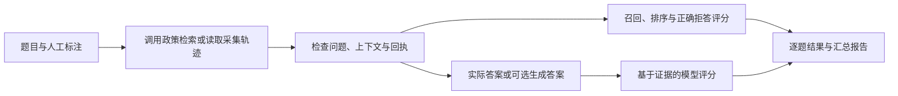

# RAG 评测说明

## 评测职责

RAG 评测检查政策问答链路中的三个问题：需要的条款是否被召回，重要条款是否排在前面，回答中的事实是否有证据支持。模块通过当前政策检索服务获取结果，也可以读取已采集的检索回执和答案进行回放评分。

评测独立于客服执行链路，不办理订单、退款或售后。结果用于分析检索与回答质量；Agent 的业务办理正确性、跨轮次状态和任务完成率由对应的业务与端到端测试验证。

## 题集与采集结果

评测将人工标注与系统输出分开保存。人工标注定义预期依据，采集结果记录系统实际返回的条款和答案，两者通过题目编号关联。

| 数据 | 内容与用途 |
| --- | --- |
| 题目与上下文 | 问题、店铺、渠道、品类、咨询时间及可选订单依据，确定政策适用范围 |
| 相关性标注 | 应命中的政策来源、版本、小节和相关等级，用于计算召回与排序指标 |
| 预期拒绝原因 | 无依据、缺少适用条件等负例的预期错误码，用于判断是否正确拒答 |
| 参考答案 | 可选的完整回答，用于评价回答质量 |
| 采集轨迹 | 原始问题、上下文、请求数量、检索回执，以及可选的实际答案、工具记录和 Token 用量 |

相关性以 `(source_id, version, section)` 标识一条政策依据。等级为 0～3，依次表示不相关、有一定帮助、重要补充和核心依据；大于 0 均视为相关。错版本不算命中，重复条款只在第一次出现时计分，但仍占据后续排名位置。

标注需要覆盖问题所需的全部相关条款，不能只标注被测系统已经召回的结果。题集应覆盖单条政策、多条依据、条件与例外、版本差异、适用范围、条件缺失和无依据等情况。仓库附带的 6 条人工示例用于展示格式和验证评分流程，不代表真实业务评测集。

## 评测流程

实际检索模式调用 `search_policy`，沿用本地或远程检索配置、政策适用条件和索引版本检查。成功回执还需通过当前有效性校验，过期或已失效的依据不能进入正常评分流程。

回放模式读取固定的采集结果，检查题目编号、问题、上下文和请求数量是否匹配，不重新查询当前索引。它适合复核历史输出，或比较不同裁判对同一批答案的评分。

默认只计算检索指标；启用模型裁判后才评价答案。实际检索模式还可生成仅依据检索证据的 RAG 答案，报告会标记答案来源。这类生成结果衡量独立的 RAG 问答能力；评价生产客服回答时，应使用实际采集的答案与证据。

## 召回与排序指标

默认计算 k=1、3、5。每题请求一次最大 k，再对同一结果列表的各个前缀评分；当前政策接口最多返回 5 条。

| 指标 | 含义与计算方式 |
| --- | --- |
| Recall@k | 前 k 条命中的不同相关条款数 / 全部已标注相关条款数，衡量所需依据是否找全 |
| Precision@k | 前 k 条命中的不同相关条款数 / k，衡量返回结果中的有效依据比例；不足 k 条仍以 k 为分母 |
| MRR@k | 第一条相关结果名次的倒数，前 k 条未命中为 0；汇总时对各题取平均 |
| NDCG@k | 实际排序收益 / 理想排序收益，衡量高相关条款是否靠前；第 r 名收益为 `(2^grade - 1) / log2(r + 1)` |
| 正确拒答率 | 负例中，实际拒绝码与预期原因一致的比例 |

未标注的结果按不相关处理。无相关条款的负例不参与召回和排序均值，单独统计正确拒答；检索故障不能算作正确拒答。

例如，一道题需要“退货条件”和“运费承担”两条依据，仅找到前者时召回率不足；两条都找到但排在无关条款之后时，排序指标会下降。这两个维度分别反映依据缺失和排序问题。

## 答案与证据核验

忠实度裁判将回答拆为可核验的事实断言，逐条判断为有证据支持、缺少支持或与证据矛盾。得分为有支持的断言数除以全部断言数。每条支持性判断必须提供证据编号和逐字引用，程序检查编号是否有效、引用是否出现在原文中。

证据来自实际检索条款、已记录的工具结果或检索失败回执。参考答案和相关性标签不作为额外事实证据。条款、答案和工具输出均作为待评测数据处理，不能修改裁判规则。

回答质量另按 1～5 分评价完整性、准确性和表达，报告同时保留原始分及归一化分。忠实度高不一定代表回答完整：只回答有依据的一部分内容，仍可能遗漏关键条件。引用检查也不能替代语义判断，裁判结果需要通过人工抽检校准。

采集轨迹中的工具记录用于补充答案的事实依据，例如退款申请状态；评测不对工具选择和执行顺序评分。Token 用量作为运行信息保留。

## 报告与失败边界

报告保留逐题回执、答案来源、指标、断言判定和错误，并汇总各指标的平均值与参与统计的样本数。真实检索回执携带来源、政策版本、适用上下文和索引信息；运行记录包含评测时间、Git 状态及输入文件摘要，便于比较和复核。

正例的默认检索通过条件是在最大 k 下召回全部已标注依据，负例则要求返回正确拒绝码。启用答案裁判后，整体检查还要求忠实度为 1、回答质量至少 3/5，且没有评测或裁判错误。Precision 和排序指标单独报告，不参与当前通过门槛。

检索不可用、回执不匹配和裁判异常会被明确记录。缺失答案、无法解析的评分和没有可核验断言均不计为满分；阅读均值时需要同时查看有效样本数及错误数量。未启用裁判的通过结果只说明检索检查通过。

报告默认写入 `data/evaluation/`。答案生成与裁判的模型调用、Token 用量和耗时分别记录；没有模型价格配置时不推算费用。比较实验应固定题集、知识版本、上下文、k 和裁判配置，避免把输入差异误认为系统改进。

## 代码入口

- [题集与轨迹结构](../app/evaluation/dataset.py)、[示例数据](../app/evaluation/datasets/)
- [检索适配与评测编排](../app/evaluation/evaluator.py)、[政策检索服务](../app/rag/service.py)
- [召回与排序指标](../app/evaluation/metrics.py)
- [模型裁判](../app/evaluation/judges.py)、[评分提示词](../app/prompts/evaluation.py)
- [命令行与报告输出](../app/evaluation/run.py)、[评测回归测试](../tests/test_evaluation_pipeline.py)

政策适用条件与索引机制见 [政策检索设计](政策检索设计.md)，运行命令见 [项目 README](../README.md#rag-质量评测)。
