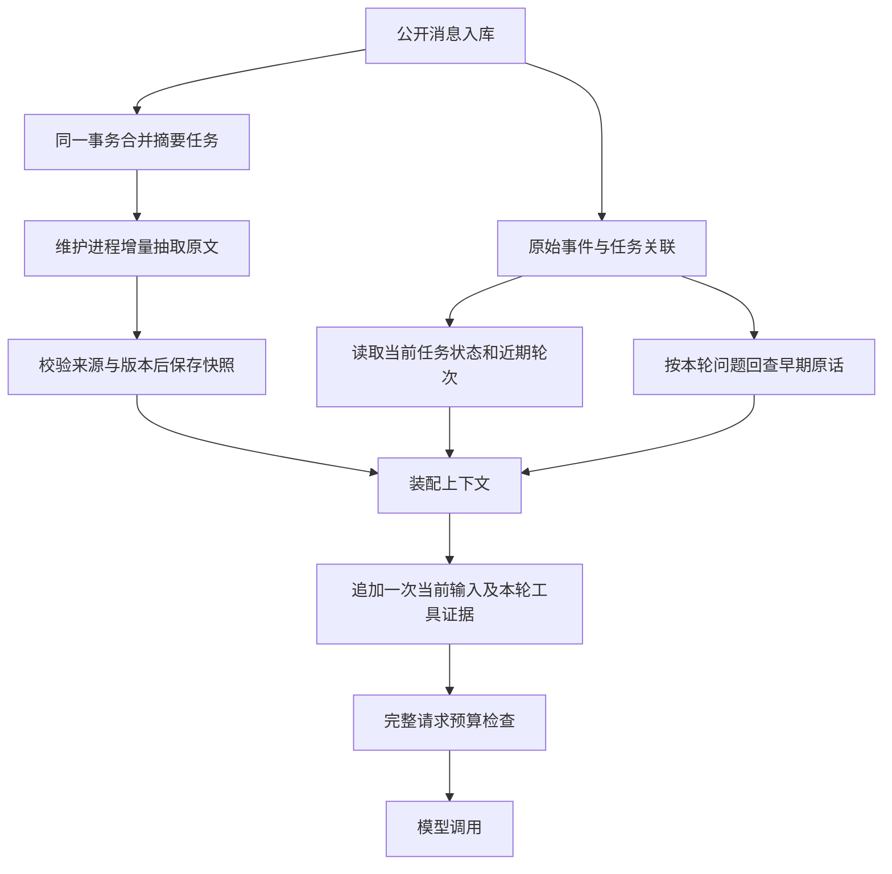

# 短期上下文设计与实现方案

状态：已实现，通过全量离线回归。分支：`short-term-memory`。范围：客服会话内的上下文装配、压缩和历史回查。

## 1. 现状与目标

生产入口使用 `support_events`，任务由 `conversation_tasks` 管理，公开消息通过 `support_task_messages` 关联任务。改造前，`SupportStore.context()` 和 `TaskService.context()` 只取最近 40 条消息；旧 `session/lifecycle.py` 的滚动摘要主要服务旧会话路径。ReAct 单轮工具结果仍会继续增长，Workflow 也会把工具结果放入提示词。

目标：长会话中保留当前任务、问题和约束；能回查 40 条以前的原话；控制每次实际模型请求（包含 system、工具定义、工具结果）的大小；保留公开历史和原有确认、权限、人工接管逻辑。

## 2. 数据责任

| 数据 | 权威来源 | 模型读取方式 |
| --- | --- | --- |
| 原始公开对话 | support_events | 近期完整轮次 + 按相关性取回的原文 |
| 当前任务、槽位、待答问题 | conversation_tasks | 白名单字段形成任务状态块 |
| 操作执行结果 | support_operations / 现有业务证据与工具 | 由执行链验证，摘要不能修改或替代 |
| 较早对话概要 | 新 support_context_snapshots | 有消息序号和原文引用的结构化摘要；派生缓存 |
| 待压缩范围 | 新 support_context_jobs | 每个 session/scope 合并的持久任务 |

所有读取先验证会话归属；任务读取额外验证 task_id 属于 session。摘要、回查只处理 `kind=message AND visibility=public`；人工内部备注和内部审计事件不进入摘要。任务上下文只读取该任务关联的消息和快照。未明确选择其他任务时，不把其他任务的订单号用于当前执行。

## 3. 上下文装配

新增 `app/session/short_term.py` 提供一个 ContextService；现有两个 context 入口委托给它。API 使用支持 query 和排除当前已入库消息的扩展入口。



1. 在一致性读事务中读取会话序号上限、指定任务状态、快照以及近期公开消息。模型当前输入仅加入一次，按事件标识/当前任务范围排除已经入库的同一条消息。
2. 从最近最多 128 条公开消息中，按完整 user→assistant 轮次保留近期原文，默认最多 4 轮已回复对话及末尾待回复消息，原文预算 4,000 个估算 token。允许一轮包含多条公开人工回复；不从中间切开正常轮次。连续未回复消息也限制保留组数。若最新一轮本身超限，暂时完整保留，交给最终请求预算器处理。
3. 注入最多 1,200 token 的历史摘要。字段为用户要求、已提到的细节、客服承诺、历史待答问题，每项含 sequence、role 和 quote。标明它是历史记录，当前任务状态优先；既往客服说法不等于业务执行成功。
4. 根据当前问题在同一 scope 的早期公开消息中检索精确实体及中文词片段，最多返回 3 段、合计 1,200 token。回查结果附序号，不能覆盖当前用户明确更正。第一版使用有界 SQL 候选查询和词面排序；不新增向量库。
5. 注入当前任务的 intent、request、slots、status、question 白名单投影；不复制确认令牌，槽位也不被标为业务系统已核实。当前用户信息和当前任务状态优先于历史摘要。

意图分类继续使用其支持的近期 user/assistant 消息；回复和 ReAct 使用完整装配结果。查询改写只从当前任务与近期原文解析实体，避免把历史回查里的其他订单误当为当前订单。

## 4. 摘要与持久任务

`support_context_snapshots` 以 `(session_id, scope_key)` 为主键，scope_key 为 session 或 task:<id>。保存 through_sequence、version、payload、updated_at。payload 为结构化摘要，引用的序号必须来自已授权的公开消息。

`support_context_jobs` 同样以 session/scope 为键，保存 requested_sequence 和重试信息。公开消息提交和任务暂停、完成、取消、转人工时，在同一事务内更新任务；多轮消息只合并范围。维护进程批量处理任务，模型调用在事务外进行；通过快照版本和覆盖序号条件写入，旧结果不能覆盖新结果。压缩边界与在线近期窗口一致，不摘要窗口内的原文。

超过近期原文预算或轮数后，后台读取有界增量批次和上一份摘要，请模型选择、分类最有用的原文引用。默认每批最多 64 条，并以约 7,000 个估算 token 为软上限，为摘要提示词预留容量；较小的请求预算会进一步收紧批次。优先处理完整轮次，超大轮次可逐条消息处理，游标不会跳过未处理消息。

第一版采用**抽取式结构化摘要**：输出必须引用原文，不允许模型创造订单状态、承诺或来源。格式、角色、序号、引用内容和预算校验全部通过后才推进游标；非空证据不接受空摘要。调用失败/输出无效保留原快照并退避重试。下面是快照 payload 的结构示例：

```json
{"items":[{"sequence":12,"role":"assistant","kind":"agent_commitments","quote":"明天下午回电说明处理进展。"}]}
```

四类 kind 为 `user_request`、`confirmed_details`、`agent_commitments`、`open_questions`。其中 `confirmed_details` 只是对话细节分类，不表示经过业务系统核实。每段 quote 必须是新增原文或旧摘要中某一条合法引用的连续子串；不能拼接不连续语句伪造引用。单条消息若超过整个摘要请求容量，任务退避且游标不前进，原文仍可按查询取回片段。

后台积压或未配置模型时，在线装配仍然使用任务状态、近期原文和历史检索；不在聊天请求中增加同步摘要调用。原始事件始终可回查。维护进程复用现有 scripts/platform_maintenance.py，默认 300 秒一轮；因此摘要存在延迟，不能作为立即可见的任务状态。

## 5. 每次模型调用的预算

新增独立的请求预算器，所有 LlmClient 同步/异步调用在发往提供商之前统一执行。默认输入上限 12,000 个估算 token；输出仍由 MODEL_MAX_OUTPUT_TOKENS 控制（默认 2,048）。可配置模型窗口总上限和安全余量，实际输入上限取应用上限与窗口剩余额度的较小值。

计入消息边界、system、工具定义、工具调用参数和结果。固定指令、当前用户输入和当前任务状态必须保留。先移除低优先级回查/摘要，再移除最老完整历史轮次，随后对大型工具结果做有标记的有界结构化投影。保留工具调用与所有对应结果的配对、success/error/业务标识等关键字段。完整工具结果留在现有 ToolStep 与证据存储中；裁剪后的内容不会用于业务状态写入。若必要内容本身超过预算，抛出明确的上下文容量错误，不能静默截断当前用户请求。

错误传播至 API 时，暂停任务并提示用户简要重述订单和问题，或转人工。Workflow 回复生成保留现有确定性模板回退：工具执行已产生结果时，即使生成请求超限，也可以根据结果返回模板回复；任务结果继续由执行器判定。两条路径都不会把超限请求发给提供商。

token 是提供商无关估算，不声明为精确计费值；记录估算前后输入量、移除消息数以及模型返回的实际 usage，便于校准。可通过配置关闭新版装配及请求预算，以便回滚。

## 6. 变更位置与兼容

- app/session/short_term.py：数据读取、状态投影、回查、装配、快照和后台压缩。
- app/session/context_budget.py / request_budget.py：消息与完整请求估算、裁剪及容量错误。
- app/support/store.py：schema 升级、公开消息入库时合并压缩任务、会话 context 委托。
- app/tasks/service.py：任务 context 委托、分类后关联原始用户事件、任务结束时合并压缩任务。
- app/api/main.py：按请求装配、去重当前消息、任务采用后重装配、容量错误呈现。
- app/intent/query_rewrite.py：优先使用当前任务订单槽位，历史回查与摘要不参与隐式订单选择。
- app/agents/engine.py：Workflow 工具结果独立装配，允许预算器处理大型结果。
- app/observability/llm_client.py：统一模型请求预算入口。
- scripts/platform_maintenance.py：后台摘要任务执行。
- app/config/settings.py、.env.example：开关、预算和批次设置。

已有未提交的意图/商品能力改动保留。旧 JSON 会话继续使用原有持久化接口，模型请求最终也经过统一预算器；生产客服事件不会迁出 support_events。新派生表可直接回填，无需破坏性迁移。

## 7. 验证与交付

离线测试使用临时 SQLite 和模拟模型，不访问真实订单、Redis 或模型 API。覆盖：长于 40 条的历史回查、摘要增量与错误输出、并发过期快照拒绝、任务隔离、跨用户访问拒绝、私有备注排除、当前消息去重、摘要失效时的继续服务、大工具结果与工具配对、同步/异步统一预算、固定内容超限错误。回归现有多任务、人工客服、会话展示、执行器和观测测试。

验收要求：请求估算值不超过配置上限；当前输入不被静默删除；任务与确认语义不变；旧事件仍可分页读取；测试不依赖外部服务。真实模型摘要质量及延迟另需上线前用脱敏会话抽样验收，离线测试只能验证协议和治理行为。

2026-10-15 验证结果：执行 `.venv/Scripts/python.exe scripts/run_platform_checks.py`，**668 passed，35 skipped**。新增核心、预算和 API 测试分别为 19、20、7 项。跳过项需要相应外部环境；本次未验证真实模型调用和生产 PostgreSQL。两条警告来自已有登录测试中的短 JWT 测试密钥。

## 8. 配置与启用

| 环境变量 | 默认值 | 用途 |
| --- | --- | --- |
| SHORT_TERM_MEMORY_ENABLED | true | 新版生产会话上下文装配及后台摘要开关 |
| SHORT_TERM_RECENT_TURNS / SHORT_TERM_RECENT_TOKENS | 4 / 4000 | 近期原文轮数及估算预算 |
| SHORT_TERM_SUMMARY_TOKENS / SHORT_TERM_RECALL_TOKENS | 1200 / 1200 | 两类派生上下文各自预算 |
| SHORT_TERM_COMPACTION_BATCH_MESSAGES | 64 | 每次摘要最多读取的增量消息数 |
| CONTEXT_REQUEST_BUDGET_ENABLED | true | 所有 LlmClient 请求的预算检查 |
| CONTEXT_REQUEST_INPUT_TOKENS | 12000 | 应用允许的估算输入量，含工具定义 |
| CONTEXT_MODEL_WINDOW_TOKENS | 0 | 实际提供商窗口；0 表示未配置 |
| CONTEXT_WINDOW_MARGIN_TOKENS / MODEL_MAX_OUTPUT_TOKENS | 1024 / 2048 | 配置窗口后扣除的安全余量和默认输出预留 |

部署新代码后，SupportStore 初始化自动把 schema 升至版本 8，创建两张派生表和任务索引。已有会话收到新消息后会入队，逐批补充旧历史摘要；没有新活动的历史会话不会自动批量调用模型。关闭新版装配可恢复最近 40 条的旧路径；已有原文和派生表仍保留。

Docker 继续使用现有 `maintenance` 服务。本地处理一批：

```powershell
python -m scripts.platform_maintenance --once
```

持续运行使用 `python -m scripts.platform_maintenance`，默认每 300 秒执行一轮，每轮最多处理 20 个 scope 的批次。摘要使用项目已有主模型配置；需要缩短摘要延迟时，可配置该命令的 `--interval`。

限制：词面回查不能保证找回没有相同词语的语义相关消息；候选集最多 96 条。抽取摘要可以验证引用真实性，但不能保证模型选出的信息完整。超大单条历史消息可能阻塞该 scope 的摘要推进。先监测摘要失败数、积压与实际 token usage，再决定是否增加语义检索或分段抽取。
