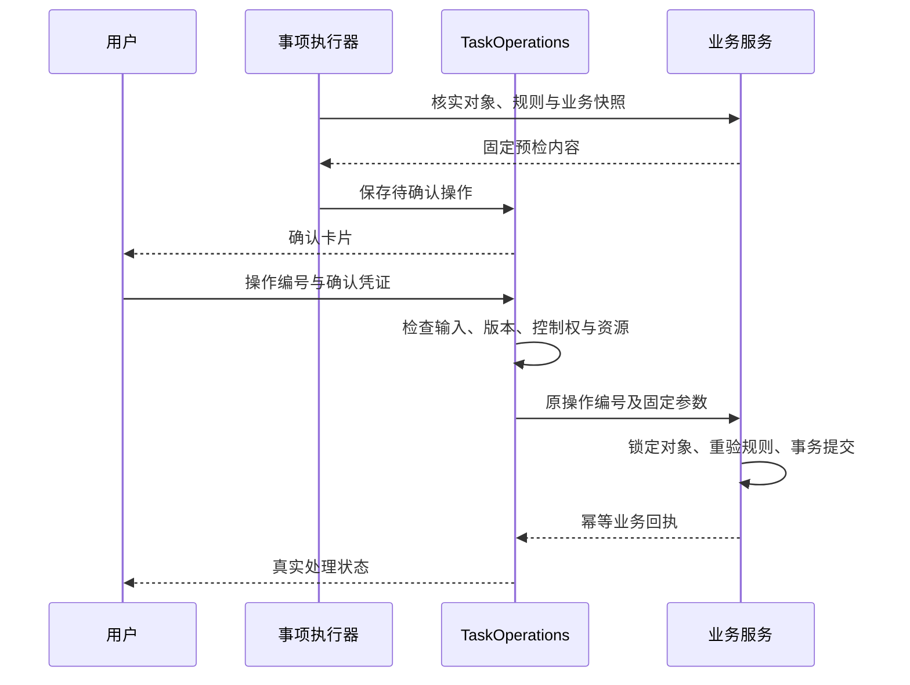

# 业务操作与交易设计

## 职责划分

`TaskOperations` 管理操作提案、确认、执行资格与回执；`CommerceService` 管理 MySQL 中的真实业务规则和事务。模型只能查询或准备固定内容，不能自行确认办理。

| 对象                          | 保存内容                                         |
| ----------------------------- | ------------------------------------------------ |
| `task_operation_proposals`    | 用户、事项与版本、固定预检内容、凭证摘要、有效期 |
| `support_operations`          | 操作状态、执行及核实信息、回执                   |
| `task_operation_resources`    | 执行中或结果未知操作占用的共同业务资源           |
| `business_operation_receipts` | 同一 MySQL 事务中的业务结果与参数摘要            |

PostgreSQL 操作记录与 MySQL 业务变更属于不同事务，通过稳定 `operation_id`、原始回执查询和核实恢复衔接。

## 准备、确认与提交

确认内容明确订单、商品行、数量、动作、金额性质、原因与权益影响。凭证绑定用户、事项、固定参数、版本和有效期，服务端保存摘要。默认确认有效期为 10 分钟。

确认事务先锁定消息接收边界，检查尚未关联的输入、事项版本、纠错与接管状态，再登记开始并占用共同资源。业务调用在事务外发出，业务库提交时再次锁定订单并核验快照。

确认 API 读取已保存参数，不接受客户端替换业务内容。相关对象或参数变化使旧卡片失效；无关事项不会被当作同一操作范围。

## 交易不变量

| 约束           | 实现边界                                                           |
| -------------- | ------------------------------------------------------------------ |
| 身份与对象归属 | 每次读写按认证用户、平台与对象引用核验                             |
| 金额与币种     | 使用 Decimal / DECIMAL，按商品行分摊到分，不隐式换汇               |
| 库存           | 可售与预留分别保存，条件更新检查数量和版本，预留记录用于释放或消耗 |
| 优惠券         | 检查本人持券、范围、领取快照、占用及已用状态，不能由模型指定资格   |
| 幂等           | 同一操作编号与参数对应同一回执，业务变更与回执同事务保存           |
| 外部结果       | 提交、受理、完成和资金渠道结果分别记录                             |

Redis 和进程锁不替代数据库约束。多个事项写同一订单时仍按订单和共同权益协调。

## 主要业务流程

### 报价与下单

`quote_checkout` 保存包含地址、价格、优惠与运费的完整报价，不占用库存或券。`prepare_purchase` 核验明确选中的报价。用户确认时重验有效期、价格、地址、库存和权益，在事务中创建订单、商品行、地址快照、库存预留、券占用和超时记录。

费用缺失或组合不合法时不生成可提交报价；变化后重新准备，不擅自换券、改价或替换商品。下单不包含自动扣款。

### 取消与修改

待付款同城改址需重新计算配送费用，只更新订单地址快照并保存历史，不修改用户地址簿。待付款允许联系方式、备注和发票信息变更；已付款未发货仅允许电话与备注；实际发货后不能修改。

待付款取消释放仍由本地持有的库存和券占用。已付款取消登记审核与原支付退款申请；已发货时还需逐包裹拒收、退回和验货。已签收转售后流程。只有满足审核、停止履约与退款证据条件后才更新取消结果，申请登记不等于已取消。

### 售后与价保

按订单商品行和数量核验可申请范围，区分退款、退货、换货、维修和价保。换货预留指定 SKU，逆向物流与补发分别记录。价保比较成交时权益与同口径价格，扣除已有占用，不按两次标价直接计算赔偿。

真实渠道的退货授权提供经核实的地址、承运商和期限，用户确认后登记实际运单；演示渠道提供明确标识的演示地址和运单，两类来源不可混用。发票申请与正式票据分开；修改订单发票信息不会生成正式发票。

**当前闭环边界：** 普通 `prepare_after_sale` 与首次 `prepare_invoice` 已在确认提交事务内创建持久渠道任务。本地模拟模式可推进仅退款、退货授权及分包验收退款、首次演示票据生成与授权下载；申请提交仍不代表后续完成，模拟结果不代表真实资金或正式票据。扩展换货、维修、价保、取消及发票重开仍需各自渠道配置，当前模拟器不支持这些类型。运行与恢复见 [本地模拟渠道设计](本地模拟渠道设计.md)。

### 超时与外部渠道

交易 Worker 扫描到期的本地待付款订单。存在支付处理中、成功支付或实际发货时不直接关单；可关闭时在事务中释放相关预留。

`COMMERCE_PROVIDER_MODE` 选择禁用、模拟或 HTTP 渠道，模式在提交任务时固定；模拟器只接受演示订单，HTTP 普通售后和首次开票拒绝演示订单。HTTP 模式下，`COMMERCE_PROVIDER_CONFIG` 按业务类型配置固定 HTTPS 接口。`submit` 与 `query` 使用同一请求编号，处理方须保证按编号幂等及可查询。参数不允许覆盖接口地址，敏感提交内容加密保存。

处理方请求使用以下契约：

| 接口或字段             | 含义                                                                 |
| ---------------------- | -------------------------------------------------------------------- |
| `POST {url}/submit`    | 提交 `{request_id, kind, payload}`，`Idempotency-Key` 与请求编号一致 |
| `POST {url}/query`     | 按同一编号核实原处理结果，只有明确 `not_found` 后才允许按原编号重投  |
| `status` / `reference` | 状态及真实处理方凭据；除 `not_found` 外要求有效凭据                  |
| 换货或维修回执         | 退货授权、逆向事件、补发运单及真实收货依据                           |
| 价保回执               | 原成功支付、渠道退款编号、金额、币种与完成时间                       |
| 取消回执               | 审核通过、停止履约、所需逐包退回验货及全部原支付退款依据             |
| 发票重开回执           | 原票作废依据、新票信息、私有文件引用与摘要                           |

响应区分 `accepted`、`processing`、`completed`、`rejected`、`not_found`。时间使用带时区的 ISO 8601，金额使用十进制字符串。完成状态必须有对应资金、原票作废、物流或收货凭据；缺失时不把响应文字当作完成证据。

普通售后退款先按原成功支付分配金额，校验原渠道交易号、币种及已占用退款额度；退货退款还要求登记包裹的签收、验货和商品数量一致。首次开票回执必须匹配申请、金额、抬头摘要及私有票据文件。回执落库使用保存点，校验失败撤销本次业务变更并保留未知状态和错误码，不将部分写入解释为成功。实现见 [standard_fulfillment.py](../app/services/commerce/standard_fulfillment.py)。

模型执行层不自动重试未知写入。上表的“明确 `not_found` 后按原编号重投”属于处理方协议内的专用恢复条件，与换一个新操作编号重复申请不同。

## 未知结果与恢复

超时或连接中断后先按原操作编号查回执，查不到不等于没有提交。结果未知时保留资源占用并交人工核实，不能更换编号自动重试。

取消或接管先于开始登记时阻止提交；操作已开始时保存用户新要求并核实实际结果。迟到回执保留，但不能覆盖新的事项状态或被解释为撤销已经发生的业务。

`GET /api/v1/task-operations/{session_id}` 读取卡片与回执；`confirm` 提交固定内容；`cancel` 取消未开始操作；`refresh` 查询原结果。具体请求路径见 [操作 API](../app/api/task_operations.py)。

## 代码入口

- [操作协调](../app/tasks/operations.py)、[确认凭证](../app/tasks/confirmation_tokens.py)
- [业务写入](../app/services/commerce/writes.py)、[扩展写入](../app/services/commerce/extended_writes.py)
- [处理方协议](../app/services/commerce/providers.py)、[履约](../app/services/commerce/fulfillment.py)
- [业务连接与事务](../app/data/business_store.py)
- [交易 Worker](../scripts/commerce_worker.py)

字段关系见 [数据库表设计](数据库表设计.md)；受理后的跟进见 [外部进度跟踪设计](外部进度跟踪设计.md)。
