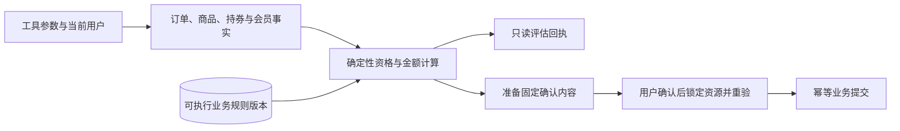

# 业务规则与权益计算设计

## 模块职责与调用链

模型选择业务工具，资格与金额由程序根据数据库事实计算。[RuleService](../app/services/commerce/rules.py) 提供订单操作、售后、换货维修、优惠券与商品金额试算；[membership_store.py](../app/data/membership_store.py) 负责会员身份、订阅和权益额度。`QueryService` 组合规则与查询，办理服务在准备和确认提交时复用规则并重新核验状态。



对象归属及结果契约见 [业务数据访问设计](业务数据访问设计.md)，确认和事务写入见 [业务操作与交易设计](业务操作与交易设计.md)。本模块的 `eligible` 表示当前事实满足规则，申请、渠道处理和最终完成分别记录。

## 两类规则的分工

| 规则 | 存储与实现 | 用途 |
| --- | --- | --- |
| 可执行资格规则 | MySQL `business_policy_versions.rules`，由严格的 `Rules` 模型解析 | 判断动作是否允许、适用期限、叠加开关及本地履约权限 |
| 检索政策正文 | Markdown、审核侧文件和 `PolicyIndex` | 解释条款，返回来源、版本、适用范围和有效期 |

`Rules` 拒绝额外字段，要求 `schema_version=1`；字段类型和数值范围由 Pydantic 校验。活动金额与范围另读 `promotion_rules/promotion_scopes`，券的金额和领取限制另读券模板、范围及领取快照。

可执行规则可通过 `rag_policy_id/rag_policy_version` 关联正文。`search_policies` 比较命中的来源与版本，返回 `rule_checks`；关联缺失或版本不一致会附限制说明。命中 Markdown 本身不产生操作资格。

## 适用版本与时间

`policy(tx, action, ...)` 按平台、动作和 `active` 状态读取规则。当前入口没有可信渠道上下文，跳过带特定 `channel` 的版本。每份规则声明自己的 `time_basis`：

| 值 | 选择版本所用时点 |
| --- | --- |
| `request` | 当前请求时刻 |
| `order_created` | 订单创建时刻 |
| `delivered` | 原始履约包裹的签收时刻；带商品行评估时逐行核实 |

有效区间包含起点、不含终点。代码要求恰好一个版本适用；版本重叠、时间缺失或规则格式错误均返回无法核实，不直接选择版本号最大的记录。

`item_delivery_times` 只读取申请商品所属订单的原始包裹，排除取消包裹和换货补发。所有关联数量须与购买数量一致，且全部有签收记录；同一商品分包时以最早签收时刻校验申请期限，避免后到包裹延长同一购买行的期限。

## 资格判断与售后金额

`decision` 将 `not_eligible` 映射为 `ineligible`，将 `insufficient_data` 映射为 `unknown`；有效结果返回 `eligible`。对象不存在、越权或参数错误仍按原错误协议处理，不统一转换成资格否定。

订单操作检查订单状态与动作规则：取消、改址要求本地履约控制权限；未付款取消还检查库存和券是否纳入本地事务；开票检查已核实支付金额及既有有效申请。

售后评估按商品行检查同一订单、规则状态、原因审核、签收期限和可申请数量。活动中的售后占用数量，已取消、拒绝、关闭的申请不占用；价保不占用普通售后的购买数量。未知售后状态使结果进入 `unknown`。

部分退款使用成交行金额累计分摊，金额采用 `Decimal` 并按分四舍五入。设购买数量为 `q`、此前占用数量为 `u`、本次申请数量为 `n`、该行实付为 `T`，本次金额为：

```text
round(T × (u + n) / q, 2) − round(T × u / q, 2)
```

这样连续的部分申请累计后与该行金额一致。评估同时核验币种和退款状态，按申请金额与已登记退款金额的较大值计算占用，防止重复申请超过已付余额。`refund_shipping` 要求独立运费分摊依据，不能直接把订单运费加入商品退款。

换货与维修共用 `service_assessment`。换货另验目标 SKU 的商品、商家、币种、可售状态、库存和价差开关；库存记录缺失与库存数量不足分别处理。只读评估不创建申请、不预占库存，维修回执也不将退款分摊值当作维修费用。

## 活动与优惠券计算

`estimate_purchase` 只计算指定 SKU、数量与持券组合：

1. 合并相同 SKU，读取价格与库存，限制合并数量，并要求同一商家和币种。
2. 取得唯一适用的 `pricing` 规则。
3. 按活动优先级降序、活动编号及版本排序处理活动；检查平台、商家、币种、范围与有效版本。相同互斥组只使用先命中的有效活动。
4. 按活动的 `allows_coupon` 和价格规则的 `promotions_with_coupons/coupon_stacking` 核验叠加。
5. 按传入持券顺序，对折扣后的商品行校验范围、门槛并继续分摊减免。

范围支持全部、商家、商品或 SKU；缺少范围或出现未知范围不自动视为全场适用。`amount_off` 计算定额减免，`percent_off` 按 `discount_bps / 10000` 计算减免比例，随后应用封顶值与商品金额上限。代码按固定规则执行，不搜索最优券组合。

`allocate_discount` 按 SKU 排序，用累计金额比例计算累计应分摊值，再求相邻差值；各行分摊之和等于总优惠，且不超过商品金额。报价使用这些商品金额，再结合地址与配送规则计算完整费用；单独 `estimate_purchase` 的 `shipping_amount/payable_amount` 为空，表示该工具只完成商品部分试算。

## 持券快照与领取

`coupon_template` 是可领取模板，`coupon_instance` 是本人持券。金额试算必须使用当前用户的可用持券，并核验平台和币种。

`coupon_claim_rules` 冻结领取时的模板、范围及会员要求。持券的使用资格采用该快照；模板后续修改不直接重写历史券规则。持券缺少快照时，展示工具可以附说明展示当前模板，实际用券计算则返回无法核实。

领取检查生效时间、固定或相对有效期、总量、个人限额和新人资格，再检查会员额度。查询可领券只是当前视图；实际领券在用户确认后的写事务中再次核验，并同时保存持券、规则快照与权益消耗记录。

## 会员身份与周期权益

`membership_facts` 组合成长会员、付费 VIP 和店铺会员，并检查账号、体系、会员有效区间及订阅状态。付费 VIP 只有一个当前有效订阅时明确为有效；多个重叠有效订阅返回未知状态。`users` 中的会员字段是展示投影，资格检查读取会员与权益事实表。

会员券通过权益规则中的 `coupon_template_id` 绑定模板，不根据名称推断。领取要求唯一有效权益、金额与币种一致、月周期有效，且 `membership_check` 为以下模式之一：

| 模式 | 检查时机 |
| --- | --- |
| `claim_only` | 领取时核验，使用时沿用领取快照 |
| `claim_and_use` | 领取和用券时均核验对应体系会员身份；付费体系还核验有效订阅 |

月周期按 UTC+8 自然月计算，数据库时间使用 UTC；额度有效期受月末、会员到期和付费订阅到期共同限制。额度键由用户、会员体系、权益族及月份组成，同权益族换模板或等级后仍读取同一周期的已领数量。

写入时先锁用户，再核验并消耗额度。`consume_coupon_entitlement` 在同一领取事务中登记持券编号，使用原已领数量作为条件递增，并拒绝同一持券重复计入。额度记录保留权益版本和会员依据。

注册入口调用 `enroll_registered_user`：仅当存在唯一启用的默认成长体系时，按该体系规则版本建立青铜身份与事件，截止 UTC+8 当前季度末，再更新用户展示投影；没有默认体系时不隐式授予会员。

## 代码与测试入口

- [资格、优惠与分摊](../app/services/commerce/rules.py)、[查询组合](../app/services/commerce/queries.py)。
- [会员事实与额度](../app/data/membership_store.py)、[领取及业务写入](../app/services/commerce/writes.py)。
- [扩展业务](../app/services/commerce/extensions.py)、[参数契约](../app/tools/contracts.py)。
- [核心工具测试](../tests/test_core_tools.py)、[扩展工具测试](../tests/test_extended_tools.py)、[换货维修评估测试](../tests/test_service_assessments.py)。
