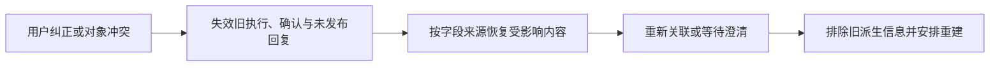

# 事项关联与纠错设计

## 候选召回

`CandidateService` 从已保存的本批原话、近期公开对话、有效待答问题和当前事项建立候选。存在历史指代时，在同一用户及业务范围内查找跨会话事项；查询改写只辅助检索。

候选保留事项编号、版本、目标、细节、状态、来源与召回依据。多个合理候选同时返回，排序不表示选中。历史已结束事项可以提供线索，不能因此恢复办理。

必要时使用只读订单查询核实对象。同商品的多个订单仍需区分；“昨天”若按事项更新时间匹配，依据不能冒充订单创建时间。候选缺失、检索失败和省略范围通过 `gaps` 等字段明示。

## 关联契约

`AgentEngine.associate` 提出结构化决定，`AssociationService` 校验并提交；此模型调用不执行业务工具。

| 决定      | 处理方式                                   |
| --------- | ------------------------------------------ |
| `create`  | 为独立目标创建事项                         |
| `update`  | 将回答、补充、更正或目标调整应用于已有事项 |
| `clarify` | 保存归属歧义与候选，提出区分问题           |
| `ignore`  | 保存无需建立事项的处理结果                 |

一条消息可以产生多个决定，多条消息也可以共同补充一个事项。缺少办理材料不一定是归属不明，可以先建立清楚的目标，再由执行阶段补问。

决定包含来源消息序号、原文引用及必要的事项和问题编号。`goal` 忠实保留完整目标；字段变化必须有可核验的原话来源，改写文本和客服陈述不能替代用户证据。

当前 `Quote.kind` 还区分 `text_quote`、`attachment_ref` 和 `image_observation`：后两类证明图片提交或可见内容，不能替代文字授权。关联可按明确图片证据分别建立 `task_attachments`；规范业务对象字段的细节仍要求原话证据及后续业务核验，不能将截图编号直接当作所属订单。契约见 [图片处理与多模态上下文设计](图片处理与多模态上下文设计.md)。

## 提交校验

关联提交检查：

1. 本批消息范围完整，原文引用与实际保存内容一致。
2. 事项属于当前用户，业务范围与对象有效。
3. 事项版本、控制状态和接管状态未变化。
4. 问题已公开发送、仍有效，简短回答对应实际问题或选项。
5. 已有业务操作不允许通过普通更新悄悄更换处理对象。

“是的”同时面对多个有效问题时需要区分；同一订单的两个目标也不能仅靠订单号合并。归属澄清与执行阶段补充材料的问题分别记录。

事项更新、关联决定、来源索引和消息处理位置同事务提交。稳定作业编号用于重试去重；版本冲突后重新读取并在有限预算内重试，无法可靠确定时保存澄清。

## 纠错流程

纠错记录保留原决定、来源、原因和影响范围。仅恢复错误变更造成的字段，后续正确修改继续保留；不能恢复整个旧快照覆盖新信息。

来源失效检查在读取时立即生效，后台再清理摘要与记忆缓存。错误原话仍可保留用于核对，但不能继续生成有效业务依据。

尚未开始的确认失效。已开始、结果未知或已成功的业务操作保留真实回执，转入核实或人工处理；修正关联不能撤销外部已经发生的业务。

## 代码入口

- [候选召回](../app/tasks/candidates.py)、[订单候选](../app/tasks/order_candidates.py)
- [关联模型](../app/agents/association.py)、[提示词](../app/prompts/association.py)
- [关联提交](../app/tasks/association.py)、[澄清记录](../app/tasks/clarifications.py)
- [纠错](../app/tasks/correction.py)、[来源保护](../app/tasks/provenance.py)

事项更新如何影响运行中执行见 [事项执行与调度设计](事项执行与调度设计.md)。
