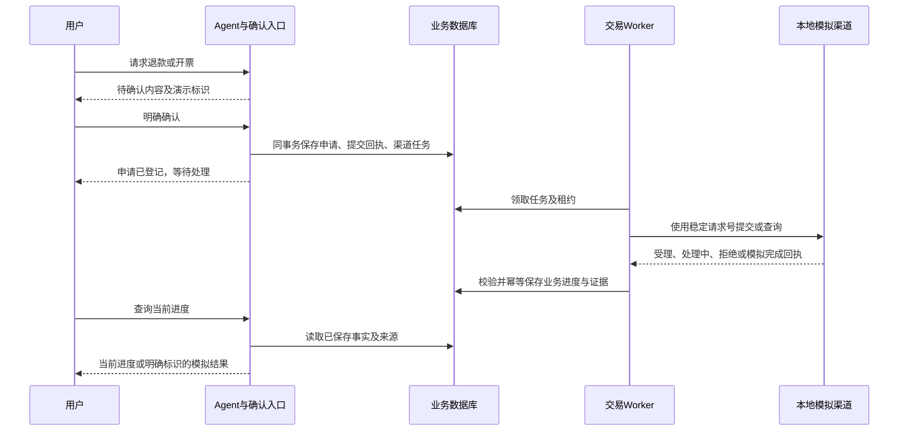

# 售后与开票本地演示闭环方案

日期：2026-10-29  
状态：待实施方案；本文不代表功能已经完成。  
适用范围：个人项目的本地开发、功能演示与自动化测试。

## 1. 目标与项目边界

本项目无需为了完成个人作品而接入真实商家、支付机构或开票服务，但需要让用户提交的申请有后续、有结果、可查询。

采用「实际运行的业务流程 + 本地模拟处理渠道」：用户确认、申请持久化、后台处理、状态查询、异常恢复和人工接管使用项目的实际代码；外部审核、资金渠道响应、物流与票据结果由本地模拟器产生。

演示不发生真实扣款、退款、发货或正式开票。所有模拟结果必须保留明确来源，并在确认卡片、查询结果、客服工作台和用户通知中标明演示性质。

本方案处理 [待改进](待改进.md) 中的两个问题：

| 问题 | 当前缺口 | 本方案的处理 |
| --- | --- | --- |
| BIZ-01：普通售后和首次开票提交后的处理未闭环 | 申请及提交回执已经保存，但缺少继续推进这些申请的处理任务或审核入口 | 补齐申请、后台任务、模拟处理、结果落库与查询链路 |
| BIZ-06：渠道协议不等于真实供应商已接通 | 已有渠道调用约定，缺少真实供应商部署与联调证据 | 保留真实渠道适配接口，增加持久化的本地模拟实现；真实供应商接入列为生产扩展项 |

BIZ-01 属于本地演示也需要解决的功能缺口。BIZ-06 属于项目适用范围和接入证据边界，不应因为个人项目没有商业合作方就阻止演示版本验收。

## 2. 已有基础与复用范围

以现有实现为基础，补充缺失环节，不另外搭建一套绕过业务校验的演示流程。

| 现有模块 | 当前职责 | 本次拟扩展内容 |
| --- | --- | --- |
| [TaskOperations](../app/tasks/operations.py) | 准备、用户确认、提交资格、操作回执和恢复 | 保留确认与幂等边界；向用户区分申请提交和后续处理完成 |
| [WriteService](../app/services/commerce/writes.py) | 业务事务与普通售后、首次开票申请 | 在创建申请的同一业务事务中创建对应渠道任务 |
| [providers.py](../app/services/commerce/providers.py) | 固定 HTTPS 网关、提交/查询协议与结果校验 | 增加显式选择的本地模拟渠道，复用结果契约 |
| [fulfillment.py](../app/services/commerce/fulfillment.py) | 渠道请求处理、租约和履约结果应用 | 补充普通售后及首次开票结果处理分支 |
| [交易 Worker](../scripts/commerce_worker.py) | 扫描并推进持久渠道任务 | 消费新增任务，按原请求号推进和恢复 |
| [queries.py](../app/services/commerce/queries.py) | 订单、售后、退款等事实查询 | 从持久记录返回处理进度、结果与模拟来源 |
| [外部进度跟踪](../app/tasks/external_progress.py) | 已进入等待状态事项的进度核实与通知 | 读取新增流程的结果，保留来源及完成范围 |

现有 `provider_factory` 测试替身可以继续用于单元测试，但不能单独作为可启动、可重启恢复的演示渠道。面向用户的演示结果也需要持久化。

## 3. 首期范围与后续范围

### 3.1 第一阶段：退款和首次开票

先完成两条可独立演示的流程：

1. 普通售后中的「仅退款」：提交申请、模拟审核、模拟退款处理、结果查询。
2. 首次开票：提交申请、模拟受理、生成演示票据文件、授权下载。

同时支持审核拒绝、延迟完成、提交结果未知、重复请求和进程重启恢复。

### 3.2 第二阶段：退货退款

补齐退货授权、演示退货运单登记、模拟收货与验货、模拟退款。退货地址、物流记录和运输结果全部使用明确的演示数据。

只完成「仅退款」时，应将 BIZ-01 的仅退款子项标记完成，不能声称所有普通售后均已闭环。退货退款仍需单独验收。

换货、维修、价保、取消和发票重开可以后续复用模拟渠道，但不属于首期交付承诺。真实支付、真实银行到账、真实仓库履约和正式税务票据均不在本地演示验收范围内。

## 4. 完整处理链路

交易 Worker 推进业务，外部进度跟踪模块读取业务结果并组织必要通知。两者职责保持分开；没有开启持续跟踪的事项，也应能通过用户主动查询看到结果。

## 5. 模拟渠道设计

### 5.1 显式启用与来源隔离

拟增加渠道模式配置，例如 `COMMERCE_PROVIDER_MODE=disabled|simulator|http`。这是待实现的配置提案，不是当前已有配置。

- `disabled`：未启用处理渠道，明确返回不可用。
- `simulator`：只处理演示业务数据，使用本地模拟器。
- `http`：使用现有 `COMMERCE_PROVIDER_CONFIG` 配置的真实适配网关。

真实渠道调用失败时不得自动切到模拟器。实施时应明确已有 HTTP 部署的配置迁移方式，避免新增默认值使已有部署静默失效。

创建渠道任务时绑定模式和来源。后续修改配置不改变已有任务的来源，尤其不能让待处理真实任务在重启后被模拟器接管。不同模式应使用独立演示数据库或有明确隔离标记的数据集。

### 5.2 模拟器持久化

模拟器提供与网关一致的 `submit`、`query` 行为；首期可以是同进程适配器，不要求另起 HTTP 服务。

拟新增模拟请求存储，至少保存：

| 信息 | 用途 |
| --- | --- |
| 请求编号、业务类型、所属用户与申请编号 | 唯一识别一次模拟办理，核对对象归属 |
| 固定参数摘要 | 拒绝相同请求号对应不同办理内容 |
| 场景、当前阶段、下一推进时间 | 可重复演示成功、拒绝、延迟和异常 |
| 模拟回执及事件编号 | 重复查询返回一致结果，避免重复应用 |
| 渠道模式、模拟来源、创建和更新时间 | 重启恢复、审计与演示标识 |

复用 `commerce_provider_requests` 记录应用侧任务；模拟器另存处理方视角的受理记录，才能演示“处理方已受理，但应用没收到提交响应”。具体表名和字段在实现迁移时确定。

状态通过后台轮询和受控的阶段推进持久更新，不能仅保存在内存中，也不能每次查询都重新生成一个成功结果。成功、拒绝等场景由开发者的演示配置或受权限控制的演示入口选择，不允许聊天中的模型参数任意指定结果、金额或身份。

### 5.3 来源标记贯穿整个链路

拟统一提供 `is_demo=true` 和 `source=simulated_provider` 等来源信息，实际字段与现有查询契约统一。来源由可信服务端生成，不能只依赖外部回执自报。

标识需要保存在渠道任务、退款或票据结果、工具查询回执、人工交接和公开进度中。将现有固定写入 `source=provider` 的路径一并检查，避免模拟数据被写成普通外部渠道事实。

前端使用固定标识展示演示性质，模型答复也应保留相同限定。不能只在系统提示词中要求模型“记得说明”。

## 6. 两类业务的状态与完成条件

以下名称表示业务阶段；实现时映射到已有状态枚举，只有表达能力不足时才新增数据库状态。

### 6.1 普通售后

仅退款流程：

`申请已提交 → 模拟审核中 → 模拟退款处理中 → 模拟退款完成`

审核可进入「已拒绝」；通信异常进入「结果待核实」，不能直接当作办理失败或重新创建申请。

验收时应分别检查：

- 申请提交成功只说明已登记，不能提前标记退款完成。
- 审核通过后按原申请、商品行、数量和程序核算金额产生模拟退款记录。
- 模拟退款完成必须有匹配的退款编号、原支付关联、金额、币种和时间。
- 金额或对象不一致、证据缺失时保留待核实状态，不因一条 `completed` 字符串就完成事项。
- 查询展示“模拟退款处理完成，未发生真实资金流转”，不得声称真实银行卡到账。

退货退款增加「待寄回 → 模拟运输 → 模拟收货/验货」阶段，只有满足对应条件后才推进模拟退款。部分退货和部分退款不能被说成整单完成。

### 6.2 首次开票

`申请已提交 → 模拟开票处理中 → 演示票据已生成`

拟为首次开票增加独立渠道任务及结果应用分支，不能借用发票重开的“原票作废”条件。

- 票据关联原申请和订单，金额与抬头信息来自已确认业务内容。
- 生成可实际下载的演示 PDF，明显标注“演示票据，非正式发票”。
- 保存稳定文件引用、类型、摘要及生成时间，复用现有归属和文件校验逻辑。
- 文件先可靠写入并校验，再公布可下载结果；中断后应能按同一请求恢复，不能生成重复票据记录。
- 文件缺失或摘要不匹配时明确不可下载，不能返回一个不存在的链接。

## 7. 幂等、异常与人工处理

1. **提交原子性：** 申请、业务提交回执与渠道任务在同一 MySQL 事务中保存。事务失败应整体回滚，不能出现申请成功却永远没有处理任务。
2. **稳定请求号：** 用户重复确认、Worker 重试和恢复都沿用同一次办理的编号；相同编号、不同参数应拒绝。
3. **未知结果：** 模拟“已受理后响应丢失”，下一次先查询原请求。只有协议明确返回 `not_found` 时，才允许按既有恢复规则用原编号重投。
4. **租约与并发：** 沿用现有 Worker 租约，重复或并发执行不得产生重复退款、重复票据或重复有效通知。
5. **回执应用：** 检查所属用户、申请对象、数量、金额和业务阶段；重复回执不重复产生副作用，旧回执不覆盖已确认的新阶段。
6. **重启恢复：** 应用和模拟器恢复后读取持久状态，继续原申请；不能将内存丢失解释为从未受理。
7. **人工接管：** 沿用现有控制关系。未开始的机器人操作停止，已提交操作保留并继续核实；转人工不代表已撤销申请。迟到回执按现有规则交人工核实。

## 8. 实施步骤

| 阶段 | 交付内容 | 完成条件 |
| --- | --- | --- |
| 1：明确契约 | 模式配置、来源字段、任务种类、阶段映射与数据库迁移 | 能区分模拟/真实/未启用渠道，既有任务来源不会被配置变化替换 |
| 2：模拟渠道 | 持久化模拟请求、提交/查询、受理/拒绝/延迟/未知场景 | 相同请求可幂等查询，模拟器重启后结果仍存在 |
| 3：仅退款闭环 | 普通售后提交创建渠道任务，Worker 应用模拟审核与退款结果 | 用户从确认到查询模拟退款结果完整走通 |
| 4：首次开票闭环 | 首次开票任务、结果落库、演示 PDF 与授权下载 | 申请结果和实际下载文件一致，文件明确标注演示 |
| 5：退货退款与异常 | 退货授权、逆向进度、验货，以及并发、超时、接管恢复 | 剩余普通售后子项完成验收；异常不重复办理 |
| 6：文档与演示 | 启动说明、演示场景、界面来源标识及问题清单调整 | 项目展示与实际能力一致，真实渠道接入列为扩展项 |

每个阶段应有对应的查询结果和运行记录，不能只凭测试替身返回成功就标记完成。

## 9. 验收用例

| 用例 | 预期结果 |
| --- | --- |
| 确认仅退款申请 | 申请与渠道任务同时落库，首次回复只说明已提交 |
| 模拟审核通过并完成退款 | 查询返回持久退款结果、金额范围和演示标识 |
| 模拟审核拒绝 | 查询说明拒绝原因，无完成退款记录 |
| 确认首次开票申请 | 后台生成演示票据，所属用户可下载，其他用户不可下载 |
| 生成文件后进程中断 | 恢复后关联同一份有效文件，不重复生成有效票据记录 |
| 渠道已受理但提交响应丢失 | 按原请求号查询恢复，只存在一次有效办理 |
| 重复确认及多个 Worker 竞争 | 不重复申请、不重复退款、不重复应用票据结果 |
| Worker 或模拟器重启 | 已有进度保留，后续可继续推进与查询 |
| 模拟器返回错订单、错金额或不完整完成证据 | 拒绝完成，保留错误及待核实记录 |
| 处理中转人工或用户改变需求 | 不自动宣称撤回；保留真实的本地提交事实和模拟渠道进度 |
| 未配置渠道 | 明确不可用，不静默生成成功回执 |
| 修改渠道模式后恢复旧任务 | 按任务原绑定来源处理或明确阻塞，不将真实任务交给模拟器 |
| 退货退款仅部分验货或退款 | 查询保留商品行、数量和金额范围，不宣称整单完成 |

单元测试覆盖结果契约和状态条件；集成测试验证申请、任务、回执与文件的一致性及数据库并发语义；最后以实际运行的 API、Worker、模拟器和界面完成一次端到端演示。便携数据库或内存替身测试不能替代 MySQL 事务验收。

## 10. 问题清单与项目介绍

实施后建议按以下口径调整 [待改进](待改进.md)，本方案不提前修改现有问题状态：

- **BIZ-01：** 改为“普通售后和首次开票本地演示闭环”，拆出仅退款、退货退款与首次开票子项。相关子项全部验收后，标记“本地演示范围已完成”；真实渠道能力单独保留。
- **BIZ-06：** 归入“生产扩展：真实供应商接入与联调”，明确当前不在个人演示项目范围内。模拟器完成不等于真实渠道已接通，未来需另外验证凭据、接口适配、幂等、异常和业务终点。

以下项目介绍仅在本方案对应范围验收完成后使用：

> 已实现普通售后与首次开票的本地演示闭环，包括申请确认、后台处理、进度查询和异常恢复。外部处理渠道采用可持久化的模拟实现，预留真实供应商适配接口；演示不执行真实退款、发货或正式开票。

若只完成第一阶段业务，应将“普通售后”改为“仅退款”，并明确退货退款仍在开发中。
