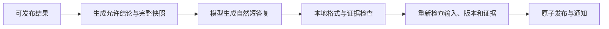

# 回复组织与通知设计

## 职责与发布单位

回复协调器把当前可发布的事项结果、澄清问题和操作提示组织成公开回复。一个回复可以覆盖多个事项；快事项不必等待慢事项结束。

接收回执和处理中提示不等于正式答复。`task_reply_items` 保存结果的发布状态，`task_reply_sessions` 保存会话检查进度，正式回复保存在 `support_events`。

## 证据到允许结论

工具证据先检查用户、事项、业务对象、来源、控制版本、有效期和政策适用条件，再投影为允许结论。完整快照保存对象、查询参数、证据编号、数据时间、完整性和限制。

当前投影覆盖业务查询、商品和权益等客户事实，并可加入 `image_claims`。图片结论始终标注为“图片观察”，携带不确定性；它不能与订单、退款等业务回执合并成已核实业务状态。`reply_observations.py` 还保留旧证据块兼容路径，正常回复使用自然生成流程，`claims` 编号仅用于关联依据；旧编号选择接口保留兼容用途。

演示业务回执保留 `is_demo` 和来源限制，退款、售后和开票的公开结论继续标明模拟性质；不得将模拟完成改写为真实资金到账或正式票据。来源处理见 [reply_observations.py](../app/tasks/reply_observations.py)。

`recall_user_memory` 的实际读取也投影为允许结论，区分当前偏好与历史时点，保留“历史陈述、本次要求优先”等限制。未找到相关记忆不等于用户从未表达过；暂不可用也不等于空召回。发布前重新校验记忆修订、事实有效期和原话来源，读取后发生的更正或遗忘会使旧草稿失效。

发给回复模型的视图包含当前用户原话、必要公开历史、事项目标、证据绑定及已验证工具回执。存在原始业务回执时，不发送旧结论中的文案模板和选择摘要；不把 ReAct 执行草稿当作事实。

## 回复模型的边界

模型返回 `{"reply":"自然答复","claim_ids":["依据编号"],"question":null}`，根据本轮问题组织语言，不套物流、退款等固定文案。回复不设固定字数限制，以简单易懂、直接回答、保留必要信息为准；不能通过机械截断丢掉条件或否定。

回复组织提示词要求模型围绕当前问题，依据同一对象的证据组织语言，保留影响结论的条件、模拟来源和不确定性，删除客套、复述、处理过程和重复总结。服务端只做本地格式、证据归属和关键业务断言检查，不因超过20或50字拒绝答复，也不另行调用模型复核。通过本地检查且仍绑定原快照的 `VerifiedReply` 才能发布；这些检查不代表对所有自然语言含义的完整验证。

只问物流状态时可以回答“模拟记录显示在途，实际进展待核实。”，不重复订单编号、完整时间戳、分页说明或用户未问的家人代收假设。用户追问时再按当前问题解释细节。澄清选项与确认提示保留服务端绑定，不允许模型改掉确认对象。

回答与澄清共用 [reply_style.py](../app/prompts/reply_style.py) 中的表达要求。执行 Agent 不再调用 `ask_user`：可以回答时返回 `ready`；必须等待补充时返回 `needs_input`、`missing_information` 和已查候选的 `candidate_refs`，不撰写客户问题。

回复组织模型读取澄清所需信息与候选摘要，在同一次生成中输出 `question={task_id,prompt,options:[{label,ref}]}`，自由回答时 `options=[]`；仅需提问时 `reply` 和 `claim_ids` 可以为空。问题直接询问一个有用区别，选项只保留必要属性。没有 `clarification` 的事项不允许额外生成结构化问题。

服务端校验候选属于当前事项的有效查询结果，历史订单查找回执在30分钟内仅投影为定位信息，不将旧状态作为当前事实。快照复核通过后，在发布消息的同一事务中保存问题、候选引用、`question_id` 和 `waiting_user` 状态；生成失败或新输入使快照失效时，不留下未发布的等待问题。多个事项待澄清时，一次只发布一个问题。

用户下一轮明确选择序号或完整选项标签后，事项关联把绑定引用保存到 `details.selected_candidate`，供后续查询沿用；自由描述仍由关联与执行模型结合上下文理解。定位线索不等于业务授权，更正对象时清除旧选择。原有确认卡片与历史已保存问题仍沿用固定发布路径。

表达原则参考 [Anthropic 开源客服示例](https://github.com/anthropics/claude-quickstarts/blob/main/customer-support-agent/app/api/chat/route.ts) 中的简洁、有用、依据给定资料回答，以及 [τ²-bench 零售政策](https://github.com/sierra-research/tau2-bench/blob/main/data/tau2/domains/retail/policy.md) 中不编造信息和办理流程的约束。具体的澄清选项精简规则针对本项目的订单查找场景制定。

只有固定提示时不调用回复模型。回复组织只调用一次模型，在后台回复线程中等待生成完成，不设15秒或其他固定生成时限；模型请求显式使用 `timeout=None`。返回后通过本地校验且快照仍有效就发布，不因生成较慢丢弃答复。网络异常、生成未完成、本地校验失败或关闭回复组织时，业务答复使用简短的无法核实提示，不再直接展示内部长文。

例如，未查到发货记录只表示当前记录缺失；渠道退款成功不表示已核实银行卡到账；原包裹和换货补发包裹不能合并为同一对象。

## 并发与失效检查

模型调用在事务外完成。生成前冻结输入与结论快照，生成后重新收集有效结果、检查政策并比较指纹。

指纹包含用户输入位置、公开上下文、事项版本、控制版本、来源修订和完整证据。新消息、接管、更正、证据过期或其他回复发布可能使当前草稿失效。失效结果不标记已发送，下轮重新组织，已核实的工具结果按规则复用。

最终事务核验输入边界与版本，保存公开事件、覆盖的结果和通知。多个 Worker 可以重复准备回复，但同一结果只能成功发布一次。

## SSE 与历史恢复

通知 Outbox 与事件同事务落库。通知 Worker 和 Redis 只提示会话有变化，API 依据数据库游标读取实际内容，再通过 SSE 推送。

页面先读取 `transcript` 获取消息和一致的事件游标，后续按游标续接。断线重连携带 `Last-Event-ID`；重复通知、迟到 HTTP 和乱序事件通过稳定编号及序号合并，不重复展示。

每次历史读取与补拉都检查用户或客服权限。权限撤回、登录到期或连接租约失效时关闭旧连接。

## 代码入口

- [回复协调](../app/tasks/replies.py)
- [结论投影](../app/tasks/reply_claims.py)、[证据校验](../app/tasks/reply_grounding.py)
- [客户事实投影](../app/tasks/customer_facts.py)、[旧证据块兼容](../app/tasks/reply_observations.py)
- [回复组织](../app/tasks/reply_composition.py)、[自然答复契约](../app/tasks/natural_reply.py)、[自然答复提示词](../app/prompts/natural_reply.py)
- [通知](../app/runtime/notifications.py)、[SSE](../app/runtime/streaming.py)
- [前端事件状态](../frontend/src/conversationState.js)

前端接收与恢复行为见 [前端交互设计](前端交互设计.md)。
