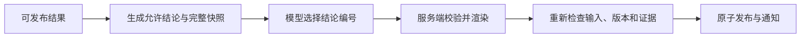

# 回复组织与通知设计

## 职责与发布单位

回复协调器把当前可发布的事项结果、澄清问题和操作提示组织成公开回复。一个回复可以覆盖多个事项；快事项不必等待慢事项结束。

接收回执和处理中提示不等于正式答复。`task_reply_items` 保存结果的发布状态，`task_reply_sessions` 保存会话检查进度，正式回复保存在 `support_events`。

## 证据到允许结论

工具证据先检查用户、事项、业务对象、来源、控制版本、有效期和政策适用条件，再投影为允许结论。完整快照保存对象、查询参数、证据编号、数据时间、完整性和限制。

当前投影覆盖业务查询、商品和权益等客户事实，并可加入 `image_claims`。图片结论始终标注为“图片观察”，携带不确定性；它不能与订单、退款等业务回执合并成已核实业务状态。`reply_observations.py` 还保留旧证据块兼容路径，正式协调器以 `claims` 编号选择为主。

演示业务回执保留 `is_demo` 和来源限制，退款、售后和开票的公开结论继续标明模拟性质；不得将模拟完成改写为真实资金到账或正式票据。来源处理见 [reply_observations.py](../app/tasks/reply_observations.py)。

`recall_user_memory` 的实际读取也投影为允许结论，区分当前偏好与历史时点，保留“历史陈述、本次要求优先”等限制。未找到相关记忆不等于用户从未表达过；暂不可用也不等于空召回。发布前重新校验记忆修订、事实有效期和原话来源，读取后发生的更正或遗忘会使旧草稿失效。

发给回复模型的视图只包含当前用户原话、必要公开历史、事项目标与允许结论摘要，不包含确认凭证、完整数据库行、内部备注或 ReAct 草稿。

## 回复模型的边界

模型只返回 `{"claim_ids":["..."]}`，选择允许结论及顺序，不生成业务正文、不调用工具、不修改事项。服务端拒绝额外字段、自由文本、未知编号、重复编号或遗漏必须回答事项的计划。

最终正文来自可信快照的渲染结果。每条结论与其数据限制绑定，不能只选择有利部分。澄清问题、固定选项、确认提示和无法核实说明由服务端附加。

只有固定提示时不调用模型。模型超时、异常、无效计划或关闭回复组织功能时，沿用确定性的结果渲染。

例如，未查到发货记录只表示当前记录缺失；渠道退款成功不表示已核实银行卡到账；原包裹和换货补发包裹不能合并为同一对象。

## 并发与失效检查

模型调用在事务外完成。生成前冻结输入与结论快照，生成后重新收集有效结果、检查政策并比较指纹。

指纹包含用户输入位置、公开上下文、事项版本、控制版本、来源修订和完整证据。新消息、接管、更正、证据过期或其他回复发布可能使当前草稿失效。失效结果不标记已发送，下轮重新组织，已核实的工具结果按规则复用。

最终事务核验输入边界与版本，保存公开事件、覆盖的结果和通知。多个 Worker 可以重复准备回复，但同一结果只能成功发布一次。

## SSE 与历史恢复

通知 Outbox 与事件同事务落库。通知 Worker 和 Redis 只提示会话有变化，API 依据数据库游标读取实际内容，再通过 SSE 推送。

页面先读取 `transcript` 获取消息和一致的事件游标，后续按游标续接。断线重连携带 `Last-Event-ID`；重复通知、迟到 HTTP 和乱序事件通过稳定编号及序号合并，不重复展示。

每次历史读取与补拉都检查用户或客服权限。权限撤回、登录到期或连接租约失效时关闭旧连接。

## 代码入口

- [回复协调](../app/tasks/replies.py)
- [结论投影](../app/tasks/reply_claims.py)、[证据校验](../app/tasks/reply_grounding.py)
- [客户事实投影](../app/tasks/customer_facts.py)、[旧证据块兼容](../app/tasks/reply_observations.py)
- [回复组织](../app/tasks/reply_composition.py)
- [通知](../app/runtime/notifications.py)、[SSE](../app/runtime/streaming.py)
- [前端事件状态](../frontend/src/conversationState.js)

前端接收与恢复行为见 [前端交互设计](前端交互设计.md)。
