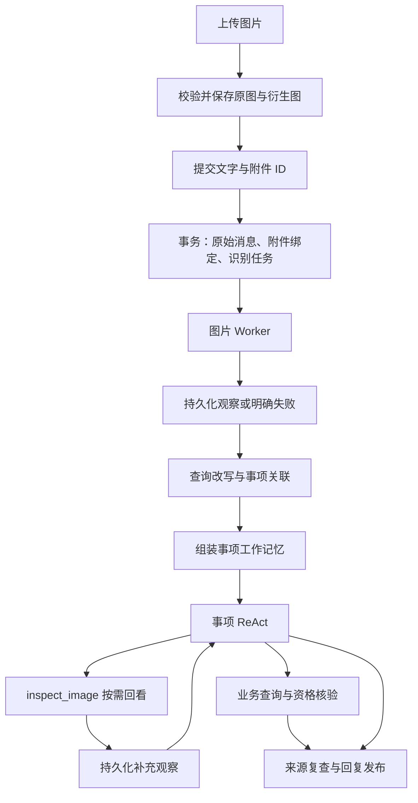
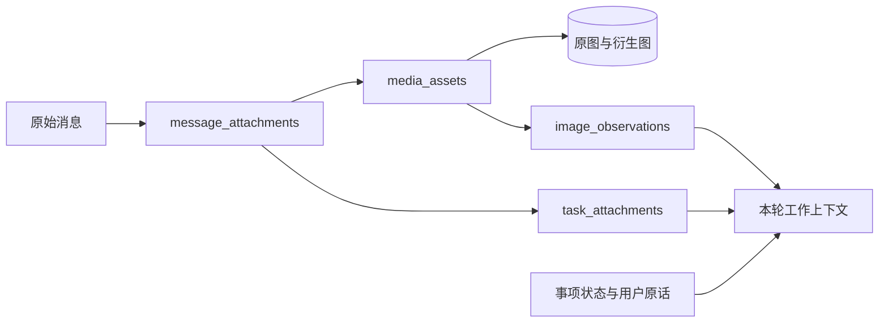

# 图片处理与多模态上下文设计

## 设计目标与边界

图片是用户消息的组成部分。系统保存原图和来源，通过视觉模型产生可追溯的图片观察，再将相关观察纳入事项关联和执行上下文。用户可以继续追问图片细节，也可以跨会话恢复对应事项。

本模块覆盖图片上传、消息绑定、识别、按需回看、上下文组装、权限、纠错和生命周期。商品说明书等公共资料中的图片由知识库处理；用户提交的订单截图、面单和实拍照片属于会话附件，不自动写入公共知识库或长期用户偏好。

核心数据流为：**原图产生观察，观察帮助关联事项，事项加载有效观察形成工作记忆，业务工具核验业务事实。**

| 信息 | 含义 | 使用边界 |
| --- | --- | --- |
| 用户原话 | 用户直接输入的文字 | 保持原文，支持逐字证据校验 |
| 图片附件 | 用户在某条消息中提交的文件 | 可以证明文件被提交，不能独立证明用户意图 |
| 图片观察 | 模型针对图片及具体问题产生的描述或提取结果 | 保留来源、问题范围和不确定性，不能冒充用户原话 |
| 业务事实 | 业务服务返回的订单、金额、物流和售后信息 | 按对象、权限和时效核验 |
| 工作记忆 | 当前执行需要的事项、原话、观察、待答问题和回执 | 按需组装、控制预算、每次读取检查来源 |

例如，“截图中显示退款成功”是图片观察；“退款渠道报告成功”是业务查询结果；“银行卡已到账”还需要对应依据。三者不能互相替代。

## 模块职责与主链路

| 模块 | 职责 |
| --- | --- |
| 附件 API 与存储服务 | 上传校验、文件保存、鉴权预览、附件状态与生命周期 |
| 消息接收 | 校验附件归属，原子保存消息、绑定关系和首次识别任务 |
| 图片 Worker 与视觉适配器 | 有界识别、租约恢复、观察持久化、失败状态 |
| 消息理解与事项关联 | 使用文字和图片证据选择事项，保存图片的事项归属 |
| 图片上下文服务 | 读取有效附件与观察，向关联、执行和短期上下文提供一致视图 |
| `inspect_image` 工具 | 根据具体问题读取原图、复用观察或重新识别 |
| 来源校验与回复协调 | 在使用、发布和业务确认前核验图片依赖 |



首次识别发生在事项关联之前，使纯图片消息也有可用于理解的内容。后续细节通过工具按需获取。视觉模型负责观察，不负责修改事项、选择业务操作或生成授权。

## 接口与接收契约

### 上传与访问

| 接口 | 用途 |
| --- | --- |
| `POST /api/v1/attachments` | Multipart 上传图片，包含 `session_id`、`upload_request_id` 和文件 |
| `GET /api/v1/attachments/{attachment_id}` | 获取有权访问的附件元数据、状态及预览入口 |
| `GET /api/v1/attachments/{attachment_id}/content` | 鉴权读取原图或指定预览版本 |
| `DELETE /api/v1/attachments/{attachment_id}` | 撤回附件，立即使其停止被使用并调度清理 |
| `POST /api/v1/attachments/{attachment_id}/analysis-retries` | 对已发送图片发起有明确请求编号和来源消息的识别重试 |

身份从认证上下文获取。上传时校验会话归属，限制数量、文件字节数、解码后的像素总量和处理资源；根据实际内容验证格式，生成服务端文件名。原始文件不可覆盖，方向校正、缩放和预览使用独立衍生文件，并记录处理版本和各自哈希。

同一用户的 `upload_request_id` 与会话、文件摘要绑定：相同输入重试返回同一附件；编号相同而输入不同则拒绝。仅在原图和必需衍生图可读取、资产记录提交后返回上传成功。模型输入衍生图清除无关元数据；原图仅供有权访问者使用。

上传阶段完成文件准备，不进行依赖用户问题的语义识别。模型和客户端都不直接使用内部存储 key。预览地址在授权检查后生成，临时地址过期不影响附件身份和存储定位。

### 消息提交

`POST /api/v1/task-messages` 使用同一消息协议接收文字和图片：

```json
{
  "session_id": "…",
  "request_id": "…",
  "message": "收到就这样了，可以换吗？",
  "attachment_ids": ["img_001", "img_002"]
}
```

- 文字与附件至少有一项非空；纯图片消息保存空文字，不生成虚假的用户原话。
- 附件列表有数量上限，不允许重复 ID，保留用户发送时的顺序。
- 新提交附件必须属于当前用户和允许绑定的会话，且文件准备完成、未撤回。历史事项中的图片通过事项权限读取，不凭一个附件 ID 任意跨会话绑定。
- 消息幂等指纹包含会话、原文、附件 ID 及顺序、控制参数。同一请求编号换图或交换图片顺序属于不同内容。
- 同一事务保存原始消息、`message_attachments` 和首次 `image_jobs`。事务提交后返回已接收，接收成功不表示识别完成。
- 消息事件只保存原文和有序附件引用。识别结果通过独立记录关联，不回写覆盖原文。

前端先上传，再提交消息。网络结果未知时复用原请求编号；本地待发送记录保存附件 ID，不持久化 Base64。会话历史和人工工作台均通过附件接口恢复图片。

## 存储模型

### 存储分工

原图、预览图和模型输入图保存在私有文件存储。开发环境使用持久化目录；多进程、多副本部署使用所有相关进程均可访问的共享存储或对象存储。图片元数据、观察和任务状态保存在 SupportStore 所在数据库，Redis 只承担唤醒、共享限流和可丢弃缓存。



### 表与约束

以下字段定义模块的数据契约；所有记录使用服务端生成的身份、时间和版本。

| 表 | 主要字段 | 约束与索引 |
| --- | --- | --- |
| `media_assets` | `attachment_id`、`user_id`、`origin_session_id`、`upload_request_id`、`storage_key`、`sha256`、`mime_type`、`byte_size`、`width`、`height`、`variants`、`status`、`generation`、`expires_at` | 主键附件 ID；用户与上传请求号唯一；索引所有者、状态和过期时间 |
| `message_attachments` | `user_id`、`session_id`、`sequence`、`attachment_id`、`ordinal`、`status`、`version` | 消息内序号唯一；消息内附件唯一；索引附件及消息位置 |
| `image_observations` | `observation_id`、`attachment_id`、`asset_generation`、`input_hash`、`purpose`、`detail`、`question`、`context_sources`、`context_digest`、`model_revision`、`prompt_version`、`result`、`reuse_key`、`status`、`supersedes_id`、`created_at` | 观察 ID 唯一；按附件、复用键及有效状态检索；结果内容不可变 |
| `image_jobs` | `job_id`、`user_id`、`session_id`、`sequence`、`attachment_id`、`asset_generation`、`request_key`、`input_snapshot`、`status`、`lease_owner`、`lease_until`、`attempts`、`deadline_at`、`next_attempt_at`、`observation_id`、`error_code` | 请求键唯一；索引可领取时间和租约；完成提交必须匹配当前领取凭证 |
| `task_attachments` | `task_id`、`attachment_id`、`source_session_id`、`source_sequence`、`decision_id`、`status`、`version` | 事项、附件及来源消息关系去重；索引事项和附件；保留关联决定来源 |

`variants` 保存衍生图的存储 key、哈希、尺寸与处理版本。观察记录绑定实际送入模型的图像哈希，不仅绑定原图名称。`context_sources` 记录识别使用的消息与版本，不能只保存一个无法回查的摘要。

图片可以因不同问题产生多个观察；模型升级或提示词变更产生新的观察。观察正文不原地修改，更正通过失效状态及 `supersedes_id` 表达。用于事项关联的具体观察 ID 随关联证据保存；工具执行引用的观察 ID 随工具回执保存。

被事项或回执引用的有效观察不按普通缓存策略淘汰。缓存只加速查找，缓存丢失后仍可从数据库恢复。数据库保留策略可以清理或脱敏观察内容，但读取端必须同步排除相应证据。

### 文件与数据库的一致性

文件上传与数据库提交采用分阶段保存和补偿，不假定对象存储参与数据库事务。文件已经写入而资产记录提交失败时，调度或执行孤儿文件清理；资产记录没有进入 `ready` 前不能绑定消息。

未发送附件按上传保留期清理。已被有效消息、事项引用的图片不能按“临时上传”规则删除，按会话和售后材料保留策略管理。物理去重不共享权限，也不因一个引用删除而删除仍被其他有效引用使用的文件。

## 图片识别与观察契约

### 首次识别

图片 Worker 使用独立视觉模型适配器。输入包含单张图片、本条消息文字、发送顺序和必要的前文，例如客服刚提出的问题。读取范围以该消息位置为界，固定输入快照，识别过程中到达的新消息由后续处理消费。

输出经过结构和长度校验后持久化：

```json
{
  "image_type": "product_photo",
  "summary": "白色杯子，杯口右侧疑似缺口",
  "visible_text": [],
  "candidate_entities": [],
  "uncertainties": [
    "无法判断缺口形成时间",
    "无法从图片确定对应订单"
  ]
}
```

`observation_id`、图片版本、来源、模型和提示词版本由服务端补充，模型不能自行指定。`candidate_entities` 保存识别到的订单号、型号、运单号等候选值及对应观察字段；截图中的金额与状态保持“图中显示”的语义。

文字提取与画面理解可以在一次视觉调用中完成。文字密集图片使用 OCR 或局部裁剪时，输出仍归一到同一观察契约。模型自报置信度不能作为业务核验或授权条件。

一条消息的多张图片逐张保留观察及顺序；需要联合比较时，补充观察显式记录全部参与图片及其版本，不能把整体结论挂到第一张图片后当成逐图结论。

### 按需重新看图

`inspect_image` 是只读分析工具，参数为附件 ID、问题和细节级别：

```json
{
  "attachment_id": "img_001",
  "question": "检查杯口缺口旁边是否有延伸裂纹",
  "detail": "full"
}
```

用户、当前事项和会话由运行上下文注入。工具先校验当前事项与附件关系、用户权限和图片有效性，再读取可复用观察或调用视觉模型。执行中的模型不能通过提供任意文件路径、URL、用户 ID 或事项 ID 扩大读取范围。

成功返回包含观察 ID、图片 ID、问题范围、识别结果和不确定性。观察成功持久化后才作为可引用证据返回；写入失败返回可重试错误，不把临时模型输出当作持久证据。工具成功仅表示完成观察，不表示售后资格通过或业务操作成功。

### 复用规则

复用键由以下内容确定：

```text
附件身份及有效版本
+ 实际模型输入图像哈希
+ 模型配置版本
+ 提示词版本
+ detail 与完整规范化问题
+ 实际使用的上下文摘要哈希
```

只复用仍有权读取、来源仍有效且要求相同的成功观察。相同图片的“整体描述”不能替代“读取订单号”；不同问题不能仅凭语义相近复用。问题过长时明确拒绝或要求缩短，不静默截断后形成错误缓存命中。

同一进程合并重复识别请求；跨进程通过请求键、数据库租约和唯一结果提交协调。模型调用无法保证恰好执行一次，租约过期后的重复调用不能造成重复状态推进。失败和空输出保留任务状态，不缓存成成功观察。

## 异步任务、消息顺序与恢复

图片资产、图片识别、消息关联分别记录状态：

| 对象 | 状态 | 含义 |
| --- | --- | --- |
| 图片资产 | `preparing / ready / failed / revoked / deleted` | 文件是否可用及是否允许读取 |
| 图片任务 | `pending / running / retrying / succeeded / failed / cancelled` | 某次固定识别请求的进度 |
| 图片观察 | `valid / invalidated / superseded` | 某个成功结果是否仍可使用 |
| 消息关联 | 沿用 `pending / associated / clarification / control` | 输入是否已经被事项关联消费 |

图片任务具有总截止时间、单次调用超时、最大尝试次数及租约。总截止时间包含排队和重试，不能因每次重试而无限延长。文件准备完成不等于识别成功，识别成功不等于业务完成。

图片队列独立于事项关联任务，使用数据库保存任务和领取资格，Redis 唤醒可丢失。Worker 定期扫描可运行任务；模型调用在事务外执行。完成时检查租约、附件版本、消息绑定及上下文来源，在一个事务中写入观察、任务结果和唤醒记录。失去租约的 Worker 不得回写。

### 输入屏障与批次

- 图片处理期间，消息保持 `association_status=pending`，继续参与原有输入屏障。
- 消息领取选择准备完成的连续前缀。一个消息的全部附件必须具有成功观察或明确的终态失败；不能跳过其中一张仍在处理的图片。
- 后一条“就是这一单”不能越过前一条图片先完成关联。不同会话的识别可以并行，但业务执行和回复仍遵循现有用户级输入屏障。
- 明确转人工、结构化取消等控制请求按控制入口及时受理，不等待图片识别。
- 截止时间到达后保存失败状态，允许关联阶段基于原话、成功观察和失败附件信息澄清，解除无限等待。
- 领取批次固定每张图的观察 ID、失败状态和有效性版本。重试沿用同一快照；来源发生变化则废弃快照，重新走受版本控制的处理。

### 失败后的再次识别

用户重试已终态失败的图片时，服务端创建带独立请求键的识别任务，并保存关联补充输入，使其参与输入屏障。结果完成后通过关联流程更新事项；不能修改已消费批次的识别快照，也不能由图片 Worker 直接修改事项或发布业务回复。

首次任务超时后返回的旧模型结果不能代替新重试结果。重复重试请求复用任务与回执。已撤回图片或失效来源不能恢复为有效识别输入。

## 查询改写、事项关联与证据

查询改写输入区分 `current_messages`、附件清单和 `visual_observations`。原文保持不变，改写只辅助召回。纯图片消息即使没有文字，也保留其附件和观察；识别失败不伪造描述。

改写持久化指纹与提前改写缓存均包含原文、附件顺序、图片版本、观察 ID、准备状态及所用历史快照。附件尚未就绪时不提前生成依赖图片的改写；不能仅因文字相同而复用不同图片的结果。

### 三类关联证据

| 类型 | 证据内容 | 可用于 |
| --- | --- | --- |
| `text_quote` | 会话、消息序号、逐字原文 | 用户意图、条件、确认与更正的原话依据 |
| `attachment_ref` | 会话、消息序号、附件 ID | 证明提交了图片；纯图片或识别失败时的澄清来源 |
| `image_observation` | 消息绑定、附件 ID、观察 ID、结果字段路径 | 图片内容、候选实体、售后材料补充 |

```json
{
  "kind": "image_observation",
  "session_id": "…",
  "sequence": 42,
  "attachment_id": "img_001",
  "observation_id": "obs_001",
  "field_path": "summary"
}
```

校验器检查证据所指字段存在、附件确实绑定该消息、来源属于当前用户、观察版本有效，并限制在本批或允许的历史来源范围内。类型扩展覆盖源消息完整性检查、字段校验和澄清兜底，纯图片消息不需要伪造非空 `quote`。

图片观察中的订单号可作为候选检索条件。平台与店铺范围来自可信上下文，订单归属由业务服务核验；存在多个候选时询问用户。未经核验的编号保留在候选观察中，不直接覆盖事项的规范业务对象字段。

关联决定明确每个事项使用哪些图片和观察，同一消息的全部附件不能自动分发给所有事项。同一图片确实服务多个事项时分别记录关系。纯图片可补充已明确事项；缺少足够上下文时询问用途，不从照片独立推导退款、取消或付款授权。

## 工作记忆与跨会话恢复

工作记忆由当前事项状态、用户原话、图片上下文和业务回执共同组成。图片上下文服务提供一致的 `visual_context` 视图，供候选关联、事项执行、短期上下文和人工交接使用。

```text
事项：杯子换货咨询
用户原话：收到就这样了，可以换吗？

图片：img_001，本条消息第 1 张，属于当前事项
观察：obs_001，整体查看，杯口右侧疑似缺口
不确定：破损原因、对应订单
来源性质：模型对用户图片的观察

待办：确认订单，查询当前售后资格
可用能力：inspect_image(img_001, question, detail)
```

### 上下文选择与预算

- 本条消息图片、正在追问的图片、当前事项尚未解决的问题及其观察优先保留。
- 其他历史图片保留有界清单与引用，详细内容按需读取。省略时显式标记数量和范围，不能把未载入解释为不存在。
- 原图和 Base64 不进入普通文字摘要、消息正文或长期记忆。视觉请求使用独立的图片数量、像素、请求字节和供应商用量预算，不能只按文字长度估算。
- 主 Agent 的 `inspect_image` 调用计入工具预算，工具内部视觉调用同时计入模型调用和时间预算。首次识别使用接收侧的用户额度与图片任务预算。
- 历史压缩保留图片 ID、观察 ID、问题范围、事项关系和未解决项。恢复时从数据库重新校验，不把摘要当成独立证据。
- 事项图片通过 `task_attachments` 独立查询，不依赖最近若干条文字消息仍在上下文窗口中。

### 来源跟踪与长期记忆

一次执行记录使用过的图片有效版本、消息绑定版本、观察 ID 和事项关系版本。在模型调用后、后续工具执行前、回复发布及业务确认时重新核验。仅追加一个不同问题的观察不会自动废弃其他有效观察；撤回、纠错或归属变更则使相关依赖失效。

长期记忆继续要求用户明确表达的稳定信息及可验证原话。图片观察不自动写入偏好，不从“照片中有红鞋”推导“用户喜欢红鞋”。用户文字明确表达的偏好按既有提取和证据校验规则处理。

跨会话续接先恢复用户有权访问的事项，再通过事项关系读取有效图片与观察。模型和客户端的临时 URL 失效不影响恢复。订单状态、金额、资格及退款结果仍需按时效重新查询。

## 纠错、撤回与权限

“发错图”“这张不是这个订单”等更正进入来源和关联纠错流程。单独解除一个事项关系只影响该关系；撤回附件使其全部读取关系失效。二者不能混为同一种删除。

撤回事务更新资产有效版本、失效相关观察使用关系、取消待处理任务，并推进受影响事项及来源版本。读取层立即拒绝旧依赖；物理文件、衍生图和缓存由后台按保留策略清理。晚到识别结果必须再次检查资产和领取版本，不能重新激活已撤回附件。

用户只能读取自己的有效图片；人工客服访问依照工单和会话授权。跨会话访问要求有效事项关系。缓存命中、哈希相同或知道附件 ID 均不能替代授权检查。

图片内的文字属于输入资料，不能改变系统指令、工具权限或确认规则。日志记录附件 ID、观察 ID、状态、耗时和脱敏错误，不记录 Base64、临时签名地址、完整面单或模型凭证。

## 前端、人工协作与运行观测

前端分别展示上传、发送和识别状态。上传失败不发送未就绪附件；消息已接收后不因识别失败重复发送整条消息。图片顺序在历史恢复和人工工作台中一致。

图片任务状态变化通过持久化事件通知前端；SSE 断线后通过事件游标和进度查询恢复。显示“分析成功”必须以成功观察提交为依据，部分图片失败时分别说明。

人工接管后，自动关联、回复和业务推进遵循会话控制版本。图片材料仍可供有权客服读取；人工触发的识别需要独立授权与预算，不能借用已失效的机器人执行资格。

运行指标覆盖上传失败率、待识别数量、排队时长、识别时长、超时率、重试次数、缓存命中、图片与文本用量、来源失效拒绝及孤儿文件清理。模型升级通过真实截图和实拍样本评估，不能仅以接口调用成功判断识别质量。

## 模块协作入口

| 入口 | 图片模块与其协作的契约 |
| --- | --- |
| [消息 API](../app/api/task_messages.py)、[接收与领取](../app/tasks/intake.py) | 文字与附件统一提交、幂等、准备状态与批次范围 |
| [候选上下文](../app/tasks/candidates.py)、[提前改写](../app/tasks/rewrite_ahead.py) | 图片观察参与召回，缓存包含图片与观察版本 |
| [关联契约](../app/agents/association.py)、[关联校验](../app/tasks/association.py) | 多类型证据、纯图片澄清、图片到事项的关系 |
| [事项执行](../app/tasks/execution.py)、[执行更新](../app/tasks/execution_updates.py) | 图片输入屏障、读图工具预算、重规划 |
| [事项上下文](../app/memory/task_context.py)、[短期上下文](../app/session/short_term.py) | 有效观察加载、引用保留、跨会话恢复 |
| [来源校验](../app/tasks/provenance.py)、[回复依据](../app/tasks/reply_grounding.py) | 图片依赖复查、观察与业务事实分离 |
| [工具目录](../app/tools/catalog.py)、[工具分发](../app/tools/dispatch.py) | `inspect_image` 的只读分析契约与作用范围 |
| [共享存储](../app/support/store.py) | 图片元数据、观察、识别队列与关系的事务和迁移 |
| [发送状态](../frontend/src/chat/useTaskConversation.js)、[消息展示](../frontend/src/chat/Transcript.jsx) | 上传与发送衔接、图片预览、进度和重试 |

图片存储、视觉适配、任务处理、观察查询和上下文投影保持独立职责。图片队列不通过只接受消息关联的任务接收入口提交；两类任务只通过数据库状态和唤醒协作。

## 验证场景

### 运行配置与源码入口

视觉请求使用独立配置 `VISION_BASE_URL`、`VISION_API_KEY`、`VISION_MODEL`。服务需支持 OpenAI-compatible 图片输入与 JSON 输出；模型升级时修改 `VISION_MODEL_REVISION`，使不同模型版本的观察缓存分开。未配置视觉服务时，图片仍可上传和查看，首次识别明确标记失败，关联进入澄清流程。

`MEDIA_STORAGE_DIR` 默认为 `data/media`。API 与 Worker 访问同一私有持久卷；项目 Compose 已将两者的 `/app/data` 映射到同一目录。文件不挂载到静态服务器，预览和原图均经过附件接口鉴权。数据库初始化自动应用图片表结构（schema version 26）。

默认每条消息最多 4 张静态 JPEG、PNG 或 WebP 图片，每张 10 MiB、2,000 万像素；归一化模型图最长边 2,048 像素。每用户最多保留 500 个有效资产，保留期 90 天。图片 Worker 每进程并发 2，单次视觉请求超时 25 秒，识别任务总期限 120 秒，最多尝试 3 次；过期任务转为失败，不阻塞后续关联。模型请求不经过记录完整输入的文字模型日志，诊断日志隐藏观察正文。

核心实现位于：

- [`app/media/service.py`](../app/media/service.py)：文件校验、存储、撤回、清理、观察复用及按需识别。
- [`app/media/vision.py`](../app/media/vision.py)：视觉服务协议与结构化输出校验。
- [`app/media/jobs.py`](../app/media/jobs.py)：消息绑定、独立持久队列、租约恢复与结果提交。
- [`app/media/context.py`](../app/media/context.py)：消息和事项图片视图、来源校验及带限定的回复依据。
- [`app/api/attachments.py`](../app/api/attachments.py)：用户与客服访问、上传、预览、撤回和补充识别入口。

`analysis-retries` 创建新的纯图片补充消息，引用 `source_sequence`；原消息的识别快照保持不变。事项关联的图片证据只影响事项归属与理解，`details` 仍要求用户原话，图片候选编号交由业务查询核实。按需识别缓存同时包含图片内容哈希、问题、detail、模型/提示词版本，以及事项版本和最近原话的摘要。

事项图片视图优先返回最近图片，最多 32 条引用，观察正文预算由 `MEDIA_CONTEXT_TOKENS` 控制（默认 3,000 token）。预算不足时整条省略观察正文并保留附件与观察引用，不截断限定语；图片清单被省略时给出数量。最终文字模型请求仍受统一上下文预算约束。

离线测试入口为 `python scripts/run_platform_checks.py tests/test_image_context.py tests/test_image_api.py`；前端交互测试为 `cd frontend` 后运行 `npx playwright test tests/browser/images.spec.js`。这些测试使用确定性视觉适配器，供应商的图像理解质量需用配置后的实际视觉模型验证。

| 场景 | 预期行为 |
| --- | --- |
| 纯图片、图片加文字、多张图片 | 正确保存原始输入和顺序；按证据理解，缺信息则澄清 |
| “第二张”“上一张”、同名文件 | 使用消息位置和附件身份定位，不依赖文件名猜测 |
| 截图订单号、金额、退款状态 | 作为候选观察；查询核验后使用业务结论 |
| 同图同问题、同图不同问题、上下文变化 | 有效同输入复用；要求或依赖变化重新识别 |
| 进程退出、Redis 唤醒丢失、重复提交 | 数据库恢复任务；消息与事项不重复推进 |
| 部分图片失败、超时后重试、旧结果晚到 | 明确展示失败；补充输入重新关联；旧领取结果不回写 |
| 长对话压缩、跨会话续接 | 通过事项恢复图片和观察，不依赖旧 URL 或最近消息窗口 |
| 发错图、解除关系、撤回和并发读取 | 只失效对应范围；发布与业务确认拒绝过期依赖 |
| 用户隔离、人工接管、共享存储 | 鉴权覆盖原图、预览和缓存；控制版本约束自动执行 |
| 图片内指令、恶意格式、过大像素 | 不改变授权；文件与资源限制在识别前生效 |
| 观察写入失败、缓存淘汰、文件清理 | 不发布无持久证据的结果；有效引用不因缓存或临时清理丢失 |

## 设计参考

参考腾讯 WeKnora 固定提交 [`dacb9c2643bdfe7b3f95e0d96e1584513b27f3a2`](https://github.com/Tencent/WeKnora/tree/dacb9c2643bdfe7b3f95e0d96e1584513b27f3a2)：

- [附件职责与读取边界](https://github.com/Tencent/WeKnora/blob/dacb9c2643bdfe7b3f95e0d96e1584513b27f3a2/internal/application/attachment/README.md)：原文件与数据库是持久依据，沙箱文件是可恢复副本。
- [带范围的图片观察](https://github.com/Tencent/WeKnora/blob/dacb9c2643bdfe7b3f95e0d96e1584513b27f3a2/internal/application/attachment/images.go)：按 detail、focus、模型及图像哈希生成和复用观察。
- [观察持久化](https://github.com/Tencent/WeKnora/blob/dacb9c2643bdfe7b3f95e0d96e1584513b27f3a2/internal/application/repository/attachment_descriptions.go)：并发更新与附件生命周期绑定。
- [历史上下文重建](https://github.com/Tencent/WeKnora/blob/dacb9c2643bdfe7b3f95e0d96e1584513b27f3a2/internal/application/service/agent_history.go)：从持久消息与附件恢复可读上下文。

本项目采用附件身份、按需读取及带范围观察的职责划分；识别结果使用独立证据记录，结合事项版本、输入屏障和业务确认规则管理。相关契约见 [消息接收与查询改写设计](消息接收与查询改写设计.md)、[事项关联与纠错设计](事项关联与纠错设计.md) 和 [上下文与记忆设计](上下文与记忆设计.md)。
