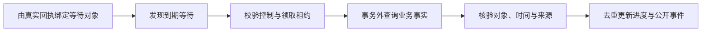

# 外部进度跟踪设计

## 等待记录与完成条件

事项等待业务系统、物流或处理方结果时进入 `waiting_external`，保存对象、申请号或运单、来源、实际阶段、下次查询时间与完成条件，不占用 ReAct 执行和模型额度。

完成条件由用户目标及有效原话决定：

| 用户目标         | 结束依据                                       |
| ---------------- | ---------------------------------------------- |
| 只提交申请       | 已核实的成功提交回执                           |
| 跟进退款         | 对应资金处理证据，说明渠道状态与银行入账的区别 |
| 查询指定物流     | 对应运单的进度；单票不能代表其他包裹           |
| 换货、维修或开票 | 核实相应子流程与交付范围，能力不足转人工       |

用户道谢、长时间不回复、模型生成了答复都不是业务完成证据。后来的跟进要求优先于此前“只提交”的范围。

## 查询与应用流程

`ExternalProgress` 从真实操作或查询回执创建 `task_external_waits`。只有用户、事项、订单及商品或运单范围一致时才绑定，无法覆盖的范围交人工。

每轮按数量上限领取到期记录；领取前检查新输入、归属澄清、事项版本、暂停和接管。查询在事务外执行，不调用模型、不准备或重试业务提交。

应用结果时再次核验租约、当前事项版本和控制状态。迟到查询不能覆盖已改变的目标或恢复已暂停的事项。

## 去重与事件顺序

`task_external_receipts` 按事项与稳定外部事件编号去重。记录业务来源时间与观察时间，重复结果不重复发布。

旧时间、更低阶段、来源切换或同一时间的冲突结果不直接覆盖进度，保留错误并重新核实。不能只用“后收到”判断业务更晚。

进度变更、事项版本、外部回执与公开通知在同一事务保存。已直接发布的外部进展不会再唤醒一次空的 Agent 执行，避免重复追问。

## 多商品与多包裹

售后申请、原发货、退货和补发包裹分别关联商品行和数量。只核实某个运单时，公开说明仅代表这一票。

退货仓库收货、商品验收、退款成功与换货补发签收是不同阶段。用户提出签收争议时同时保留系统状态与用户陈述，不以物流字段否定争议。

## 失败与恢复

等待安排、尝试次数、下次查询时间、租约及最近观察保存在数据库。进程退出后按到期安排继续，重复领取受租约约束。

超时、次数耗尽、期限已到、业务拒绝或来源无法核实时进入人工路径。等待和恢复只查询原对象，不重复提交申请，也不承诺尚未接入的离线推送。

## 代码入口

- [等待安排与轮询](../app/tasks/external_progress.py)
- [外部证据与完成判断](../app/tasks/external_evidence.py)
- [维护调度](../app/runtime/maintenance.py)
- [履约与处理方](../app/services/commerce/fulfillment.py)、[处理方接口](../app/services/commerce/providers.py)

业务提交与外部渠道任务的关系见 [业务操作与交易设计](业务操作与交易设计.md)。
