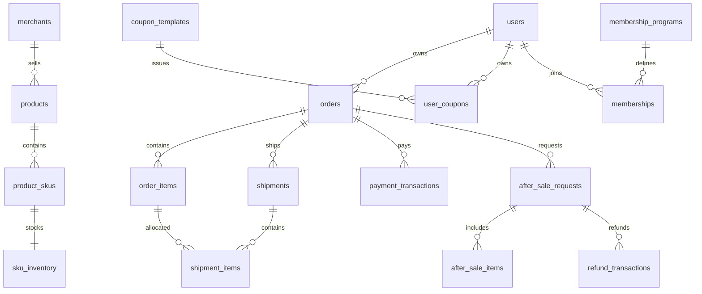

# 数据库表设计

## 存储边界

| 存储       | 数据职责                                         | 结构来源                                 |
| ---------- | ------------------------------------------------ | ---------------------------------------- |
| MySQL      | 账号、商品、订单、权益、售后与业务回执           | `app/data` 基础建表及 `migrations/mysql` |
| PostgreSQL | 会话、事项、关联、执行、确认、人工工单和 v3 记忆 | `SupportStore`、事项迁移与记忆 schema    |
| Redis      | 唤醒、共享额度、缓存与通知                       | `app/runtime`                            |
| Chroma     | 版本化政策向量索引                               | `app/rag`                                |

本地隔离测试可以使用 SQLite 承载 SupportStore。Redis、向量索引、模型摘要均不是订单金额或办理结果的最终事实来源。

## 公共建模约定

- `user_id` 是稳定内部身份，用户名、电话和平台昵称不能替代外键。
- 订单通过 `(platform_code, order_id)` 标识，外部订单号不保证跨平台唯一。
- 金额使用 `DECIMAL(12,2)` 并保存币种；数量为整数，程序校验累计占用与上限。
- 业务时间按 UTC 保存，接口携带可解释的时间信息，界面再转换为展示时区。
- 商品名、规格、成交价、优惠与地址保留下单时快照，后续资料变动不改写历史事实。
- 归属、金额、状态、幂等键和高频筛选字段使用普通列与索引；JSON 保存扩展属性和证据。
- 密码保存哈希，地址和业务敏感参数保存带版本密文；密钥不与业务记录混存。

## MySQL 领域模型

### 账号与用户资料

| 表                                  | 关键关系与约束                                                     |
| ----------------------------------- | ------------------------------------------------------------------ |
| `users`                             | `user_id` 主键，规范化用户名唯一；保存账号状态与会员展示摘要       |
| `user_credentials`                  | 一位用户一份密码哈希与修改时间                                     |
| `auth_sessions`                     | 哈希登录会话编号、用户、到期和撤销时间；与客服聊天会话分开         |
| `auth_login_attempts`               | 规范化用户名及失败窗口、锁定时间                                   |
| `user_profiles`                     | 展示资料与用户一对一                                               |
| `user_contacts`                     | 加密联系方式、查重摘要、密钥版本与验证时间                         |
| `user_addresses` / `address_labels` | 用户保存地址与可检索标签，软删除不影响订单历史快照                 |
| `user_platform_accounts`            | 已验证的平台账号绑定，平台与外部用户编号共同唯一                   |
| `user_roles`                        | 业务角色结构；人工客服当前授权来源为 PostgreSQL 的 `support_staff` |

### 商家、SKU 与库存

| 表                               | 关键关系与约束                                           |
| -------------------------------- | -------------------------------------------------------- |
| `merchants` / `products`         | 商家与商品；商品目录不挂某个用户                         |
| `product_skus`                   | 商品下的具体规格、标价与币种，商品内 SKU 编码唯一        |
| `sku_inventory`                  | 按 SKU 保存 `available_qty`、`reserved_qty` 和 `version` |
| `sku_price_history`              | 价格类型、金额、来源及适用时间，不用当前标价解释历史成交 |
| `sku_fulfillment`                | SKU 对应仓库、重量与来源                                 |
| `restock_plans`                  | 有来源的补货计划，不作为已经入库的事实                   |
| `inventory_reservations`         | 订单行、SKU、数量、状态和唯一请求号                      |
| `service_inventory_reservations` | 换货工单的 SKU 预留，与原订单库存预留分别核验            |

预留必须与库存数量变化在同一事务完成。退款不自动表示商品已入库；释放只能作用于可核实且仍被持有的预留。

### 订单、报价与履约

| 表                        | 关键关系与约束                                             |
| ------------------------- | ---------------------------------------------------------- |
| `orders`                  | 平台与订单号复合主键；保存用户、状态、金额、币种和关键时间 |
| `order_items`             | 购买行、SKU、规格快照、数量与成交分摊                      |
| `order_address_snapshots` | 按订单保存地址密文，不受地址簿修改影响                     |
| `order_address_changes`   | 原、新地址密文与唯一操作号                                 |
| `order_edit_details`      | 订单备注与待付款发票信息的加密内容，不代表正式开票申请     |
| `order_events`            | 订单业务事件与操作号去重                                   |
| `checkout_quotes`         | 不可变报价快照、摘要、所属用户与有效期                     |
| `order_expirations`       | 本地订单到期时间及处理状态                                 |
| `delivery_rules`          | 版本化地区、仓库、重量、费用和时效规则                     |
| `shipments`               | 订单包裹、承运商、运单、类型、发出和收货证据               |
| `shipment_items`          | 包裹与订单行的数量关系，补发可保存实际 SKU 与规格          |
| `shipment_events`         | 包裹轨迹、业务时间、来源事件及记录时间                     |

一单多行、一单多包裹、一个包裹多商品行分别建模。单票签收不自动等于整单收货；仅生成运单也不等于实际发货。

### 活动、优惠券与会员

| 表                                           | 关键关系与约束                                     |
| -------------------------------------------- | -------------------------------------------------- |
| `promotion_rules` / `promotion_scopes`       | 促销版本、优先级、互斥、可否叠券及适用对象         |
| `coupon_templates` / `coupon_scopes`         | 券模板、类型、领取条件、期限、总量与适用范围       |
| `user_coupons`                               | 本人持券的领取、占用、使用和失效状态               |
| `coupon_claim_rules`                         | 冻结领取时模板和范围，停发模板不抹除历史权益       |
| `coupon_redemptions`                         | 持券与订单的占用、核销、释放关系                   |
| `membership_programs`                        | 成长、付费或店铺会员体系及规则版本                 |
| `membership_levels`                          | 体系、等级与版本复合关系                           |
| `memberships`                                | 用户在具体体系中的身份，用户与体系共同唯一         |
| `membership_subscriptions`                   | 订阅有效区间、激活依据、方案快照及唯一请求号       |
| `membership_growth_ledger` / `points_ledger` | 成长与积分增减、来源事件及原流水引用               |
| `membership_events`                          | 等级或身份变化与采用的规则版本                     |
| `membership_benefits`                        | 等级版本下的权益、周期、额度及有效期               |
| `benefit_entitlements`                       | 用户、体系、权益族与周期唯一，已领数量不得超过额度 |

用户表中的会员字段用于展示，实际资格检查读取对应体系、有效身份、订阅和权益记录。券的可领取、已持有、可用于指定商品及允许叠加分别判断。

### 支付、售后与发票

| 表                                                | 关键关系与约束                                       |
| ------------------------------------------------- | ---------------------------------------------------- |
| `payment_transactions`                            | 关联原订单及用户，渠道交易号去重，保存真实渠道状态   |
| `after_sale_requests` / `after_sale_items`        | 售后类型、商品行、数量、请求金额、申请状态与处理阶段 |
| `after_sale_events`                               | 申请过程和操作来源                                   |
| `refund_transactions`                             | 关联售后与原支付，按渠道退款号去重                   |
| `return_authorizations`                           | 经核实的退货地址、承运商、材料与期限                 |
| `return_shipments` / `return_shipment_items`      | 退件运单、登记操作号及分包商品数量                   |
| `return_shipment_events`                          | 退回、签收、验货等逆向事实                           |
| `service_work_orders`                             | 换货、维修、价保及取消等处理子流程                   |
| `order_item_benefits` / `price_protection_prices` | 成交时权益和当前同口径可比价格                       |
| `invoice_requests`                                | 加密抬头、税号与申请状态                             |
| `issued_invoices` / `invoice_corrections`         | 正式票据、文件摘要及原票与更正申请关系               |

订单、售后、包裹和资金流水的状态分别保存。退款金额按商品、运费、历史退款与占用计算，渠道成功记录不替代银行卡到账核实。发票结构存在不代表已接通真实开票系统。

### 规则与恢复

`business_policy_versions` 按政策编号和版本保存可执行 JSON 规则、动作、平台、有效期与来源。规则版本与自然语言政策条款分开，未知或冲突规则不能直接放行。

`business_operation_receipts` 以 `operation_id` 保存动作、参数摘要和结果，业务变更与回执同事务提交。

`commerce_provider_requests` 保存处理类型、目标、加密参数、状态、请求号、租约与回执；`provider_mode` 固定该任务的渠道模式，`error_code` 保存未知结果、渠道切换或回执校验等错误。请求按稳定编号查询和恢复，不能凭接口超时断言未执行。

`simulated_provider_requests` 是模拟处理方的持久状态，以请求号为主键，保存用户、业务类型、目标、参数摘要、场景、阶段、下次推进时间、步进间隔和结果。它与应用侧渠道任务分开落库，可复现受理后丢失响应及重启恢复；同编号改变参数会拒绝。

[012_local_provider.sql](../migrations/mysql/012_local_provider.sql) 增加上述模拟表、渠道模式及错误字段，并为 `orders`、`after_sale_requests`、`invoice_requests`、`refund_transactions`、`issued_invoices` 增加默认关闭的 `is_demo`。演示来源贯穿订单、申请、资金和票据，不能仅凭完成状态当作真实资金或正式票据。该迁移不把普通订单改为演示订单，也不自动补建历史申请的渠道任务。

## 主要关系

该图表达业务关系；具体外键、可空性与索引以迁移 DDL 为准。服务层还需检查子记录的用户、订单和商品行一致性，已知编号本身不构成授权。

## PostgreSQL 运行数据

| 表组                                                                                                       | 职责                                         |
| ---------------------------------------------------------------------------------------------------------- | -------------------------------------------- |
| `support_conversations` / `support_events`                                                                 | 会话归属、控制版本、稳定事件序号与公开范围   |
| `conversation_tasks` / `task_sessions` / `support_task_messages` / `task_changes`                          | 事项、跨会话关联、消息来源与变更版本         |
| `message_intake_sessions` / `message_intake_items`                                                         | 接收和关联位置、请求去重                     |
| `association_runs` / `association_decisions` / `association_sources` / `association_clarifications`        | 批次决定、证据与归属澄清                     |
| `task_corrections` / `task_invalid_sources` / `task_provenance_users`                                      | 纠错、来源失效与用户来源修订                 |
| `runtime_jobs` / `task_execution_wakes`                                                                    | 执行请求、租约、预算与恢复唤醒               |
| `task_reply_items` / `task_reply_sessions`                                                                 | 回复覆盖与去重                               |
| `support_operations` / `support_operation_tasks` / `task_operation_proposals` / `task_operation_resources` | 操作状态、固定确认内容与共同资源             |
| `support_staff` / `support_tickets` / `task_handoffs`                                                      | 客服角色、工单与事项接管                     |
| `task_external_waits` / `task_external_receipts`                                                           | 外部轮询安排与结果去重                       |
| `memory_v3_users` / `memory_v3_records` / `memory_v3_forgets`                                              | 用户版本、记忆记录与遗忘屏障                 |
| `memory_v3_receipts` / `memory_v3_jobs` / `memory_v3_archives`                                             | 提取回执、后台任务与截止点归档               |
| `interaction_trace_events` / `interaction_trace_sessions`                                                  | 阶段记录与交互日志导出位置                   |
| `task_pipeline_state` / `task_pipeline_users` / `task_rollout_audit`                                       | 自动处理模式与控制审计                       |
| `media_assets` / `message_attachments` / `task_attachments`                                                | 私有图片资产、消息内顺序、事项关联与撤回版本 |
| `image_jobs` / `image_observations`                                                                        | 首次图片识别队列、租约与不可变观察           |
| `support_context_jobs` / `support_context_snapshots`                                                       | 短期摘要处理位置及带原话来源的快照           |
| `runtime_notifications` / `runtime_job_archives`                                                           | 待发布变更通知与终态执行大载荷归档           |
| `support_staff_audit` / `support_ticket_task_snapshots`                                                    | 客服授权审计及工单可读的事项快照             |
| `support_schema_versions` / `task_legacy_imports`                                                          | 支持库模块迁移登记与历史事项导入去重         |
| `conversation_task_choices` / `conversation_task_turns`                                                    | 旧事项选择与轮次兼容记录                     |

事项变更、来源、事件与相关回执共用事务。模型与外部网络调用不持有长事务，返回后再核验版本和控制权。

v3 的六张 `memory_v3_*` 表是当前记忆主路径。`agent_long_term_memory`、`agent_memory_items`、`agent_memory_item_users`、`agent_memory_batches`、`agent_memory_source_cursors`、`memory_evidence` 以及 `support_memory_jobs/support_memory_candidate_outcomes` 属于旧记忆兼容实现，不应与 v3 表混为同一套提交协议。审计器按独立 DSN 或默认 PostgreSQL 保存 `agent_audit_log`。

## 文件与索引控制数据

原图及归一化模型图保存在 `MEDIA_STORAGE_DIR`，数据库只保存资产定位、哈希、状态和关系；库备份不包含图片字节。实际图片字段、状态与目标设计的差异见 [图片处理与多模态上下文设计](图片处理与多模态上下文设计.md)。

政策发布在 Chroma 目录旁的 SQLite 文件保存 `releases/active_release/revoked_sources`，与 Chroma collection 一起构成可恢复索引。它不属于 PostgreSQL 运行库。Redis 中的唤醒、额度和缓存没有替代上述持久化数据。

## 结构来源与迁移边界

- [MySQL 迁移](../migrations/mysql)：业务结构及字段演进。
- [迁移调度](../scripts/migrate_mysql_business_schema.py)：基线建表与按版本执行。
- [账号表](../app/data/auth_store.py)、[订单基础表](../app/data/order_dao.py)、[商品基础表](../app/data/product_dao.py)。
- [SupportStore](../app/support/store.py)、[事项迁移](../app/tasks/migrations.py)、[记忆结构](../app/memory/v3/schema.py)。
- [图片表](../app/media/schema.py)、[短期上下文表](../app/session/short_term.py)、[通知表](../app/runtime/notifications.py)。

迁移建立结构，不自动复制某台机器的演示数据，也不把模拟支付记录转换为真实资金凭据。MySQL DDL 的恢复边界与业务 DML 事务不同，迁移状态通过版本表检查。运行与初始化命令见 [项目 README](../README.md)。

业务迁移 `--check` 只读检查已登记版本：齐全时退出码为 0，缺失时为 1；数据库连接或执行错误同样返回非零。完整镜像下的空库、重复迁移和启动门禁验收见 [配置与部署设计](配置与部署设计.md)。
