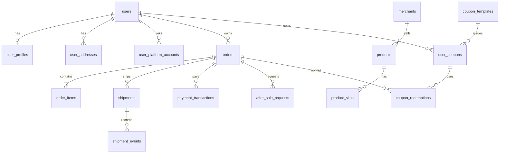

# MySQL 业务数据库表设计

本文定义电商客服项目的 MySQL 业务数据模型，供建表、迁移和接口改造使用。会员与优惠券的当前实现统一维护在本文第13、14节；商家商品、历史订单的数据来源与映射见第15节，售后履约见第16节，库存与报价首批落库见第17节，2026-10-25缺口补齐见第18节，取消及修改订单的最新实现见第19节。前文同时保留结构演进记录，阶段数量不应相加或当作最新总数。目标是让用户、商品、订单、支付、物流、优惠券和售后数据有明确的归属、状态与关联，客服工具能够按认证身份查询可靠的业务事实。

**实施状态：业务库66张表，001—011迁移均已执行并登记。** [迁移脚本](../scripts/migrate_mysql_business_schema.py)已完成新版建表和旧结构清理。`orders`旧列、`logistics`和旧版`commerce_*`表已删除；新版`commerce_provider_requests`承担外部业务处理请求，与已退役的旧表不同。工具使用目标业务表，配置见[工具实现说明](工具实现与运行配置.md)。发票相关表暂保留为空，按用户要求不补发票内容。下文“原有”指迁移前结构，“目标”指新版结构。PostgreSQL仍承载客服对话、事项、任务执行和审计等运行数据。

## 1. 当前结构与主要问题

### 会员身份更新（2026-10-25，迁移010）

已实施会员身份与演示数据：平台成长、VIP订阅、店铺会员三种体系独立。users新增会员平台、成长等级、VIP卡种、VIP起止时间和摘要更新时间六列；摘要只用于展示，资格以会员关系及订阅实时核实。William为铂金成长会员和有效年卡VIP。完整10人配置、表结构、有效期及能力边界见[第13节：会员身份与数据](#membership-model)。8项会员券权益已启用，领取和使用校验见第13、14节；季度自动重评和收费续费尚未启用。


### 优惠券现状（2026-10-25核对）

当前74个模板（67个active、7个inactive）、850条范围、113张持券与113条领取快照、3条订单用券记录（占用、释放、使用各1条，状态会随超时任务变化）；active不代表当前用户一定可领，还需核对时间、库存和会员资格。当前券种、额度、领取、使用和与淘宝规则的差异统一见[第14节：优惠券设计与数据](#coupon-model)。会员身份和已启用的会员券权益见[第13节](#membership-model)。

### 售后与多商品履约更新（2026-10-24，迁移 008）

已实施 `008_after_sale_fulfillment`：售后增加详细阶段 `stage` 与成功时间 `completed_at`；补发包裹通过 `shipments.after_sale_id` 显式关联售后，`shipment_kind` 区分原发货和换货，`receipt_confirmed_at` 区分确认收货与物流签收；包裹明细保存实际 SKU 和规格。退货授权支持多个寄回包裹，新增 `return_shipment_items` 记录各包裹的商品及数量。

商品明细分别查询原购买履约和售后进度。换货只发出时保持处理中，全部换货数量完成收货确认后才结束；多包裹及重复回执分别核验。完整字段、接口行为与两笔 William 样例见 [第16节：售后履约与多商品订单](#after-sale-fulfillment)。2026-10-24整理后为160笔订单、William 49笔；2026-10-25补充第17节交易样例后为170笔订单、William 50笔，旧原始订单保留。

### 订单状态更新（2026-10-24）

迁移 `006_order_statuses` 将订单 `completed` 改为 `received`，新增 `after_sale`；迁移 `007_pending_receipt` 将 `fulfilling`、`shipped` 合并为 `pending_receipt`，同步售后前状态和规则的订单状态列表，并更新 MySQL CHECK 约束。订单允许值为：`pending_payment`（待付款）、`paid`（已付款待发货）、`pending_receipt`（待收货，含备货与已发货）、`received`（已收货）、`after_sale`（售后中）、`cancelled`（已取消）、`closed`（已关闭）。是否真正发货以包裹记录判断，包裹的 `shipped` 状态保留。

`orders.status_before_after_sale VARCHAR(32) NULL` 保存进入售后前的主状态。存在待审核、已批准或处理中的售后申请时，订单进入 `after_sale`；所有申请结束后恢复原状态并清空该字段。新增／撤回售后与处理方回执更新都在同一业务事务内同步主状态，多个申请不提前恢复。售后期间的规则评估仍可依据保留的原状态判断资格，商品数量及退款额度继续按售后明细校验。售后申请自身的 `completed` 仍表示售后处理完成。

约束禁止非法主状态、售后中缺少原状态，以及非售后状态残留原状态。直接修改售后表的外部导入也必须同步订单；CHECK 本身不能替代跨表业务流程。后续如接入售后期间的发货或收货回执，应更新保留的基础状态，不能覆盖正在处理的 `after_sale`。

物流与订单主状态分开记录：

| 表 | 关键字段 | 含义 |
|---|---|---|
| `shipments` | `shipment_id`、`platform_code`、`order_id`、`carrier`、`tracking_number`、`status`、`shipped_at`、`delivered_at` | 一行一个包裹，订单可拆成多个包裹 |
| `shipment_items` | `shipment_id`、`order_item_id`、`quantity` | 包裹装了哪些订单商品、各多少件，同一明细可分包发货 |
| `shipment_events` | `event_id`、`shipment_id`、`event_time`、`status`、`location`、`description`、`source_event_id`、`recorded_at` | 包裹的揽收、运输、派送、签收等已采集轨迹，保留业务发生时间与本地记录时间 |

`shipments.status=delivered` 表示该包裹签收，不能自动等同于整单 `received`。整单收货需要确认收货或经过核实的整单完成收货规则。本次只调整状态模型，没有新增确认收货工具或物流接口。

原始 mall 导入批次有 18 个包裹、32 条包裹明细，源资料缺少逐站轨迹，因此未生成来源于承运商的轨迹。后续新增本地模拟包裹与明确标注的模拟轨迹，见[第15节](#catalog-order-data)与[第16节](#after-sale-fulfillment)。历史 `completed` 的 14 个 mall 订单同时有收货时间，迁移为 `received`。

| 范围 | 原有运行时表 | 当前结构与限制 |
| --- | --- | --- |
| 账号 | `users`、`user_credentials`、`auth_sessions`、`auth_login_attempts` | 已分开保存身份、密码哈希和可撤销会话；尚无资料、联系方式、地址和外部平台账号映射。见 [认证表定义](../app/data/auth_store.py)。 |
| 商品 | `merchants`、`products` | 商品只有一层 `product_id`；价格和库存位于商品行，尚未区分不同规格的 SKU。见 [商品表定义](../app/data/product_dao.py)。 |
| 订单 | `orders` | 主键为 `(platform_code, order_id)`；商品明细在 `items` JSON，金额只有 `total`，物流和退款状态也写在订单行。见 [订单表定义](../app/data/order_dao.py)。 |
| 物流 | `logistics` | 以 `(platform_code, tracking_number)` 为主键，轨迹在 `events` JSON；一单多包裹和包裹商品明细缺少独立结构。见 [物流表定义](../app/data/logistics_dao.py)。 |
| 业务证据 | `commerce_offers`、`commerce_promotions`、`commerce_coupons`、`commerce_delivery`、`commerce_price_history`、`commerce_after_sales`、`commerce_invoices`、`commerce_payments`、`commerce_order_policies`、`commerce_mutations` | 前九类共用 `platform_code、user_id、record_id、object_id、channel、region、recorded_at、is_demo、payload` 结构；业务字段主要在 JSON 中。`commerce_mutations` 保存写操作的幂等结果。它们适合当前证据和演示台账，但不等同于完整的领券、支付或售后交易模型。见 [通用台账定义](../app/data/commerce_dao.py)。 |

原有 `commerce_*` 记录使用 `VARCHAR(128)` 用户标识及空字符串表示公共规则，不能可靠映射到认证用户。按本次清理要求，这批旧记录不迁入新表；旧演示初始化入口已停用。

## 2. 建模约定

1. `users.user_id` 是系统内部稳定身份。用户名、手机号、邮箱和外部平台用户号均不能作为订单外键。新账号当前生成 32 位 UUID 十六进制字符串；旧账号保留原 `user_id`，所以近期继续使用 `VARCHAR(64)`。目标用户专属业务表的 `user_id` 与之保持相同字符集、排序规则和长度。
2. 平台订单继续用 `(platform_code, order_id)` 标识；外部订单号在不同平台可能重复。商品、包裹、优惠券实例和售后申请使用各自稳定 ID。迁移前不改变现有订单主键。
3. 金额使用 `DECIMAL(12,2)`，同时记录 `currency CHAR(3)`；数量使用非负整数。金额计算和优惠叠加规则由业务层明确，不能只信任前端或模型计算值。
4. 时间统一按 UTC 写入 `DATETIME(6)`，接口展示时转换时区。历史交易保存下单时的商品名称、单价、收货地址和优惠金额快照；之后修改资料或商品目录不能改写历史事实。
5. 高频查询与唯一性所需的字段使用普通列及索引。JSON 只保存不常筛选的原始证据或扩展属性，不承担用户归属、金额、状态、幂等键等核心约束。
6. 交易表默认禁止级联删除用户或订单，账号停用不删除交易历史。敏感资料按业务需要收集、限制读取；联系方式和地址中的敏感值应加密，密文应带密钥版本以支持轮换，密钥不放在同一数据库中；密码只保存哈希。
7. 以下字段为目标逻辑结构，`?` 表示可空。主键、外键和唯一约束列在“约束”栏；创建实际 DDL 时须统一 MySQL 字符集与排序规则，并先核对历史数据。[MySQL 外键约束](https://dev.mysql.com/doc/refman/8.4/en/create-table-foreign-keys.html)要求引用列具备兼容类型和索引。

## 3. 用户、身份与权限

`users` 保存稳定身份及会员展示摘要；密码凭证、登录状态、个人资料、平台账号、正式会员关系和客服角色分别管理。会员摘要不替代实时资格判断。

| 表及状态 | 字段 | 约束与用途 |
| --- | --- | --- |
| `users`（现有，保留） | `user_id VARCHAR(64)`、`username VARCHAR(64)`、`username_key VARCHAR(64)`、`status VARCHAR(16)`、`created_at DATETIME(6)`、`updated_at DATETIME(6)`；009增加 `newcomer_coupon_eligible BOOLEAN`，010增加六个会员摘要字段，详见第13节 | PK `user_id`；UNIQUE `username_key`；当前状态为 `active/disabled`。改用户名不能改 `user_id`。 |
| `user_credentials`（现有，保留） | `user_id VARCHAR(64)`、`password_hash VARCHAR(255)`、`changed_at DATETIME(6)` | PK/FK `user_id → users`；仅存密码哈希，不存明文。 |
| `auth_sessions`（现有，保留） | `session_hash CHAR(64)`、`user_id VARCHAR(64)`、`created_at`、`expires_at`、`revoked_at?`，后三者为 `DATETIME(6)` | PK `session_hash`；FK `user_id → users`；索引 `(user_id, expires_at)`；退出登录通过 `revoked_at` 失效。此表是**登录会话**，不是客服聊天会话。 |
| `auth_login_attempts`（现有，保留） | `username_key VARCHAR(64)`、`attempts INT`、`window_started_at DATETIME(6)`、`locked_until DATETIME(6)?` | PK `username_key`；限制连续失败登录。未注册用户名也可能产生记录，故不直接加用户外键。 |
| `user_profiles`（目标新增） | `user_id VARCHAR(64)`、`display_name VARCHAR(80)?`、`avatar_url VARCHAR(512)?`、`updated_at DATETIME(6)` | PK/FK `user_id → users`；仅放展示资料。暂不收集与业务无关的生日、性别等字段。 |
| `user_contacts`（目标新增） | `contact_id BIGINT UNSIGNED`、`user_id VARCHAR(64)`、`contact_type VARCHAR(16)`、`value_ciphertext VARBINARY(512)`、`lookup_digest BINARY(32)`、`key_version SMALLINT UNSIGNED`、`verified_at DATETIME(6)?`、`created_at DATETIME(6)` | PK `contact_id`；FK `user_id → users`；UNIQUE `(contact_type, lookup_digest)`。`lookup_digest` 对规范化值计算带密钥的 HMAC，便于查重，不存明文手机号或邮箱；只有完成验证的联系方式才可用于找回账号。 |
| `user_addresses`（目标新增） | `address_id BIGINT UNSIGNED`、`user_id VARCHAR(64)`、`recipient_name_ciphertext VARBINARY(512)`、`phone_ciphertext VARBINARY(512)`、`province_code VARCHAR(16)`、`city_code VARCHAR(16)`、`district_code VARCHAR(16)`、`detail_ciphertext VARBINARY(1024)`、`key_version SMALLINT UNSIGNED`、`is_default BOOLEAN`、`created_at DATETIME(6)`、`updated_at DATETIME(6)`、`deleted_at DATETIME(6)?` | PK `address_id`；FK `user_id → users`；索引 `(user_id, deleted_at)`。默认地址“每人最多一个”须在事务中保证；订单另存地址快照。 |
| `user_platform_accounts`（目标新增） | `id BIGINT UNSIGNED`、`user_id VARCHAR(64)`、`platform_code VARCHAR(16)`、`external_user_id VARCHAR(128)`、`verified_at DATETIME(6)`、`status VARCHAR(16)` | PK `id`；FK `user_id → users`；UNIQUE `(platform_code, external_user_id)`。只在平台身份被可靠核验后建立绑定；不能凭订单姓名或手机号猜测归属。 |
| `user_roles`（目标新增，需单独迁移） | `user_id VARCHAR(64)`、`role VARCHAR(16)`、`enabled BOOLEAN`、`granted_by VARCHAR(64)?`、`granted_at DATETIME(6)` | PK `(user_id, role)`；FK `user_id → users`。客服、管理员权限不能由注册请求自报。当前客服角色在 PostgreSQL 的 `support_staff` 中，迁移前仍以现有权限来源为准。 |

## 4. 商家、商品、规格与库存

商品目录是公开业务数据，不能强行挂某个 `user_id`。同一商品的不同规格需要独立 SKU，订单引用 SKU 并保留购买时快照。

| 表及状态 | 字段 | 约束与用途 |
| --- | --- | --- |
| `merchants`（现有，扩展） | `merchant_id VARCHAR(64)`、`name VARCHAR(128)`、`category VARCHAR(32)`、`description VARCHAR(512)`、`store_type VARCHAR(24)`（005新增）；目标增加 `status VARCHAR(16)`、`created_at DATETIME(6)`、`updated_at DATETIME(6)` | PK `merchant_id`。商家是商品和活动的经营主体；店铺类型与经营类目分开，取值及现有数据见第15节。 |
| `products`（现有，逐步调整） | `product_id VARCHAR(64)`、`merchant_id VARCHAR(64)`、`name VARCHAR(128)`、`category VARCHAR(32)`、`description VARCHAR(512)`、`specs JSON?`；现有 `price DECIMAL(12,2)`、`stock INT` 在迁移期保留 | PK `product_id`；目标 FK `merchant_id → merchants`，索引 `(merchant_id, category)`。清理现有空 `merchant_id` 后再加外键。 |
| `product_skus`（目标新增） | `sku_id VARCHAR(64)`、`product_id VARCHAR(64)`、`sku_code VARCHAR(64)`、`spec_values JSON`、`list_price DECIMAL(12,2)`、`currency CHAR(3)`、`status VARCHAR(16)`、`created_at DATETIME(6)`、`updated_at DATETIME(6)` | PK `sku_id`；FK `product_id → products`；UNIQUE `(product_id, sku_code)`。不同颜色、尺码等规格分别定价。 |
| `sku_inventory`（目标新增） | `sku_id VARCHAR(64)`、`available_qty INT`、`reserved_qty INT`、`version BIGINT`、`updated_at DATETIME(6)` | PK/FK `sku_id → product_skus`；库存扣减与预留在事务中校验版本和非负数量。 |
| `sku_price_history`（目标新增） | `price_id BIGINT UNSIGNED`、`sku_id VARCHAR(64)`、`price_type VARCHAR(16)`、`amount DECIMAL(12,2)`、`currency CHAR(3)`、`effective_from DATETIME(6)`、`effective_until DATETIME(6)?`、`source VARCHAR(64)` | PK `price_id`；FK `sku_id → product_skus`；索引 `(sku_id, price_type, effective_from)`。历史报价与当前价分离，避免用今天价格解释旧订单。 |

## 5. 订单、支付与退款

订单头保存总体状态与金额，商品行保存实际购买内容，交易流水保存支付及退款结果。订单归属使用 `user_id`；需要展示姓名时，从用户资料或订单地址快照读取。

| 表及状态 | 字段 | 约束与用途 |
| --- | --- | --- |
| `orders`（现有，已清理旧列） | `platform_code VARCHAR(16)`、`order_id VARCHAR(40)`、`user_id VARCHAR(64)`、`merchant_id VARCHAR(64)?`、`status VARCHAR(32)`、`currency CHAR(3)?`、`goods_amount DECIMAL(12,2)?`、`discount_amount DECIMAL(12,2)?`、`shipping_amount DECIMAL(12,2)?`、`payable_amount DECIMAL(12,2)?`、`paid_amount DECIMAL(12,2)?`、`created_at DATETIME`、`paid_at DATETIME(6)?`、`updated_at DATETIME(6)?` | PK `(platform_code, order_id)`；UNIQUE `(platform_code, order_id, user_id)` 供子表复合外键引用。用户和商家外键及部分非空约束待数据接入时收紧。旧 `user_name/items/total/tracking_number/refund_*` 等列已删除。 |
| `order_items`（目标新增） | `order_item_id VARCHAR(64)`、`platform_code VARCHAR(16)`、`order_id VARCHAR(40)`、`sku_id VARCHAR(64)?`、`product_id VARCHAR(64)?`、`title_snapshot VARCHAR(255)`、`spec_snapshot JSON?`、`quantity INT`、`unit_price DECIMAL(12,2)`、`discount_amount DECIMAL(12,2)`、`payable_amount DECIMAL(12,2)` | PK `order_item_id`；FK `(platform_code, order_id) → orders`；索引 `(platform_code, order_id)`。即使商品下架，历史行仍可展示。 |
| `order_address_snapshots`（目标新增） | `platform_code VARCHAR(16)`、`order_id VARCHAR(40)`、`recipient_name_ciphertext VARBINARY(512)`、`phone_ciphertext VARBINARY(512)`、`province_code VARCHAR(16)`、`city_code VARCHAR(16)`、`district_code VARCHAR(16)`、`detail_ciphertext VARBINARY(1024)`、`key_version SMALLINT UNSIGNED`、`captured_at DATETIME(6)` | PK/FK `(platform_code, order_id) → orders`。创建订单时复制地址，之后用户修改地址簿不影响旧订单。 |
| `payment_transactions`（目标新增） | `payment_id VARCHAR(64)`、`platform_code VARCHAR(16)`、`order_id VARCHAR(40)`、`user_id VARCHAR(64)`、`provider VARCHAR(32)`、`provider_txn_id VARCHAR(128)?`、`amount DECIMAL(12,2)`、`currency CHAR(3)`、`status VARCHAR(24)`、`paid_at DATETIME(6)?`、`created_at DATETIME(6)` | PK `payment_id`；FK 订单及用户；UNIQUE `(provider, provider_txn_id)`（仅非空交易号）；索引 `(platform_code, order_id)`。第三方支付回执才可确认为已支付。 |
| `refund_transactions`（目标新增） | `refund_id VARCHAR(64)`、`after_sale_id VARCHAR(64)`、`payment_id VARCHAR(64)?`、`provider VARCHAR(32)?`、`provider_refund_id VARCHAR(128)?`、`amount DECIMAL(12,2)`、`currency CHAR(3)`、`status VARCHAR(24)`、`requested_at DATETIME(6)`、`completed_at DATETIME(6)?` | PK `refund_id`；FK `after_sale_id → after_sale_requests`；可关联原支付；`(provider, provider_refund_id)` 对非空回执唯一。申请退款与退款到账是不同状态。 |

订单金额满足 `payable_amount = goods_amount + shipping_amount - discount_amount` 等业务规则；退款累计不得超过可退金额。金额规则涉及行优惠、运费和多次退款，不能仅靠数据库 `CHECK` 完成，需在同一事务中锁定相关订单及流水并校验。

同时含 `user_id` 与订单号的支付、售后、开票等子表，必须保证 `user_id` 与订单实际归属相同。可在 `orders` 增加 `(platform_code, order_id, user_id)` 唯一键并让子表使用同组复合外键；迁移前及不适合加外键的路径，仍要在事务中核验归属。

## 6. 发货与物流

一张订单可以拆为多个包裹，一个包裹可以包含多个订单商品行。轨迹事件独立保存以支持按时间查询和去重。

| 表及状态 | 字段 | 约束与用途 |
| --- | --- | --- |
| `shipments`（目标新增） | `shipment_id VARCHAR(64)`、`platform_code VARCHAR(16)`、`order_id VARCHAR(40)`、`tracking_number VARCHAR(64)?`、`carrier VARCHAR(32)?`、`status VARCHAR(32)`、`shipped_at DATETIME(6)?`、`delivered_at DATETIME(6)?`、`created_at DATETIME(6)`、`shipment_kind VARCHAR(24)`、`after_sale_id VARCHAR(64)?`、`receipt_confirmed_at DATETIME(6)?` | PK `shipment_id`；FK 订单；索引 `(platform_code, order_id)`；非空运单号按承运商、平台建立唯一约束前须核对复用规则。 |
| `shipment_items`（目标新增） | `shipment_id VARCHAR(64)`、`order_item_id VARCHAR(64)`、`quantity INT`、`actual_sku_id VARCHAR(64)?`、`actual_spec_snapshot JSON?` | PK `(shipment_id, order_item_id)`；FK 包裹和订单商品行；写入时校验商品行属于同一订单；原发货数量不超购买量，换货补发单独按售后数量核验。 |
| `shipment_events`（目标新增） | `event_id VARCHAR(64)`、`shipment_id VARCHAR(64)`、`event_time DATETIME(6)`、`status VARCHAR(32)`、`location VARCHAR(128)?`、`description VARCHAR(512)?`、`source_event_id VARCHAR(128)?`、`recorded_at DATETIME(6)` | PK `event_id`；FK `shipment_id → shipments`；索引 `(shipment_id, event_time)`；承运商事件 ID 用于幂等去重。 |

旧 `logistics` 与 `orders.tracking_number` 已删除。物流数据应写入 `shipments`、`shipment_items`、`shipment_events`。

## 7. 活动、优惠券与价格权益

优惠券模板、用户持券、领取快照、范围和核销的当前字段、约束及执行规则统一见[第14节](#coupon-model)。`promotion_rules` 保存无需先领券的促销规则，会员权益配置与资格见[第13节](#membership-model)。此处不再维护第二份优惠券定义。

## 8. 售后、发票与规则版本

| 表及状态 | 字段 | 约束与用途 |
| --- | --- | --- |
| `after_sale_requests`（目标新增） | `after_sale_id VARCHAR(64)`、`platform_code VARCHAR(16)`、`order_id VARCHAR(40)`、`user_id VARCHAR(64)`、`kind VARCHAR(24)`、`status VARCHAR(24)`、`reason VARCHAR(255)`、`requested_amount DECIMAL(12,2)?`、`created_at DATETIME(6)`、`updated_at DATETIME(6)`、`closed_at DATETIME(6)?`、`stage VARCHAR(32)?`、`completed_at DATETIME(6)?` | PK `after_sale_id`；FK 订单及用户；索引 `(user_id, created_at)`、`(platform_code, order_id)`。申请状态不代表退款到账。 |
| `after_sale_items`（目标新增） | `after_sale_id VARCHAR(64)`、`order_item_id VARCHAR(64)`、`quantity INT`、`requested_amount DECIMAL(12,2)?` | PK `(after_sale_id, order_item_id)`；FK 售后申请及订单商品行；支持部分商品、部分数量售后。 |
| `invoice_requests`（目标新增） | `invoice_id VARCHAR(64)`、`platform_code VARCHAR(16)`、`order_id VARCHAR(40)`、`user_id VARCHAR(64)`、`invoice_type VARCHAR(24)`、`title_ciphertext VARBINARY(1024)`、`tax_number_ciphertext VARBINARY(512)?`、`key_version SMALLINT UNSIGNED`、`status VARCHAR(24)`、`request_id VARCHAR(128)`、`created_at DATETIME(6)`、`issued_at DATETIME(6)?` | PK `invoice_id`；FK 订单及用户；UNIQUE `(user_id, request_id)`。本地申请与外部正式开票分别记录状态及回执。 |
| `business_policy_versions`（目标新增） | `policy_id VARCHAR(64)`、`version INT`、`action VARCHAR(32)`、`platform_code VARCHAR(16)`、`channel VARCHAR(64)?`、`rules JSON`、`effective_from DATETIME(6)`、`effective_until DATETIME(6)?`、`source VARCHAR(128)`、`status VARCHAR(16)` | PK `(policy_id, version)`；索引 `(action, platform_code, effective_from)`。规则版本必须可追溯，历史订单使用当时适用的版本。 |

## 9. 表间关系与查询边界



客服查询用户订单、券、支付和售后时，先以认证后的 `user_id` 限制业务范围，再按平台和业务编号查找。仅知道订单号、运单号或优惠券码不足以获得他人数据。公共商品、活动和政策无需伪造空 `user_id` 外键；它们与用户专属权益应分表。

## 10. 分阶段迁移与验收

执行 `python scripts/migrate_mysql_business_schema.py --dsn mysql://.../ecom_agent_orders`；`--check` 只读取 001–004 四个迁移版本。001 建立目标表，002 删除旧订单列、`logistics` 和全部 `commerce_*` 表。迁移不插入演示数据，也不把旧 JSON 台账转换为正式交易或权益。Compose 启动时自动执行同一迁移。重复执行安全；MySQL DDL 不作为单笔事务回滚，执行中断后重新运行即可继续。

后续工具改造按以下顺序进行：

1. 将订单、商品、物流、优惠券、支付、售后查询改为直接读取对应新表，统一以认证后的 `user_id` 校验归属。
2. 将领券、核销、支付回调、退款和售后写操作接入事务、幂等键和外部回执；按真实数据补齐订单与用户、商家的外键和非空约束。
3. 补充针对多商品、多包裹、部分退款、并发领券、过期券、跨用户访问和历史快照的回归测试。当前 48 个工具已通过新表访问，外部同步与处理方配置见工具实现说明。

MySQL 索引应按实际查询和写入量选择。[MySQL 索引说明](https://dev.mysql.com/doc/refman/8.4/en/optimization-indexes.html)


## 11. 核心工具配套表

[003_core_tools.sql](../migrations/mysql/003_core_tools.sql) 定义以下 7 张表。连同基础 31 张共 38 张业务与账号表，版本登记表另计。

| 表 | 字段 | 约束／用途 |
| --- | --- | --- |
| `business_operation_receipts` | operation_id, user_id, action, arguments_digest, result, created_at | operation_id 主键；记录同一事务中的最终业务回执，支持重放核实 |
| `promotion_scopes` | promotion_id, version, scope_type, scope_id | 四字段复合主键；外键绑定活动版本，提供确定的适用范围 |
| `coupon_claim_rules` | user_coupon_id, rules_snapshot, captured_at | 持券编号主键与外键；冻结领取时模板和范围 |
| `inventory_reservations` | reservation_id, platform_code, order_id, order_item_id, sku_id, quantity, status, version, request_id, created_at, updated_at | reservation_id 主键，request_id 唯一，quantity > 0；关联订单、商品行、SKU。取消前按行核实归属和数量 |
| `order_events` | event_id, platform_code, order_id, operation_id, kind, payload, created_at | event_id 主键，operation_id 唯一；业务操作事件 |
| `after_sale_events` | event_id, after_sale_id, operation_id, kind, source, payload, created_at | event_id 主键，operation_id 唯一；本地 submitted/cancelled 过程及来源 |
| `order_address_changes` | change_id, platform_code, order_id, operation_id, previous_ciphertext, replacement_ciphertext, key_version, created_at | change_id 主键，operation_id 唯一；加密保存旧、新地址，修改订单不覆盖用户地址簿 |

这些表的写入与所对应业务变更共用 MySQL 事务。PostgreSQL 的确认提案保存加密参数及脱敏摘要，不充当 MySQL 业务事实来源。状态和规则契约详见 [工具实现说明](工具实现与运行配置.md#3-可执行业务规则)。


## 12. 扩展工具配套表

[004_extended_tools.sql](../migrations/mysql/004_extended_tools.sql) 新增 19 张表，与 001–003 共存；已有订单、商品、售后、支付和发票申请继续作为主记录。

| 表 | 主要字段／关联 | 用途 |
| --- | --- | --- |
| address_labels | address_id 主外键；label、省市区名称 | 已保存地址的可检索标签 |
| sku_fulfillment | sku_id 主外键；warehouse_id、weight_grams、source | 配送所需重量与仓库 |
| delivery_rules | rule_id/version 复合主键；平台、商家、仓库、地区、首续重、费用、时效、有效期 | 可版本化配送计费；不接受模糊多规则匹配 |
| restock_plans | plan_id；sku_id 外键；计划入库／可售时间、来源 | 已记录补货计划 |
| membership_levels | 010改为体系／等级／版本复合主键；rank_value、growth_threshold、benefits、source | 冻结等级权益版本，详见第13节 |
| memberships | 010改为membership_id主键、用户／体系唯一；等级版本外键、有效期 | 分别保存成长、VIP和店铺身份，详见第13节 |
| points_ledger | entry_id；用户、平台、delta、来源、原流水引用 | 带来源去重的积分增减及撤销账本 |
| return_authorizations | authorization_id；售后申请唯一外键、地址密文、承运商、期限、来源 | 真实退货授权 |
| return_shipments | return_shipment_id；授权普通索引和外键；承运商／运单唯一；operation_id 唯一 | 同一授权可分多个包裹寄回（008） |
| return_shipment_items | 包裹／订单明细复合主键；售后／订单明细组合外键；quantity | 分包寄回的商品数量（008） |
| return_shipment_events | event_id；退件外键、状态、时间、来源 | 逆向物流及验收事实 |
| service_work_orders | work_order_id；售后申请唯一外键、类型、状态、details、外部回执 | 换货、维修、价保子流程 |
| service_inventory_reservations | work_order_id 主外键；sku_id、数量、状态 | 换货预留库存，拒绝／撤回释放，实际补发后消耗 |
| order_item_benefits | order_item_id 主外键；价保期限、可比口径、资格、来源 | 成交时承诺 |
| price_protection_prices | price_id；SKU、平台、币种、金额、可比口径、有效期、来源 | 当前可核实的同口径价保价格 |
| issued_invoices | issued_invoice_id；开票申请外键；票号唯一、文件键、摘要、状态 | 正式票据；独立于开票申请 |
| invoice_corrections | correction_id；原正式票和新开票申请外键；operation_id 唯一 | 原票作废／红冲与新票关联 |
| checkout_quotes | quote_id；用户外键、平台、预分配订单号、snapshot/digest、有效期 | 不可变完整报价；不占库存或券 |
| order_expirations | 平台／订单复合主外键；expires_at、status | 本地待支付订单超时释放 |
| commerce_provider_requests | request_id；订单／用户复合外键、kind、target_id、加密参数、状态、回执、租约 | 外部处理任务与恢复查询，避免超时后重复办理 |

金额继续使用 DECIMAL(12,2)，跨币种不隐式换算；时间统一 UTC。退货地址密文 AAD 为 `return-address:{authorization_id}`，处理方参数 AAD 为 `provider:{request_id}`。报价仅保存地址密文摘要，确认卡片私密内容随操作参数加密保存。

新查询与提交都校验用户归属；正式票通过开票申请关联用户。库存和券预留、业务事件、业务回执与订单在同一事务中提交。后台以父订单锁及请求租约协调，处理方凭 request_id 幂等。外部系统同步支付／发货／退款时须先锁相应订单，遵守同一状态与金额约束，不能绕过本地库存／券预留直接改状态。


<a id="membership-model"></a>

## 13. 会员身份与数据（迁移010）

实施日期：2026-10-25。迁移：`010_membership_programs`。

当前已落地会员身份、用户摘要、订阅期限、成长流水、权益配置及查询。本节与第14节共同说明会员和优惠券的现状，方案中尚未实施的内容不作为已开放权益。

### 13.0. 淘宝参考与本项目采用方式

淘宝在2025-08-06公布了青铜、白银、黄金、铂金、钻石、黑钻六级免费成长会员，与88VIP并存；官方88VIP开通入口区分年卡、月卡。本项目参考这种分层方式，分别保存平台成长、VIP订阅、店铺会员，月卡/年卡为期限套餐而不是成长等级。[淘宝大会员官方介绍](https://www.alibabagroup.com/zh-HK/document-1889827556354424832)、[88VIP开通协议及规则](https://terms.alicdn.com/legal-agreement/terms/c_platform_service_agreement/20230925145954208/20230925145954208.html)。

这是本项目实现，不是淘宝内部表结构。以下成长门槛、权益面额及演示授予均为本地配置，不代表淘宝实时权益。

| 会员体系 | 当前等级/套餐 | 资格与范围 |
|---|---|---|
| 平台成长 | 青铜、白银、黄金、铂金、钻石、黑钻 | 新注册默认青铜；成长值与消费积分分账 |
| 平台VIP | 一个VIP身份，monthly月卡/annual年卡 | 根据订阅有效区间及会员状态判断 |
| 店铺会员 | regular普通/advanced高级 | 各商家独立入会和有效期，不因拥有平台VIP自动加入 |

成长门槛依次为0、1,000、3,000、8,000、20,000、50,000。当前等级是演示授予；季度重评和真实订单自动计算尚未开启。

### 13.1. 十位用户

时间均为北京时间，有效区间采用“起始包含、结束不包含”。本批有效会员从2026-10-25 00:00开始；年卡到2027-10-25 00:00，月卡到2026-11-25 00:00。Sarah保留2026-08-25至2026-09-25的过期月卡样例。

| 用户ID | 用户名 | 成长等级 | 演示成长值 | VIP | 店铺会员 |
|---|---|---|---:|---|---|
| user_1 | William | 铂金 | 8,000 | 有效年卡 | 优选服饰高级、优选数码普通 |
| user_3 | James | 黄金 | 3,000 | 有效月卡 | 优选数码高级 |
| user_4 | John | 青铜 | 0 | 未开通 | 无 |
| user_5 | Michael | 钻石 | 20,000 | 有效年卡 | 无 |
| user_6 | David | 白银 | 1,000 | 未开通 | 无 |
| user_7 | Lily | 黄金 | 3,000 | 有效年卡 | 优选服饰普通 |
| user_8 | Emma | 铂金 | 8,000 | 有效月卡 | 优选数码普通 |
| user_9 | Sarah | 白银 | 1,000 | 月卡已于2026-09-25到期 | 无 |
| user_10 | Jessica | 黑钻 | 50,000 | 有效年卡 | 无 |
| user_11 | Olivia | 青铜 | 0 | 未开通 | 优选服饰普通 |

成长等级不是会员卡种：William同时是“铂金成长会员”和“年卡VIP”。十人的等级均有效至2027-01-01 00:00，届时需要重评；店铺会员样例有效至2027-10-25 00:00。

这些均为本地演示授予：`assignment_source=demo_assignment`、订阅 `activation_mode=demo_grant`、`payment_ref=NULL`。成长值通过 `demo_adjustment` 流水记录，不伪称由现有订单计算；不创建会员付款订单、不自动续费、不改变已有订单和优惠券。

### 13.2. users 新增的会员字段

| 字段 | 类型 | 含义 |
|---|---|---|
| membership_platform_code | VARCHAR(16), NULL | 用户主页默认展示的会员平台 |
| growth_level_code | VARCHAR(32), NULL | 当前成长等级摘要，如platinum |
| vip_plan_code | VARCHAR(32), NULL | 最近同步时有效的VIP卡种：annual/monthly；无有效VIP为NULL |
| vip_starts_at | DATETIME(6), NULL | 对应VIP有效期开始，存UTC |
| vip_expires_at | DATETIME(6), NULL | 对应VIP有效期结束，存UTC |
| membership_updated_at | DATETIME(6), NULL | 摘要同步时间 |

这六列是展示摘要；正式资格来源是会员关系和订阅表。日历推进不会自动改写摘要，会员查询及账号工具会实时核对期限、暂停状态和平台配置，不能仅用 `vip_plan_code IS NOT NULL` 判断VIP。后续订阅写入应在同一事务调用 `refresh_user_summary`。Sarah的摘要卡种为空，过期月卡历史在订阅表保留。

多平台、多个店铺会员不塞进users单字段；查询根据可信平台上下文读取对应关系。未指定平台时仍沿用项目现有平台选择规则。

### 13.3. 会员表

| 表 | 作用 | 关键字段/约束 |
|---|---|---|
| membership_programs | 会员体系 | program_id、platform_code、merchant_id、program_type、registration_default、rule_version、evaluation_rules；growth/paid/store |
| membership_levels | 等级配置 | 主键program_id+level_code+version；name、rank_value、growth_threshold、benefits、source |
| memberships | 用户会员关系 | membership_id主键；user_id+program_id唯一；level_code/version、starts_at、expires_at、status、growth_value、evaluated_at、next_evaluate_at、assignment_source、version |
| membership_subscriptions | VIP订阅历史 | subscription_id、membership_id、plan_code、starts_at、ends_at、status、activation_mode、payment_ref、plan_snapshot、request_id；请求号唯一 |
| membership_growth_ledger | 成长值流水 | user_id、program_id、delta、event_type、event_key、original_entry_id、订单/退款引用、effective_at、expires_at；program_id+event_key唯一 |
| membership_events | 身份变更历史 | membership_id、事件类型、原/新等级、生效/结束时间、reason、rule_version、request_id |
| membership_benefits | 可执行权益配置 | 体系与等级版本、benefit_family、period_type、quota、membership_check、rules、status、有效窗口 |
| benefit_entitlements | 用户周期权益 | user_id+program_id+benefit_family+period_key唯一；quota、claimed_count、有效期、权益版本及证据快照 |
| points_ledger | 原有消费积分模型 | 与成长值分账；本轮只补齐已有建表定义，不生成积分余额 |

本批：4个会员体系、11条等级配置、23条会员关系（10成长+7VIP+6店铺）、7条订阅、23条会员事件、8条非零成长值流水、8条已启用权益配置、22条本月周期权益实例（总额度36张，已领17张）。

原004格式的会员记录会迁到 `legacy_<platform>` 成长体系，保留原等级、期限和来源，不擅自解释为付费VIP；原会员查询仍保留 `membership` 字段兼容成长等级读法。新增 `growth_membership`、`vip`、`store_memberships` 提供完整事实。

### 13.4. 注册与查询规则

1. 配置中必须只有一个 `registration_default=true` 的有效成长体系；未配置时不伪造会员。
2. 注册成功时在同一数据库事务创建青铜会员与入会事件，写入用户摘要。失败会随注册事务回滚。单独运行认证数据库且没有会员表时，认证仍可使用。
3. 新账号不会自动成为VIP，也不会自动加入店铺会员；注册赠券资格与会员身份分开。
4. 生效判定为 `status=active AND starts_at <= now < ends_at`，并核对所属会员/体系的状态。账户被禁用也不可享有有效会员资格。
5. 到期、尚未生效、暂停、未开通分别返回。发生重叠有效VIP订阅时返回unknown，不任意选卡或重复发权益。
6. 店铺上下文仅展示该店会员，不能把甲店资格用于乙店；平台与用户所有权由SQL关联限制。
7. 订阅写接口尚未开放。未来续费必须先锁会员关系、检查区间重叠、承接当前结束时间，再保存订阅、事件和摘要；数据库已有请求幂等键，查询端对不合法重叠记录拒绝判断有效VIP。

`get_membership`同时返回成长等级、VIP当前订阅及历史、店铺会员和权益配置；`get_my_account`展示会员摘要时重新核实有效VIP。用户只能读取本人记录。

### 13.5. 会员与非会员的优惠差异：已启用

| 权益 | 配置 |
|---|---|
| 六级月度成长券 | 满200分别减10/15/20/25/30/40；每月1/1/2/2/3/3张 |
| VIP月度券 | 满200减50×2，满500减100×1；月卡、年卡共享权益家族 |

“未开VIP”用户仍可拥有成长等级；设计上成长权益与VIP额外权益并存，同月换卡不应重复发权益。目前普通用户与VIP领取现有6种活动券的金额没有身份差异，不能按年卡身份临时提高券面额。

以上8项均为 `status=active`，`rules.coupon_template_id` 已绑定具体平台券模板。22条2026-10周期权益已启用，总额度36张，17张已经通过真实领取事务生成持券及规则快照；剩余额度不是已持券。十位用户各领1张成长券，6位有效VIP各领1张满200减50，William另领1张满500减100，均为明确的模拟领取样例。

William本月额度为成长券2张、VIP满200减50券2张、VIP满500减100券1张，目前各领1张，合计已领3张、还可领2张。Sarah的VIP已到期，只能领取其成长等级券。

同一用户、体系、权益家族、上海自然月只存在一个额度账户。升级仅补当前额度与已领数量的差额，降级不能再领取超出当前等级额度的券；换月卡/年卡或换模板不重置已领数量。成长券只在领取时校验等级；VIP券领取和使用时都必须有唯一且有效的VIP订阅。券有效期不超过模板期限、本月结束和领取时会员有效期。

规则版本中保存季度重评、365天观察窗口和上海时区，但 `automatic_evaluation_enabled=false`。尚未接入收货/退款自动记成长值、季度重评任务和付费续费/退款。周期额度已支持领取时按需生成；每月券活动仍须显式配置，现有10月模板不会自动延长到下个月，也不自动替用户领券。现有成长值只用于演示，不可按旧RAG描述承诺积分倍率、免费运费险、专属客服或生日礼包已经开通。

### 13.6. 执行与验证

```powershell
.\.venv\Scripts\python.exe -B scripts/seed_memberships.py
.\.venv\Scripts\python.exe -B scripts/seed_memberships.py --apply
```

默认预览。脚本只应用会员所需010以及004中的三张基础会员/积分表，不将完整004冒记为已执行；010已注册到标准迁移入口。演示数据在同一事务写入，重复执行不续期、不增发、不覆盖用户后续变化，发现不完整批次拒绝继续。

已验证的范围包括：独立成长与VIP身份、固定生效/到期边界、已过期月卡、暂停状态、用户及平台隔离、新注册默认青铜、重复导入、重叠VIP记录返回未知、会员积分汇总兼容。测试使用可删除的隔离MySQL库；业务库应用前后核对密码、订单、订单商品和优惠券内容保持一致。

验证结果：4项隔离库集成测试通过。运行中的后端需重启才能加载新查询和注册逻辑；会员RAG源文档已更新，已有持久化向量索引需通过项目知识库入库流程更新，本轮未重建全部知识库索引。


<a id="coupon-model"></a>

## 14. 优惠券设计与数据（当前实现）

核对日期：2026-10-25。本节以MySQL和当前服务代码为准。活动金额为人民币，本节时间展示为北京时间，数据库保存UTC；到期时刻本身不再有效。

### 14.1. 淘宝参考与当前范围

淘宝公开有价券规则区分商品券、店铺券和赠品兑换券，并对领取/购买、适用范围和退款作具体约定；特定天猫品类券活动还定义合并支付及范围重叠时的叠加规则。本项目采用“模板—适用范围—用户实例—冻结规则—订单核销”的结构，当前仅实现商品金额券。不能把某个淘宝历史活动的叠加或返券规定当成所有券的通用规则。[有价优惠券购买规则](https://terms.alicdn.com/legal-agreement/terms/c_platform_service_agreement/20240131203313249/20240131203313249.html)、[2024年天猫家电品类券活动规则](https://terms.alicdn.com/legal-agreement/terms/b_end_product_protocol/20240105172611484/20240105172611484.html)。

| 维度 | 当前实现 | 限制 |
|---|---|---|
| 展示类型 | coupon_type=newcomer/shop/platform/category/general | 一列分类，尚未拆成发行方、人群、场景等可组合维度 |
| 优惠算法 | kind=amount_off/percent_off | 已包含满减、无门槛和指定SKU的9折封顶券；无门槛用门槛0表达 |
| 所属平台和店铺 | platform_code、merchant_id | 店铺券绑定商家；平台券也仍按单店购物清单试算 |
| 适用范围 | all/merchant/product/sku | 品类券按商品白名单展开，无独立类目ID树、排除列表或品牌范围 |
| 新人资格 | users.newcomer_coupon_eligible | 账号级首次注册权益，未实现实名防重复注册 |
| 会员券 | membership_benefits中8条active配置，绑定平台券模板与月度权益账户 | 成长券领取时校验等级，VIP券领取和使用时均校验有效订阅；当前为10月活动 |

新人、会员、品类、平台在业务上可以同时描述一张券；当前会员条件通过membership_benefits关联模板，与coupon_type分类独立；其他组合条件仍需明确实现，不能凭券名推断资格。

### 14.2. 优惠券表及主要字段

| 表 | 字段 | 关系与约束 |
|---|---|---|
| coupon_templates | coupon_id、coupon_type、merchant_id、platform_code、name、kind、currency、threshold_amount、discount_amount、discount_bps、cap_amount、total_limit、per_user_limit、claim_starts_at、claim_ends_at、valid_days、fixed_expires_at、status | coupon_id主键；merchant_id外键；总量可空但本批均明确限量；固定到期和领取后有效天数二选一，由领取服务校验 |
| coupon_scopes | coupon_id、scope_type、scope_id | 三列联合主键，coupon_id外键；all使用明确的`*`，不能把缺失范围当作全场 |
| user_coupons | user_coupon_id、coupon_id、user_id、status、claimed_at、expires_at、used_at、version | 持券ID主键；模板及用户外键；索引user_id+status+expires_at及coupon_id；每张实际券有独立状态 |
| coupon_claim_rules | user_coupon_id、rules_snapshot、captured_at | 持券ID主外键；冻结领取时模板和商品范围，模板后续改变不覆盖原金额及到期权益 |
| coupon_redemptions | redemption_id、user_coupon_id、platform_code、order_id、discount_amount、currency、status、request_id、created_at、released_at | 核销ID主键；券实例及订单外键；request_id唯一，记录占用/使用/释放 |
| business_operation_receipts | operation_id、user_id、action、arguments_digest、result、created_at | 复用的业务幂等回执，重复领取请求返回原结果 |
| promotion_rules / promotion_scopes | 活动ID与version、商家/平台、金额/比例、minimum_amount、优先级、互斥组、有效期、allows_coupon；范围表保存适用对象 | 满减等活动与券分开，活动需显式允许与券叠加 |
| business_policy_versions | policy_id、version、action、platform_code、rules、有效期、status | 复用的执行规则版本，当前mall_demo计价为mall_demo_coupon_pricing版本2 |

金额使用DECIMAL(12,2)，比例为整数基点；现有discount_bps表示减免比例，95折对应减免500个基点。时间为DATETIME(6)。模板不是用户持券，不能拿模板ID直接抵扣。

当前尚无独立coupon_campaigns、coupon_issue_batches、coupon_quota_counters、coupon_instance_events、order_discount_allocations等表。会员侧benefit_entitlements保存周期额度及已领数，已发券以user_coupons和领取快照为准。

### 14.3. 原有六种活动券

以下为原有六个模板的2026-10-25核对快照，每人累计限领1张，适用范围限制在mall_demo平台。新增活动见第14.9节，会员券的数量另按权益额度执行。

| 模板ID（rag_coupon_前缀） | 名称 | 范围 | 使用有效期 | 总量 | 已领 | 剩余 |
|---|---|---|---|---:|---:|---:|
| newcomer | 新人满50减10 | 首次注册资格用户、全场 | 领取后7天 | 100 | 0 | 100 |
| fashion | 店铺满100减5 | 优选服饰专营店 | 领取后7天 | 100 | 2 | 98 |
| digital_shop | 店铺满200减15 | 优选数码专营店 | 领取后30天 | 100 | 2 | 98 |
| platform_200 | 秋季大促平台满200减20 | 全场 | 2026-10-31 23:38:59.166374统一到期 | 200 | 2 | 198 |
| platform_500 | 秋季大促平台满500减60 | 全场 | 同上 | 100 | 2 | 98 |
| digital_category | 数码满1000减100 | 手机通讯、平板电脑、笔记本、硬盘的36个商品记录 | 领取后3天 | 100 | 3 | 97 |

平台券领取截止与固定到期相同；其他四种券领取截止为2026-11-23 23:38:59.166374，使用期限仍从实际领取时刻计算。领取截止不等于用户持券到期。

本批11张演示领取：William领服饰店券和数码品类券；James、Emma各领数码店券；John、Sarah各领满200减20平台券；Michael、Jessica各领满500减60平台券；David、Olivia各领数码品类券；Lily领服饰店券。调用真实领券事务写入，属于演示数据，不表示真实用户主动操作。

### 14.4. 五种历史券：停发但保留已领取权益

| 历史模板ID | 金额规则 | 范围 | 持券到期 | 已领 |
|---|---|---|---|---:|
| mall_demo_coupon_27 | 满100减10 | 全场 | 2026-11-23 00:00 | 10 |
| mall_demo_coupon_28 | 满1000减100 | 手机通讯27个商品记录 | 2026-11-23 00:00 | 10 |
| mall_demo_coupon_29 | 满4000减600 | 指定苹果商品6个记录 | 2026-11-23 00:00 | 10 |
| mall_demo_coupon_30 | 满2000减200 | 指定小米商品6个记录 | 2026-11-23 00:00 | 10 |
| mall_demo_coupon_31 | 满500减20 | 全场 | 2026-10-27 00:00 | 10 |

五个模板均为inactive，不能继续领取；即使总发行上限尚有余额也不能显示为可领。十个历史用户每种各持1张，共50张；原金额、范围和到期时间由领取快照保存，不因停发自动作废。当前全局计价策略仍由pricing版本2决定，领取快照尚未独立冻结一套完整叠加矩阵。

历史金额和范围适配自macrozheng/mall的sms_coupon及关联表，日期和用户分配为本地重建。固定源文本SHA-256为`fd68990fc1de8ebcb8e968f45a0a7cb4072a3dd2a54aaa4b278b72c4546e4488`；源sms_coupon_history的16条记录未导入，也未向历史订单倒填核销。具体解析与映射保留在[导入脚本](../scripts/seed_mall_coupons.py)。

### 14.5. 领取资格、上限与幂等

1. 用户身份来自登录上下文，查询和领取均核实所属平台及范围。
2. 模板须active且处于领取窗口；valid_days必须为正，fixed_expires_at须未过期。
3. `remaining_total = total_limit - 模板累计持券条数`，`remaining_user = per_user_limit - 本人累计领取条数`。已用、过期、失效券仍计入累计次数；物理删除实例会破坏统计，因此不应通过删券重置额度。
4. 领取事务先锁模板；新人券额外锁用户资格。首次通过注册创建账号时资格置true，领取新人券后同事务置false，跨新人模板也不能重复领取。历史导入十人默认无新人资格；退款、登录和券过期不重置。
5. 同事务写入实例、领取快照和幂等回执；会员券同时扣减周期额度并保存实例关联。失败整体回滚。相同请求编号及参数返回原券，不重复发放或扣额度。
6. 当前上限通过MySQL行锁和索引计数执行。会员券额外锁用户及周期权益，跨模板、跨等级共享同月权益家族额度；尚无活动金额预算、场次库存或积分兑换扣减流程。

品类范围在领取时冻结为商品ID白名单，新上架的同类商品不会自动加入旧券。当前平台券没有特殊商品排除配置。

### 14.6. 使用、促销叠加与退款

- 当前一次同商家、同币种试算最多使用1张本人可用券；不支持店铺券再叠平台券，不支持跨店凑单。
- 满减门槛按促销后、符合券范围的商品金额判断；优惠不超过适用商品金额，不拆分余额、不找零。
- 当前pricing版本2允许活动与券叠加，但实际活动必须显式`allows_coupon=true`；秒杀等特殊活动或未确认活动默认拒绝叠加。没有多券叠加矩阵。
- 试算必须显式提供持券引用，省略代表不用券；当前不会自动挑最优券，也不会自动领取模板。运费和最终应付额还需配送/结算规则。
- available为可用、reserved为占用、used为已使用，另有expired和invalid。查询依据expires_at判断过期，不依赖定时任务写状态。
- 未支付取消释放占用，券未过期可恢复使用；已支付订单发生售后退款，当前不恢复已核销券。尚未支持按模板配置整单返券、展期或多次部分退款后的返券。

这里的“一单一券、售后不返券”是当前项目限制，并非淘宝所有活动的统一规则。淘宝参考中的组合用券、按活动返券与优惠分摊仍需后续实现。

### 14.7. 会员券与普通券的关联边界

会员表记录“身份及计划权益”，user_coupons记录“已经领到的实际券”。两者不能混淆：William是年卡VIP，但当前钱包中的普通活动券金额不会因此自动增加。

成长等级月度券与VIP额外券已经按第13.5节启用。会员模板仍使用coupon_type=platform，资格从membership_benefits的模板绑定解析，不能只根据券名称放行。月度额度保存在benefit_entitlements，领取快照新增membership对象，冻结权益版本、体系、权益家族、月份、校验方式及额度账户ID。

get_membership返回周期额度与已领数量；list_claimable_coupons只列本人当前可领取的会员券。claim_coupon在事务中再次检查资格及额度；check_coupon、金额试算和下单重新计价都会校验VIP使用资格。会员暂停、到期或订阅重叠时拒绝VIP用券；已领成长券仍按领取时面额使用。取消订单或退款不重置月度已领次数。

店铺入会券、生日券、积分兑换券、补偿券、品牌券、运费券、渠道券、付费券包、赠品券、可拆余额红包均未在本库启用。会员价属于价格活动，不能直接当作优惠券；余额类资产需要独立账务设计。

### 14.8. 数据量、代码入口与后续范围

| 表 | 当前记录数 |
|---|---:|
| coupon_templates | 74（67 active、7 inactive） |
| coupon_scopes | 850 |
| user_coupons | 113（本轮核验时109 available、1 reserved、1 used、1 expired、1 invalid） |
| coupon_claim_rules | 113 |
| coupon_redemptions | 3（本轮核验时reserved、released、used各1条） |
| membership_benefits | 8（全部active） |
| benefit_entitlements | 22（额度36、已领17、剩余19） |

实现入口：[领取与业务写入](../app/services/commerce/writes.py)、[资格与计价规则](../app/services/commerce/rules.py)、[会员事实查询](../app/data/membership_store.py)。演示导入入口：[旧商城券](../scripts/seed_mall_coupons.py)、[现有四类券](../scripts/seed_rag_coupons.py)、[会员数据](../scripts/seed_memberships.py)。旧商城券重复导入会拒绝；后两脚本使用固定批次/请求标识，不自动延长有效期。

后续按需完成下月活动配置和定时发放、真实成长值入账及季度重评，再扩展同店组合计价和确定性择优；跨店结算、逐商品优惠分摊和可配置返券需要另行实现完整交易流程。本文不将这些目标列为已建表或已开放能力。

本次已更新数据库和会员券校验代码。以上数量为核对时刻快照，实际可用性始终以工具查询为准。第18节已用新建演示订单补入用券占用、释放和模拟支付核销；没有将普通历史订单倒填为使用新券。


### 14.9. 2026-10-25数据补全与旧数据修正

所有新增ID使用 `demo26_coupon_` 前缀，活动平台为mall_demo。没有新增来源辅助表或文档文件。

| 新增组别 | 模板数 | 规则及范围 |
| --- | ---: | --- |
| 店铺券 `shop_<merchant_id>` | 39 | 与原有2张店铺券一起覆盖41家店；每店单独绑定merchant范围，限领1张、总量100、领取后14天有效。数码家电满200、服饰居家满100、其他满50；具体减免以模板为准 |
| 品类券 `category_1`～`category_9` | 9 | litemall九类商品各一券，满100减10，商品白名单合计714行；总量150、限领1张、领取后7天有效 |
| 平台无门槛券 `platform_no_min` | 1 | 全场减5，总量200、限领1张、领取后7天有效 |
| 商品券 `product_shoes` | 1 | 优选服饰店的NIKE AIR MAX 90商品，满100减20，product范围，总量50 |
| SKU券 `sku_shoes_90` | 1 | 仅 `mall_demo_fashion_a_s163`，9折、最高减20元；discount_bps=1000，总量50 |
| 边界样例 `sold_out/scheduled/expired/invalid` | 4 | 分别为总量1且已领完、北京时间10月28日零点开领、已过期、持券已作废；后两模板inactive |
| 会员券 `member_<benefit_id>` | 8 | 六级成长券与两档VIP券，金额/数量按第13.5节；总量各100，10月券统一于北京时间11月1日零点到期，实际持券还受领取时会员有效期限制 |

除固定活动和边界样例外，本批普通券领取窗口为北京时间2026-10-25 00:00至2026-11-25 00:00，结束时刻不包含。金额均为模拟活动配置，不代表淘宝现行活动。

**普通券新增35张：** 十位用户各领取1张店铺券、1张品类券、1张无门槛平台券；William另领取商品券、SKU折扣券和限量券，并补充过期、作废各1张历史样例。前33张走真实领取事务，后2张明确记录为本地测试数据。

**会员券新增17张：** 十人各领1张成长券，有效VIP六人各领1张满200减50，William另领1张满500减100。William钱包现有18张券；James、Michael、Lily、Emma、Jessica各11张，John、David、Sarah、Olivia各10张。普通活动券不因会员身份临时变更面额，会员优惠来自独立的会员券实例。

**旧数据统一修正：** 核对原有11个模板和61张持券，实际修正9个模板、57份领取快照。mall的27、31号券归为platform，28号归为category，29、30号维持指定商品的general类型并明确名称；普通旧券统一每人累计限领1张。已领取金额、范围、有效期和持券人不变，5个历史模板仍停发。修改后的快照补齐coupon_type、名称和限领值，同时增加data_correction说明、递增持券version，并在现有business_operation_receipts记录修正回执。这是用户授权的演示数据纠正，不是允许日常修改模板追溯改变已成交权益。

已有脚本提供幂等入口（省略--apply为预览）：

```powershell
.\.venv\Scripts\python.exe -B scripts/seed_rag_coupons.py --normalize-existing --apply
.\.venv\Scripts\python.exe -B scripts/seed_memberships.py --enable-coupons --claim-examples --apply
```

会员启用命令要求事先准备并核对本批模板，拒绝自动延长已过期活动。重复样例领取复用固定请求ID，不增发、不刷新到期时间。领取及修正记录保存在业务表和幂等回执中；不创建额外来源表。普通领取33张加会员领取17张，共50张走领取事务，另2张为历史状态样例。

验证覆盖：店铺/商品/SKU范围、满减门槛、9折计算及封顶、总量与个人限领、过期/作废/未开始/领完、用户隔离、会员等级与VIP资格、同月跨模板并发限额、幂等与事务回滚。代码变化仅涉及会员券查询、领取和用券校验，没有修改订单或库存数据。本轮12项隔离MySQL集成测试通过；业务库重复执行修正与样例领取后，模板、持券、快照、周期额度和幂等回执均未变化。现有知识库源文档已同步，已建立的向量索引需通过项目入库流程更新。


<a id="catalog-order-data"></a>

## 15. 商家商品与历史订单的数据来源及映射

本节合并原商品、地址和订单导入记录中需要长期维护的内容。数量是截至2026-10-24已完成导入的记录，不会随文档阅读时间自动更新。所有演示店铺关系、报价及补充订单均为本地模拟数据。

### 15.1 来源、目标表与数量

源文件只解析数据，不直接执行上游建表或写入 SQL；脚本校验固定源资料，避免上游变更后静默导入不同数据。

| 资料 | 使用内容与筛选 | 目标表 | 本批新增 |
| --- | --- | --- | ---: |
| [mall 的 mall.sql](https://github.com/macrozheng/mall/blob/master/document/sql/mall.sql) | `pms_product`、`pms_brand`、`pms_product_category`、`pms_sku_stock`；38个商品排除18个已删除项，保留20个商品、96个SKU，分别配置3家店铺报价 | `merchants` / `products` / `product_skus` / `sku_inventory` | 14 / 60 / 288 / 288 |
| [litemall](https://github.com/linlinjava/litemall) 的 `litemall-db/sql/litemall_table.sql`、`litemall_data.sql` | 表定义用于识别字段顺序；解析商品、SKU、规格、属性、类目和制造商标签。239个商品排除1006010，保留238个商品、243个SKU，各配置3家店铺 | `merchants` / `products` / `product_skus` / `sku_inventory` | 27 / 714 / 729 / 729 |
| mall 的 `ums_member_receive_address` | 收货地址及其省市区名称 | `user_addresses` / `address_labels` | 5 / 5 |
| mall 的 `oms_order`、`oms_order_item` | 65笔订单排除17笔已删除订单及其明细 | `orders` / `order_items` | 48 / 77 |
| mall 订单内收货信息 | 成交地址快照 | `order_address_snapshots` | 48 |
| mall 订单付款时间、金额、支付方式 | 从历史订单派生付款记录，非真实支付网关回执 | `payment_transactions` | 34 |
| mall 订单发货、收货时间及承运信息 | 从订单级物流派生包裹和商品对应关系 | `shipments` / `shipment_items` | 18 / 32 |
| mall 导入事实与原始金额差异 | 保留导入事件及异常，不新建来源辅助表 | `order_events` | 48 |

两批商品导入合计 **41家店铺、774个店铺商品、1017个SKU、1017条SKU库存**。mall 源文件按去除UTF-8 BOM后的文本计算 SHA-256：`fd68990fc1de8ebcb8e968f45a0a7cb4072a3dd2a54aaa4b278b72c4546e4488`；litemall 两个源文件的校验值维护在导入脚本中。

### 15.2 店铺分类、规格与三店对比

- `merchants.store_type` 表示店铺类型：`flagship`旗舰店、`exclusive`专卖店、`specialty`专营店、`general`综合店。现有模拟数据为8家旗舰店、33家专营店；旗舰店名称不代表取得真实品牌授权。
- `merchants.category` 表示经营方向，与店铺类型独立。mall包含数码、服饰、家电经营方向；litemall覆盖居家、洗护、餐厨、婴童、杂货、饮食、服装、配件、志趣九类，每类配置拾光、宜选、悦享三家店。当前没有独立的店铺多类目关联表。
- 关联链为 `merchants → products → product_skus → sku_inventory`。每个店铺商品拥有自己的SKU和库存；`products.category` 保存末级类目，litemall完整类目路径另存商品JSON和描述。
- `products.specs.catalog_model_key` 关联同一来源目录商品的跨店副本。它不是GTIN，也不能证明不同来源的商品为同款；货比三家仍需核对完整SKU规格、币种及适用优惠。
- litemall的商品属性存入 `products.specs.参数`，同名属性存在多个值时保留数组。制造商标签不自动解释为已验证品牌。保留图片及画廊URL，不下载图片，不执行源详情HTML。
- mall商品标题中与具体SKU冲突的固定颜色、容量、鞋码已清理；源规格中误用的“颜色”等字段按原值含义纠正。未知CPU、内存、保修或运费不补造。仅有“标准”规格的商品不推断具体配置。
- 商品数据标记 `is_demo=true`、`specification_verification=source_example_unverified`。未补造销量、评分、历史价格、官方授权或服务承诺。

| 批次 | 三店价格 | 初始可用库存 |
| --- | --- | --- |
| mall | 品牌店用源SKU示例价格，优选店×0.97，惠购店×0.95，保留两位小数 | 每SKU确定性生成20～100；预占为0 |
| litemall | 拾光店用源SKU示例价格，宜选店×0.97，悦享店×1.02，保留两位小数 | `(源SKU ID × 7 + 店铺序号 × 31) mod 121`，0～120，包含缺货；预占为0 |

这些是测试报价，不是实时市场价或促销规则。`products.price/stock` 仅在导入时初始化为最低SKU价和库存合计，实时查询应读取 `product_skus` 与 `sku_inventory`。不同店铺标价不能直接解释为最终结算价差。

### 15.3 地址、订单与历史快照

原始48笔订单属于 William（`user_1`，40笔、3个地址）和 Olivia（`user_11`，8笔、2个地址）。后续模拟订单补齐十位用户，合计 **160笔订单、195条订单明细**：William 49笔、Olivia 15笔，James、John、Michael、David、Lily、Emma、Sarah、Jessica各12笔。用户主键保留源编号且去除mall前缀，不要求连续；当前没有 `user_2`。

1. 历史订单 `platform_code=mall_demo`，订单号保留源 `order_sn`。按商品经营方向映射到已存在的优选数码或优选服饰模拟店，并验证订单商家、商品、SKU一致；这不是源资料中的真实多店关系。
2. 商品名称、规格、数量、成交价保存在 `order_items` 快照中，不用当前目录覆盖。源明细 `real_amount` 为每件口径，目标明细应付为 `real_amount × quantity`，行优惠为 `(unit_price - real_amount) × quantity`。
3. 订单头保留源商品金额、运费、应付金额，优惠金额汇总源促销、积分、优惠券和后台调整字段。仅有付款时间的订单记录已付金额；历史付款记录不伪造支付网关交易号。
4. 地址ID使用 `700000000 + 源地址ID`，冲突或默认地址冲突时停止。姓名、电话、详细地址使用AES-GCM加密，按用户身份绑定AAD；订单地址独立存快照。省市区使用行政区划代码，名称存 `address_labels`，不能用邮编代替；未知地区映射停止导入。
5. 源订单时间约定按北京时间解释、转UTC保存。后续近期订单也是固定的真实日历时间，系统使用真实时钟；例如2026-10-18的样例以后不会自动成为“昨天”的订单，相关测试须按查询当日换算时间范围。
6. 历史订单导入不重复扣减当前库存，不生成新的支付、退款请求或超时任务。订单优惠金额不自动证明用户持有某张优惠券。
7. 原始物流只有订单级记录，因此创建的包裹与装箱关系是本地适配，不代表真实逐件装箱证据；没有源逐站轨迹时不冒充承运商轨迹。后续补充轨迹明确标记为模拟，按送货上门设计，无取件码和驿站数据。

**保留的源数据异常：**

- `mall_order_item_21`、`mall_order_item_26`、`mall_order_item_31`引用的源SKU 90在源SKU表中不存在。初次导入时`sku_id=NULL`；第18节已根据三条一致的原订单规格和SKU编码重建不可售的历史SKU并恢复关联，原始缺失事实仍保留在订单事件中。
- `201809150101000001`、`202002250100000004` 的“明细应付合计＋运费－订单应付”均为20元，“商品金额＋运费－头部优惠－应付”均为10元；`202005160100000001` 的前一差值为-0.01元、后一差值为0。原值和 `order_events.payload.amount_differences` 保留，这三笔不应直接作为严格金额一致的退款测试样例。

### 15.4 导入入口与重复执行边界

| 脚本 | 范围与前提 |
| --- | --- |
| [seed_mall_catalog.py](../scripts/seed_mall_catalog.py) | mall商家商品；需001业务表，按需执行005店铺类型迁移 |
| [seed_litemall_catalog.py](../scripts/seed_litemall_catalog.py) | litemall商品补充；需已有业务表及005字段，不自动改表 |
| [seed_mall_orders.py](../scripts/seed_mall_orders.py) | 历史地址、订单、付款与物流；需用户、目录及地址密钥，按需创建所用配套表，不将部分执行标记为整个003/004迁移完成 |
| [seed_recent_orders.py](../scripts/seed_recent_orders.py) | 近期模拟订单；具体数量及日期以脚本参数和执行批次为准 |
| [seed_william_after_sales.py](../scripts/seed_william_after_sales.py) | 两笔多商品售后订单及往返物流，见第16节 |
| [seed_william_tracking.py](../scripts/seed_william_tracking.py) | William近期订单的模拟物流轨迹补全 |

商品、历史订单脚本默认预览，`--apply` 才写入；已存在相应演示批次时拒绝覆盖。目标业务数据按事务写入，MySQL DDL单独提交，不能依赖数据事务回滚建表。操作前核对当前脚本参数、迁移和已有数据，不将种子脚本视为日常同步程序。地址密钥及其版本需持续保留，不能输出到日志或文档。

<a id="after-sale-fulfillment"></a>

## 16. 售后履约、往返物流与多商品订单

本节说明已实施的 [008迁移](../migrations/mysql/008_after_sale_fulfillment.sql) 及对应查询规则。字段总表见第6、8、12节；订单主状态见第1节。设计借鉴电商平台的部分售后、分包退回和换货流程，不声明与淘宝内部表结构一致。

### 16.1 售后、物流和收货的独立状态

- 售后类型包括 `refund_only`仅退款、`return_refund`退货退款、`exchange`换货；已有维修、价保子流程继续保留。`after_sale_requests.status=completed` 和 `completed_at` 表示成功结束，撤销、拒绝或关闭不等于成功完成。
- `stage` 描述处理阶段：`awaiting_review`、`awaiting_return`、`awaiting_collection`、`return_in_transit`、`inspecting`、`awaiting_replacement`、`replacement_in_transit`、`completed`。没有证据的旧记录保持NULL。
- 原购买商品履约和售后进度分开计算。某件商品售后不能让整单所有商品都成为售后中；订单级 `after_sale` 是聚合状态，使用 `status_before_after_sale` 保存基础状态。
- 物流签收 `delivered_at` 与用户确认收货 `receipt_confirmed_at` 分开。换货包裹仅发出时仍为处理中，全部换货数量确认收货后才完成；仅退款无需强制创建物流。

### 16.2 退回与补发的关系及数量约束

| 关系或字段 | 设计与处理规则 |
| --- | --- |
| 售后申请 → `after_sale_items` → 原订单明细 | 明确本次涉及哪些商品、各多少件；支持部分数量和部分金额 |
| 售后申请 → `return_authorizations` → 多个 `return_shipments` | 一个退货授权可分包寄回；授权外键不是唯一约束，承运商与运单组合用于去重 |
| `return_shipment_items` | 包裹与订单明细复合主键；通过售后与订单明细组合外键约束归属，记录每包数量，不超过授权剩余数量 |
| `return_shipment_events` | 每个退回包裹独立记录运输与验收进度，多包裹回执必须明确 `return_shipment_id` |
| `shipments.shipment_kind` / `after_sale_id` | `original`表示原发货，`exchange`表示换货补发；换货必须关联相应售后，可产生多个补发包裹 |
| `shipment_items.actual_sku_id` / `actual_spec_snapshot` | 保存实际补发SKU和规格；换尺码不覆盖原订单购买规格 |
| `service_inventory_reservations` | 分批补发仅消耗本次实际数量，仍预留的数量独立保留；补发数量从包裹记录统计 |
| `refund_transactions` | 独立记录退款结果及到账时间；退款不改写原支付金额 |

补发回执按售后、承运商及运单识别已有包裹，并校验SKU和数量，避免重复建包裹或重复消耗库存。模拟处理方不触发外部承运商请求或实际库存扣减。

### 16.3 查询与登记行为

- `get_order`、`get_order_items` 返回原购买 `fulfillment_status`、原发货/签收数量、未发货数量及售后列表；换货发出数量单独统计。缺少证据时不猜测履约状态。
- 明细售后汇总为 `none/processing/completed/closed`，存在活跃售后时优先显示处理中；列表保留各申请的类型、状态、阶段、数量及完成时间。
- `get_after_sale_status` 返回 `return_shipments[]`、`replacement_shipments[]`，包含商品和轨迹。兼容单值 `return_shipment` 仅在恰有一个退件时返回，否则为NULL。
- `prepare_return_shipment` 的可选 `items: [{order_item_id, quantity}]` 用于分包；省略时登记剩余全部未登记商品。已有旧退件缺少商品明细时停止并要求补齐证据，不能猜测剩余可寄数量。

### 16.4 William的两笔多商品样例

两单均属于 `user_1`、现有模拟服饰店 `mall_demo_fashion_a`，商品与原购买SKU均关联目录。以下为2026-10-24整理时的固定样例状态，日期按北京时间展示。

| 订单 | 下单时间 | 商品/件数 | 原支付金额 | 订单状态及基础状态 |
| --- | --- | --- | ---: | --- |
| `DEMO-WILLIAM-MULTI-1` | 2026-10-18 10:00 | 4种/5件 | 654.75元 | 售后中；基础状态待收货 |
| `DEMO-WILLIAM-MULTI-2` | 2026-10-17 10:00 | 4种/4件 | 461.72元 | 售后中；基础状态已收货 |

| 订单明细 | 商品及数量 | 履约与售后样例 |
| --- | --- | --- |
| `WM1-I1` | 海澜之家动物印花T恤×1 | 待发货，无售后 |
| `WM1-I2` | 海澜之家蓝灰花纹T恤×1 | 待收货，无售后 |
| `WM1-I3` | 海澜之家基础款T恤×1 | 已收货，无售后 |
| `WM1-I4` | NIKE ROSHE RUN×2 | 原购买已收货；退货退款处理中，分两个退件各1件，一件已验收、一件在途 |
| `WM2-I1` | 海澜之家动物印花T恤×1 | 仅退款20元完成，商品保留 |
| `WM2-I2` | 海澜之家蓝灰花纹T恤×1 | 退回已验收，退款85.36元完成 |
| `WM2-I3` | NIKE ROSHE RUN×1 | 38码换39码，退回已验收，补发在途，售后未完成 |
| `WM2-I4` | NIKE AIR MAX90×1 | 38码换39码，退回及补发收货均完成，售后完成 |

第二单原购买快照保留38码，补发明细保存实际39码；累计退款105.36元，原支付仍为461.72元。第一单展示同单商品的不同履约状态，第二单展示不同售后进度。William后续补全的物流事件均为模拟，送货上门，不增加“已到站”状态或取件码字段。

## 17. 库存、地址、报价与配送落库（2026-10-25）

本节记录本地`ecom_agent_orders`第一批补建7张表时的实施结果；当时仅执行所需建表语句，没有把整个004标记为完成。后续第18节已补齐剩余表并完成迁移登记，以下数量和未启动说明是首批阶段快照。

### 17.1 表、字段与实际数据量

| 表 | 主要字段及关联 | 本次写入数量与状态 |
| --- | --- | --- |
| `inventory_reservations` 订单库存预占 | `reservation_id`主键；`platform_code/order_id`关联订单；`order_item_id`关联明细；`sku_id`、`quantity`、`status`、`version`、唯一`request_id`、创建/更新时间 | 20条；16条`reserved`、4条`released`，每条1件 |
| `order_address_changes` 地址变更历史 | `change_id`主键；订单复合外键；唯一`operation_id`；`previous_ciphertext`、`replacement_ciphertext`、`key_version`、`created_at` | 2条，分别为William和Olivia的新订单；变更前后内容加密保存 |
| `checkout_quotes` 结算报价 | `quote_id`主键；`user_id`外键；平台与预分配订单号唯一；`snapshot`、`snapshot_digest`、`status`、`created_at/expires_at` | 20条；10条已下单`used`，10条未提交`active`，每人各1条；未提交报价10分钟后按时间失效 |
| `delivery_rules` 配送规则 | `rule_id/version`联合主键；平台、商家、仓库；省市区匹配条件；币种、首重/首费、续重/续费；最短/最长天数；来源、有效期、状态 | 41条，覆盖41家店铺；15家固定免运费，26家按重量计费 |
| `service_inventory_reservations` 换货库存预留 | `work_order_id`主键及工单外键；`sku_id`、`quantity`、`status`、`updated_at` | 3条；1条`reserved`，2条历史补发`consumed`，每条1件 |
| `sku_fulfillment` SKU配送资料（配套） | `sku_id`主键及外键；`warehouse_id`、`weight_grams`、`source`、`updated_at` | 1,017条，覆盖全部SKU；每店一个演示仓库 |
| `order_expirations` 支付期限（配套） | 订单复合主键及外键；`expires_at`、`status`；状态与期限联合索引 | 10条；8条`active`，1条取消后`inactive`，1条超时`expired` |

这里的地址变更表记录已经完成的变更，不是待审核改址申请。报价里的订单号为预分配编号，未提交报价没有对应订单是正常情况。报价快照包含商品、金额、规则、配送、券和地址摘要，不保存明文收件人、电话或详细地址。

### 17.2 演示规则与数据来源

- 用户、地址、商品、规格和价格全部取自现有业务表；没有新增用户或商品，也没有调用外部下单、支付或物流服务。
- 仓库、商品重量和配送费为本项目新增的模拟配置，`source`以`demo_fulfillment_20261025`标识。重量按类目设置，例如T恤300克、男鞋1,200克、手机500克、床品件套2,500克、家具20,000克；不是mall/litemall提供的真实包裹重量。
- 配送范围限定广东省`440000`，市区为通配符，覆盖目前13个地址；统一送货上门，预计1—3天。其他省份没有配置时返回规则不足，不能承诺可配送。
- 15家免运费店首费、续费均为0。其余26家首重1,000克6元，每增加不足或满1,000克均加2元。每个商家/仓库/地区只有一条有效规则；当前没有满额包邮、偏远地区加价或多规则优先级。
- 为`mall_demo`新增3条有效业务策略：`purchase`、`change_address`、`cancel_order`。新报价有效10分钟，新订单支付期限30分钟，改址与取消只允许待付款且未进入发货流程的订单。
- 本次通过现有Python业务服务生成报价、确认下单、改址、取消和超时关闭；批次业务写入在一个事务内完成。复用现有`business_operation_receipts`记录批次`demo_fulfillment_20261025`，其中保存10笔订单映射和数量；没有新增来源记录表。

### 17.3 订单和地址样例

10个用户每人新增1笔含2种商品的本店订单，共20条明细；商品来自其商家目录，规格保存于购买快照。所有订单金额均通过商品价格与配送报价计算，实付金额为0，本批未选择优惠券。业务库累计170笔订单、215条订单明细、16笔售后申请、3张服务工单。

| 用户 | 新订单号 | 写入后的状态及样例 |
| --- | --- | --- |
| William | `9e2369bcb4a34f1f99e06dce04d8917b` | 待付款，2件预占；地址700000001改为本人700000003 |
| James | `5b4f5934c8c84770a564233d9001cbaf` | 已取消，2件预占已释放 |
| John | `7f4b81e6b7b4461db85395c8775959cf` | 支付超时已关闭，2件预占已释放 |
| Michael | `f2143534650743e6b298bc15e2029a5c` | 待付款，2件预占 |
| David | `ef7fc7a381334a8ca3a364a4083bfd36` | 待付款，2件预占 |
| Lily | `80c732bcfb8c4365a95d9e42377d4feb` | 待付款，2件预占 |
| Emma | `094f440d150048d1b6d66a0c1ae9eaa9` | 待付款，2件预占 |
| Sarah | `72fcb2237d5744d6ae4465c514777a88` | 待付款，2件预占 |
| Jessica | `5ceadcd49a334e47813cb7326450808d` | 待付款，2件预占 |
| Olivia | `e5c1e3ae7cb743509097eba4924fb452` | 待付款，2件预占；地址700000005改为本人700000006 |

除John的超时样例外，使用执行时的真实时间。John的订单和创建事件设为执行前35分钟，支付期限为创建后30分钟，再调用实际超时关闭方法；重复调用不会再次释放库存。时间以UTC存储，展示转换北京时间。

两次改址均修改订单收货快照并保留加密历史，不修改地址簿。新旧地址均在同一运费规则覆盖区域，变更前核验运费相同；跨运费区域改址的重新计价不在本次样例范围内。

### 17.4 换货预留与库存口径

- `work_WM2-I3`、`work_WM2-I4`的替换商品已存在实际演示补发记录，分别补记SKU`s173`、`s165`（完整前缀`mall_demo_fashion_a_`）的1件`consumed`记录，时间取对应发货时间。它们属于历史事实补录，不再从本次可售库存扣减。
- 新增`demo26_inventory_exchange_work`，关联售后`demo26_inventory_exchange`、William近期订单`DEMO-RECENT-1-received`及其原商品SKU。样例为质量问题同规格换新，待审核，实际预留1件。订单转为售后中，基础状态仍为已收货。
- 新换货工单`source=local_demo`、`processing_mode=local_manual_demo`，没有伪造商家审核通过或退货授权，没有发送外部请求；后续审核、退回、补发需要继续接通处理流程。
- 写入后所有SKU合计：可售61,205件、预留17件，总计61,222件。预留数等于16件订单预占加1件换货预留；取消/超时释放的4件不再计入预留。库存的演示期初余额不是由全部历史采购、发货和退货流水推导的真实库存账。
- 同一SKU的订单预占和换货预留共同占用`sku_inventory.reserved_qty`；核对时只汇总两表`status='reserved'`的数量，不能累加`released/consumed`行。

### 17.5 验证和运行边界

已核验20份报价的摘要、商品金额与运费公式，2条加密地址历史与当前订单快照，20次跨用户报价访问拒绝，以及全部SKU预留汇总、明细归属和非负库存。下单、改址、取消均重放相同操作编号核验幂等，超时关闭核验重复释放保护。

另在独立临时MySQL测试库运行7项集成测试并全部通过，覆盖取消释放、地址历史与身份隔离、用券下单和超时释放、报价变化、并发争抢最后库存，以及换货库存生命周期；测试库结束后删除，未用业务库承载测试清理。

此前导入的19笔历史待付款订单仍保留导入状态，本批没有为它们补造当年的库存预占或自动关闭。它们不属于新增30分钟支付期限样例；后续如要全部纳入本地下单生命周期，需要单独制定历史订单清理或转换规则。

报价`status='active'`仍须结合`expires_at`判断有效性。8笔新待付款订单的30分钟期限已持久化，但本次未启动后台Worker；期限到达不代表已有常驻进程自动执行关闭。`commerce_provider_requests`等004剩余配套表及Worker启动仍需完成，真实支付、MQ、外部换货处理不因本次建表自动启用。

## 18. 业务缺口补齐与当前状态（2026-10-25）

本节更新第17节之后的实际状态。业务库现有65张表，001—010全部登记，SQL定义中没有缺失的目标表。新增数据批次为`demo_gaps_20261025`，记录在现有`business_operation_receipts`中；未新增来源辅助表。**用户明确暂停发票相关内容，本轮开票、更正与对应处理样例已撤回，未生成发票文件。**

### 18.1 缺口处理结果

| 原缺口 | 已完成的处理 | 当前数量或边界 |
| --- | --- | --- |
| 6张扩展表缺失 | 完整执行003/004剩余迁移并登记 | `commerce_provider_requests`、`restock_plans`、`order_item_benefits`、`price_protection_prices`及两张发票扩展表均已存在 |
| 3条订单明细没有SKU | 重新核对固定校验值的mall源SQL，按原订单信息重建历史SKU并关联 | SKU总数1,018，其中1,017个原目录SKU和1个不可售历史SKU；无NULL SKU明细 |
| 19笔历史待付款没有库存预占 | 核验无成功/进行中支付、无有效发货、已超30分钟，关闭订单并记清理事件与到期记录 | 不伪造历史预占，不凭空释放库存；剩余待付款均有对应有效预占 |
| 67个包裹没有轨迹 | 新增259条明确标记的模拟物流事件 | 81个包裹全部有轨迹，共347条事件 |
| 用券交易样例为空 | 新建3笔William用券订单，执行占用、取消释放和演示支付核销 | 3条`coupon_redemptions`；没有追溯修改旧订单用券情况 |
| 配送仅广东 | 按商家、仓库、省份补充不重叠规则 | 41家店×内地31个省级地区＝1,271条规则；未覆盖港澳台及境外 |
| 补货计划为空 | 为66个可售数≤10的在售SKU建立计划 | 每SKU计划补50件，预计执行后第3天到仓、第4天可售；尚未增加实际库存 |
| 价保权益和比较价为空 | 每条订单明细保存演示权益，每个在售SKU保存目录价快照 | 219条明细权益、1,017条价格依据；已验证一笔可申请17.65元的价保查询 |
| 积分流水为空 | 十位用户均有演示授予和调整，William另有冲正记录 | 21条流水，余额非负；不代表已启用真实消费积分奖励 |
| 外部处理请求为空 | 补录William已完成换货的本地演示处理记录 | 1条`completed`，关联`work_WM2-I4`；没有发出外部请求 |
| 超时处理未运行 | 启动本地Python后台进程，每10秒扫描，并实测到期自动关闭与释放 | 当前Windows进程运行；不是开机自启服务 |
| 发票内容 | 按用户最新要求暂停 | `invoice_requests`、`issued_invoices`、`invoice_corrections`均为0；没有票据文件 |

### 18.2 历史SKU和物流的可信边界

源SKU表仍然没有编号90；三个原订单行一致保存了源商品26、编码`201806070026001`、金色/16G规格和单价3,788元。新增`mall_demo_digital_a_s90_archived`，关联现有商品`mall_demo_digital_a_p26`，状态`inactive`、库存0。它用于解释历史购买内容，不进入在售商品供给；并非找到了已经缺失的原SKU库存记录。

补录物流保持原发货/签收时间及当前包裹状态。已签收包裹补充揽收、始发分拨、目的分拨、派送、签收；在途包裹不补造签收，只有发货事实的包裹仅记录揽收。每条描述均包含“模拟补录，非承运商实际轨迹”。原始样例中存在很长的发货到签收间隔，仍保留原边界时间，不应用于真实配送时效统计。

新增配送规则均为模拟配置。广东保留原规则，避免改变已有报价；普通外省预计2—5天，西藏、青海、新疆预计5—8天且使用首公斤12元、续公斤3元。所有配送均送货上门，不引入驿站或取件码。不能将这些模拟费率宣传为淘宝或承运商真实规则。

### 18.3 用券与超时样例

| 场景 | 订单号 | 行为 |
| --- | --- | --- |
| 用券待付款 | `7d38cd6ddad04798b427f66d1c5f38f0` | 2双NIKE AIR MAX90，占用库存和一张已有券；30分钟支付期限到达后由Worker释放 |
| 取消返还占用 | `d38e410214234847bcfc65e63d492dde` | 使用已有券下单后取消，库存恢复、用券记录released、持券恢复available |
| 演示支付用券 | `95b136d5e7f1466eae51c685ad88eb39` | 194元商品减5元，运费0，应付/演示实付189元；券used，2件库存预占转consumed，订单待发货 |
| 后台超时探针 | `5141f6a0c6aa4825b1ee595e36a3dec2` | Olivia的1件商品订单，演示创建时间设在约30分钟前；没有手动调用该单关闭方法，后台进程实际生成payment_expired事件并释放1件 |

支付记录`provider=demo_manual`，交易编号包含`demo_gaps_20261025`，订单事件标记`real_payment=false`。这是一次在事务内完成的模拟记账，未调用银行或支付平台，也不代表已经实现生产支付回调。尚未付款的占用状态会随真实时间和后台扫描变化。

此轮结束时共174笔订单、219条订单明细、24条库存预占、3条换货预留、24份结算报价、33条支付期限记录。库存核验时可售61,201件、预留19件，总计61,220件；较首批期初61,222件减少的2件对应上述模拟支付消耗，其他取消/超时仅在可售和预留之间转移。

### 18.4 运行和验证

已运行现有`scripts.commerce_worker`，后台扫描间隔10秒。可只读检查当前进程：

```powershell
Get-CimInstance Win32_Process |
  Where-Object { $_.Name -match '^python(w)?\.exe$' -and $_.CommandLine -match 'scripts[.\\/]commerce_worker' } |
  Select-Object ProcessId, ParentProcessId, Name
```

Windows虚拟环境启动器可能显示父子两个Python进程，不应据此重复启动Worker。电脑重启后如需手动恢复，可在项目目录运行：

```powershell
.\.venv\Scripts\python.exe -B -m scripts.commerce_worker
```

`--once`可执行单轮扫描。现有Docker Compose也有`commerce-worker`定义，但本轮使用本地虚拟环境启动，没有构建或启动整套Compose服务。

验收结果：目标表缺失0、订单明细缺SKU 0、包裹无轨迹0、待付款无有效预占0、库存预留差异0、每SKU省级配送覆盖异常0、订单明细缺权益0、未来物流事件0。另验证10人的积分查询、补货查询、价保正差额和后台自动到期关闭。相关现有隔离MySQL集成测试5项通过；其中票据访问回归仅使用临时测试库和临时文件，业务库发票内容按用户要求保持为空。

真实支付验签/查单/关单、真实商家和承运商接口、真实价保退款、自动积分奖励、RocketMQ与Outbox均未因演示数据填充而上线。历史订单原金额差异继续保留原始来源和第15节说明；这些样例不用于严格金额一致的退款验收。


## 19. 取消及修改订单规则对齐（2026-10-25，迁移011）

按 `cancel_order.md`、`modify_order.md` 实现，删除 `shipping_fee.md` 及其旧向量分块；实际配送费用继续查询 `delivery_rules`。

| 表／字段 | 作用 |
| --- | --- |
| `order_edit_details`（新增） | `(platform_code,order_id)` 主键及订单外键；`details_ciphertext MEDIUMBLOB` 保存加密备注和待付款发票信息，另有 `key_version`、`updated_at`。不是开票申请，不生成票据 |
| `order_address_snapshots`、`order_address_changes` | 同城改址与联系人变更只更新订单快照，保存加密的新旧地址历史，不修改地址簿 |
| `orders.shipping_amount/payable_amount` | 待付款同城改址时重新核算并在确认后更新；存在支付中／成功交易时阻断，不执行资金补退 |
| `after_sale_requests`、`after_sale_items` | `kind=order_cancel` 保存已付款取消申请，关联整单明细并阻止重复售后；初始 `pending_review`，不立即取消订单 |
| `service_work_orders`、`commerce_provider_requests` | `kind=order_cancel` 保存审核、履约停止、拒收退回验货和外部回执；沿用后台队列与幂等请求编号 |
| `refund_transactions` | 按原成功支付分配退款并预占，完成回执逐笔核验支付归属、渠道、币种、金额和时间，避免重复退款 |
| `business_policy_versions` | 011为已有本地取消策略生成新版本，允许待付款、已付款、待收货状态进入事实校验；实际已签收仍拒绝直接取消。没有本地控制权的平台不自动开通 |

修改权限：待付款允许同城地址、收货人联系方式、备注、发票信息；已付款待发货仅允许电话和备注；有实际发货记录后不能修改。运单仅创建不等于实际发货，但订单状态或资料不完整时仍需核实。各操作确认时重新锁订单并校验准备版本，返回幂等回执。

商品取消限制使用规格／商品JSON中的布尔 `cancel_allowed`。SKU配置优先于商品配置，精确分类“定制／定制商品／生鲜／生鲜食品”在未显式配置时默认不可取消；不从商品标题猜测。新订单将结果冻结到 `order_items.spec_snapshot.cancel_allowed`，历史订单无快照时检查当前商品配置。正式商品同步需补齐例外商品配置。

已付款未发货取消在审核后全额原路退款；已发货申请须逐包裹提供拒收、退回和验货回执，退款扣除原单运费。完成前订单处于售后中，只有审核、履约停止和全部原支付退款成功凭据齐全才改为 `cancelled`。已用优惠券不恢复；仅释放仍由本地完整持有的库存预留，不凭退款生成仓库入库记录。拒绝取消后释放退款预占并恢复原订单状态。

当前已执行011迁移，`mall_demo`取消策略更新至版本2。没有向业务库提交取消／退款样例，也没有生成票据；真实 `order_cancel` 处理渠道尚未配置，已付款取消准备会明确返回能力未接通。测试通过隔离MySQL库及模拟处理方回执验证，不代表真实支付渠道已上线。
