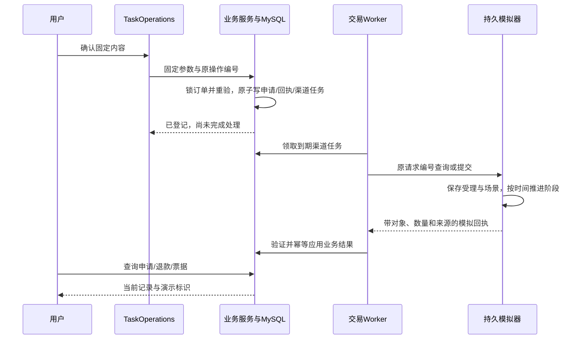

# 本地模拟渠道设计

## 实现范围与模块职责

当前已实现仅退款、退货退款和首次开票的本地模拟闭环。用户确认、申请持久化、渠道任务、后台推进、业务校验、查询、下载与人工接管使用项目的实际代码；审核、退款、物流和票据结果由持久化模拟器产生。

演示不发生真实资金流转、发货或正式开票。确认卡片、查询回执、人工交接、公开进度和文件均保留演示性质。模拟器与 HTTP 渠道使用共同的回执校验路径，渠道模式及处理结果分别持久化。

| 已实现业务 | 当前链路                                                                | 结果含义                     |
| ---------- | ----------------------------------------------------------------------- | ---------------------------- |
| 仅退款     | 申请确认 → 受理 → 模拟处理 → 匹配原支付的退款记录                       | 模拟退款完成，不是银行卡到账 |
| 退货退款   | 申请确认 → 退货授权 → 用户登记演示运单 → 模拟揽收/运输/收货/验货 → 退款 | 仅覆盖实际申请商品行与数量   |
| 首次开票   | 申请确认 → 模拟处理 → 演示 PDF → 记录与授权下载                         | 演示票据，非正式发票         |

当前模拟器不处理换货、维修、价保、取消、催单或发票重开；这些已有业务协议需要各自渠道配置。历史未创建渠道任务的申请不自动补发，不把已有非演示订单批量改为演示订单。

## 模块与数据

| 入口                                                                        | 职责                                                   |
| --------------------------------------------------------------------------- | ------------------------------------------------------ |
| [writes.py](../app/services/commerce/writes.py)                             | 在确认提交事务内保存申请、业务回执与渠道任务           |
| [standard_fulfillment.py](../app/services/commerce/standard_fulfillment.py) | 普通退款、退货退款和首次开票预检、资金占用及回执应用   |
| [providers.py](../app/services/commerce/providers.py)                       | 选择 disabled/simulator/http，检查任务绑定来源         |
| [simulator.py](../app/services/commerce/simulator.py)                       | 持久化模拟受理、场景和阶段；生成有明确标识的回执及 PDF |
| [fulfillment.py](../app/services/commerce/fulfillment.py)                   | 领取渠道任务、沿原请求号查询/提交、复核租约并应用结果  |
| [commerce_worker.py](../scripts/commerce_worker.py)                         | 扫描到期订单及持久化渠道任务                           |
| [external_progress.py](../app/tasks/external_progress.py)                   | 对明确进入等待的事项读取业务结果，发布进度             |
| [InvoiceDocuments.jsx](../frontend/src/InvoiceDocuments.jsx)                | 查询开票申请进度并展示有权下载的文件                   |

[012_local_provider.sql](../migrations/mysql/012_local_provider.sql) 建立 `simulated_provider_requests`，按请求号保存用户、业务类型、目标、参数摘要、场景、阶段、下次推进时间、步进间隔和回执。它表示模拟处理方的受理状态；`commerce_provider_requests` 表示应用侧待处理任务，两者分别保存才能复现“处理方已受理但应用未收到响应”。

迁移还增加任务的 `provider_mode/error_code`，以及订单、售后、开票申请、退款和票据的 `is_demo`。历史订单默认非演示，历史渠道任务绑定 HTTP；迁移可中断后按结构检查重入，不能据此推断历史资金或申请已经处理完成。

## 确认、提交与后台推进



申请与后续任务在同一业务事务创建；提交成功只表示申请已登记。外部进度跟踪只读取结果，不承担处理方推进。没有开启持续跟踪的事项也可通过用户主动查询取得进度。

模式在准备内容和任务中绑定。模式改变后，旧任务不能切换处理来源；来源不匹配写入任务错误并阻止继续处理，恢复原模式后才能继续。HTTP 失败不会自动改用模拟器。

## 模拟模式与场景

`COMMERCE_PROVIDER_MODE` 支持：

| 模式        | 当前行为                                              |
| ----------- | ----------------------------------------------------- |
| `disabled`  | 不启用处理渠道，准备阶段明确不可用                    |
| `simulator` | 只处理明确标记的演示订单及三种已支持业务              |
| `http`      | 按 `COMMERCE_PROVIDER_CONFIG` 使用对应固定 HTTPS 网关 |
| 空值        | 兼容已有部署：存在非空渠道配置时选 HTTP，否则禁用     |

模拟提交检查 `orders.is_demo`、用户、订单和请求号；HTTP 普通退款/首次开票路径拒绝演示订单。模型不能通过传参选择渠道、场景或模拟成功结果。

`COMMERCE_SIMULATOR_SCENARIO` 可选 `success`、`reject`、`delay`、`lost_response`。场景和 `COMMERCE_SIMULATOR_STEP_SECONDS` 在处理方首次受理时冻结，后续修改配置不改变已受理请求。

- `success`：受理后逐步推进到完成。
- `reject`：模拟审核拒绝，释放对应退款占用，查询保留拒绝结果。
- `delay`：首次推进等待扩大为步进间隔的 6 倍，后续仍受持久化时间控制。
- `lost_response`：先提交模拟受理记录，再抛结果未知；下次按原编号查询恢复。

重复请求核对固定参数摘要。重启后继续读取持久阶段，不因进程内状态丢失重新创建申请。

## 退款、退货与金额校验

准备普通售后时，服务端核验真实存在于业务库中的原成功支付及渠道流水、币种、已有退款占用和可用额度。仅有订单 `paid_amount` 不足以提交退款；不能由模型指定任意退款金额。

结果应用时重新检查申请、用户、订单、原支付、商品行与数量、金额、币种及时间。缺少或不一致的完成证据不会因 `status=completed` 而被接受；应用失败回滚业务变更并保留待核实任务。

退货退款先取得演示退货授权，用户再经正常确认入口登记 `DEMO` 承运商和演示运单。模拟器逐步产生 `collected → in_transit → received → accepted` 逆向事件，按申请商品行汇总验收数量；未覆盖全部申请数量时不完成退款。支持分包登记，部分收货或退款不能被渲染为整单完成。

演示地址和运单只用于本地流程，界面与材料明确提示不要实际寄件。

## 演示 PDF 与下载

首次开票使用独立 `invoice` 处理类型，不借用发票重开的原票作废条件。票据关联原申请与订单，金额、币种和抬头摘要需匹配已确认内容。

模拟器用 ReportLab 生成 PDF，明显标注“演示票据，非正式发票”。文件按稳定请求号生成路径和确定性内容，写临时文件、刷盘后原子替换；重试遇到已有文件先比较 SHA-256，不能用新内容静默覆盖。

文件先生成并通过校验，再公布票据记录与可下载状态。文件写入后、数据库提交前中断，可沿同一请求重新校验并复用文件。文件缺失、摘要错误或归属不符时明确拒绝下载。

`GET /api/commerce/invoice-requests/{invoice_id}` 返回本人申请状态及票据摘要，确认卡片组件每 5 秒轮询，终态停止；`GET /api/commerce/invoices/{issued_invoice_id}/document` 逐次核验本人申请、文件状态、私有根目录、格式与摘要。当前文件根目录由 `COMMERCE_INVOICE_ROOT` 指定。

## 本地运行

依赖安装与数据库启动见 [项目 README](../README.md)。在 API、事项 Worker 和交易 Worker 的同一环境配置：

```dotenv
COMMERCE_PROVIDER_MODE=simulator
COMMERCE_SIMULATOR_SCENARIO=success
COMMERCE_SIMULATOR_STEP_SECONDS=10
COMMERCE_INVOICE_ROOT=D:/GitHub/ecom-customer-service/data/demo-invoices
```

容器内使用 `/app/data/demo-invoices`，API 和交易 Worker 需访问同一持久卷。先应用全部业务迁移，再通过应用注册演示账号，使用稳定 `user_id`：

```powershell
python -m pip install -r requirements.txt
python scripts/migrate_mysql_business_schema.py
python scripts/demo_commerce.py --user <user_id>
python scripts/commerce_worker.py
```

种子脚本只新增 `demo` 平台的三笔演示订单、商品行及原支付记录，不改写已有订单。输出的对象用于在实际界面发起申请并确认。纯脚本复现可显式加 `--submit`，直接经业务 `preview/submit` 创建三类申请并推进一次 Worker；它不代替聊天界面的确认流程。

仅退款和首次开票由 Worker 继续轮询推进。退货退款受理后查询 `get_return_instructions`，登记演示运单并继续推进。异常场景需修改配置后创建新申请；历史无渠道任务的申请不自动补发。

## 测试入口

[test_local_provider.py](../tests/test_local_provider.py) 使用一次性 MySQL 数据库，覆盖正常提交、三种业务、重复确认、Worker 竞争、受理后响应丢失、重启恢复、错对象/金额回执、文件中断、下载权限及人工接管。前端确认卡和工单展示分别见 [confirmed-operations.spec.js](../frontend/tests/browser/confirmed-operations.spec.js)、[human-handoff.spec.js](../frontend/tests/browser/human-handoff.spec.js)。

```powershell
$env:CORE_TOOLS_TEST_MYSQL_ADMIN='mysql://<test-admin>:<password>@127.0.0.1:<port>/mysql'
$env:API_AUTH_BACKEND='env'
python -m pytest tests/test_local_provider.py -q
```

这些测试通过隔离业务库与模拟处理方验证本地处理链路、回执校验、文件授权和故障恢复。容器装配与持久卷检查见 [配置与部署设计](配置与部署设计.md)。
