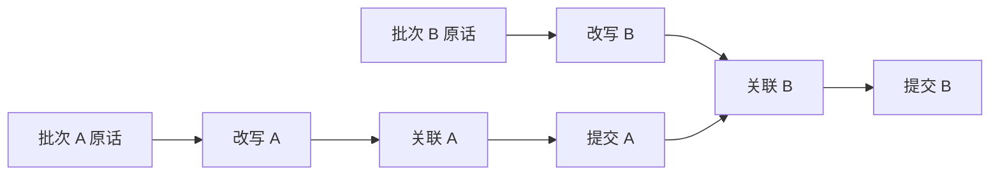

# 消息接收与查询改写设计

## 接收契约

`POST /api/v1/task-messages` 接收 `session_id`、`request_id`、`message` 与有序 `attachment_ids`，也支持结构化控制参数。文字最多 4000 字符、附件最多 4 张，允许纯图片消息。用户身份由认证上下文注入，服务端检查会话归属；请求与响应概览见 [HTTP接口与事件协议设计](HTTP接口与事件协议设计.md)。

`MessageIntake.receive` 在一个事务中保存原始消息、请求回执、接收位置与 Outbox 唤醒。只有事务提交后才返回已接收。数据库不可用时不返回成功。

同一用户范围内，相同请求编号和相同内容重试返回原结果，同编号改变会话、文字、附件顺序或控制内容被拒绝。文字相同但编号不同的消息分别保存。客户端网络结果未知时继续使用原编号。

## 消息位置与批次

接收位置、完成关联的位置、事项执行和回复发布分别记录。事件序号之间可能夹有其他事件，不能用数字不连续推断丢失消息。

Worker 领取有上限的待处理消息，固定本批的原话与历史范围，并持有期限内的领取凭证。领取后到达的消息进入后续批次。`complete` 只接受当前凭证和完整范围，不能越过尚未处理的消息。

含图片时只领取识别已终态的连续消息前缀。成功、失败或取消均可解除对应图片的识别等待，仍在 `pending/running/retrying` 的图片阻止后续普通消息越过；失败只允许以“未识别”进入澄清，不能补造观察。`ConversationWorker` 内部持有独立 `ImageWorker` 队列与线程池，不需要另起一个图片命令行进程。

`GET /api/v1/task-messages/{session_id}` 返回接收与处理位置。`pending`、`associated`、`clarification`、`control` 描述消息的处理状态，不代表业务完成。

## 查询改写

改写输入包含本批原话和必要的近期公开对话，尤其是客服实际提出的问题及选项。改写结果是自然语言检索辅助，原话保持不变。

改写保留全部诉求、对象、否定、疑问、限制和前后更正。例如“换不了再退”保留条件关系，“能不能退款”保留咨询语义。无法确定的指代保持不确定，不补造订单或操作授权。

超时、异常、空输出或不符合自然语言契约的输出会回退原话。改写及原始历史快照存入关联任务的 `runtime_jobs.payload.query_rewrite`，重试沿用相同批次范围。

## 顺序与提前改写

同一会话的关联按批次顺序读取最新事项并提交；上一批关联期间，可以提前改写下一批。提前改写不持有消息处理权，也不能提前提交事项。

`QUERY_REWRITE_PREFETCH` 控制提前改写。每个 Worker 使用有上限的线程和会话缓存，仅在原话、历史与范围一致时复用结果。缓存丢失或不同 Worker 重复只读改写不改变提交唯一性。

## 持续输入与恢复

新消息尚未关联时，当前用户相关机器人执行在步骤边界等待，回复与确认入口也检查输入屏障。已发出的调用可以返回，但旧计划不能直接启动后续步骤。

关联期间进程退出后，新 Worker 根据数据库中未完成范围和过期租约重新领取；旧处理器不能回写。Redis 唤醒只是通知，消息及恢复依据始终保存在数据库。

明确转人工和结构化控制请求由控制入口受理；对象不明的自然语言停止请求仍需关联，不能凭模糊词语取消任意事项。

## 代码入口

- [消息 API](../app/api/task_messages.py)
- [接收与批次](../app/tasks/intake.py)
- [改写模型](../app/agents/query_rewrite.py)、[提示词](../app/prompts/query_rewrite.py)
- [提前改写](../app/tasks/rewrite_ahead.py)
- [会话 Worker](../app/tasks/conversation_worker.py)

后续处理见 [事项关联与纠错设计](事项关联与纠错设计.md)。
