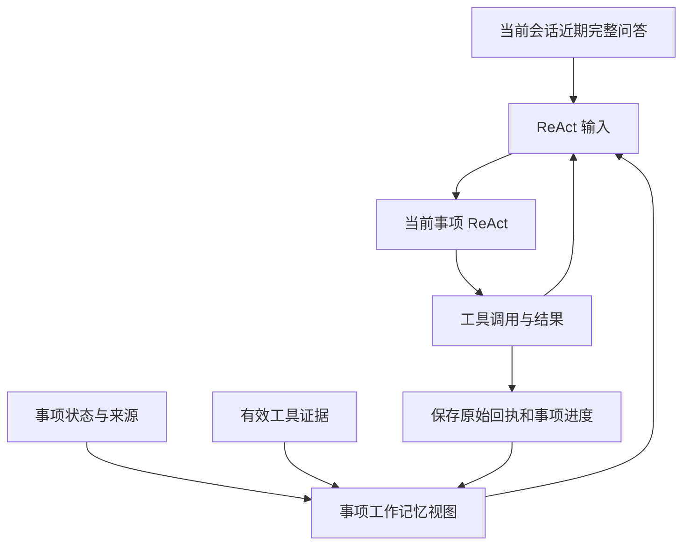

# 短期上下文与摘要设计

## 要解决的问题

长会话不能每次把全部原话和工具结果都发送给模型，但压缩又不能丢掉否定、更正或来源。模块用“近期完整消息 + 带原话引用的摘要 + 相关旧原话”缩小上下文，并在使用时回查来源。原始事件始终保留，摘要不是新的业务事实。

长期稳定偏好的提取与遗忘另见 [上下文与记忆设计](上下文与记忆设计.md)。本模块处理公开会话上下文，不负责用户长期画像写入。

## 构建视图

[ContextService.build](../app/session/short_term.py) 检查会话及可选事项归属，在同一读取事务固定事件上限，再组装：

| 部分                 | 来源与选择方式                                     |
| -------------------- | -------------------------------------------------- |
| 事项状态             | 可选的当前事项记录；注明处理进度与业务状态的区别   |
| `short_term_summary` | 当前范围的持久摘要项目，重新核验原消息后按预算装入 |
| `short_term_recall`  | 对更早公开原话进行词法相关性匹配，返回完整消息     |
| 近期消息             | 在近期轮数与 Token 预算内保留的原始对话            |
| `visual_context`     | 当前消息或事项中仍有效的附件与观察摘要             |

范围键为 `session` 或 `task:<task_id>`，事项范围通过 `support_task_messages` 过滤。关键词召回不是 Chroma 向量检索，也不会扩大到其他用户的会话。

## 后台摘要

公开消息写入时在同一事务合并 `support_context_jobs`，记录需要处理到的消息位置。维护进程调用 `process_context_jobs`，分批读取超出近期保留范围的完整消息，在事务外请求摘要，再用快照版本和来源修订校验提交。

`support_context_snapshots` 保存处理位置、版本、内容和更新时间。多个维护者可以准备相同摘要，但条件更新防止旧快照覆盖新快照。没有模型配置、输出校验失败或提交冲突时，不用无效摘要覆盖历史。

摘要输出仅包含 `items`；每项严格使用 `sequence`、`role`、`kind`、`quote`。`kind` 为 `user_request`、`confirmed_details`、`agent_commitments`、`open_questions`，其中承诺必须来自客服原话，用户请求必须来自用户原话。逐字引用必须存在于对应公开消息，不能把模型概括作为原文。

读取 `_current_summary` 时再次核对角色、序号、原文和来源有效性，并可展开回原始完整消息。因此更正导致来源失效后，不必等待后台重写摘要才停止使用旧依据。

## 当前事项执行如何使用它

ReAct 的上下文分为当前会话短期问答、当前事项工作记忆和本次执行的工具消息。`ContextService.recent_dialogue` 读取当前用户在当前会话的近期完整问答，不按事项过滤，因此保留助手问题、选项及用户的“第二个”等回答。按完整轮次和 Token 预算保留，单个超长轮次不截断，由完整请求预算明确拒绝。

事项工作记忆由已有事项记录、原话来源、操作状态、人工交接、图片观察和有效工具证据构建，不另存完整对话或业务回执副本。近期问答已经包含的原话只保留来源引用；窗口外和跨会话的必要事项原话仍保留。历史摘要仅用于恢复确实属于当前事项的有效原话，不将其他事项的历史状态带入当前执行。

初始工作记忆只注入一次。`read_task_context` 对比本次执行已提供的视图，仅返回变化的字段；字段清空也作为变化返回。本次工具消息已携带的业务回执，在进度读取中只提供证据引用。重复工具调用复用已有结果时返回原工具消息的引用，不重复追加结果全文；原始结果仍参与后端事实核验。

事项版本变化触发重新规划时，重新构建近期问答和工作记忆，并清空旧视图的增量基线，不因为旧执行“看过”某证据而遗漏新上下文。模型可见原话绑定来源有效性检查，已纠错、删除或转为私有的内容不能继续使用。操作历史只提供脱敏状态和必要回执，不恢复旧确认凭证，不把内部客服备注送给模型。

共享近期问答只提供语境，不扩大执行范围。每个执行器仍只处理指定事项，工具权限、对象归属、用户确认和版本检查继续由服务端执行。该方案减少重复输入，不保证任意大小的合法证据都能装入上下文；大结果仍需工具分页和完整请求预算。

长期偏好另由事项专用工具 `recall_user_memory(query)` 按需读取，不属于 `ContextService.build` 或 `task_history` 的每轮预注入。召回结果及其后续影响绑定到执行来源依赖；更正和遗忘屏障见 [上下文与记忆设计](上下文与记忆设计.md)。

## 完整请求预算

上下文分块预算之外，[request_budget.py](../app/session/request_budget.py) 还计算包含 system、工具 schema、工具参数与结果的完整提供商请求，并为输出与模型窗口留出空间。

当前 `scene=task_execution` 请求超限时直接抛 `ContextBudgetExceeded`，不截断事项目标或业务工具证据。其他适用场景按顺序去掉可选召回、长期记忆与摘要，再删除完整旧轮次；仍超限才按保留关键字段的规则投影工具内容，最后明确失败。

工具请求与工具响应的对应关系也需校验。不能为了压缩而留下没有对应调用的工具结果，或改变 `tool_call_id` 和原始参数。估算 Token 用于应用资源控制，与供应商返回的实际用量分别记录。

## 代码入口

- [构建与摘要后台任务](../app/session/short_term.py)、[摘要提示词](../app/prompts/summarizer.py)。
- [事项历史与来源跟踪](../app/memory/task_context.py)、[失效来源](../app/tasks/provenance.py)。
- [事项工作视图与增量](../app/memory/working_context.py)、[ReAct 上下文装配](../app/tasks/execution.py)。
- [Token 估算](../app/session/context_budget.py)、[完整请求预算](../app/session/request_budget.py)。
- [维护进程](../scripts/platform_maintenance.py)、[模型请求预算记录](../app/observability/llm_client.py)。
