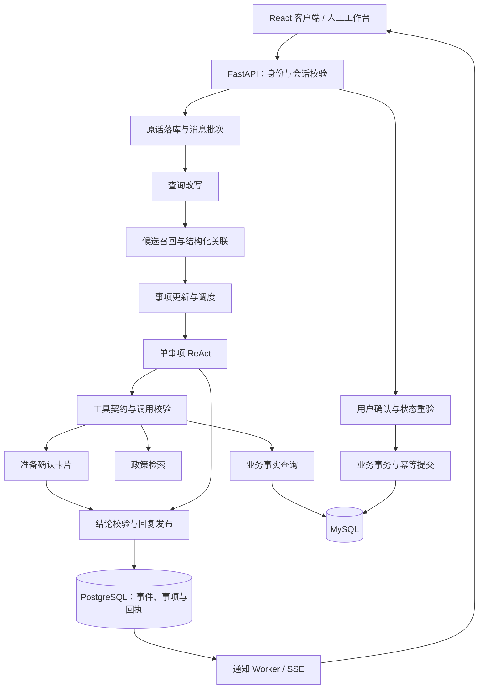

# 系统架构设计

## 模块边界

系统围绕用户要完成的“事项”组织服务。同一会话可以讨论多个事项，同一事项也可以跨会话续接。消息保存、语义理解、事项执行、业务提交和回复发布分别有独立的状态与校验。

| 层次         | 职责                                       | 主要代码                                     |
| ------------ | ------------------------------------------ | -------------------------------------------- |
| 交互与接入   | 登录、消息、会话历史、确认卡片、人工工作台 | `frontend/src`、`app/api`                    |
| 事项运行     | 接收、改写、关联、纠错、调度、执行与回复   | `app/tasks`                                  |
| 模型执行     | 查询改写、结构化归属、ReAct、结论选择      | `app/agents`、`app/execution`、`app/prompts` |
| 业务能力     | 工具契约、身份校验、确定性规则与业务事务   | `app/tools`、`app/services/commerce`         |
| 上下文与检索 | 原话、摘要、长期偏好、适用政策             | `app/session`、`app/memory`、`app/rag`       |
| 基础运行     | 队列唤醒、额度、通知、维护和日志           | `app/runtime`、`app/observability`           |

同一个 Agent 入口承担不同模型调用阶段；这些阶段由程序和数据库状态驱动。独立事项并行不等于多 Agent 协作。

当前 Worker 从 `others` 标签进入，按事项目标规则筛选工具，不另行调用一个必经的意图分类模型。多阶段模型调用、提示词与 `DataPlan` 的关系见 [模型调用与提示词设计](模型调用与提示词设计.md)。

## 主链路

1. 接收事务保存用户原话、请求回执和唤醒记录，HTTP 返回仅表示已接收。
2. Worker 固定消息批次，使用自然语言改写辅助召回，再提出结构化归属决定。
3. 程序校验原话、用户、版本和控制状态，在一个事务中保存关联、事项更新和处理位置。
4. 调度器按事项、依赖与并发额度启动 ReAct；原始消息继续接收和理解。
5. 查询产生带来源的事实；业务变更先准备固定内容，再等待用户确认。
6. 回复协调器核验结论，确认新消息、证据和控制版本仍有效后原子发布。

## 三类进度

| 对象           | 标识                                 | 表示什么                         |
| -------------- | ------------------------------------ | -------------------------------- |
| 消息与批次     | `session_id`、`request_id`、消息序号 | 输入是否保存、是否完成关联       |
| 客服事项       | `task_id`、事项版本                  | 目标、条件、待答内容和沟通进度   |
| 执行与业务操作 | `job_id`、`operation_id`             | 一次执行及一次固定参数的办理结果 |

接收成功、事项完成、申请受理和资金到账分别判断。历史记忆和政策条款提供依据，不能恢复旧授权或代替业务回执。

## 存储与后台进程

MySQL 保存登录账号和业务事实；PostgreSQL 保存会话、事项、执行、确认、人工工单和 v3 记忆。Redis 提供唤醒、缓存、通知及共享额度，数据库负责持久状态和执行资格。Chroma 保存政策向量索引。

API、事项 Worker、记忆 Worker、通知 Worker、维护进程和交易 Worker 分开运行。模型与外部接口调用在数据库事务外完成；提交时重新核验版本和归属。运行任务 Outbox 与会话事件同事务保存，业务渠道请求则由 MySQL 持久记录及交易 Worker 推进。

图片识别队列由事项 Worker 内部的 `ImageWorker` 推进，图片字节位于私有目录，元数据、观察和关联保存在 SupportStore。短期摘要由维护进程生成，v3 长期记忆与事项共用支持库；政策发布指针保存在索引旁的 SQLite，向量保存在 Chroma。

## 能力与模块协作

| 能力 | 实现方式 | 详细说明 |
| --- | --- | --- |
| 跨会话上下文 | 以事项续接公开原话，通过摘要索引与按需 v3 召回读取历史 | [短期上下文](短期上下文与摘要设计.md)、[长期记忆](上下文与记忆设计.md) |
| 远程工具 | 默认 Worker 按配置使用 MCP 业务读取，签名绑定用户与工具范围；事项流程和准备确认在本地执行 | [MCP 工具服务](MCP工具服务设计.md) |
| 数据读取 | SQL 集合分页、完整汇总与摘要到明细的继续查询 | [业务数据访问](业务数据访问设计.md) |
| 业务办理 | 规则核验、固定确认、幂等事务、持久渠道请求及回执核对 | [业务操作与交易](业务操作与交易设计.md)、[本地模拟渠道](本地模拟渠道设计.md) |
| 多模态 | 上传、首次识别、回看、绑定与撤回保护 | [图片处理](图片处理与多模态上下文设计.md) |
| 质量评测 | 独立 RAG 评测、静态/动态交互、记忆配对及响应时间统计 | [Agent 评测](Agent评测设计.md)、[RAG 评测](RAG评测说明.md) |

运行过程与配置分别见 [运行与可观测性设计](运行与可观测性设计.md)、[配置与部署设计](配置与部署设计.md)。

## 代码入口

- [会话 Worker](../app/tasks/conversation_worker.py)：组织改写、关联、调度和回复。
- [Agent 入口](../app/agents)：模型调用与执行入口。
- [共享存储](../app/support/store.py)：会话控制和事务。
- [业务服务入口](../app/services/commerce/service.py)：组装查询、规则与写入服务。
- [默认工具分流](../app/tools/task_dispatch.py)、[集合查询](../app/services/commerce/collection_queries.py)、[完整商品行](../app/services/commerce/item_queries.py)。

各模块的关系与阅读顺序见 [文档导航](README.md)。
