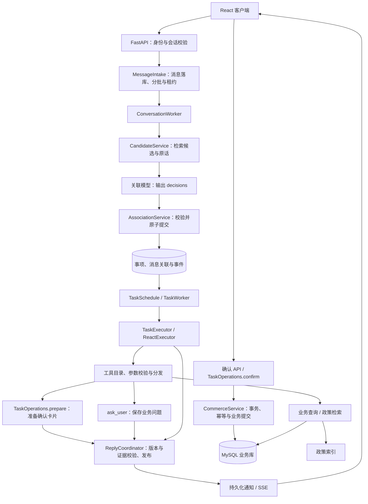

# 项目结构

仓库按运行边界组织，提交到 GitHub 的内容包含源代码、配置模板、测试和文档。密钥、模型权重、数据库文件、会话和日志留在本地或 Docker 挂载目录中。

重构实施记录见 [分步实施入口](refactoring/重构实施入口.md)；部署、人工客服初始化和故障处理见 [运行手册](并发平台运行手册.md)。本文按当前代码梳理运行架构、模块关系及目录用途。

## 核心概念与处理边界

系统以持久化的“客服事项”组织处理进度。会话是消息容器，事项是用户希望完成的目标，业务操作是对订单等业务数据的一次受控变更。这三个对象不能互相替代：一段会话可以涉及多个事项，一个事项可以跨会话继续，同一订单也可以同时有物流咨询和退货等不同事项。

模型有两个调用阶段：`AgentEngine.associate()` 提出消息归属建议；`TaskExecutor` 在确定的事项范围内运行 ReAct。两者共用模型入口，但使用不同的输入、提示词和输出契约。阶段切换由 Worker 和数据库状态驱动，不依靠模型自行调度。



## 一条消息的处理流程

1. **接收。** `api/task_messages.py` 注入登录身份，`tasks/intake.py` 按 `request_id` 接收消息、保存事件并唤醒后台任务。显式取消和人工接管可以走控制路径，不必等待模型判断。
2. **召回。** `tasks/candidates.py` 在当前用户及业务范围内检索当前和历史事项，组合本批消息、近期对话、候选来源、有效问题及缺失标记。召回只提供候选，不作最终选择。
3. **关联。** `agents/association.py` 将 `prompts/association.py` 与 Pydantic JSON Schema 一起交给模型。模型输出 create、update、clarify 或 ignore；此调用没有业务工具。
4. **提交。** `tasks/association.py` 校验消息覆盖、原文证据、用户归属、事项版本、问题有效性和控制状态，在同一事务内保存事项更新、消息关联及归属结果。失败时有限重试，最终保存归属澄清。
5. **执行。** `tasks/conversation_worker.py` 发现事项版本变化，由 `tasks/scheduling.py` 排队、限制并发和保留资源。`tasks/execution.py` 载入单个事项的原话、历史操作和证据，再调用 `execution/react.py`。
6. **查询或准备业务。** `tools/catalog.py` 和 `tools/contracts.py` 定义工具与参数，`tools/dispatch.py` 校验后调用 `services/commerce/`。查询取得事实，写操作先准备确认；`ask_user` 则把事项置为等待用户回答。
7. **确认与提交。** 用户通过确认入口提交绑定操作的凭证，`tasks/operations.py` 重新检查输入、事项版本和操作状态，再调用业务服务。自然语言“确认”经关联阶段处理，并不代替确认 API。
8. **发布与继续。** `tasks/replies.py` 过滤过期、人工接管和未定归属的结果后发布消息，通知进程送达前端。用户补充重新进入接收链路；外部进展由 `external_progress.py`、`external_evidence.py` 等维护。

## 模块职责与依赖

| 模块 | 职责 | 关键边界 |
| --- | --- | --- |
| `frontend/` | 客户对话、事项展示、确认卡片、人工工作台 | 前端展示不能代替服务端权限和状态检查 |
| `api/`、`support/` | 身份、会话、事件、人工控制、共享事务存储 | 身份由服务端提供，不能接受模型自行指定 |
| `tasks/` | 接收、召回、关联、调度、执行状态、纠错、确认与回复 | 是流程与状态主干，不把数据库写权限交给模型 |
| `agents/`、`execution/`、`prompts/` | 模型调用、结构化归属、ReAct 循环 | 模型提出建议，代码校验并执行 |
| `tools/` | 工具发现、参数契约、上下文校验及分发 | 当前 `selection.for_task()` 返回全部注册工具，实际可调用性由分发和业务服务检查；不能描述为已按意图裁剪工具 |
| `services/commerce/` | 商品、订单、优惠券、售后、地址等业务规则和事务 | 事实、金额、库存、幂等和外部渠道结果由业务代码负责 |
| `data/` | 既有查询适配、DAO 及查询入口 | 当前主要业务分发进入 `services/commerce/`，不能将 `data/` 当作唯一业务层 |
| `rag/` | 政策检索、范围、有效期及撤销校验 | 政策证据不替代订单状态和实际办理结果 |
| `memory/`、`session/` | 原话历史、记忆、摘要、来源有效性和上下文预算 | 记忆提供背景，不能恢复授权或覆盖当前用户更正 |
| `runtime/`、`harness/`、`reliability/` | 队列唤醒、并发、通知、超时、证据及失败控制 | 基础运行设施不决定用户要处理哪件事 |
| `observability/`、`config/` | 配置、交互阶段采集、审计、脱敏与指标 | `interactions.py` 将数据库阶段记录汇总为每会话一个文件、每轮交互一行；日志不能作为当前业务授权 |
| `mcp/`、`skills/` | 可选外部工具接入与技能加载 | 不是默认事项主链路的独立调度者 |

## 交易服务内部边界

`services/commerce/__init__.py` 只导出 `CommerceService`、`service()` 和 `service_factory()`，API、工具和 Worker 继续使用这些入口。

| 文件 | 职责 |
| --- | --- |
| `service.py` | 组装业务服务、管理请求级工厂、补齐工具查询结果的来源和缺失字段 |
| `common.py` | 业务异常、金额与 JSON 序列化、对象引用、加密和结果契约 |
| `base.py` | 身份归属、业务范围、对象读取和操作快照 |
| `pagination.py` | 共用的游标签名与校验、快照分页、SQL 游标分页 |
| `customer_views.py` | 客户资料、订单和优惠券页面的数据组装及只读事务 |
| `queries.py`、`reads.py`、`rules.py` | `QueryService` 显式继承基础读取与规则服务，扩展查询通过 `super()` 复用基础实现 |
| `extended_writes.py`、`writes.py` | `ExtendedWriteService` 显式继承基础写服务，未扩展的操作委托给基础实现 |

HTTP 路由负责身份、参数、缓存头和异常状态码；页面的数据组装留在 `CustomerViews`。现有事务范围和数据库锁顺序保持不变。分页游标继续绑定用户、平台、商家、工具和查询条件，保持原签名格式与 15 分钟有效期；SQL 分页每页仍执行计数和限量读取两次查询。工具结果最多收集 100 个缺失字段，达到上限后停止遍历剩余内容。

## 存储与进程

PostgreSQL 保存会话事件、事项、执行与操作记录；MySQL 保存账号及业务数据；Redis 用于唤醒、通知、缓存和共享并发协调。离线测试可以使用 SQLite 承载事项存储。政策向量索引和运行文件另行保存。

交互诊断使用同一事项库中的 `interaction_trace_events` 与 `interaction_trace_sessions`，在业务事务提交后原子导出到 `logs/traces/conversations/`。正式回复划分交互，进度通知不划分；文件损坏或丢失时可用 `scripts/export_conversation_logs.py` 从阶段记录重建。字段和排查方法见运行手册的交互日志部分。

API、事项 Worker、通知 Worker、维护进程和交易 Worker 分开运行。`runtime/outbox.py` 已实现运行任务的数据库发件箱；这不等于已经实现 MySQL 业务事务到外部消息系统的交易 Outbox。业务提交与事项存储之间还依赖操作回执、对账和恢复流程。

## 关联提示词的输入输出契约

提示词仅处理“归到哪件事”和“用户本次明确补充了什么”。业务资料不足由执行阶段提问；归属不明由关联阶段提问。咨询退货政策也可以建立事项，不应把“尚不能办理”误判为“没有用户目标”。

| 输入 | 用法 |
| --- | --- |
| `current_messages` | 必须全部覆盖的本批用户消息 |
| `recent_messages`、候选 `sources` | 理解指代及核验引用；不是可以随意加入 `sequences` 的历史消息 |
| `candidates` | 可能续接的已有事项；ID 和版本必须照抄，排序不表示用户选择 |
| 候选 `question` | 执行阶段提出且已发布、有效的问题；用 `question_id` 回答 |
| `clarifications` | 归属阶段留下的未定消息；用 `clarification_id` 续接并带回全部原始消息 |
| `scope`、`gaps`、`omitted_*` | 业务范围及上下文完整性；`gaps` 非空时校验器拒绝 create/update |
| `order_evidence`、`control_notices` | 辨认对象的辅助事实、后到的控制消息；不能推导授权 |

输出结构以 `agents/association.py` 为准：`action` 决定创建、更新、澄清或忽略，`effect` 描述更新含义，`sequences` 关联原始消息，`evidence` 提供引用，`details` 保存可证实的字段增量。`goal` 是完整目标；`task_id` 与 `task_version` 绑定已有事项。

当前后端契约的限制需要与提示词效果分开看待：

- `details` 按字段覆盖，缺少追加和删除语义。新提示词用完整 `goal` 保留累积限制，避免局部 `conditions` 覆盖；但撤销条件后旧字段仍可能存在，彻底消除冲突需要后端支持字段删除或结构化条件。
- `ask_user` 当前固定保存 `field=details`，而 `DetailField` 不包含 `details`。通用选项回答可以被关联，不能自动成为订单字段。提示词可在完整目标中保留已选 label；选项引用的结构化持久化仍需实现，执行历史也不能假设包含原客服问题及全部选项。
- `AssociationService.process()` 记录拒绝码，但下一次模型调用不携带上一份提案和拒绝原因；重试还会尝试读取订单证据，而默认未注入 `order_lookup` 时会产生缺失标记。提示词不能修复这一重试链路。
- `ReplyCoordinator.publish()` 当前按候选重新生成归属澄清的展示文本，不能假设模型写下的 `clarification` 会原样显示。选项顺序必须与 `candidate_task_ids` 一致。

## 目录与验证入口

```text
ecom-customer-service/
├── app/
│   ├── api/              FastAPI 路由、认证、中间件
│   ├── agents/           消息归属模型与事项执行的统一入口
│   ├── config/           配置模型和环境变量
│   ├── data/             订单、物流、商品 DAO 与 service
│   ├── data_plan/        业务标签、工具能力描述和执行计划
│   ├── execution/        事项 ReAct 工具循环与业务预检
│   ├── harness/          评估和故障注入运行器
│   ├── mcp/              MCP 客户端、服务端和认证
│   ├── memory/           用户长期记忆、检索和事项上下文
│   ├── observability/    审计、追踪、指标和脱敏
│   ├── prompts/          事项归属、记忆和摘要提示词
│   ├── rag/              知识库、Embedding 和索引更新
│   ├── reliability/      证据校验、失败策略和幂等变更
│   ├── runtime/          并发额度、唤醒队列、通知和运行时协调
│   ├── session/          工作记忆、摘要和上下文预算
│   ├── services/         CommerceService 业务规则、查询与事务
│   ├── skills/           通用技能加载器（暂无内置业务 Skill）
│   ├── support/          会话事件、人工客服和共享事务存储
│   ├── tasks/            事项、归属纠错、并行执行、回复、确认和放量
│   └── tools/            订单、物流、商品、退款等工具
├── data/                 本地运行数据（不提交）
├── frontend/             React/Vite 客服工作台
├── scripts/              启动 Worker、数据库初始化和当前链路评测脚本
├── tests/                单元测试、API 测试和可靠性测试
├── docs/                 架构、开发和发布说明
├── Dockerfile            后端镜像
├── docker-compose.yml    完整本地环境（PostgreSQL、Redis、MySQL、后端、前端）
└── requirements.txt      主服务依赖
```

当前评测入口：

- `scripts/eval_association.py`：事项归属判断。
- `scripts/eval_task_execution.py`：事项执行与安全边界。
- `scripts/eval_memory_algorithms.py`：记忆检索与维护。

上传前运行：

```powershell
git status --short
git diff --check
python scripts/run_platform_checks.py
Set-Location frontend
npm ci
npm run build
```

`.env`、`model/`、`.docker-data/`、`logs/`、会话数据和评估报告已加入忽略规则，不应提交到公共仓库。
